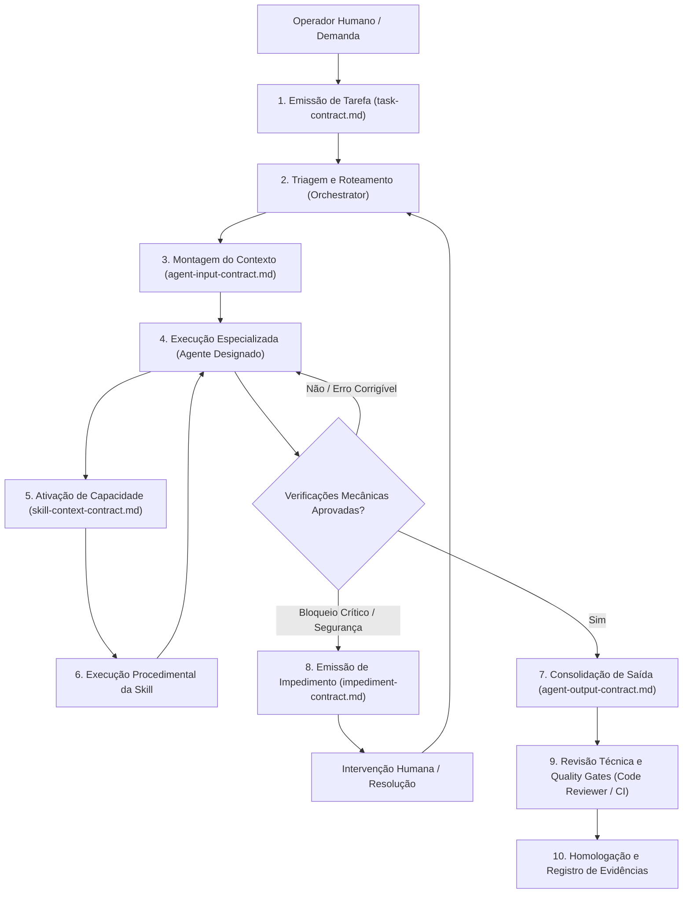
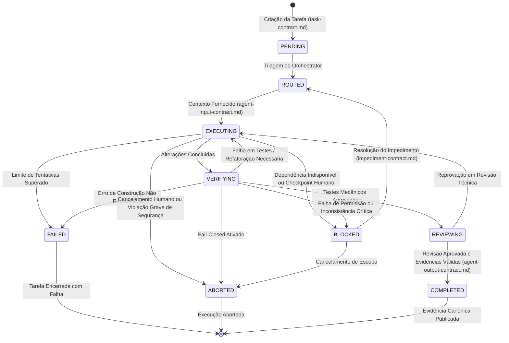

# Índice e Guia de Governança dos Contratos de Execução — ExtensionTools

> **Projeto:** ExtensionTools  
> **Classificação:** PUBLIC REPOSITORY (Safe-by-Default)  
> **Módulo:** `.harness/contracts/`  
> **Milestone:** M2 — Harness Engineering & Governance  
> **Fase:** `M2-PHASE-3` (Contratos de Execução e Políticas do Harness)  
> **Última Atualização:** 07/11/2026  

---

## 1. Finalidade e Princípios de Arquitetura

O ecossistema do **ExtensionTools** opera com base em colaboração coordenada entre agentes autônomos de engenharia, skills especializadas e operadores humanos.

Para assegurar **previsibilidade, rastreabilidade, isolamento de responsabilidades e segurança por padrão (*Safe-by-Default*)**, todas as interações operacionais devem obedecer a **Contratos de Execução Formais e Tipados**.

### Princípios Norteadores:
1. **Determinismo:** Nenhuma tarefa é delegada sem parâmetros inequívocos de entrada e critérios verificáveis de aceitação.
2. **Orientação a Evidências:** Nenhuma conclusão é aceita com base em declarações textuais subjetivas; todas as entregas exigem comandos mecânicos rastreáveis, códigos de saída auditados e relatórios centralizados sob `docs/Relatorios/`.
3. **Falha Segura (*Fail-Closed*):** Diante de violação de segurança, ambiguidade insolúvel ou ausência de autorização humana requerida, o fluxo é imediatamente interrompido com emissão de contrato de impedimento.
4. **Isolamento de Contexto:** Agentes recebem apenas os arquivos estritamente necessários para a execução da tarefa, garantindo economia de contexto e prevenção de acoplamento indevido.

---

## 2. Catálogo Canônico dos Contratos de Execução

| Arquivo de Contrato | Responsabilidade Canônica | Envelope / Schema Principal | Consumidores Primários |
| :--- | :--- | :--- | :--- |
| [`task-contract.md`](task-contract.md) | Define a unidade atômica de trabalho, objetivos, restrições e critérios de conclusão | `TaskContract` | `Orchestrator`, Operador Humano |
| [`agent-input-contract.md`](agent-input-contract.md) | Formaliza o envelope de contexto e permissões fornecido ao agente executor | `AgentInput` | Todos os Agentes Especializados |
| [`agent-output-contract.md`](agent-output-contract.md) | Formaliza o retorno estruturado, resultados de quality gates e o **Modelo Canônico de Evidências** | `AgentOutput` + `EvidenceModel` | Todos os Agentes, `Code Reviewer`, CI |
| [`skill-context-contract.md`](skill-context-contract.md) | Define os parâmetros de ativação e fronteiras de execução de uma skill | `SkillContext` | Agentes Executores e Skills |
| [`impediment-contract.md`](impediment-contract.md) | Estrutura bloqueios operacionais, incidentes de segurança e solicitações de aprovação humana | `ImpedimentReport` | Agentes, `Orchestrator`, Operador Humano |

---

## 3. Fluxo Integrado de Comunicação e Ciclo de Vida

O ciclo operacional entre tarefas, agentes e skills opera de forma estritamente sequencial e verificável:



---

## 4. Máquina de Estados Determinística da Tarefa

A execução de qualquer tarefa segue rigorosamente o autômato de estados abaixo:



### Definição dos Estados:
- **`PENDING`**: Tarefa criada e registrada, aguardando triagem.
- **`ROUTED`**: Agente especialista e skills atribuídos, pré-condições validadas.
- **`EXECUTING`**: Agente ativo realizando alterações incrementais em código ou documentação.
- **`VERIFYING`**: Execução de suítes de testes, typecheck, linters e scanners de segurança.
- **`REVIEWING`**: Auditoria técnica independente por agente revisor (`code-reviewer`).
- **`COMPLETED`**: Estado terminal de sucesso; todas as evidências estão atestadas e registradas em `docs/Relatorios/`.
- **`BLOCKED`**: Estado temporário de bloqueio; aguarda resolução externa descrita em `impediment-contract.md`.
- **`FAILED`**: Estado terminal de insucesso técnico irrecuperável dentro do ciclo operacional do agente.
- **`ABORTED`**: Estado terminal de interrupção forçada por cancelamento ou violação inegociável de segurança (*fail-closed*).

---

## 5. Relação entre Contratos, Políticas e Evidências

Os contratos atuam como interfaces estruturadas de ligação entre as camadas de governança:

1. **Políticas Técnicas (`.harness/policies/`):** Definem as regras invioláveis de comportamento (ex: vazamento zero, complexidade proporcional, padrões de scripts). Os contratos vinculam quais políticas se aplicam a cada envelope de entrada (`applicablePolicies`).
2. **Definições de Agentes (`.harness/agents/`):** Descrevem as competências, limites de autoridade e persona de cada agente. Os contratos garantem que apenas agentes canônicos sejam acionados (`assignedAgent`).
3. **Skills Especializadas (`.harness/skills/`):** Fornecem procedimentos operacionais detalhados. O contrato `skill-context-contract.md` garante que as skills recebam apenas entradas estritamente válidas.
4. **Relatórios de Evidência (`docs/Relatorios/`):** São o artefato físico obrigatório de comprovação. O `agent-output-contract.md` exige obrigatoriamente a presença de `evidenceReportPath` válido para qualquer transição para o estado `COMPLETED`.

---

## 6. Níveis de Validação dos Contratos

A garantia de conformidade contratual é exercida em 4 níveis complementares:

```text
Nível 1 — Validação Documental e Estrutural (Fase M2-PHASE-3)
          Auditoria de presença de seções normativas, frontmatter e ausência de caminhos privados
          via script mecânico scripts/quality/validate-harness-contracts.mjs.

Nível 2 — Tipagem Estática TypeScript (Fase M2-PHASE-3)
          Definições estritas em TypeScript (.d.ts ou módulos tipados) validadas via tsc --noEmit.

Nível 3 — Validação de Payloads em Runtime (Fase M2-PHASE-3)
          Funções puras e leves em Node.js ESM nativo para sanitização e validação de esquemas de dados.

Nível 4 — Validação Dinâmica de Transições de Estado (Fase M2-PHASE-4 / QG-07)
          Orquestrador de Quality Gates e esteira de automação fiscalizando o ciclo de vida da tarefa.
```

---

## 7. Versionamento e Procedimento de Evolução

- **Versionamento Semântico:** Todos os contratos seguem `version: "major.minor.patch"`.
  - Mudanças de campo obrigatório ou quebra de schema: alteração de versão `major` (ex: `1.0.0` para `2.0.0`).
  - Adição de campos opcionais retrocompatíveis: alteração `minor` (ex: `1.0.0` para `1.1.0`).
  - Correções de documentação ou exemplos: alteração `patch` (ex: `1.0.0` para `1.0.1`).
- **Governança de Alteração:** Nenhuma modificação nos contratos pode ser executada sem a aprovação do `Architect` e emissão de registro de decisão arquitetural (ADR) sob `docs/architecture/adr/`.
