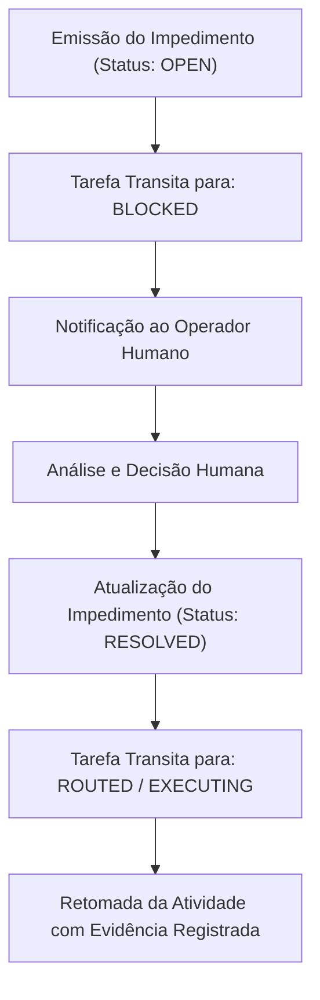

# Contrato Canônico de Impedimento e Bloqueio Operacional (`impediment-contract.md`)

> **Projeto:** ExtensionTools  
> **Classificação:** PUBLIC REPOSITORY (Safe-by-Default)  
> **Identificador do Contrato:** `CONTRACT-IMPEDIMENT-V1`  
> **Versão:** `1.0.0`  
> **Status:** CANÔNICO E VIGENTE  
> **Papéis Relacionados:** Agentes Especializados Executores, `Orchestrator` e Operador Humano  

---

## 1. Finalidade e Responsabilidade

O **Contrato de Impedimento e Bloqueio Operacional (`ImpedimentReport`)** formaliza interrupções estruturadas do fluxo de execução autônoma diante de barreiras técnicas, incidentes de segurança, ambiguidades de especificação ou checkpoints que exigem **autorização humana prévia e expressa**.

Ele assegura o princípio de **governança com soberania humana e contenção de falhas**:
- Impede que agentes tomem decisões de alto risco silenciosamente.
- Registra formalmente a causa do bloqueio, o impacto sobre a tarefa e a proposta de mitigação.
- Estabelece um protocolo determinístico de retomada e recuperação após a intervenção humana.

---

## 2. Especificação Estruturada do Contrato

### 2.1. Definição Tipada (TypeScript / Interface Canônica)

```typescript
import { CanonicalAgentId } from './task-contract';

export type ImpedimentCategory =
  | 'SECURITY_RESTRICTION'
  | 'HUMAN_APPROVAL_REQUIRED'
  | 'SPECIFICATION_AMBIGUITY'
  | 'TECHNICAL_DEPENDENCY_BROKEN'
  | 'SYSTEM_FAILURE';

export type ImpedimentSeverity = 'BLOCKING' | 'CRITICAL' | 'WARNING';

export type ImpedimentStatus = 'OPEN' | 'RESOLVED' | 'CANCELLED';

export interface ImpedimentReport {
  /** Identificador único do impedimento (ex: "IMP-SEC-01", "IMP-HUMAN-02") */
  impedimentId: string;
  /** Identificador da tarefa impactada */
  taskId: string;
  /** Agente canônico que declarou o bloqueio */
  agentId: CanonicalAgentId;
  /** Categoria fundamental do impedimento */
  category: ImpedimentCategory;
  /** Nível de severidade operacional */
  severity: ImpedimentSeverity;
  /** Descrição detalhada do obstáculo encontrado */
  description: string;
  /** Justificativa formal da impossibilidade de avanço autônomo */
  blockingReason: string;
  /** Proposta técnica sugerida pelo agente para resolução */
  mitigationProposal: string;
  /** Ação clara, objetiva e mensurável requerida do operador humano */
  humanActionRequired: string;
  /** Estado atual do impedimento */
  status: ImpedimentStatus;
  /** Data e hora de abertura no padrão ISO 8601 */
  createdAt: string;
  /** Detalhes da resolução (obrigatório se status === 'RESOLVED') */
  resolutionDetails?: {
    resolvedBy: string;
    resolvedAt: string;
    decisionTaken: string;
  };
}
```

### 2.2. Dicionário de Campos e Restrições Normativas

| Campo | Tipo | Obrigatoriedade | Restrições e Formato |
| :--- | :--- | :---: | :--- |
| `impedimentId` | `string` | **Obrigatório** | Padrão regex: `^IMP-[A-Z0-9]+-[0-9]+$` (ex: `IMP-SEC-01`). |
| `taskId` | `string` | **Obrigatório** | Deve coincidir com a tarefa sob execução. |
| `agentId` | `string` | **Obrigatório** | Agente canônico emissor (de `.harness/agents/`). |
| `category` | `string` | **Obrigatório** | Valor enumerado: `SECURITY_RESTRICTION`, `HUMAN_APPROVAL_REQUIRED`, `SPECIFICATION_AMBIGUITY`, `TECHNICAL_DEPENDENCY_BROKEN`, `SYSTEM_FAILURE`. |
| `severity` | `string` | **Obrigatório** | Valor enumerado: `BLOCKING` (para a tarefa), `CRITICAL` (para o projeto), `WARNING` (alerta). |
| `description` | `string` | **Obrigatório** | Explicação em pt-BR da situação encontrada. |
| `blockingReason` | `string` | **Obrigatório** | Motivo exato do impedimento normativo ou técnico. |
| `mitigationProposal` | `string` | **Obrigatório** | Sugestão técnica recomendada pelo agente especialista. |
| `humanActionRequired` | `string` | **Obrigatório** | Ação explícita aguardada do operador humano. |
| `status` | `string` | **Obrigatório** | Valor enumerado: `OPEN` (ativo), `RESOLVED` (sanado), `CANCELLED` (tarefa descartada). |
| `createdAt` | `string` | **Obrigatório** | Timestamp no padrão ISO 8601. |
| `resolutionDetails` | `object` | Condicional | Obrigatório se `status === 'RESOLVED'`. |

---

## 3. Invariantes e Regras de Validade

1. **Veto de Auto-Desbloqueio:** O agente autônomo é terminantemente proibido de resolver unilateralmente um impedimento da categoria `HUMAN_APPROVAL_REQUIRED` ou `SECURITY_RESTRICTION`. A resolução exige autorização humana externa explícita.
2. **Sincronia com a Máquina de Estados:** A emissão de um `ImpedimentReport` com severidade `BLOCKING` ou `CRITICAL` força a transição imediata da tarefa associada para o estado `BLOCKED`.
3. **Ausência de Propostas Cegas:** O campo `mitigationProposal` deve apresentar pelo menos uma alternativa técnica viável e justificada, evitando declarações vazias como *"aguardo instruções"*.
4. **Resolução Auditada:** Um impedimento só pode transitar para `RESOLVED` quando acompanhado do registro em `resolutionDetails` contendo a decisão tomada e o autor da aprovação.

---

## 4. Procedimento de Retomada e Recuperação (Desbloqueio)

Após a intervenção e decisão humana:
1. O operador humano fornece a resolução ou autorização necessária.
2. O registro do impedimento é atualizado para `status: "RESOLVED"` com o preenchimento de `resolutionDetails`.
3. A tarefa transita de `BLOCKED` para `ROUTED` (se for necessária reavaliação de escopo) ou diretamente para `EXECUTING` (se a instrução recebida permitir prosseguir a implementação).
4. O agente retoma a execução registrando o histórico da interrupção nas evidências finais.



---

## 5. Exemplos Sintéticos

### 5.1. Exemplo Válido — Checkpoint de Aprovação Humana

```json
{
  "impedimentId": "IMP-HUMAN-01",
  "taskId": "M2-P3-T07",
  "agentId": "orchestrator",
  "category": "HUMAN_APPROVAL_REQUIRED",
  "severity": "BLOCKING",
  "description": "A esteira concluiu os testes da suíte e está pronta para executar commit de governança.",
  "blockingReason": "A política human-approvals.md e a Seção 16 do GEMINI.md vetam commits e pushes autônomos sem instrução humana explícita.",
  "mitigationProposal": "Apresentar o relatório de evidências ao operador e solicitar aprovação para commit das alterações de governança documental.",
  "humanActionRequired": "Revisar o diff das alterações e autorizar a execução do commit com a mensagem padronizada proposta.",
  "status": "OPEN",
  "createdAt": "2026-11-07T17:25:00.000Z"
}
```

### 5.2. Exemplo Válido — Resolução de Ambiguidade de Especificação

```json
{
  "impedimentId": "IMP-SPEC-02",
  "taskId": "M4-P1-T03",
  "agentId": "developer",
  "category": "SPECIFICATION_AMBIGUITY",
  "severity": "BLOCKING",
  "description": "Divergência entre o ADR-002 e a issue sobre suporte inicial a diff de arquivos binários.",
  "blockingReason": "O ADR-002 restringe o text-diff a arquivos UTF-8, enquanto a especificação sugeria aceitar imagens.",
  "mitigationProposal": "Manter a restrição estrita de texto conforme ADR-002 e postergar suporte a arquivos binários para M6.",
  "humanActionRequired": "Confirmar se o escopo de M4 deve se limitar exclusivamente a texto/código fonte UTF-8.",
  "status": "RESOLVED",
  "createdAt": "2026-11-07T14:00:00.000Z",
  "resolutionDetails": {
    "resolvedBy": "Lead Architect / Operador Humano",
    "resolvedAt": "2026-11-07T14:15:00.000Z",
    "decisionTaken": "Aprovada a proposta do desenvolvedor. Manter escopo restrito a texto UTF-8 em M4 conforme ADR-002."
  }
}
```

### 5.3. Exemplos Inválidos e Motivos de Rejeição

#### Exemplo Inválido A — Auto-Aprovação Proibida de Segurança
```json
{
  "impedimentId": "IMP-SEC-01",
  "taskId": "M2-P1-T05",
  "agentId": "developer",
  "category": "SECURITY_RESTRICTION",
  "severity": "CRITICAL",
  "description": "Scanner detectou chave privada em arquivo.",
  "blockingReason": "Segredo encontrado pelo guardião.",
  "mitigationProposal": "Ignorar o scanner e forçar o commit.",
  "humanActionRequired": "Nenhuma, agente resolveu sozinho.",
  "status": "RESOLVED",
  "createdAt": "2026-11-07T10:00:00.000Z",
  "resolutionDetails": {
    "resolvedBy": "developer",
    "resolvedAt": "2026-11-07T10:01:00.000Z",
    "decisionTaken": "Bypass aplicado pelo próprio agente."
  }
}
```
*Motivo da Rejeição:*
- Violação grave de segurança: o agente tentou contornar o scanner e resolver seu próprio impedimento de segurança (`resolvedBy: "developer"`), violando a regra inegociável de Safe-by-Default e proibição de auto-aprovação.

---

## 6. Tratamento de Falhas

Se ocorrer erro ou inconsistência no registro do impedimento, o agente não deve mascarar o problema: o processo deve interromper imediatamente sua execução para prevenir corrupção de estado ou execução em falso positivo.
