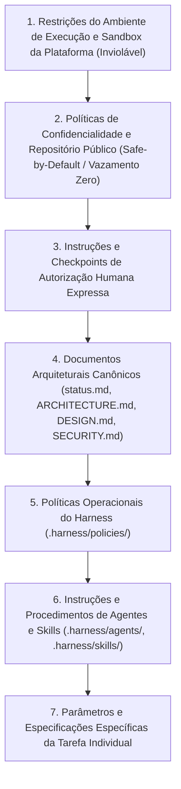

# Índice e Hierarquia de Governança das Políticas do Harness — ExtensionTools

> **Projeto:** ExtensionTools  
> **Classificação:** PUBLIC REPOSITORY (Safe-by-Default)  
> **Módulo:** `.harness/policies/`  
> **Milestone:** M2 — Harness Engineering & Governance  
> **Fase:** `M2-PHASE-3` (Contratos de Execução e Políticas do Harness)  
> **Última Atualização:** 07/11/2026  

---

## 1. Finalidade e Princípios de Governança

As políticas técnicas e operacionais sob `.harness/policies/` formalizam as **regras invariantes de conduta, engenharia, qualidade, segurança e governança** que regem o comportamento de todos os agentes autônomos, skills e automações do projeto **ExtensionTools**.

Elas modularizam e aprofundam as diretrizes estabelecidas em documentos superiores (`GEMINI.md`, `ARCHITECTURE.md`, `SECURITY.md`), permitindo injeção cirúrgica de restrições em envelopes de contexto (`AgentInput`) com **alta densidade normativa e zero redundância**.

### Princípios Fundamentais:
1. **Soberania Humana:** A IA é uma ferramenta de aceleração assistida; decisões críticas, commits, pushes e publicações dependem de autorização humana explícita.
2. **Safe-by-Default:** Toda operação presume restrição máxima de segurança até que haja liberação expressa e verificável.
3. **Complexidade Proporcional:** Veto a abstrações prematuras, camadas desnecessárias e overengineering.
4. **Orientação a Evidências:** Nenhuma conformidade é declarada sem comprovação mecânica e reproduzível.

---

## 2. Catálogo das Dez Políticas Canônicas

| Política | Eixo de Atuação | Objetivo Central | Agentes Primários |
| :--- | :---: | :--- | :--- |
| [`repository-safety.md`](repository-safety.md) | **Segurança** | Prevenção absoluta de vazamento de segredos, dados confidenciais e caminhos privados em repositório público. | `security-auditor`, Todos |
| [`agent-execution-boundaries.md`](agent-execution-boundaries.md) | **Segurança** | Definição de limites de autoridade, segregação de funções e veto de auto-aprovação de código. | `orchestrator`, Todos |
| [`destructive-operations.md`](destructive-operations.md) | **Segurança** | Proibição de comandos git e filesystem destrutivos; salvaguarda fail-closed. | `script-engineer`, Todos |
| [`architecture-governance.md`](architecture-governance.md) | **Engenharia** | Preservação das fronteiras modulares Feature-First, direção unívoca de dependências e regras para ADRs. | `architect`, `developer` |
| [`code-quality.md`](code-quality.md) | **Engenharia** | Padrões de código limpo em TypeScript estrito, React 19, immutabilidade e legibilidade sem `any`. | `developer`, `code-reviewer` |
| [`testing-strategy.md`](testing-strategy.md) | **Engenharia** | Pirâmide de testes Vitest/Playwright, determinismo temporal, casos negativos e ausência de testes flaky. | `test-engineer`, `developer` |
| [`script-standards.md`](script-standards.md) | **Engenharia** | Requisitos para automações Node.js ESM nativas sob `scripts/` e contrato de exit codes 0/1/2. | `script-engineer` |
| [`documentation-governance.md`](documentation-governance.md) | **Governança** | Prevenção de dispersão de relatórios, integridade de links relativos e centralização em `docs/Relatorios/`. | `documentation-engineer` |
| [`human-approvals.md`](human-approvals.md) | **Governança** | Matriz mandatória de checkpoints operacionais que exigem autorização humana prévia e expressa. | `orchestrator`, Todos |
| [`external-distribution.md`](external-distribution.md) | **Distribuição** | Governança de empacotamento ZIP, auditoria de permissões Manifest V3 e bloqueio até Milestone M8. | `release-engineer` |

---

## 3. Matriz de Integração: Agentes, Skills, Contratos e Políticas

A tabela a seguir consolida a amarração cruzada unívoca do ecossistema do Harness:

| Agente Canônico | Skills Associadas | Contratos Primários | Políticas Mandatórias Aplicáveis |
| :--- | :--- | :--- | :--- |
| **`orchestrator`** | `implementation`, `documentation` | `task-contract`, `agent-input`, `impediment` | `agent-execution-boundaries`, `human-approvals`, `destructive-operations` |
| **`architect`** | `architecture-review` | `task-contract`, `agent-output` | `architecture-governance`, `destructive-operations`, `repository-safety` |
| **`developer`** | `implementation` | `agent-input`, `agent-output` | `code-quality`, `architecture-governance`, `testing-strategy` |
| **`code-reviewer`** | `code-review` | `agent-output`, `skill-context` | `code-quality`, `agent-execution-boundaries`, `architecture-governance` |
| **`test-engineer`** | `testing` | `task-contract`, `agent-output` | `testing-strategy`, `code-quality`, `repository-safety` |
| **`security-auditor`** | `security-audit`, `public-repository-safety` | `agent-input`, `agent-output` | `repository-safety`, `external-distribution`, `agent-execution-boundaries` |
| **`documentation-engineer`** | `documentation` | `agent-output`, `task-contract` | `documentation-governance`, `repository-safety` |
| **`script-engineer`** | `script-development` | `task-contract`, `agent-output` | `script-standards`, `code-quality`, `destructive-operations` |
| **`release-engineer`** | `release-validation` | `agent-output`, `impediment` | `external-distribution`, `human-approvals`, `repository-safety` |

---

## 4. Hierarquia Normativa e Ordem de Precedência

Em qualquer cenário operacional, a autoridade de regras e instruções obedece estritamente à seguinte ordem de precedência decrescente:

### Regras de Solução de Conflitos:
1. **Prevalência Superior:** Em caso de divergência entre duas regras, prevalece a de nível hierárquico superior.
2. **Proibição de Mitigação Unilateral:** Nenhuma política local, instrução de agente ou especificação de tarefa pode autorizar exceções a regras de segurança, confidencialidade ou restrições do repositório público.
3. **Parada Obrigatória (*Fail-Closed*):** Diante de conflito que não possa ser sanado deterministicamente pela precedência, o agente deve interromper imediatamente a execução, transitar a tarefa para `BLOCKED` e formalizar um [`impediment-contract.md`](../contracts/impediment-contract.md) solicitando resolução humana.

---

## 5. Procedimentos de Revisão e Evolução

- **Estabilidade Normativa:** As políticas são instrumentos normativos fundamentais. Nenhuma política pode ser editada, renomeada ou removida sem a elaboração de um relatório de proposta arquitetural aprovado pelo `Architect` e homologado pelo operador humano.
- **Rastreabilidade de Exceções:** Exceções legítimas e temporárias (como allowlists de fixtures em scanners de segurança) devem constar formalmente registradas em arquivos de configuração versionados (`.harness/config/repository-safety.config.json`), sendo expressamente vedadas exceções em código não documentadas.
