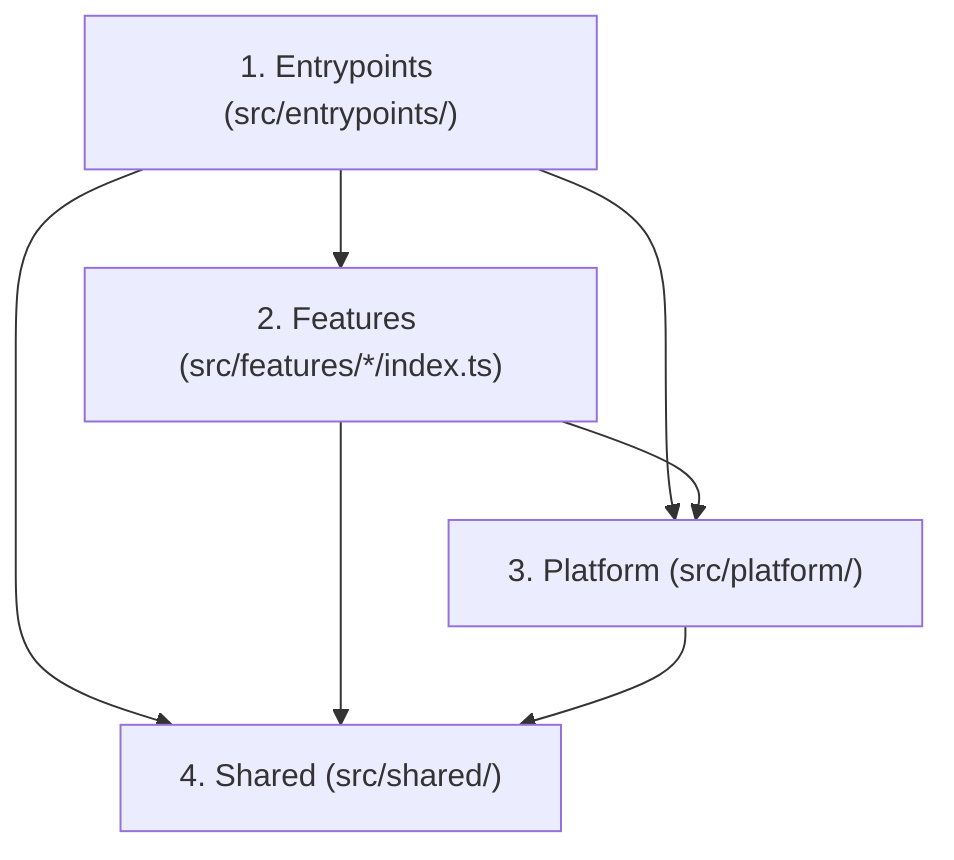

# Política Canônica de Governança Arquitetural (`architecture-governance.md`)

> **Projeto:** ExtensionTools  
> **Classificação:** PUBLIC REPOSITORY (Safe-by-Default)  
> **Identificador da Política:** `POL-ENG-01`  
> **Versão:** `1.0.0`  
> **Status:** CANÔNICA E VIGENTE  
> **Agente Guardião:** `architect` (Aderência obrigatória para `developer` e `code-reviewer`)  

---

## 1. Identificação e Finalidade

O projeto **ExtensionTools** adota a filosofia de arquitetura **Feature-First Modular com Complexidade Proporcional** e processamento prioritário no cliente (*Local-First*).

A finalidade desta política é estabelecer os **limites estruturais de acoplamento, a direção estrita de dependências e os padrões mandatórios para tomada e registro de decisões técnicas**, garantindo que a base de código permaneça desacoplada, sustentável e testável à medida que as 12 ferramentas do catálogo forem integradas.

---

## 2. Escopo de Aplicação

Esta política aplica-se a todo o código-fonte sob o diretório `src/`:
- `src/entrypoints/` (Background, Content Scripts, Pages, Side Panel)
- `src/features/` (Módulos funcionais independentes)
- `src/platform/` (Adaptadores de APIs de navegador, mensageria e persistência)
- `src/shared/` (Tipos, componentes atômicos de UI e utilitários puros)

---

## 3. Direção Canônica de Dependências (Fluxo Unidirecional)

O fluxo de dependências deve respeitar estritamente a hierarquia unidirecional descendente:

### Regras de Isolamento Modular:
1. **Isolamento Estrito entre Features (ARC-R01):** Um módulo em `src/features/<featA>/` jamais pode importar arquivos de `src/features/<featB>/`. Se uma funcionalidade precisar ser consumida por outra, o recurso deve ser formalmente promovido a `src/shared/` ou mediado via barramento de eventos em `src/platform/messaging/`.
2. **Encapsulamento por API Pública (ARC-R02):** Entrypoints e consumidores externos só podem acessar uma feature através do seu arquivo de fachada canônico `src/features/<feature>/index.ts`. É proibido importar diretamente submódulos internos (ex: `src/features/text-diff/ui/Panel.tsx`).
3. **Pureza de Domínio e Core (ARC-R03):** O código de regras de negócio em `src/features/*/core/` ou `domain/` deve ser composto por lógica pura em TypeScript. É proibido importar React, JSX, Tailwind ou invocar diretamente APIs do navegador (`chrome.*`, `window.*`, `localStorage`).
4. **Isolamento de Shared (ARC-R05):** Módulos em `src/shared/` são utilitários e primitivos universais. Eles não podem depender de `src/features/`, `src/platform/` ou `src/entrypoints/`.
5. **Prevenção de Dependências Circulares (ARC-R07):** É terminantemente proibida a introdução de ciclos de dependência diretos (`A -> B -> A`) ou transitivos (`A -> B -> C -> A`) em qualquer nível da árvore.

---

## 4. Filosofia Local-First e Princípio de Complexidade Proporcional

1. **Processamento Local Prioritário:** Toda operação de visualização, diff, parse e formatação deve ser executada localmente no navegador. A extensão não deve depender de backend proprietário obrigatório para suas funções fundamentais.
2. **Anti-Overengineering:** É proibido criar abstrações prévias, factories, inversões de controle genéricas ou múltiplas camadas de indireção sem uma necessidade funcional imediata e demonstrável. Adote Clean Architecture ou DDD apenas nos submódulos complexos que justificarem sua adoção.

---

## 5. Governança de Decisões Arquiteturais (ADRs)

Toda decisão que impacte os limites estruturais do sistema deve ser documentada como um **Architecture Decision Record (ADR)** sob `docs/architecture/adr/`.

### Critérios de Obrigatoriedade de Criação de ADR:
- Introdução de nova dependência externa de runtime (`dependencies` no `package.json`).
- Mudança na estratégia de persistência local (ex: IndexedDB vs `chrome.storage.local`).
- Alteração ou ampliação de permissões no `wxt.config.ts` (Manifest V3).
- Criação de novo canal ou protocolo de mensageria entre Content Script e Side Panel.
- Promoção de código interno de feature para `src/platform/` ou `src/shared/`.

---

## 6. Procedimentos e Comportamentos Esperados

1. **Verificação de Importações:** Durante o desenvolvimento, o engenheiro deve verificar se os caminhos relativos ou aliases `@/*` respeitam as fronteiras da camada.
2. **Uso de Aliases Canônicos:** Mapear imports através de `@/` apontando exclusivamente para raízes públicas de módulos.

---

## 7. Tratamento de Violações e Bloqueios

Se um import violar as regras de isolamento ou introduzir ciclo:
1. O Quality Gate `QG-02 (Architecture Boundaries)` falha com código `1`.
2. O agente deve refatorar o acoplamento, extraindo o contrato compartilhado para `src/shared/` ou `src/platform/`.
3. Se a refatoração exigir mudança de limite estrutural não prevista, emitir [`impediment-contract.md`](../contracts/impediment-contract.md) solicitando decisão do `Architect`.

---

## 8. Critérios Verificáveis de Conformidade (QG-02)

- [ ] Zero imports cruzados entre features detectados por linter estático.
- [ ] Zero dependências circulares no grafo de módulos de `src/`.
- [ ] 100% de imports de features por entrypoints passando exclusivamente por `index.ts`.
- [ ] Toda nova dependência ou tecnologia externa acompanhada por ADR em `docs/architecture/adr/`.

---

## 9. Referências Cruzadas

- Arquitetura Canônica: `ARCHITECTURE.md` (Design Modular Feature-First)
- Quality Gate: `docs/quality-gates/02-architecture-boundaries.md` (`QG-02`)
- Procedimentos: `.harness/skills/architecture-review/SKILL.md`
- Contratos: [`task-contract.md`](../contracts/task-contract.md) e [`agent-output-contract.md`](../contracts/agent-output-contract.md)
