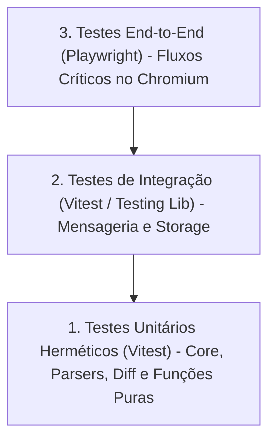

# Política Canônica de Estratégia e Pirâmide de Testes (`testing-strategy.md`)

> **Projeto:** ExtensionTools  
> **Classificação:** PUBLIC REPOSITORY (Safe-by-Default)  
> **Identificador da Política:** `POL-ENG-03`  
> **Versão:** `1.0.0`  
> **Status:** CANÔNICA E VIGENTE  
> **Agente Guardião:** `test-engineer` (Aderência obrigatória para `developer` e `script-engineer`)  

---

## 1. Identificação e Finalidade

A confiança na estabilidade e correção do **ExtensionTools** repousa sobre uma esteira de testes automatizados determinística, rápida e orientada a riscos.

A finalidade desta política é formalizar a **estratégia da pirâmide de testes, as diretrizes de determinismo estrito e a obrigatoriedade de cobertura de casos negativos**, garantindo que nenhum código seja entregue sem a comprovação de que atende aos critérios funcionais e resiste a falhas e exceções.

---

## 2. Escopo de Aplicação

Esta política governa todas as suítes de teste sob o diretório `tests/`:
- `tests/unit/`: Testes unitários de regras de negócio de features e utilitários.
- `tests/integration/`: Testes de interação entre componentes e adaptadores de plataforma.
- `tests/e2e/`: Testes ponta-a-ponta no navegador Chromium via Playwright.
- `tests/harness/`: Testes dos mecanismos, validadores e scanners de segurança do Harness.

---

## 3. Pirâmide de Testes e Distribuição de Esforço

### Diretrizes por Nível:
1. **Base (Testes Unitários — 70%+ do esforço):**
   - Execução ultra-rápida (sub-segundo) via Vitest.
   - Foco em funções puras, parsers (XML, JSON, Markdown), algoritmos de diff, validadores e transformações de dados em `core/`.
   - Isolamento absoluto: zero chamadas de rede real, zero persistência física em disco persistente.
2. **Meio (Testes de Integração — 20% do esforço):**
   - Validação da comunicação entre componentes React e estado compartilhado.
   - Teste de adaptadores de persistência local (`chrome.storage.local`, IndexedDB simulados em memória).
3. **Topo (Testes E2E — 10% do esforço):**
   - Executados via Playwright em modo headless contra a extensão empacotada no Chromium.
   - Restritos aos fluxos de usuário mais críticos (ex: abertura do Side Panel, upload de arquivo para diff e renderização).

---

## 4. Princípios Inegociáveis de Determinismo e Isolamento

1. **Erradicação de Testes Flaky:**
   - É terminantemente proibido versionar testes cujo resultado oscile entre sucesso e falha dependendo da carga da máquina ou da ordem de execução.
   - Qualquer teste instável deve ser imediatamente corrigido ou isolado.
2. **Proibição de Dependência de Timers Reais:**
   - Para testar timeouts, debounce, throttle ou rotinas assíncronas baseadas em tempo, utilize obrigatoriamente os Fake Timers do Vitest (`vi.useFakeTimers()`, `vi.advanceTimersByTime()`).
   - É expressamente proibido o uso de `sleep()` ou delays reais (`setTimeout(..., 1000)`) em testes unitários.
3. **Hermetismo e Zero Conexão Externa:**
   - Testes unitários e de integração não podem realizar requisições HTTP para a internet. Mocks e stubs devem ser configurados localmente.
4. **Isolamento de Fixtures e Ambientes Temporários:**
   - Testes que envolvam operações de sistema de arquivos ou Git devem operar exclusivamente em diretórios temporários isolados (`os.tmpdir()`), com destruição obrigatória no encerramento (`afterEach()`).

---

## 5. Obrigatoriedade de Testes Negativos e Casos Extremos

Para qualquer componente, parser, conversor ou scanner crítico, é obrigatório modelar e validar:
1. **Entradas Inválidas e Malformadas:** Arquivos corrompidos, JSON inválido, XML mal fechado, strings vazias e payloads inesperados.
2. **Limites Operacionais:** Arquivos muito grandes, listas vazias, chaves ausentes.
3. **Resiliência a Erros de Permissão e IO:** Comprovação de que o sistema falha de forma segura (*fail-safe*) com mensagens claras e sem quebrar o processo com exceções não tratadas (*uncaught exceptions*).

---

## 6. Procedimentos e Comportamentos Esperados

1. **TDD Proporcional ao Risco:** Antes de implementar lógica complexa (como algoritmos de diff ou parsers), o engenheiro deve estruturar primeiro os casos de teste que definem o comportamento esperado.
2. **Asserções Significativas:** Evite testes superficiais que apenas comprovem a existência de um arquivo ou que um método foi chamado. As asserções devem verificar o **estado e o resultado observável**.

---

## 7. Tratamento de Violações e Bloqueios

Se um teste falhar ou for detectado como instável:
1. O Quality Gate `QG-04 (Automated Testing)` bloqueia o pipeline.
2. É proibido comentar ou desabilitar testes (`it.skip`, `describe.skip`) apenas para obter aprovação do gate.
3. O agente deve identificar a causa-raiz (regressão no código funcional ou premissa inválida no teste) e aplicar a correção necessária.

---

## 8. Critérios Verificáveis de Conformidade (QG-04)

- [ ] 100% dos testes unitários e de harness aprovados no Vitest (`pnpm run test:unit`).
- [ ] Zero dependências de rede externa ou timers reais não controlados.
- [ ] Todo módulo em `src/features/*/core` acompanhado por suíte de testes unitários com cobertura de cenários positivos e negativos.

---

## 9. Referências Cruzadas

- Quality Gate: `docs/quality-gates/04-automated-testing.md` (`QG-04`)
- Procedimentos: `.harness/skills/testing/SKILL.md`
- Contratos: [`task-contract.md`](../contracts/task-contract.md) e [`agent-output-contract.md`](../contracts/agent-output-contract.md)
