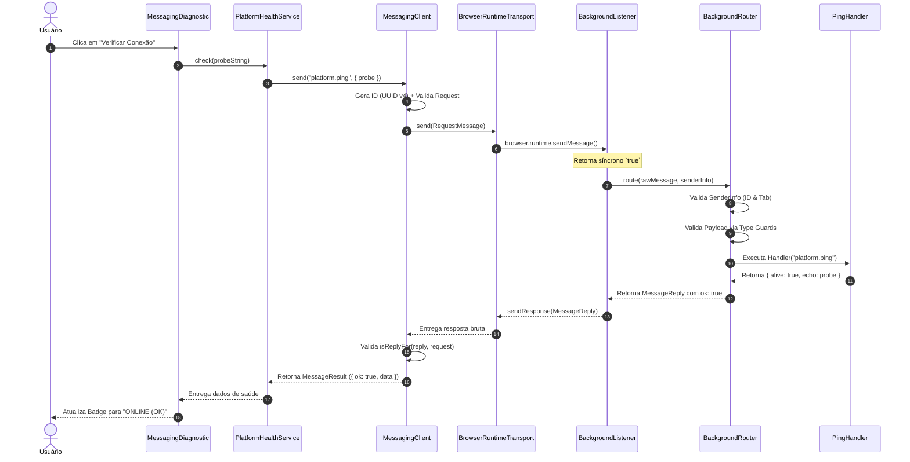
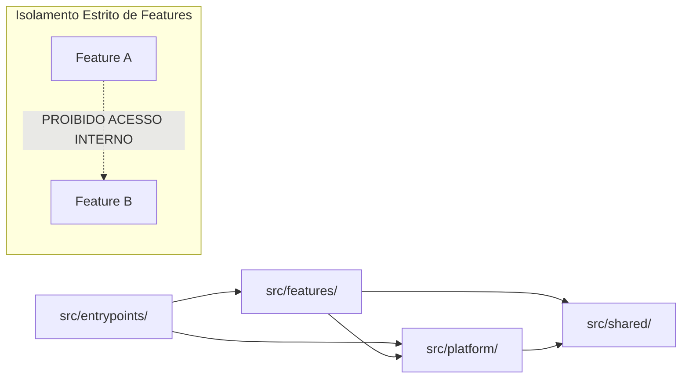
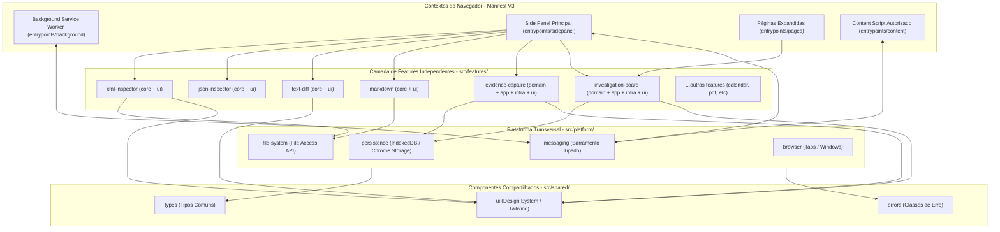

# Arquitetura de Software — ExtensionTools

> **Classificação:** PUBLIC REPOSITORY  
> **Status:** Canônico e Aprovado  
> **Padrão Principal:** Feature-First Modular com Isolamento de Dependências e Complexidade Proporcional  
> **Framework:** WXT + Manifest V3 + React 19 + TypeScript  
> **Documentos Complementares:**
> - Sistema Canônico de Quality Gates: [`docs/quality-gates/`](docs/quality-gates/README.md)
> - Governança dos Agentes: [`AGENTS.md`](AGENTS.md)
> - Arquitetura do Harness: [`docs/architecture/HARNESS-ARCHITECTURE.md`](docs/architecture/HARNESS-ARCHITECTURE.md)
> - Visão Geral do Produto: [`docs/product/PRODUCT-OVERVIEW.md`](docs/product/PRODUCT-OVERVIEW.md)
> - Política de Segurança: [`SECURITY.md`](SECURITY.md)

---

## 1. Visão Arquitetural e Propósito

O **ExtensionTools** é uma extensão de navegador modular desenvolvida para fornecer utilitários de alta performance e privacidade focados em manipulação de texto, dados, inspeção estruturada, exportação de arquivos e organização de investigações técnicas.

A arquitetura do ExtensionTools existe para garantir que a extensão evolua de forma **sustentável, segura e compreensível**, tanto para desenvolvedores humanos quanto para **agentes autônomos de IA**.

### 1.1. Atributos de Qualidade Prioritários

1. **Privacidade e Processamento Local (*Local-First*)**: O processamento de dados do usuário (XML, JSON, texto, Markdown, arquivos e capturas) ocorre 100% no navegador. Serviços externos são inexistentes ou estritamente opcionais sob demanda explícita.
2. **Modularidade e Limites Explícitos**: Cada ferramenta do catálogo opera como uma funcionalidade independente (*feature*), possuindo ciclo de vida, modelos e interfaces próprios.
3. **Baixo Acoplamento e Alta Coesão**: Modificações ou manutenções em um módulo (e.g., `text-diff`) não afetam outros módulos (e.g., `calendar` ou `xml-inspector`).
4. **Testabilidade Isolada**: As regras de validação, parser, transformação e domínio são testáveis independentemente de interfaces React ou do runtime de extensões Web.
5. **Segurança por Padrão (*Safe-by-Default*)**: Princípio do menor privilégio no Manifest V3, saneamento de dados externos e isolamento formal contra vazamento de segredos corporativos em repositório público.
6. **Evolução Incremental e Complexidade Proporcional**: A complexidade estrutural de um módulo deve refletir a complexidade intrínseca de seu problema, sem camadas ou abstrações especulativas desnecessárias.

---

## 2. Princípios Fundamentais de Engenharia

O ExtensionTools adota princípios consagrados de engenharia aplicados pragmaticamente:

| Princípio | Definição no ExtensionTools | Problema Resolvido | Riscos de Ignorar | Exemplo Prático |
|---|---|---|---|---|
| **Coesão** | Cada módulo concentra exclusivamente os comportamentos do seu propósito funcional. | Espalhamento de lógica relacionada em pastas genéricas (`components/`, `utils/`). | Dificuldade de identificar impacto de alterações; código espaguete. | Toda a manipulação de parsing e validação XML reside em `src/features/xml-inspector/`. |
| **Baixo Acoplamento** | Módulos comunicam-se via contratos públicos ou eventos, sem acessar a implementação interna alheia. | Dependências cruzadas e efeito dominó em refatorações. | Modificar a UI de uma feature quebra a compilação de outra. | `markdown` não importa componentes internos de `evidence-capture`. |
| **Encapsulamento** | Detalhes internos (hooks privados, adaptadores, estados) não são exportados. | Vazamento de detalhes de implementação para a aplicação inteira. | Acoplamento acidental e impossibilidade de refatorar código privado. | `src/features/text-diff/index.ts` expõe apenas o ponto de entrada da ferramenta. |
| **Separação de Responsabilidades** | Diferenciação nítida entre lógica pura (core/domain), orquestração (application) e exibição (ui). | Mistura de algoritmos de formatação/diff dentro de componentes visuais JSX. | Testes lentos dependentes de DOM; UI poluída de regras complexas. | O algoritmo de diff de texto reside em `core/`, sendo invocado por componentes em `ui/`. |
| **Inversão de Dependência** | Lógica de negócio e casos de uso dependem de contratos/interfaces, não de APIs do navegador. | Vinculação direta a `chrome.storage` ou `IndexedDB` no meio da regra funcional. | Impossibilidade de testar regras de negócio sem mocks complexos de browser. | `EvidenceCaptureRepository` é uma interface; o adapter IndexedDB é um detalhe de infraestrutura. |
| **Simplicidade Proporcional** | Não criar camadas DDD/Clean Architecture completas onde um simples utilitário é suficiente. | *Overengineering*, proliferação de DTOs, mappers e interfaces vazias. | Excesso de código sem valor que retarda a entrega e confunde agentes de IA. | `text-diff` adota estrutura `core/` + `ui/`, sem camadas artificiais de repositórios. |
| **Segurança por Padrão** | Validação estrita de entradas, sem `eval()`, sem injeção de HTML arbitrário e dados não confiáveis tratados com desconfiança. | Execução de código arbitrário e vazamento de dados em contextos de extensão. | Comprometimento do navegador do usuário e rejeição na Chrome Web Store. | O preview de Markdown sanitiza rigorosamente qualquer tag antes da renderização. |

---

## 3. Estilo Arquitetural: Feature-First

A estrutura física do código-fonte em `src/` adota o padrão **Feature-First**:

```text
src/
├── entrypoints/    # Contextos de execução da Web Extension (WXT)
├── features/       # Módulos funcionais independentes do produto
├── platform/       # Serviços e adaptadores de runtime do navegador/OS
└── shared/         # Tipos universais, design system compartilhado e utilitários
```

### 3.1. Entrypoints (`src/entrypoints/`)
Os entrypoints correspondem aos pontos de entrada declarados no Manifest V3 gerenciados pelo framework WXT:
- `background/`: Service Worker da extensão. Executa tarefas de ciclo de vida, eventos de contexto e comunicação assíncrona entre janelas. **Não contém regras de negócio ou lógica complexa de features.**
- `sidepanel/`: Interface principal do usuário aberta na barra lateral do navegador. Hospeda a navegação e instancia as ferramentas disponíveis.
- `pages/`: Páginas completas da extensão (e.g., visualização expandida de investigações, quadro de evidências em aba dedicada).
- `content/`: Scripts injetados em páginas web autorizadas para interações contextuais mínimas (e.g. captura autorizada de texto/evidência).

> [!IMPORTANT]  
> Os contextos de execução de uma extensão possuem isolamentos rígidos de memória impostos pelo navegador. A comunicação entre Content Scripts, Background Worker e UI deve utilizar exclusivamente a camada `platform/messaging/`.

### 3.2. Features (`src/features/`)
Representa cada utilitário funcional do ExtensionTools. Cada diretório de feature é autônomo e responsável pela sua própria lógica, apresentação e testes locais.

As 12 features previstas:
1. `calendar`: Marcação temporal, visualização de cronogramas e eventos de auditoria.
2. `evidence-capture`: Coleta contextual estruturada de evidências com hash de integridade e metadados.
3. `investigation-board`: Quadro visual analítico para conectar evidências, notas e conclusões.
4. `json-inspector`: Visualizador em árvore, validador de schema, filtro e projeção JSON.
5. `markdown`: Editor com pré-visualização, formatação e manipulação rápida de documentos.
6. `pdf-export`: Compilação e exportação local de relatórios e relatórios técnicos em PDF.
7. `quick-files`: Espaço de trabalho em memória para arquivos em análise rápida.
8. `reference-hub`: Catálogo e organizador de referências técnicas e regulatórias.
9. `snippet-library`: Acervo de trechos reutilizáveis de código, queries e padrões de texto.
10. `tab-workspaces`: Agrupamento e gestão de abas do navegador por contexto investigativo.
11. `text-diff`: Comparador visual semântico de textos, diff de linhas e palavras.
12. `xml-inspector`: Inspetor, validador de sintaxe, formatação e pesquisa XPath/XPath-like de XML.

### 3.3. Platform (`src/platform/`)
Fornece abstrações e implementações de infraestrutura técnica transversais ao navegador e ao sistema operacional:
- `browser/`: Wrappers seguros e tipados para as APIs do Chrome/WebExtension (`tabs`, `windows`, `permissions`).
- `file-system/`: Integração local via File System Access API ou downloads nativos ([especificação detalhada](docs/architecture/file-system-access-architecture.md)).
- `persistence/`: Mecanismos de armazenamento local (IndexedDB via Dexie/idb e `chrome.storage.local`).
- `messaging/`: Barramento de mensagens fortemente tipadas entre Background e Side Panel com Inversão de Dependências (DIP), Runtime Validation e autorização `SenderInfo` ([especificação canônica](docs/architecture/platform-messaging.md) e [`ADR-006`](docs/architecture/adr/ADR-006-platform-messaging-ports-adapters.md)).

### 3.4. Shared (`src/shared/`)
Elementos genuinamente reutilizáveis em múltiplos módulos:
- `ui/`: Componentes visuais atômicos do Design System (botões, inputs, modais, painéis) construídos com Tailwind CSS.
- `types/`: Tipos primitivos, identificadores genéricos e contratos universais de utilitários.
- `errors/`: Hierarquia de classes de erro da aplicação (`AppError`, `ValidationError`, `SecurityError`).

> [!WARNING]  
> `src/shared/` **não é lixeira de código**. Um componente ou utilitário só deve ser colocado em `shared/` quando for consumido por pelo menos duas features distintas e tiver responsabilidade genérica clara.

---

## 4. Complexidade Proporcional e Organização Interna das Features

Não adotamos uma arquitetura rígida única para todas as ferramentas. A estrutura interna de cada feature varia conforme sua complexidade intrínseca:

```mermaid
flowchart TD
    subgraph ProportionalArchitecture [Arquitetura Proporcional por Complexidade]
        direction TB
        subgraph Simple [1. Feature Simples: text-diff, xml-inspector, json-inspector]
            S_Core["core/ (Lógica Pura / Parsers)"]
            S_UI["ui/ (Componentes React)"]
            S_Index["index.ts (API Pública)"]
            S_UI --> S_Core
        end

        subgraph Intermediate [2. Feature Intermediária: reference-hub, snippet-library]
            I_Domain["domain/ (Modelos & Invariantes)"]
            I_App["application/ (Casos de Uso)"]
            I_UI["ui/ (Componentes & Hooks)"]
            I_Index["index.ts (API Pública)"]
            I_UI --> I_App
            I_App --> I_Domain
        end

        subgraph Complex [3. Feature Complexa: evidence-capture, investigation-board]
            C_Domain["domain/ (Entidades & Regras)"]
            C_App["application/ (Casos de Uso)"]
            C_Infra["infrastructure/ (Adapters Locais)"]
            C_UI["ui/ (Visualização & Estado)"]
            C_Index["index.ts (API Pública)"]
            C_UI --> C_App
            C_App --> C_Domain
            C_Infra -.-> C_Domain
            C_App --> C_Infra
        end
    end
```



### 4.1. Categoria 1: Features Simples (Utilitários de Transformação/Inspeção)
*Exemplos: `text-diff`, `xml-inspector`, `json-inspector`, `markdown`, `pdf-export`, `quick-files`, `calendar`, `tab-workspaces`.*
- **`core/`**: Funções puras de cálculo de diff, formatação, parsing, validação e manipulação. Não utilizam React nem APIs de navegador. Testadas via testes unitários instantâneos.
- **`ui/`**: Componentes React de interação e apresentação que consomem as funções do `core/`.
- **`index.ts`**: Ponto de entrada que exporta o componente principal para o Side Panel ou páginas.

### 4.2. Categoria 2: Features Intermediárias (Catálogo e Gestão Local de Itens)
*Exemplos: `reference-hub`, `snippet-library`.*
- **`domain/`**: Tipos, validações e regras de agrupamento de snippets ou referências.
- **`application/`**: Casos de uso de busca, filtragem, exportação e organização.
- **`ui/`**: Interface de visualização, formulários e listagem.

### 4.3. Categoria 3: Features Complexas (Modelagem Rica e Persistência Estruturada)
*Exemplos: `evidence-capture`, `investigation-board`.*
- **`domain/`**: Entidades com identidade (`Evidence`, `InvestigationNode`), cálculo de hashes criptográficos e invariantes.
- **`application/`**: Casos de uso complexos (`CaptureEvidenceUseCase`, `LinkNodesUseCase`), com interfaces de portas (ports) para armazenamento.
- **`infrastructure/`**: Adaptadores específicos que implementam as interfaces de persistência utilizando a base em `src/platform/persistence/`.
- **`ui/`**: Componentes visuais ricos (e.g. diagramas, canvas, timelines).

---

## 5. Subsistema de Mensageria da Plataforma (Platform Messaging)

O subsistema de mensageria da plataforma (`src/platform/messaging/`) é o barramento de comunicação bidirecional fortemente tipado que conecta os processos isolados do navegador (Side Panel e Background Service Worker) sob o paradigma **Manifest V3**.

> [!NOTE]  
> A documentação canônica exaustiva do subsistema, detalhando contratos, validadores, códigos de erro e guia de implementação, reside em [`docs/architecture/platform-messaging.md`](docs/architecture/platform-messaging.md). A formalização da decisão reside em [`ADR-006`](docs/architecture/adr/ADR-006-platform-messaging-ports-adapters.md).

### 5.1. Contextos de Execução e Fronteiras de Confiança

1. **Side Panel (`src/entrypoints/sidepanel/`):** Contexto persistente de UI com React 19. Não possui acesso direto ao ciclo de vida do navegador ou a APIs privilegiadas exclusivas de background.
2. **Background Service Worker (`src/entrypoints/background/`):** Contexto *headless*, estritamente *stateless* e efêmero. O Chromium encerra o processo após ~30 segundos de inatividade e o reinicia sob demanda. O roteador de background não pode depender de estado mutável em memória global.
3. **Fronteira de Confiança (IPC Boundary):** Dados transmitidos via `chrome.runtime.sendMessage` cruzam a fronteira do processo e chegam ao destino como `unknown`. O protocolo impõe validação estrita em runtime antes de qualquer processamento.

### 5.2. Arquitetura Implementada vs. Arquitetura Planejada

| Dimensão | Arquitetura Implementada (M3 / Bloco 3) | Arquitetura Planejada (Fases Futuras) |
|---|---|---|
| **Modelo de Transporte** | Solicitação e resposta pontual (*one-off request-response*) via `browser.runtime.sendMessage`. | Portas de longa duração (*long-lived connections*) e streaming contínuo para arquivos pesados. |
| **Abstração (DIP)** | Interface `MessageTransport` desacoplada; cliente agnóstico em relação a APIs de browser. | Adaptadores alternativos para comunicação com workers dedicados e WebLocks. |
| **Runtime Validation** | Type Guards funcionais puros (`isRecord`, `isProtocolMessage`, `isRequestMessage`, `isReplyFor`). | Esquemas declarativos com validação automatizada de payloads complexos de domínio. |
| **Tratamento de Timeout** | Barreira local de espera com `Promise.race()` sem retentativa automática. | Protocolo de cancelamento cooperativo com tokens de cancelamento (`AbortController`). |
| **Operações Suportadas** | Operação canônica de verificação de conectividade: `platform.ping`. | Comandos de persistência (M3 / Bloco 4), captura de abas e exportação. |
| **Autorização** | Verificação obrigatória de `SenderInfo`: `sender.id === extensionId` e `sender.tab == null`. | Políticas granulares de permissão para Content Scripts autorizados em abas específicas. |

### 5.3. Diagrama de Componentes de Mensageria

```mermaid
flowchart LR
    subgraph SidePanelContext ["Contexto Side Panel (UI)"]
        Diagnostic["MessagingDiagnostic (UI)"] --> Service["PlatformHealthService"]
        Service --> Client["MessagingClient"]
        Client --> TransportPort["MessageTransport (Port / DIP)"]
        TransportPort -.-> Adapter["BrowserRuntimeTransport (Adapter)"]
    end

    subgraph IPC ["Canal IPC do Chromium"]
        Adapter ==>|browser.runtime.sendMessage| Listener["Background Messaging Listener"]
        Listener ==>|sendResponse assíncrono| Adapter
    end

    subgraph BackgroundContext ["Contexto Background Worker (Stateless)"]
        Listener --> Router["Background Message Router (Puro)"]
        Router --> Auth["Autorização SenderInfo"]
        Auth --> Validation["Runtime Type Guards"]
        Validation --> Handler["Handler: platform.ping"]
    end
```



### 5.4. Diagrama de Sequência do Fluxo `platform.ping`



---

## 6. Regras de Dependência e Matriz de Fronteiras



### 5.1. Matriz de Dependências Permitidas

| De (Origem) \ Para (Destino) | `entrypoints/` | `features/*/ui` | `features/*/core/domain` | `platform/` | `shared/` |
|---|:---:|:---:|:---:|:---:|:---:|
| **`entrypoints/`** | ❌ Não | ✅ Sim (via `index.ts`) | ❌ Proibido | ✅ Sim | ✅ Sim |
| **`features/*/ui`** | ❌ Proibido | ❌ Proibido | ✅ Sim (própria feature) | ✅ Sim | ✅ Sim |
| **`features/*/core/domain`**| ❌ Proibido | ❌ Proibido | ❌ Proibido | ❌ Proibido | ✅ Sim (tipos) |
| **`features/*/application`**| ❌ Proibido | ❌ Proibido | ✅ Sim (própria feature) | ⚠️ Apenas Interfaces | ✅ Sim |
| **`features/*/infra`** | ❌ Proibido | ❌ Proibido | ✅ Sim (própria feature) | ✅ Sim (Adapters) | ✅ Sim |
| **`platform/`** | ❌ Proibido | ❌ Proibido | ❌ Proibido | ❌ Proibido | ✅ Sim |
| **`shared/`** | ❌ Proibido | ❌ Proibido | ❌ Proibido | ❌ Proibido | ❌ Não |

### 5.2. Invariantes Arquiteturais Inegociáveis
1. **Isolamento entre Features**: Uma feature NUNCA deve importar arquivos de dentro de outra feature (`import ... from '../other-feature/core/something'`). Caso haja necessidade genuína de colaboração, a funcionalidade compartilhada deve ser promovida para `platform/` ou `shared/`, ou orquestrada no nível de `entrypoints/`.
2. **Pureza do Domínio/Core**: Arquivos em `domain/` ou `core/` não importam React, JSX, hooks do React ou APIs globais do navegador (`window`, `chrome.*`).
3. **Comunicação por API Pública**: Se um entrypoint precisa instanciar uma feature, deve importar exclusivamente a partir do `src/features/<feature-name>/index.ts`.

---

## 7. Segurança e Superfície de Ataque

Sendo um projeto mantido em **repositório público no GitHub**, a arquitetura estabelece as seguintes barreiras:

1. **Proteção Contra Vazamento no Código-fonte**: A esteira de segurança desenvolvida no harness (Fase H1) executa os scanners (`publication-guard`, `scan-secrets`, `scan-markdown`, `scan-private-paths`) antes de qualquer commit ou push.
2. **Privacidade e Menor Privilégio no Manifest V3**: Permissões declaradas em `wxt.config.ts` devem ser estritamente mínimas. Permissões amplas como `<all_urls>` são proibidas a menos que estritamente justificadas em ADR.
3. **Saneamento de Conteúdo Não Confiável**: XML, JSON ou Markdown colados ou importados pelo usuário são tratados como entradas potencialmente maliciosas. Bibliotecas de renderização devem utilizar sanitizadores consolidados (e.g. DOMPurify).
4. **Isolamento de Dados Locais**: Todos os dados gravados no `IndexedDB` pertencem ao origin isolado da extensão e não são acessíveis por páginas web externas visitadas pelo usuário.

---

## 8. Estratégia de Testabilidade

A organização Feature-First foi planejada para permitir uma esteira de testes veloz e determinística:

- **Testes Unitários de Core/Domain (`tests/unit/` ou adjacentes)**:
  - Foco em funções de diff, transformadores, validações XML/JSON e parsing.
  - Execução pura em memória com Vitest (tempo de execução na ordem de milissegundos).
  - Sem necessidade de emulação de navegador ou mocks de UI.
- **Testes de Integração de Features (`tests/integration/`)**:
  - Testam o fluxo entre `ui/` e `core/` ou `application/` utilizando React Testing Library.
  - Verificam comportamento de componentes diante de erros de validação e entradas de arquivos.
- **Testes de Plataforma e Harness (`tests/harness/`)**:
  - Garantem a eficácia dos scanners de segurança, pre-commit guards e integridade estrutural.
- **Testes End-to-End (`tests/e2e/`)**:
  - Testes com Playwright executando a extensão empacotada no Chromium para validar interação no Side Panel e permissões.

---

## 9. Governança do Desenvolvimento Assistido por IA

Para agentes autônomos operando no repositório (Gemini, Claude, GPT, etc.), este documento estabelece as seguintes regras operacionais:

1. **Consulta Mandatória**: O agente `architect` é o guardião das fronteiras aqui descritas. O agente `developer` não tem autorização para violar a matriz de dependências ou criar acoplamentos cruzados entre features.
2. **Proibição de Boilerplate Especulativo**: Nunca criar interfaces, DTOs ou classes de serviço vazias antes da implementação de uma necessidade real.
3. **Respeito aos Quality Gates**: Nenhuma alteração é considerada pronta sem execução dos gates mecânicos (especificação canônica completa em [`docs/quality-gates/`](docs/quality-gates/README.md)):
   ```bash
   pnpm run compile       # Typecheck estático rigoroso
   pnpm run lint          # Conformidade com ESLint 10
   pnpm run format:check  # Estilo Prettier
   pnpm run test:security # Scanners de segurança
   ```
4. **Governança de Mudanças Arquiteturais (ADRs)**:
   - Qualquer introdução de dependência externa relevante, criação de nova feature ou alteração na camada `platform/` exige a criação de um Architecture Decision Record em `docs/architecture/adr/`.
   - Mudanças banais não devem gerar ADRs.

---

## 10. Antipadrões Desencorajados ou Proibidos

- ❌ **Shared Dump**: Mover arquivos para `src/shared/` simplesmente para resolver um erro de importação sem avaliar coesão.
- ❌ **Deep Cross-Feature Imports**: Fazer `import { Button } from '@/features/calendar/ui/Button'`.
- ❌ **Estado Global Monolítico**: Concentrar todo o estado de todas as features em um único Redux/Zustand store gigante no entrypoint. O estado deve ser local da feature sempre que possível.
- ❌ **God Components**: Criar componentes React de 800 linhas que cuidam de download de arquivo, parsing de XML, cálculo de diff e renderização visual.
- ❌ **Dependência Direta do Browser no Domínio**: Chamar `chrome.storage.local.get` ou `window.location` dentro de classes de domínio ou funções de cálculo puro.

---

## 11. Diagrama Arquitetural Consolidado


