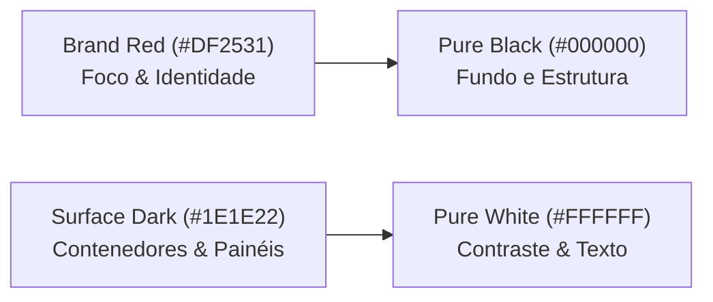
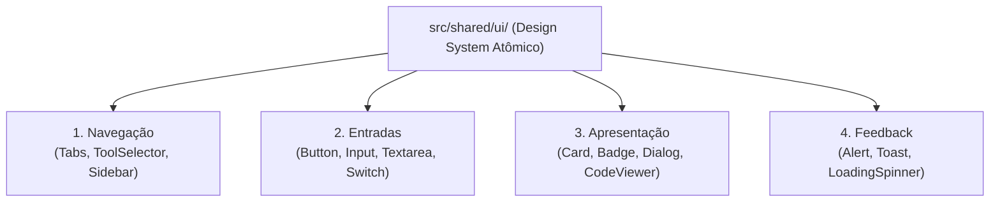

# Design System & Identidade Visual — ExtensionTools

> **Classificação:** PUBLIC REPOSITORY  
> **Status:** Canônico e Aprovado  
> **Papel:** Diretrizes Universais de UI/UX, Design Tokens, Temas e Identidade Visual  
> **Documentos Complementares:**
> - Arquitetura de Software: [`ARCHITECTURE.md`](ARCHITECTURE.md)
> - Governança dos Agentes: [`AGENTS.md`](AGENTS.md)
> - Visão Geral do Produto: [`docs/product/PRODUCT-OVERVIEW.md`](docs/product/PRODUCT-OVERVIEW.md)
> - Política de Segurança: [`SECURITY.md`](SECURITY.md)

---

## 1. Visão do Design System

O **ExtensionTools Design System** é a linguagem visual e o conjunto de convenções de interface projetados para criar uma experiência de usuário **moderna, tecnológica, minimalista e altamente funcional** em uma extensão de navegador.

Sua finalidade primordial é conferir uma **sensação de produto coeso e unificado**, garantindo que 12 ferramentas analíticas e técnicas distintas (de inspeção XML/JSON a diff de texto e quadros de investigação) compartilhem o mesmo DNA visual, a mesma precisão operacional e a mesma previsibilidade de interação, sem violar o isolamento modular **Feature-First**.

---

## 2. Filosofia de Design e Princípios de UX

A interface do ExtensionTools existe para apoiar o raciocínio e a produtividade técnica do usuário, evitando o cansaço visual em jornadas prolongadas de trabalho.

### 2.1. Funcionalidade Antes da Ornamentação
Cada elemento visual (cor, borda, sombra, ícone ou espaçamento) deve possuir uma função clara e identificável. Ornamentos decorativos, brilhos desnecessários, gradientes intrusivos e ilustrações vazias são proibidos. A estética emerge da tipografia limpa, da precisão geométrica e da contenção visual.

### 2.2. Simplicidade Operacional e Baixa Carga Cognitiva
Ferramentas de produtividade não devem exigir manual de instruções para ações triviais. Fluxos de colagem, formatação, validação e download devem ser intuitivos, exigindo o mínimo de cliques possíveis e mantendo estados de trabalho protegidos contra recarregamentos acidentais.

### 2.3. Consistência Visual sem Acoplamento Funcional
O usuário transita entre o visualizador JSON e o editor Markdown reconhecendo a mesma barra de ferramentas, os mesmos botões, o mesmo padrão de abas e a mesma resposta tátil/visual. No entanto, essa consistência é alcançada através de **Tokens Semânticos Universais** e primitivos atômicos em `src/shared/ui/`, sem que uma feature precise conhecer os detalhes internos de outra.

### 2.4. Densidade Informacional Equilibrada
As ferramentas do ExtensionTools manipulam grandes volumes de dados brutos (tabelas, payloads de API, árvores hierárquicas e logs). A interface deve equilibrar alta densidade de informação com respiração tipográfica, proporcionando modos de visualização compactos e confortáveis.

### 2.5. Feedback Claro e Previsibilidade
Toda ação relevante deve fornecer confirmação imediata:
- **Carregamento**: Skeleton screens ou indicadores mínimos de progresso.
- **Sucesso**: Confirmações visuais breves (e.g. "Copiado para o clipboard").
- **Erro**: Diagnósticos claros com localização do problema e sem mensagens crípticas.
- **Ações Destrutivas**: Confirmações explícitas (e.g. limpar workspace, descartar evidência).

### 2.6. Acessibilidade por Padrão (WCAG 2.2 Nível AA)
A extensão é desenhada para navegação por teclado fluida (`Tab`, `Shift+Tab`, atalhos de comando), indicadores de foco evidentes, alvos de clique adequados (mínimo de 24x24 px em densidade compacta e 44x44 px em ações primárias) e conformidade estrita de contraste de cores.

### 2.7. Design Proporcional
Componentes e padrões visuais devem ser proporcionais à complexidade da ferramenta. Um utilitário de diff textual não requer modais complexos de configuração se um seletor em linha resolver o problema com menor atrito.

---

## 3. Identidade Visual Oficial

A identidade visual do ExtensionTools é inspirada no contraste marcante entre o **vermelho intenso vibrante, o preto profundo, o branco puro e superfícies grafite neutras**.

> **Direção Estética:** Moderna, Tecnológica, Minimalista, Funcional e Marcante.  
> O vermelho atua como o ponto focal de identidade da marca e como direcionador de interações essenciais, nunca como ruído de fundo generalizado.



### 3.1. Paleta Primária

| Papel Visual | Nome do Token | Valor Hexadecimal | Aplicação Principal |
|---|---|:---:|---|
| **Vermelho Marca** | `color.brand.primary` | `#DF2531` | Logotipo, ações primárias ativas, acentos de foco, indicador ativo de navegação. |
| **Branco Puro** | `color.base.white` | `#FFFFFF` | Texto principal em modo escuro, fundo base em modo claro, ícones de alto contraste. |
| **Preto Puro** | `color.base.black` | `#000000` | Fundo principal da extensão em modo escuro (Side Panel e Canvas), texto em modo claro. |

### 3.2. Diferenciação Crucial: Transparência vs. Opacidade

A especificação de design original da marca define duas composições de Brand Red (`#DF2531`) com **45% de transparência** e **65% de transparência**. 

> [!IMPORTANT]  
> **Atenção Técnica Matemática:**  
> - Transparência de **45%** equivale a uma **Opacidade de 55%** (`alpha = 0.55` ou hex `8C`).  
> - Transparência de **65%** equivale a uma **Opacidade de 35%** (`alpha = 0.35` ou hex `59`).  
> 
> As cores resultantes dependem da superfície sobre a qual são renderizadas. Não devem ser gravadas como valores hexadecimais sólidos arbitrários sem indicar o fundo de composição.

| Referência | Opacidade Real | Notação CSS (rgba) | Hexadecimal com Alpha | Comportamento Visual em Fundo `#101013` |
|---|:---:|:---:|:---:|---|
| **Brand Red (45% transparência)** | **55%** | `rgba(223, 37, 49, 0.55)` | `#DF25318C` | Destaque intermediário, bordas ativas e seleções secundárias. |
| **Brand Red (65% transparência)** | **35%** | `rgba(223, 37, 49, 0.35)` | `#DF253159` | Superfícies sutis de hover, tags suaves e halos de foco. |

### 3.3. Paleta Neutra Proposta (Modo Escuro / Default)

Para garantir profundidade e hierarquia sem recorrer a sombras pesadas, adota-se a seguinte escala neutra:

| Token | Hexadecimal | Propósito e Uso |
|---|:---:|---|
| `color.bg.dark` | `#101013` | Fundo da janela da extensão e do Sidepanel. |
| `color.surface.dark` | `#1E1E22` | Superfície de cartões, barras de ferramentas e painéis de ferramentas. |
| `color.surface.elevated` | `#2B2B31` | Menus suspensos, diálogos flutuantes, tooltips e modais. |
| `color.border.subtle` | `#2B2B33` | Linhas divisórias, bordas de inputs e separadores de painéis. |
| `color.border.focus` | `#DF2531` | Anel de foco ativo para elementos selecionados. |

### 3.4. Cores Semânticas de Feedback

Para evitar confusão entre a **cor da marca (vermelho)** e **estados de erro**, a interface diferencia rigidamente a semântica de ação e a semântica de alerta:

| Semântica | Token | Hexadecimal | Distinção Operacional |
|---|---|:---:|---|
| **Brand / Ação Primária** | `color.action.primary` | `#DF2531` | Ações intencionais positivas do usuário (executar, formatar, salvar). |
| **Erro Crítico** | `color.feedback.error` | `#E53935` | Falhas de validação, parsing quebrado, exceções. Usa ícone obrigatório `⚠️` / `✕`. |
| **Sucesso** | `color.feedback.success` | `#10B981` | Validação concluída, dados íntegros, copiado com sucesso. |
| **Aviso** | `color.feedback.warning` | `#F59E0B` | Depreciações, avisos de performance, arquivos truncados. |
| **Informativo** | `color.feedback.info` | `#3B82F6` | Dicas contextuais e badges de telemetria local. |

---

## 4. Design Tokens

O sistema de tokens adota arquitetura em três camadas para desacoplar a escolha de valor da sua aplicação:

```text
[Tokens Primitivos]  ──>  [Tokens Semânticos]  ──>  [Tokens de Componente]
(ex: red.500 = #DF2531)     (action.primary)          (button.primary.bg)
```

### 4.1. Mapeamento de Tokens Semânticos

```yaml
# Cores de Fundo e Superfície
color.bg.canvas: "{color.neutral.950}"         # #101013 (dark) / #F8F9FA (light)
color.surface.default: "{color.neutral.900}"   # #1E1E22 (dark) / #FFFFFF (light)
color.surface.elevated: "{color.neutral.800}"  # #2B2B31 (dark) / #F1F3F5 (light)

# Cores de Texto
color.text.primary: "{color.base.white}"       # #FFFFFF (dark) / #111827 (light)
color.text.secondary: "{color.neutral.400}"     # #9CA3AF (dark) / #4B5563 (light)
color.text.muted: "{color.neutral.500}"         # #6B7280 (dark) / #9CA3AF (light)

# Cores de Interação
color.action.primary.default: "#DF2531"
color.action.primary.hover: "#C01F2A"
color.action.primary.active: "#A31822"
color.action.primary.subtle: "rgba(223, 37, 49, 0.15)"

# Bordas
color.border.default: "{color.neutral.800}"    # #2B2B33
color.border.highlight: "#DF2531"
```

---

## 5. Tipografia

A hierarquia tipográfica divide-se com rigor entre **expressão de marca**, **usabilidade de interface** e **conteúdo técnico estruturado**.

### 5.1. Tipografia de Marca: Mokoto (Display / Títulos Expressivos)
- **Papel**: Utilizada exclusivamente no logotipo, no cabeçalho institucional do Sidepanel e em números de destaque no Investigation Board.
- **Restrição**: Proibida em menus, formulários, botões, tabelas ou texto corrido.
- **Licenciamento & Governança**: Sendo uma fonte de terceiros, a distribuição de arquivos binários `.woff2` em repositório público depende de licença permissiva comprovada. Na ausência de licença validada, a fonte permanece como *conceito estético*, adotando-se uma tipografia display geométrica aberta ou renderização vetorial SVG estática para a marca.

### 5.2. Tipografia de Interface: Open Sans (Funcional / UI)
- **Papel**: Família primária para toda a interface de usuário (botões, menus, formulários, descrições, modais e tooltips).
- **Fallbacks de Sistema**: `Open Sans, -apple-system, BlinkMacSystemFont, "Segoe UI", Roboto, Helvetica, Arial, sans-serif`.
- **Pesos**: Regular (400), SemiBold (600), Bold (700).

### 5.3. Tipografia Técnica Monoespaçada: Code & Monospace
- **Papel**: Inspeção de XML, JSON, Markdown bruto, diff de textos, logs de investigação e expressões regulares.
- **Famílias**: `ui-monospace, "JetBrains Mono", "Fira Code", Menlo, Monaco, Consolas, "Courier New", monospace`.
- **Características**: Suporte a numeração alinhada (*tabular figures*), altura de linha generosa (`1.5` a `1.6`) e legibilidade de caracteres ambíguos (`0` vs `O`, `1` vs `l` vs `I`).

### 5.4. Escala Tipográfica (Rem com base em 16px)

| Nome | Tamanho | Line Height | Peso | Uso Principal |
|---|---|---|---|---|
| `text-display` | 24px (1.5rem) | 32px | 700 / Bold | Cabeçalho principal da extensão (Mokoto/Sans). |
| `text-h1` | 18px (1.125rem) | 26px | 600 / SemiBold | Título de ferramentas individuais no Sidepanel. |
| `text-h2` | 15px (0.9375rem) | 22px | 600 / SemiBold | Título de seções internas, painéis e cartões. |
| `text-body` | 13px (0.8125rem) | 18px | 400 / Regular | Texto corrido de UI, descrições e inputs normais. |
| `text-small` | 11px (0.6875rem) | 16px | 500 / Medium | Badges, tooltips, tags de metadados e legendas. |
| `text-code` | 12px (0.75rem) | 18px | 400 / Regular | Editores de código, payloads XML/JSON e diff. |

---

## 6. Espaçamento, Geometria e Superfícies

### 6.1. Escala de Espaçamento (Base 4px)
- `space-1`: 4px — Microespaçamentos entre ícone e texto.
- `space-2`: 8px — Gaps internos em botões e badges.
- `space-3`: 12px — Padding padrão de inputs e cartões compactos.
- `space-4`: 16px — Margem padrão de painéis e espaçamento entre grupos de ferramentas.
- `space-6`: 24px — Separação de seções principais no Sidepanel.
- `space-8`: 32px — Margens de respiro em páginas dedicadas completas.

### 6.2. Raios de Borda (Border Radius)
- `radius-sm` (4px): Badges, tooltips, tags e nós de código.
- `radius-md` (6px): Botões, inputs, selects e cards internos.
- `radius-lg` (8px): Painéis principais, janelas modais e dialogs.
- `radius-full` (9999px): Indicadores de status e avatares circulares.

### 6.3. Hierarquia de Superfícies e Elevação
A extensão evita sombras difusas pesadas que degradam a nitidez em telas com diferentes densidades de pixels. A profundidade é comunicada primordialmente por **contraste sutil de planos neutros** e bordas de 1px:
- **Nível 0 (Fundo Base)**: `#101013`
- **Nível 1 (Cartões & Painéis)**: `#1E1E22` com borda `1px solid #2B2B33`
- **Nível 2 (Popovers & Menus)**: `#2B2B31` com borda `1px solid #3F3F46` e sombra suave `0 4px 12px rgba(0, 0, 0, 0.45)`.

---

## 7. Catálogo Conceitual de Componentes Compartilhados (`src/shared/ui/`)

O catálogo oficial de componentes atômicos compartilhados foi estruturado em quatro categorias fundamentais:



### 7.1. Componentes de Navegação
- **`ToolSelector`**: Barra ou menu seletor de ferramentas no topo do Sidepanel, permitindo troca ágil com preservação de estado da sessão.
- **`Tabs`**: Abas de navegação interna de cada feature (e.g. "Visualizar", "Editar", "Configurações").

### 7.2. Componentes de Entrada
- **`Button`**:
  - *Variante Primary*: Fundo `#DF2531`, texto branco, cantos `6px`.
  - *Variante Secondary*: Fundo `#2B2B31`, borda sutil, texto branco.
  - *Variante Ghost*: Transparente com hover suave em `#DF253159`.
  - *Variante Destructive*: Borda e texto em `#E53935` para operações perigosas.
- **`Input` / `Textarea`**: Fundo `#1E1E22`, borda `#2B2B33`, foco destacado com anel `#DF2531`. Tipografia limpa com label acessível associado.
- **`Switch` / `Checkbox`**: Controles compactos para alternar modos (e.g. "Wrap text", "Ignorar espaços").

### 7.3. Componentes de Apresentação
- **`Card`**: Contêiner estrutural com fundo `#1E1E22` e borda `#2B2B33`.
- **`Badge`**: Etiqueta compacta para status (e.g. `VALID XML`, `RESTRICTED`, `DRAFT`).
- **`CodeViewer`**: Bloco com numeração de linhas, tipografia monospace, suporte a highlight sintático e botão integrado de cópia rápida.
- **`EmptyState`**: Apresentação visual limpa quando não há dados carregados, com orientação clara de ação inicial.

### 7.4. Componentes de Feedback
- **`Alert`**: Banner de contextualização com ícone, descrição e fechamento manual opcional.
- **`Toast`**: Notificação flutuante de curta duração no rodapé do Sidepanel para operações assíncronas.
- **`LoadingSpinner`**: Indicador mínimo em Brand Red para processamentos em andamento.

---

## 8. Estados e Interações

Cada elemento interativo deve implementar claramente os seguintes estados:
- **Default**: Aparência estável, legível e em contraste harmonioso.
- **Hover**: Elevação sutil de brilho de superfície (+5% a +10%) ou overlay transparente `rgba(223, 37, 49, 0.15)`.
- **Focus Visible**: Contorno nítido de `2px solid #DF2531` com offset de `2px`, acionado exclusivamente em navegação por teclado.
- **Active / Pressed**: Compressão tátil sutil (`scale(0.98)`) ou escurecimento de cor.
- **Disabled**: Opacidade reduzida para `40%`, cursor `not-allowed`, eventos de clique suprimidos e atributo `aria-disabled="true"`.
- **Loading**: Exibição de spinner interno substituindo o ícone ou texto da ação, mantendo dimensões do botão inalteradas.

### 8.1. Regra contra a Ambiguidade do Vermelho
Como a cor da marca (`#DF2531`) pertence à família dos vermelhos:
1. **Botões de ação primária** (e.g. "Formatar XML", "Comparar Textos") utilizam o Brand Red com ícone positivo ou descritivo.
2. **Mensagens ou estados de erro** utilizam obrigatoriamente um **ícone explícito de alerta** (`⚠️`, `✕`) e texto explicativo, nunca dependendo exclusivamente da cor para comunicar o erro.

### 8.2. Movimento e Animações
- Duração padrão: `150ms` a `200ms` com função `cubic-bezier(0.4, 0, 0.2, 1)`.
- **Respeito a `prefers-reduced-motion`**: Todas as transições de deslocamento ou escala devem ser substituídas por transições instantâneas ou simples fade de opacidade quando a preferência do sistema operacional estiver ativada.

---

## 9. Layout e Experiência em Extensões de Navegador

O design do ExtensionTools é estritamente condicionado pelos ambientes de execução de extensões Web:

### 9.1. O Sidepanel (Contexto Primário)
- **Restrição de Largura**: O Side Panel varia tipicamente entre `320px` e `600px` de largura útil.
- **Diretriz de Design**:
  - Layouts de coluna única com empilhamento vertical limpo.
  - Barras de ação fixadas no rodapé ou cabeçalho para garantir que comandos primários não desapareçam no scroll.
  - Scroll independente apenas nas áreas de conteúdo/código.
  - Preservação rigorosa de estado em memória para evitar que o fechamento involuntário da aba lateral descarte o trabalho em andamento.

### 9.2. Páginas Dedicadas / Abas Expandidas (Contexto Secundário)
- Para ferramentas que demandam visualização ampla (como o *Text Diff* lado a lado ou o *Investigation Board* bidimensional), a interface oferece um botão discreto de **"Expandir em Nova Aba"**.
- Em tela cheia, a interface mantém a mesma identidade visual, expandindo o grid e a área útil de trabalho sem quebrar a proporção dos componentes.

---

## 10. Acessibilidade (WCAG 2.2 AA)

A conformidade com as diretrizes de acessibilidade é mandatória:

### 10.1. Análise Matemática de Contraste
- **Brand Red (`#DF2531`) sobre Branco Puro (`#FFFFFF`)**:
  - Relação de contraste aproximada: **4,72:1**.
  - Atende ao critério de texto normal do WCAG 2.2 AA (mínimo de 4,5:1).
- **Brand Red (`#DF2531`) sobre Preto Puro (`#000000`)**:
  - Relação de contraste aproximada: **4,45:1**.
  - Adequado para texto em tamanho grande (mínimo de 3:1), componentes gráficos e botões de ação em destaque, devendo-se utilizar texto interno branco no botão para contraste ideal de 4,72:1.
- **Texto Principal (`#FFFFFF`) sobre Superfície Escura (`#101013`)**:
  - Relação de contraste de **18,5:1** (altíssimo contraste e legibilidade perfeita).

### 10.2. Navegação Sem Mouse e Leitores de Tela
- Ordem do DOM lógica e sequencial.
- Todos os botões e links de ícone possuem `aria-label` ou texto oculto acessível (`sr-only`).
- Painéis de código e visualizadores técnicos possuem tags semânticas `<pre>` e `<code>`, com suporte a navegação por setas do teclado.

---

## 11. Padrões Específicos para Ferramentas Técnicas

Para as ferramentas de inspeção e manipulação:
1. **Contadores e Metadados Visíveis**: O topo de visualizadores XML/JSON deve informar o tamanho do payload, contagem de linhas e status sintático (`Válido`, `Erro na linha X`).
2. **Área de Diff**:
   - Linhas adicionadas: Fundo verde suave (`rgba(16, 185, 129, 0.15)`) com marcador `+`.
   - Linhas removidas: Fundo vermelho suave (`rgba(223, 37, 49, 0.15)`) com marcador `-`.
   - Suporte a quebra automática de linha (*word-wrap*) ativável por switch.
3. **Botão de Ação Imediata**: Toda caixa de saída técnica deve disponibilizar botões de um clique para `Copiar`, `Baixar Arquivo` e `Limpar`.

---

## 12. Governança e Evolução do Design System

1. **Autoridade Normativa**: O `DESIGN.md` possui soberania sobre decisões visuais, paletas, tokens e regras de experiência do usuário. O `ARCHITECTURE.md` possui soberania sobre a organização física do código, limites de dependência e padrões de software.
2. **Fluxo para Adição de Novos Componentes**:
   - Se um componente for necessário apenas em uma ferramenta, ele é implementado privadamente em `src/features/<feature>/ui/`.
   - Somente após validação de reuso em duas ou mais features, o componente pode ser promovido para `src/shared/ui/` sob revisão arquitetural.
3. **Proibição de Hexadecimais Hardcoded**: O código React/Tailwind futuro deve consumir tokens semânticos (e.g. `bg-surface-dark`, `text-brand-primary`), impedindo a dispersão de valores literais de cor pelo repositório.

---

## 13. Antipadrões Visuais Proibidos

- ❌ **Over-Red UI**: Pintar barras inteiras, planos de fundo ou contornos maciços de vermelho, tornando a interface visualmente agressiva e cansativa.
- ❌ **Inversão Mecânica em Modo Claro**: Não inverter simplesmente cores escuras para cores claras sem recalcular contrastes e saturações de superfície.
- ❌ **Dependência Exclusiva de Cor para Erros**: Apresentar bordas vermelhas sem ícone ou mensagem textual descritiva de erro.
- ❌ **Animações Lentas e Espalhafatosas**: Utilizar transições com mais de 300ms em extensões de produtividade técnica.
- ❌ **Textos Longos em Fontes Display**: Aplicar a tipografia Mokoto em blocos de texto ou tabelas.
