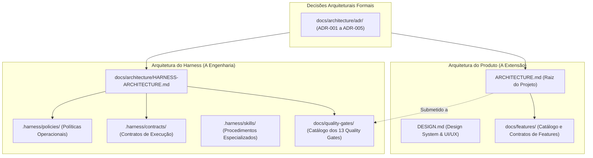

# Governança e Índice de Arquitetura — ExtensionTools

> **Projeto:** ExtensionTools  
> **Classificação:** PUBLIC REPOSITORY (Safe-by-Default)  
> **Diretório:** `docs/architecture/`  
> **Documento Canônico Central da Aplicação:** [`ARCHITECTURE.md`](../../ARCHITECTURE.md)  
> **Documento Canônico do Harness:** [`HARNESS-ARCHITECTURE.md`](HARNESS-ARCHITECTURE.md)  
> **Última Atualização:** 07/11/2026  

---

## 1. Propósito do Diretório

O diretório `docs/architecture/` é o espaço oficial de governança, registro de decisões estruturantes e especificação das fundações técnicas do projeto **ExtensionTools**.

Sua finalidade é garantir que agentes de inteligência artificial e engenheiros humanos compreendam com clareza as diretrizes que regem a construção do software, mantendo coerência, separação estrita de fronteiras modulares e rastreabilidade entre os requisitos de produto e as soluções técnicas adotadas.

---

## 2. Relação entre Arquitetura do Produto e Arquitetura do Harness

O ExtensionTools distingue formalmente duas dimensões arquiteturais interdependentes, mas com escopos e fontes de autoridade separados:

1. **Arquitetura do Produto (A Extensão Web):**
   - **Fonte Canônica Única:** [`ARCHITECTURE.md`](../../ARCHITECTURE.md) (na raiz do repositório).
   - **Escopo:** Padrão *Feature-First* modular, contextos Manifest V3 gerenciados pelo framework WXT (`src/entrypoints/`), camada de utilitários isolados (`src/features/`), serviços transversais de navegador (`src/platform/`) e componentes compartilhados do Design System (`src/shared/ui/`).
   - **Princípios Vitais:** *Local-First* (zero servidores externos obrigatórios), privacidade por padrão, menor privilégio e pureza das regras de domínio.

2. **Arquitetura do Harness (A Engenharia Assistida por IA):**
   - **Fonte Canônica Única:** [`HARNESS-ARCHITECTURE.md`](HARNESS-ARCHITECTURE.md) (neste diretório).
   - **Escopo:** Infraestrutura de desenvolvimento, governança de agentes autônomos (`.harness/agents/`), contratos formais de entrada/saída (`.harness/contracts/`), políticas operacionais inegociáveis (`.harness/policies/`), procedimentos especializados (`.harness/skills/`), scripts ESM nativos (`scripts/`) e o sistema de **13 Quality Gates** (`docs/quality-gates/`).
   - **Princípios Vitais:** *Safe-by-Default* (proteção absoluta contra vazamento de segredos em repositório público), *Fail-Closed* (falha segura diante de ambiguidades) e fiscalização mecânica automatizada.

---

## 3. Architecture Decision Records (ADRs)

### 3.1. O que é um ADR no ExtensionTools
Um **Architecture Decision Record (ADR)** é um documento conciso e versionado que captura uma decisão arquitetural relevante, suas motivações, contexto, restrições consideradas, consequências positivas e trade-offs técnicos assumidos.

### 3.2. Quando Criar um ADR
Um ADR deve ser proposto quando uma mudança:
- Alterar limites arquiteturais ou matrizes de dependência entre camadas.
- Introduzir novas dependências de runtime ou modificar significativamente a stack técnica.
- Mudar estratégias de persistência local ou tratamento de dados sensíveis.
- Afetar o modelo de permissões no Manifest V3 (`wxt.config.ts`).
- Estabelecer convenções estruturais permanentes que limitem implementações futuras.

> [!NOTE]
> Modificações triviais de código, correções de bugs locais e refatorações puramente cosméticas não devem gerar ADRs.

### 3.3. Convenção de Registro e Nomenclatura
- **Diretório:** `docs/architecture/adr/`
- **Nomenclatura:** `ADR-XXX-descricao-curta.md` (três dígitos sequenciais, minúsculas, separados por hífens).
- **Estrutura Obrigatória:**
  1. Identificação e Metadados (ID, Título, Estado, Data, Autoridade).
  2. Contexto e Problema de Engenharia.
  3. Forças e Restrições Envolvidas.
  4. Decisão Adotada.
  5. Justificativa Técnica.
  6. Consequências Positivas.
  7. Trade-offs, Limitações e Riscos Mitigados.
  8. Rastreabilidade e Evidências.

---

## 4. Índice Canônico de ADRs Homologados

| ADR | Título / Decisão | Estado | Escopo | Marco de Origem | Documento |
| :---: | :--- | :---: | :---: | :---: | :--- |
| **ADR-001** | Stack Base: WXT, React 19 e TypeScript Estrito | **Homologado** | Plataforma / Framework | M0 / M1 | [`adr/ADR-001-stack-wxt-react19-typescript.md`](adr/ADR-001-stack-wxt-react19-typescript.md) |
| **ADR-002** | Arquitetura Modular Feature-First com Isolamento Estrito | **Homologado** | Produto / Estrutura | M1 | [`adr/ADR-002-arquitetura-modular-feature-first.md`](adr/ADR-002-arquitetura-modular-feature-first.md) |
| **ADR-003** | Processamento Local-First e Privacidade Absoluta | **Homologado** | Produto / Segurança | M1 | [`adr/ADR-003-processamento-local-first.md`](adr/ADR-003-processamento-local-first.md) |
| **ADR-004** | Verificação Mecânica de Fronteiras via Boundary Linter AST | **Homologado** | Harness / Governança | M2 (H4) | [`adr/ADR-004-boundary-linter-ast.md`](adr/ADR-004-boundary-linter-ast.md) |
| **ADR-005** | Composição do Side Panel Shell e Navegação Desacoplada | **Homologado** | Produto / Shell M3 | M3 (Bloco 1) | [`adr/ADR-005-composicao-sidepanel-shell-navegacao.md`](adr/ADR-005-composicao-sidepanel-shell-navegacao.md) |

---

## 5. Regras de Manutenção e Atualização

1. **Imutabilidade Histórica:** ADRs aprovados e homologados não são editados retroativamente para alterar o sentido da decisão original. Caso uma decisão seja superada por nova evolução técnica, emite-se um novo ADR com estado `Superado por ADR-YYY` e o novo ADR referencia `Substitui ADR-XXX`.
2. **Autoridade do Architect:** Qualquer proposição de ADR exige chancela técnica do papel `Architect`.
3. **Sincronia Mandatória:** A criação ou alteração de estado de um ADR exige atualização concomitante deste arquivo (`docs/architecture/README.md`) e da Seção 10 de `status.md`.
