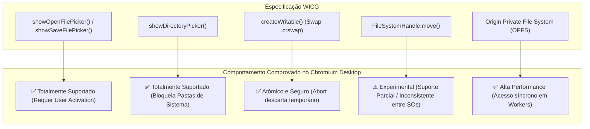
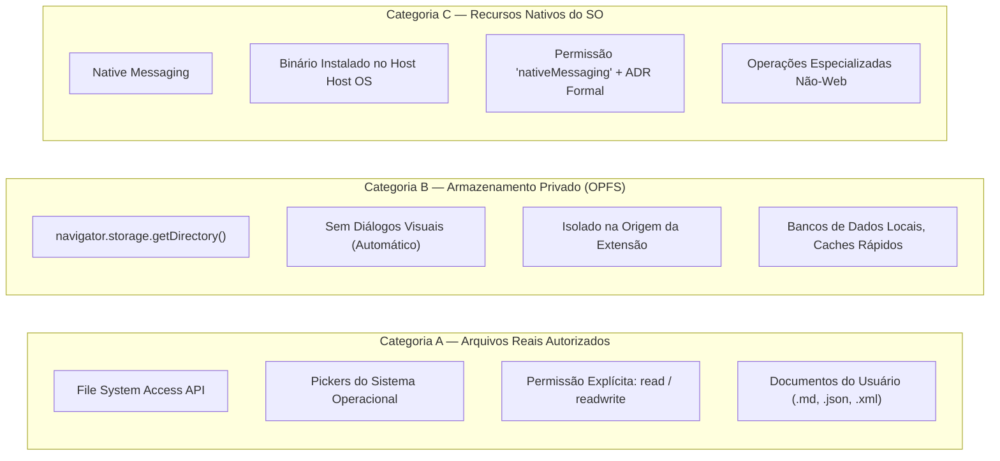
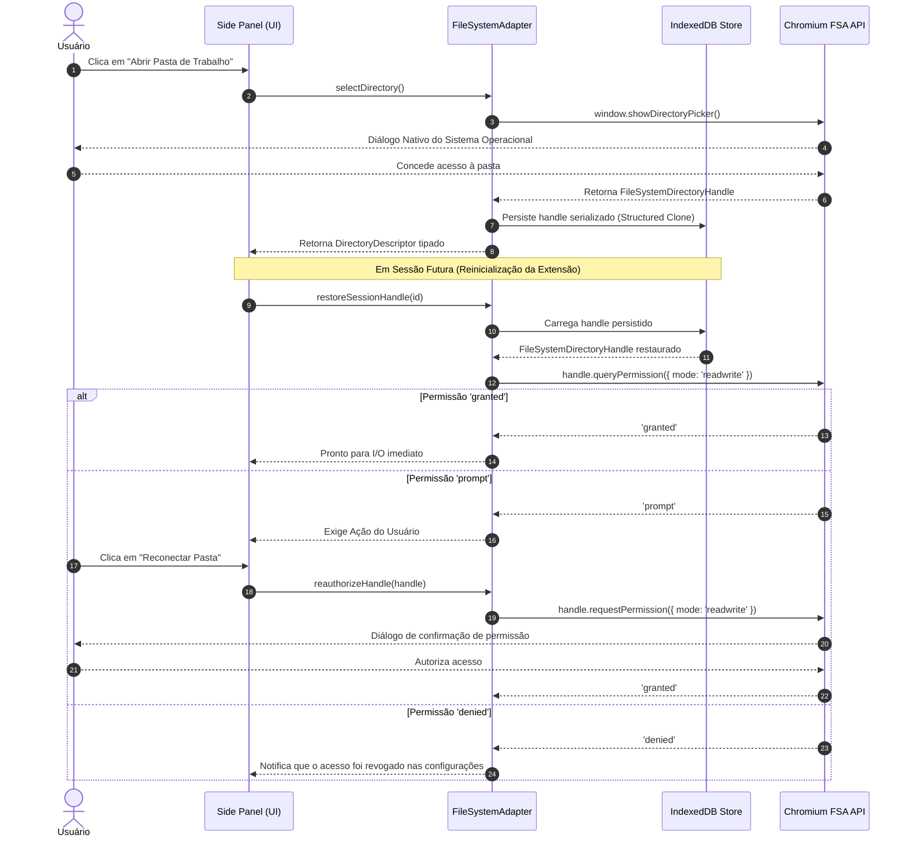

# Arquitetura e Governança da File System Access API — ExtensionTools

> **Projeto:** ExtensionTools  
> **Classificação:** PUBLIC REPOSITORY (Safe-by-Default)  
> **Módulo:** `src/platform/file-system/`  
> **Papel Arquitetural:** Especificação Canônica de Infraestrutura, Segurança e Governança para Acesso a Arquivos Locais  
> **Data de Homologação:** 08/11/2026  
> **Status:** Normativo — Preparação de Infraestrutura e Governança Concluída  

---

## 1. Missão e Princípios Fundamentais

O **ExtensionTools** adota a filosofia *Local-First*: o processamento e a manipulação de dados ocorrem primariamente no dispositivo do usuário, sem dependência mandatória de servidores remotos. A capacidade de interagir com o sistema de arquivos local do computador (ler, editar, exportar e catalogar documentos) é fundamental para os módulos de produtividade do produto, tais como:

- **Markdown Workspace**: Edição e salvamento direto de arquivos `.md`.
- **Quick Files**: Espaço de inspeção e cache rápido de arquivos locais.
- **Evidence Capture**: Exportação de evidências coletadas com hash de integridade SHA-256.
- **Text Diff**: Comparação lado a lado entre arquivos locais e conteúdos capturados.
- **PDF Export**: Compilação e gravação de relatórios formatados em disco.

### Princípios Inegociáveis de Governança:
1. **Soberania do Usuário**: Nenhum arquivo ou diretório pode ser lido, alterado ou excluído sem o consentimento explícito e prévio do usuário.
2. **Encapsulamento em Plataforma**: Todas as chamadas de baixo nível às APIs nativas do navegador devem permanecer estritamente confinadas em `src/platform/file-system/`. Componentes visuais React consomem apenas abstrações desacopladas.
3. **Fail-Safe & Atômico**: Nenhuma operação destrutiva (como sobrescrita de arquivo ou remoção recursiva) pode ocorrer de forma tácita ou sem confirmação em duas etapas. Escritas utilizam swap atômico para prevenir corrupção diante de quedas de processo.
4. **Isolamento de Contexto no Manifest V3**: Respeito categórico aos limites de execução entre Side Panel (com `window`), Background Service Worker (sem `window`, ciclo de vida efêmero) e Content Scripts (isolamento estrito).

---

## 2. Rastreabilidade com Fontes Oficiais Normativas

A infraestrutura foi especificada e parametrizada com base nas seguintes fontes oficiais consultadas:

| Fonte Oficial | Especificação / Documento | Data / Versão de Referência | Escopo Técnico Aplicado |
| :--- | :--- | :--- | :--- |
| **WICG** | [WICG File System Access Specification](https://wicg.github.io/file-system-access/) | W3C Editor's Draft (2024–2026) | Contratos de `FileSystemHandle`, `FileSystemFileHandle`, `FileSystemDirectoryHandle`, `FileSystemWritableFileStream` e algoritmos de serialização. |
| **Chrome Developers** | [The File System Access API](https://developer.chrome.com/docs/capabilities/web-apis/file-system-access) | Atualizado Chromium 120+ | Métodos globais de seleção (`showOpenFilePicker`, `showSaveFilePicker`, `showDirectoryPicker`), restrições de User Activation e swap files `.crswap`. |
| **Chrome Developers** | [Persistent Permissions for FSA API](https://developer.chrome.com/blog/persistent-permissions-for-the-file-system-access-api) | Chromium 122+ (Março 2024) | Integração com Permission Manager, persistência de permissões no Page Info e fluxo de re-solicitação via `queryPermission()` / `requestPermission()`. |
| **MDN Web Docs** | [File System API](https://developer.mozilla.org/en-US/docs/Web/API/File_System_API) | Revisão Contínua Mozilla (2025–2026) | Matriz de compatibilidade entre motores de renderização, tratamento de exceções `DOMException` e ciclo de vida de streams. |
| **MDN Web Docs** | [Window.showDirectoryPicker()](https://developer.mozilla.org/en-US/docs/Web/API/Window/showDirectoryPicker) | Revisão Contínua Mozilla (2025–2026) | Opções de modo (`read` / `readwrite`), diretórios de partida sugeridos (`startIn`) e diretórios bloqueados pelo sistema. |
| **Chrome Developers** | [Native Messaging](https://developer.chrome.com/docs/extensions/develop/concepts/native-messaging) | Manifest V3 Documentation | Restrições de comunicação com hosts binários nativos no sistema operacional, requisitos de manifesto e vedação como atalho sem ADR. |
| **WXT Framework** | [WXT Entrypoints Guide](https://wxt.dev/guide/essentials/entrypoints) | WXT v0.21.x (2025–2026) | Isolamento modular de pontos de entrada (`entrypoints/sidepanel`, `entrypoints/background`, `entrypoints/content`). |
| **WXT Framework** | [WXT Manifest Configuration](https://wxt.dev/guide/essentials/config/manifest) | WXT v0.21.x (2025–2026) | Declaração segura de permissões no `wxt.config.ts`, sem adição indevida de permissões legadas (`fileSystem`). |

---

## 3. Matriz Comparativa: Comportamento Documentado vs Comprovado

A engenharia do ExtensionTools não presume que toda funcionalidade descrita em especificações teóricas esteja homogeneamente disponível em todos os ambientes operacionais:

### 3.1. Diferenciação Crítica: `FileSystemHandle.move()`
- **Status Documentado**: Prevê renomeação de arquivos e movimentação atômica entre diretórios dentro do mesmo handle raiz.
- **Comportamento Comprovado**:
  - Falha com `InvalidModificationError` ao tentar mover arquivos entre sistemas de arquivos físicos ou volumes lógicos distintos.
  - Implementação incompleta em algumas versões do Linux e Windows com locks ativos de outros processos.
- **Decisão Arquitetural do ExtensionTools**: O adaptador de plataforma nunca dependerá exclusivamente de `move()`. Deverá implementar o algoritmo seguro de cópia atômica:
  1. Leitura integral dos dados da origem.
  2. Gravação confirmada e fechada no destino via `createWritable()`.
  3. Verificação de integridade (hash ou tamanho).
  4. Remoção da entrada de origem via `removeEntry()`.

---

## 4. Classificação das Capacidades de Armazenamento Local

A arquitetura estabelece três categorias fundamentais e inconfundíveis para acesso a dados no sistema local:

1. **Categoria A (Arquivos Reais Autorizados pelo Usuário)**:
   - Utilizada pelas features para interagir diretamente com arquivos do computador do usuário.
   - Requer gesto ativo de interação do usuário (**User Activation**).
   - Handles obtidos podem ser persistidos no IndexedDB, mas sua autorização deve ser revalidada a cada sessão via `queryPermission()`.
2. **Categoria B (Origin Private File System — OPFS)**:
   - Caixa de areia privativa da extensão (`chrome-extension://<id>`).
   - Não requer permissão nem exibe caixas de diálogo.
   - Suporta acesso síncrono de altíssima performance em Web Workers através de `createSyncAccessHandle()`.
   - Utilizado pelo ExtensionTools para persistência interna de índices analíticos, caches e árvores de busca estruturadas.
3. **Categoria C (Native Messaging)**:
   - Proibido como mecanismo padrão do produto. Exige Architecture Decision Record (ADR) aprovado e motivado caso venha a ser considerado no futuro.

---

## 5. Matriz de Contextos e Restrições de Execução no Manifest V3

| Contexto / Entrypoint | Acesso a `window` | Diálogos de Seleção (Pickers) | Handles de Arquivo (`FileSystemFileHandle`) | Gravação em Streams (`createWritable`) | OPFS (`navigator.storage`) |
| :--- | :---: | :---: | :---: | :---: | :---: |
| **Side Panel** (`entrypoints/sidepanel/`) | ✅ Sim | ✅ Permitido (c/ User Activation) | ✅ Suportado | ✅ Suportado | ✅ Suportado |
| **Páginas Completas** (`entrypoints/pages/`) | ✅ Sim | ✅ Permitido (c/ User Activation) | ✅ Suportado | ✅ Suportado | ✅ Suportado |
| **Background Service Worker** (`entrypoints/background/`) | ❌ **Não** | ❌ **PROIBIDO** (`ReferenceError`) | ⚠️ Passivo (sem pickers diretos) | ✅ Suportado | ✅ Suportado |
| **Content Scripts** (`entrypoints/content/`) | ⚠️ Isolado | ❌ **PROIBIDO** (Risco de Injeção) | ❌ Não Recomendado | ❌ Bloqueado | ⚠️ Isolado à página externa |
| **Web Workers Dedicados** | ❌ Não | ❌ Não | ✅ Sim (via postMessage) | ✅ Suportado | ✅ **Sync Access Handle** |

### Regra do Background Service Worker
O Service Worker no Manifest V3 não possui interface gráfica nem objeto `window`. O script `scripts/filesystem/verify-boundaries.mjs` aplica a regra **FS-ARC-05**, que reprova sumariamente qualquer menção ou tentativa de invocar `showOpenFilePicker`, `showSaveFilePicker` ou `showDirectoryPicker` dentro de `src/entrypoints/background/`.

---

## 6. Tratamento Canônico de Exceções (`DOMException`)

Toda interação com a File System Access API está sujeita a falhas do sistema operacional ou intervenções do usuário. O adaptador de plataforma traduz deterministicamente as exceções nativas em erros de domínio tipados:

| DOMException Nativa | Causa Raiz Provável | Ação do Adaptador de Plataforma | Erro Canônico de Domínio |
| :--- | :--- | :--- | :--- |
| `AbortError` | Usuário cancelou ou fechou o diálogo de seleção de arquivo/pasta sem escolher. | Interrompe o fluxo sem gerar erro na interface; retorna estado de cancelamento gracioso. | `FileOperationCancelled` |
| `NotAllowedError` | Permissão de leitura ou escrita foi recusada pelo usuário ou User Activation expirou. | Atualiza estado de permissão na aplicação, desativa botões de salvamento e notifica UI. | `FilePermissionDeniedError` |
| `NotFoundError` | O arquivo ou pasta foi excluído, movido ou renomeado fora do navegador. | Invalida o handle persistido no IndexedDB e solicita ao usuário que reabra o arquivo. | `FileNotFoundError` |
| `TypeMismatchError` | Tentativa de tratar um diretório como arquivo ou vice-versa. | Validação estrita do metadado `handle.kind` antes da execução de operações de I/O. | `FileTypeMismatchError` |
| `InvalidModificationError` | Tentativa de remover diretório não vazio com `recursive: false`. | Bloqueia a exclusão imediata; exige confirmação explícita de exclusão recursiva. | `DirectoryNotEmptyError` |
| `NoModificationAllowedError` | Arquivo bloqueado por outro processo do sistema operacional ou unidade somente-leitura. | Informa que o arquivo está bloqueado externamente e sugere salvar com outro nome. | `FileLockedError` |
| `QuotaExceededError` | Disco rígido cheio ou quota de armazenamento do OPFS esgotada. | Aborta o stream temporário `.crswap` e emite alerta visual de espaço insuficiente. | `StorageQuotaExceededError` |
| `SecurityError` | Tentativa de abrir pastas protegidas do sistema (`/Windows`, `/System32`, `/etc`) ou User Activation ausente. | Navegador bloqueia automaticamente; aplicação emite aviso de pasta restrita. | `RestrictedDirectoryError` |

---

## 7. Persistência de Handles e Ciclo de Vida de Permissões

---

## 8. Salvaguardas e Modelagem de Ameaças

1. **Ameaça: Sobrescrita Silenciosa de Dados**:
   - **Risco**: Perda irreversível de arquivos do usuário ao clicar acidentalmente em "Salvar".
   - **Controle**: Abertura de `createWritable()` sem `keepExistingData: true` trunca o arquivo. O verificador `verify-security.mjs` fiscaliza a presença de opções explícitas e validação de arquivos pré-existentes.
2. **Ameaça: Exclusão Recursiva Catastrófica**:
   - **Risco**: `removeEntry(name, { recursive: true })` apaga permanentemente pastas inteiras do computador sem passar pela lixeira do sistema.
   - **Controle**: Regra **FS-SEC-01** do linter de segurança bloqueia qualquer chamada a `removeEntry` com `recursive: true` que não esteja protegida por um guard de confirmação em duas etapas.
3. **Ameaça: Exposição de Conteúdo em Logs**:
   - **Risco**: Gravação acidental de dados confidenciais do usuário ou caminhos do sistema operacional em `console.log`.
   - **Controle**: Regra **FS-SEC-06** detecta impressões de conteúdo em console. Todo diagnóstico deve utilizar o logger sanitizado em `scripts/lib/logger.mjs`.
4. **Ameaça: Inflação de Permissões no Manifesto**:
   - **Risco**: Solicitação desnecessária de permissões no `wxt.config.ts`, como a permissão legada de Chrome Apps `"fileSystem"` ou `"nativeMessaging"` sem justificativa.
   - **Controle**: Regra **FS-SEC-07** audita automaticamente as configurações de manifesto do projeto.

---

## 9. Esteira de Governança Automatizada (`scripts/filesystem/`)

A infraestrutura de governança é composta por 4 verificadores determinísticos integrados pelo orquestrador mestre:

| Script Verificador | Quality Gate | Responsabilidade Técnica |
| :--- | :--- | :--- |
| `scripts/filesystem/verify-boundaries.mjs` | **QG-FS-01** | Garante o confinamento das APIs de FSA em `platform/file-system/`, impedindo vazamento para React, Messaging ou Background. |
| `scripts/filesystem/verify-security.mjs` | **QG-FS-02** | Detecta vulnerabilidades estáticas de exclusão recursiva, permissões não tratadas, timers e manifesto. |
| `scripts/filesystem/verify-contracts.mjs` | **QG-FS-03** | Audita a presença de interfaces puras, contratos tipados e erros de domínio. Retorna aprovação na fase de preparação. |
| `scripts/filesystem/verify-tests.mjs` | **QG-FS-04** | Fiscaliza a cobertura dos 13 cenários obrigatórios de teste da File System Access API. |
| `scripts/filesystem/run-verify.mjs` | **Orquestrador Mestre** | Executa toda a esteira em ordem sequencial determinística, suportando saídas em texto e `--json`. |

---

## 10. Próximos Passos na Implementação do Produto

Concluída a preparação de infraestrutura e governança, os seguintes componentes poderão ser desenvolvidos em `src/platform/file-system/` quando o roadmap do produto avançar para a implementação das capacidades de persistência e manipulação de arquivos:

1. **`src/platform/file-system/contracts/types.ts`**: Declaração das interfaces públicas (`IFileSystemAdapter`, `FileDescriptor`, `DirectoryDescriptor`) e erros tipados de domínio (`FileNotFoundError`, `FilePermissionDeniedError`, etc.).
2. **`src/platform/file-system/adapters/ChromeFileSystemAdapter.ts`**: Implementação concreta compatível com a especificação Chromium WICG.
3. **`src/platform/file-system/adapters/MockFileSystemAdapter.ts`**: Implementação em memória para testes unitários ultrarrápidos e determinísticos.
4. **`src/platform/file-system/hooks/useFileSystem.ts`**: Hook React para consumo seguro e ergonômico nos componentes visuais do Side Panel.
