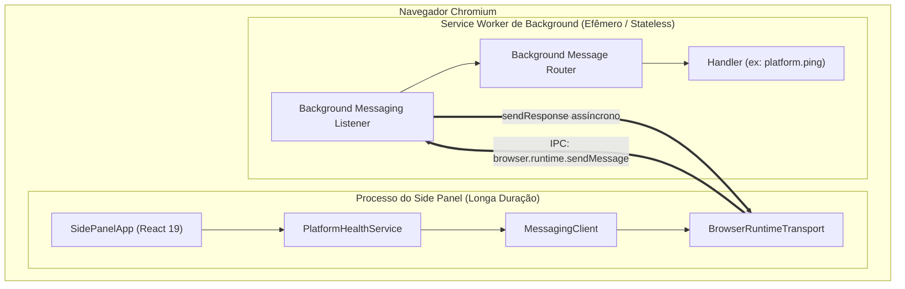
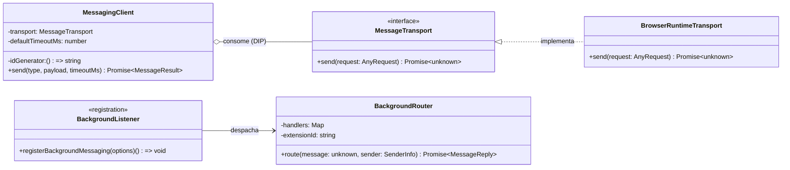
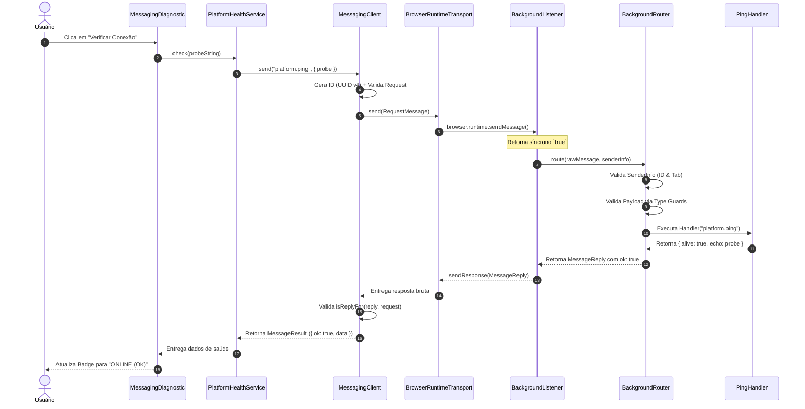

# Arquitetura de Plataforma — Platform Messaging

> **Projeto:** ExtensionTools  
> **Classificação:** PUBLIC REPOSITORY (Safe-by-Default)  
> **Módulo:** `src/platform/messaging/`  
> **Status:** Homologado com Reservas Documentadas (Milestone M3 / Bloco 3)  
> **Padrão Arquitetural:** Ports and Adapters (Hexagonal) com Inversão de Dependências (DIP) e Runtime Type Guards  
> **Decisão Formal:** [`docs/architecture/adr/ADR-006-platform-messaging-ports-adapters.md`](adr/ADR-006-platform-messaging-ports-adapters.md)  
> **Relatório de Homologação:** [`docs/Relatorios/m3/Bloco_3/RELATORIO-REVISAO-FINAL-BLOCO-3.md`](../Relatorios/m3/Bloco_3/RELATORIO-REVISAO-FINAL-BLOCO-3.md)  

---

## 1. Objetivo da Infraestrutura

O subsistema de **Platform Messaging** do ExtensionTools provê a infraestrutura canônica, bidirecional, fortemente tipada e segura de comunicação entre os múltiplos contextos do navegador (Side Panel, Background Service Worker e futuros Content Scripts) sob o padrão **Manifest V3**.

Ele estabelece um barramento assíncrono de solicitação e resposta (*one-off request-response*) desacoplado da tecnologia concreta de extensão, garantindo que regras de negócio, serviços de aplicação e componentes de interface operem com contratos estáveis, sem importações diretas de APIs globais do Chrome.

---

## 2. Problema Arquitetural Resolvido

Em arquiteturas convencionais de extensões Web, é comum encontrar chamadas diretas a `chrome.runtime.sendMessage()` dispersas no meio de componentes React, sem tipagem formal de payloads e sem validação estrutural das respostas. Essa abordagem acarreta sérios problemas de engenharia:

1. **Acoplamento Tecnológico e Testabilidade Prejudicada:** O código fica rigidamente dependente do runtime do Chromium, exigindo mocks globais complexos para testes simples.
2. **Quebra Silenciosa de Tipos (*Runtime Drift*):** O TypeScript valida contratos apenas durante a compilação. Em tempo de execução, dados que trafegam entre processos do navegador são recebidos como `unknown` e podem estar corrompidos ou maliciosamente alterados.
3. **Vulnerabilidades de Origem:** No Manifest V3, o evento `runtime.onMessage` recebe mensagens de qualquer contexto da extensão e potencialmente de páginas externas ou abas injetadas. Tratar mensagens sem autenticação do remetente expõe a extensão a comandos indevidos.
4. **Vazamento de Detalhes Internos:** Exceções não tratadas no Background propagam stack traces e caminhos de arquivos para a interface do usuário.

A infraestrutura de Platform Messaging resolve esses problemas através de **inversão de dependências**, **runtime type guards puros**, **autorização estrita de remetentes** e **envelopes padronizados de resultado**.

---

## 3. Contextos de Execução do Manifest V3

O ExtensionTools opera sob o modelo de processos e isolamento do **Manifest V3**:



- **Side Panel (`src/entrypoints/sidepanel/`):** Contexto visual de longa duração. Executa enquanto o painel lateral estiver aberto pelo usuário.
- **Background Service Worker (`src/entrypoints/background/`):** Contexto sem interface gráfica (*headless*). Seu ciclo de vida é governado por eventos: o Chromium encerra o worker após inatividade (~30 segundos ocioso) e o instancia novamente diante de eventos ou mensagens recebidas. Por essa razão, **o roteador de mensagens de background deve ser estritamente stateless**.

---

## 4. Visão Geral dos Componentes

A infraestrutura é decomposta em dez unidades funcionais cooperativas:



---

## 5. Organização Física dos Arquivos

Todo o subsistema reside em [`src/platform/messaging/`](../../src/platform/messaging/), com fronteiras estritamente delimitadas e auditadas pelo Boundary Linter (`QG-02`):

```text
src/platform/messaging/
├── contracts.ts                  # Esquemas e tipos estáticos do protocolo
├── contracts.typecheck.ts        # Testes de compilação de tipos estáticos
├── validation.ts                 # Type guards puros e validação de runtime
├── errors.ts                     # Catálogo de mensagens e fábricas de erro
├── transport.ts                  # Porta de saída MessageTransport (DIP)
├── browser-runtime-transport.ts  # Adaptador tecnológico browser.runtime
├── messaging-client.ts           # Coordenação de envio, timeout e correlação
├── background-router.ts          # Roteador puro com autorização de remetente
├── register-background-messaging.ts # Listener de onMessage e resposta assíncrona
└── index.ts                      # Barrel canônico de exportação pública
```

---

## 6. Contratos de Mensagens

Definidos em [`contracts.ts`](../../src/platform/messaging/contracts.ts), os contratos utilizam união discriminada (*discriminated union*) baseada na chave literal `type`.

### Tipos Fundamentais

```typescript
export interface MessagePayloadMap {
  'platform.ping': {
    request: { probe?: string };
    response: { alive: true; echo?: string };
  };
}

export type MessageType = keyof MessagePayloadMap;

export interface RequestMessage<K extends MessageType = MessageType> {
  protocol: 'extensiontools';
  version: 1;
  id: string; // Identificador unívoco de correlação (UUID v4)
  type: K;
  payload: MessagePayloadMap[K]['request'];
}

export type MessageReply<K extends MessageType = MessageType> =
  | { protocol: 'extensiontools'; version: 1; id: string; ok: true; data: MessagePayloadMap[K]['response'] }
  | { protocol: 'extensiontools'; version: 1; id: string; ok: false; error: MessageError };
```

Para o consumidor, a resposta é entregue através do envelope funcional [`MessageResult<T>`](../../src/platform/messaging/contracts.ts#L58):

```typescript
export type MessageResult<T> =
  | { ok: true; data: T }
  | { ok: false; error: MessageError };
```

---

## 7. Runtime Validation

Localizada em [`validation.ts`](../../src/platform/messaging/validation.ts), a validação em runtime utiliza **Type Guards funcionais puros** para certificar que os dados recebidos respeitam o protocolo antes de qualquer processamento:

1. [`isRecord(value)`](../../src/platform/messaging/validation.ts#L10): Garante que a entrada é um objeto não nulo com protótipo seguro (`Object.prototype` ou `null`), prevenindo poluição de protótipo.
2. [`isBoundedString(value, maxLength)`](../../src/platform/messaging/validation.ts#L20): Valida strings com limite rígido de caracteres, impedindo identificadores anômalos.
3. [`isProtocolMessage(value)`](../../src/platform/messaging/validation.ts#L30): Confirma se o cabeçalho pertence a `protocol === 'extensiontools'` e `version === 1`.
4. [`isRequestMessage(value)`](../../src/platform/messaging/validation.ts#L65): Inspeciona o envelope completo de solicitação e o sub-objeto de payload.
5. [`isReplyFor(reply, request)`](../../src/platform/messaging/validation.ts#L80): Valida que a resposta recebida corresponde exatamente ao identificador (`id`) emitido pela solicitação cliente.

---

## 8. Error Handling

Centralizado em [`errors.ts`](../../src/platform/messaging/errors.ts), o subsistema padroniza as falhas em códigos canônicos:

| Código de Erro | Significado | Exemplo de Causa |
|---|---|---|
| `UNAUTHORIZED` | Remetente não autorizado a invocar a operação | Mensagem enviada por Content Script para operação de plataforma |
| `INVALID_REQUEST` | Envelope ou payload corrompido ou malformado | Tipo não reconhecido, ID excedendo 128 chars |
| `UNKNOWN_OPERATION` | Operação do protocolo sem handler cadastrado | Operação desativada ou não implementada no router |
| `HANDLER_FAILED` | Erro interno durante o processamento do handler | Falha em serviço do background (exceção capturada) |
| `INVALID_REPLY` | Resposta retornada não compatível com o contrato | Handler retornou payload com tipagem divergente |
| `TIMEOUT` | Limite de espera local expirado | Service Worker ocupado ou não respondeu no prazo |
| `TRANSPORT_ERROR` | Falha na camada tecnológica de transporte IPC | Canal fechado ou navegador reiniciando |

As mensagens públicas de erro provêm de [`PUBLIC_ERROR_MESSAGES`](../../src/platform/messaging/errors.ts#L15), garantindo que **nenhuma stack trace ou detalhe interno do host seja vazado para a interface**.

---

## 9. Transport Port (Abstração de Transporte)

Em conformidade com o princípio de Inversão de Dependências (DIP), [`transport.ts`](../../src/platform/messaging/transport.ts) declara o contrato de saída do cliente:

```typescript
export interface MessageTransport {
  send(request: AnyRequest): Promise<unknown>;
}
```

A porta aceita um envelope tipado de requisição e retorna `Promise<unknown>`, estabelecendo explicitamente que a resposta recebida do canal físico cruza uma fronteira de confiança e precisa ser validada por runtime type guards.

---

## 10. Browser Runtime Adapter

Implementado em [`browser-runtime-transport.ts`](../../src/platform/messaging/browser-runtime-transport.ts), este adaptador concreto conecta a porta de transporte à API do navegador:

```typescript
export class BrowserRuntimeTransport implements MessageTransport {
  async send(request: AnyRequest): Promise<unknown> {
    return await browser.runtime.sendMessage(request);
  }
}
```

O adaptador propaga transparentemente rejeições assíncronas do WXT/Chrome para que o cliente converta em resultados padronizados `TRANSPORT_ERROR`.

---

## 11. Messaging Client

O [`MessagingClient`](../../src/platform/messaging/messaging-client.ts) atua como coordenador de solicitações no Side Panel:

1. **Construção do Envelope:** Atribui `protocol: 'extensiontools'`, `version: 1` e gera um identificador único de correlação (UUID v4 injetável).
2. **Barreira Local de Timeout:** Executa a chamada concorrentemente com um temporizador via `Promise.race()`. Caso o tempo limite expire, o cliente rejeita a promessa com código `TIMEOUT`.
3. **Validação da Resposta:** Verifica a integridade da resposta recebida via `isReplyFor(reply, request)`.
4. **Sem Retry Automático:** Evita retentativas cegas que poderiam provocar efeitos colaterais duplicados ou ocultar falhas de rede local.

---

## 12. Background Message Router

O [`BackgroundRouter`](../../src/platform/messaging/background-router.ts) é um componente puro de roteamento **sem qualquer dependência de APIs do navegador**:

```typescript
export interface SenderInfo {
  id?: string;
  tab?: { id?: number };
}
```

### Regras de Autorização
1. Se `sender.id !== extensionId`, a solicitação é recusada com código `UNAUTHORIZED`.
2. Se `sender.tab != null`, a solicitação provém de um Content Script e é rejeitada para operações reservadas de plataforma (`platform.*`).
3. Se o `type` não for reconhecido, devolve `UNKNOWN_OPERATION`.
4. Exceções lançadas por handlers são capturadas e convertidas em respostas seguras `HANDLER_FAILED`.

---

## 13. Background Messaging Listener

Implementado em [`register-background-messaging.ts`](../../src/platform/messaging/register-background-messaging.ts), este componente conecta o roteador puro ao evento `browser.runtime.onMessage.addListener`.

### Características Críticas
- **Retorno Literal `true`:** Informa síncronamente ao Chrome que a resposta será enviada assincronamente via `sendResponse`.
- **Descarte Silencioso de Mensagens Estranhas:** Mensagens que não sejam do protocolo ExtensionTools retornam `false` ou `undefined`, permitindo que outros listeners tratem a mensagem.
- **Tolerância a Canal Fechado:** Captura e suprime erros de canal caso o Side Panel tenha sido fechado antes da resposta do Service Worker.

---

## 14. Background Entrypoint (Composition Root)

Localizado em [`src/entrypoints/background/index.ts`](../../src/entrypoints/background/index.ts), o entrypoint atua como Composition Root do Service Worker:

```typescript
export default defineBackground(() => {
  // Bloco 1: Comportamento do Side Panel
  if (browser?.sidePanel?.setPanelBehavior) {
    browser.sidePanel.setPanelBehavior({ openPanelOnActionClick: true });
  }

  // Bloco 3: Barramento de Platform Messaging
  const extensionId = browser?.runtime?.id || 'extensiontools';
  const router = createBackgroundRouter({
    extensionId,
    handlers: {
      'platform.ping': async (payload) => ({ alive: true, echo: payload.probe }),
    },
  });

  registerBackgroundMessaging({ router, extensionId });
});
```

---

## 15. Integração com o Side Panel

A interface do usuário consome a mensageria através de serviços de aplicação dedicados:

- **Serviço de Aplicação:** [`PlatformHealthService`](../../src/app/sidepanel/services/platform-health-service.ts) encapsula o envio de pings e formata os dados para o consumo de UI.
- **Componente Diagnóstico:** [`MessagingDiagnostic.tsx`](../../src/app/sidepanel/components/MessagingDiagnostic.tsx) oferece um painel acessível de conferência operacional com botões de disparo, status reativo e badges semânticos (`neutral`, `success`, `danger`).
- **Composição da Casca:** O diagnóstico é instanciado em [`SidePanelApp.tsx`](../../src/app/sidepanel/SidePanelApp.tsx#L40) protegido por [`RenderErrorBoundary`](../../src/features/workspace-shell/components/RenderErrorBoundary.tsx).

---

## 16. Fluxo Completo de Comunicação (`platform.ping`)



---

## 17. Autorização e Fronteiras de Confiança

A arquitetura estabelece barreiras rígidas em conformidade com o princípio do menor privilégio:

1. **Fronteira Externa (Web Pages):** Nenhuma página web pode se comunicar diretamente com o barramento do ExtensionTools. Mensagens sem `sender.id === extensionId` são sumariamente descartadas.
2. **Fronteira de Conteúdo (Content Scripts):** Mensagens enviadas de abas autorizadas possuem `sender.tab != null`. O `BackgroundRouter` bloqueia categoricamente essas mensagens para operações reservadas de infraestrutura (`platform.*`).
3. **Fronteira Interna (Side Panel):** Mensagens do Side Panel possuem `sender.id === extensionId` e `sender.tab == null`, sendo aceitas para despacho de plataforma.

---

## 18. Timeout, Concorrência e Ciclo de Vida

- **Timeout Local:** O tempo limite (padrão de 5000 ms) cancela a espera do consumidor no Side Panel, mas **não envia instrução de cancelamento remoto ao Background**. Em operações idempotentes (como leituras ou pings), essa assimetria é inócua.
- **Concorrência e Fora de Ordem:** Múltiplas solicitações simultâneas utilizam identificadores únicos de correlação. O `MessagingClient` garante que cada promessa resolve exclusivamente a resposta cujo `id` corresponde à sua requisição original, mesmo que o motor do navegador entregue as respostas fora de ordem.
- **Ciclo de Vida Stateless:** O Background Router não mantém sessões em memória global. Cada requisição é auto-contida, sobrevivendo com perfeição ao encerramento ocioso e reativação do Service Worker pelo Chromium.

---

## 19. Estratégia de Testes

A infraestrutura possui **100% de cobertura determinística em testes automatizados**:

- **Testes Unitários de Protocolo e Validação:** [`validation.test.ts`](../../tests/unit/platform/messaging/validation.test.ts) (68 testes com probes Unicode e fuzzing em loop).
- **Testes Unitários do Cliente com Fake Timers:** [`messaging-client.test.ts`](../../tests/unit/platform/messaging/messaging-client.test.ts) (13 testes cobrindo timeouts, concorrência e ausência de retry).
- **Testes Unitários do Roteador com Spies:** [`background-router.test.ts`](../../tests/unit/platform/messaging/background-router.test.ts) (12 testes verificando autorização de remetente e isolamento de falhas).
- **Testes do Listener:** [`register-background-messaging.test.ts`](../../tests/unit/platform/messaging/register-background-messaging.test.ts) (8 testes cobrindo canais assíncronos e prevenção de duplicidade).
- **Integração Simulada Ponta a Ponta:** [`platform-messaging-e2e.test.ts`](../../tests/integration/platform-messaging-e2e.test.ts) (5 testes simulando todo o fluxo com atrasos variáveis e concorrência).

---

## 20. Limitações Conhecidas e Ressalvas Documentadas

1. **Ressalva RESS-B3-01 (Validação Interativa do Ciclo de Inatividade do Service Worker):** Em ambientes de teste de contêiner ou terminais headless sem servidor gráfico (X11/Wayland), o Chromium não executa a suspensão ociosa de service worker no mesmo tempo de uma sessão real de usuário. O comportamento stateless foi validado por arquitetura e testes unitários, restando a validação física interativa na interface gráfica para ser inspecionada pelo operador.
2. **Ausência de Streaming / Long-Lived Ports:** O barramento atual é otimizado para requisição-resposta atômica. Transferência contínua de grandes volumes de dados (streaming de arquivos pesados) será tratada em subsistema próprio caso necessário.

---

## 21. Decisões Arquiteturais Relacionadas

- [`ADR-001 — Stack Base: WXT, React 19 e TypeScript Estrito`](adr/ADR-001-stack-wxt-react19-typescript.md)
- [`ADR-002 — Arquitetura Modular Feature-First com Isolamento Estrito`](adr/ADR-002-arquitetura-modular-feature-first.md)
- [`ADR-005 — Composição do Side Panel Shell e Navegação Desacoplada`](adr/ADR-005-composicao-sidepanel-shell-navegacao.md)
- [`ADR-006 — Arquitetura de Mensageria da Plataforma: Inversão de Dependências, Validação em Runtime e Isolamento de Contextos`](adr/ADR-006-platform-messaging-ports-adapters.md)

---

## 22. Referências Oficiais e Documentação Interna

- Chrome Extensions — Message Passing: <https://developer.chrome.com/docs/extensions/develop/concepts/messaging>
- Chrome Extensions — Service Worker Lifecycle: <https://developer.chrome.com/docs/extensions/develop/concepts/service-workers/lifecycle>
- WXT — Extension Testing & Storage: <https://wxt.dev/guide/essentials/unit-testing>
- Vitest — Mocking Timers: <https://vitest.dev/guide/mocking/timers>
- Relatório de Revisão Final do Bloco 3: [`docs/Relatorios/m3/Bloco_3/RELATORIO-REVISAO-FINAL-BLOCO-3.md`](../Relatorios/m3/Bloco_3/RELATORIO-REVISAO-FINAL-BLOCO-3.md)
