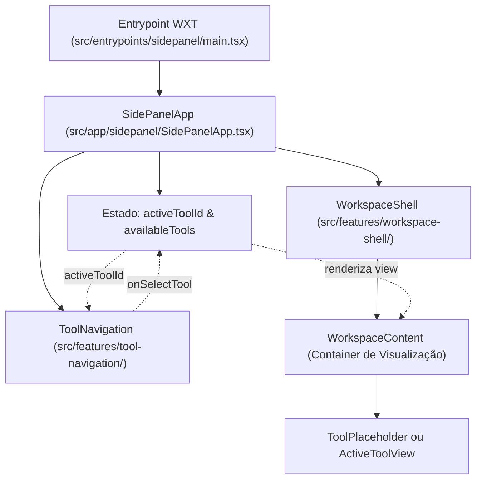

# Planejamento Técnico e Especificação de Execução — M3-PHASE-1 (Bloco 1)

> **Projeto:** ExtensionTools  
> **Milestone:** M3 — Product Shell & Platform Foundation  
> **Fase:** `M3-PHASE-1` — Entrypoints WXT & Side Panel Shell  
> **Bloco:** **Bloco 1 — Estrutura WXT e Side Panel Shell**  
> **Identificador do Plano:** `PLAN-M3-B1`  
> **Tarefas Cobertas:** `M3-P1-T02` a `M3-P1-T06`  
> **Status:** PLANEJAMENTO APROVADO — PRONTO PARA IMPLEMENTAÇÃO  
> **Arquitetura Base:** [`ARCHITECTURE.md`](../../ARCHITECTURE.md) | [`ADR-005`](../architecture/adr/ADR-005-composicao-sidepanel-shell-navegacao.md)  
> **Design System:** [`DESIGN.md`](../../DESIGN.md)  
> **Especificações de Feature:** [`docs/features/workspace-shell/`](../features/workspace-shell/README.md) | [`docs/features/tool-navigation/`](../features/tool-navigation/README.md)  

---

## 1. Objetivo do Bloco 1

O objetivo primordial do **Bloco 1** é construir a primeira presença física, visual e executável do ExtensionTools no navegador Chromium:
1. Configurar os pontos de entrada WXT para Manifest V3 (`src/entrypoints/sidepanel/`, `background.ts`).
2. Inicializar o runtime declarativo do **React 19** e carregar os estilos globais com Tailwind CSS 4.
3. Desenvolver o **Workspace Shell** (`FEAT-SHELL`) e a **Tool Navigation** (`FEAT-NAV`).
4. Implementar a camada de composição da aplicação (`SidePanelApp`).
5. Validar a compilação limpa do WXT (`pnpm run build`), o manifesto gerado e os testes unitários da casca.

> [!IMPORTANT]
> **DELIMITAÇÃO ESTRITA DE ESCOPO:**  
> Neste Bloco 1, é **terminantemente proibido implementar regras de negócio de ferramentas do produto** (como algoritmos de diff, parsers XML ou filtros JSON). A casca visual montará placeholders limpos e tecnológicos para as ferramentas ainda em planejamento.

---

## 2. Arquitetura da Composição da Aplicação (`Application Composition`)

A interface do Side Panel não é montada diretamente no entrypoint técnico do WXT. Adota-se a separação formal entre **Bootstrap de Entrypoint**, **Composição da Aplicação** e **Features Estruturais**:



### Direção das Dependências
- `src/entrypoints/sidepanel/main.tsx` importa exclusivamente o componente `SidePanelApp`.
- `SidePanelApp` importa exclusivamente as APIs públicas `src/features/workspace-shell/index.ts` e `src/features/tool-navigation/index.ts`.
- As features consomem primitivos visuais compartilhados de `src/shared/ui/`.
- O isolamento entre módulos é 100% preservado e fiscalizado pelo Boundary Linter (`QG-02`).

---

## 3. Entrypoints WXT e Runtime Manifest V3

### 3.1. O que são Entrypoints no WXT
No framework WXT, qualquer arquivo localizado diretamente em `src/entrypoints/` é interpretado como um contexto oficial de execução de extensão e incluído na compilação do `manifest.json`.

Para o Bloco 1 de M3, os entrypoints planejados são:
1. **`src/entrypoints/sidepanel/` (Essencial):**
   - `index.html`: Página HTML mínima que define a viewport e carrega o script principal.
   - `main.tsx`: Ponto de inicialização do React 19 (`createRoot`), importação do CSS global e montagem de `<SidePanelApp />`.
2. **`src/entrypoints/background.ts` (Condicional / Mínimo):**
   - Service Worker da extensão. No Bloco 1, registra unicamente o listener de ciclo de vida (`browser.runtime.onInstalled`) e a regra para abrir o Side Panel ao clicar no ícone da extensão via `chrome.sidePanel.setPanelBehavior`.

### 3.2. Distinção de Contextos de Execução
- **Side Panel:** Interface principal persistente enquanto a barra lateral estiver aberta. Acesso total ao DOM e ciclo de vida controlado pelo usuário.
- **Background Worker:** Execução assíncrona efêmera sem DOM. Responsável por eventos de ciclo de vida.
- **Content Scripts:** Não serão implementados no Bloco 1 (previstos apenas para M5 sob a feature de captura).

---

## 4. Integração Chromium e Manifest V3

A compilação do WXT deverá gerar um pacote em `.output/chrome-mv3/` em estrita observância ao princípio do menor privilégio:
- **`manifest_version`:** `3`.
- **`permissions`:** Apenas permissões indispensáveis à operação da casca:
  - `"sidePanel"`: Para exibição da interface na barra lateral nativa do Chromium.
  - `"storage"`: Para gravação local da última ferramenta ativa e preferências de interface.
- **`action`:** Abertura automática do Side Panel ao clicar no ícone da extensão:
  ```typescript
  // Em background.ts
  chrome.sidePanel.setPanelBehavior({ openPanelOnActionClick: true });
  ```

---

## 5. Organização Proposta do Código-Fonte (`src/`)

A estrutura física resultante da execução do Bloco 1 será:

```text
src/
├── app/
│   └── sidepanel/
│       ├── SidePanelApp.tsx         # Composição principal da interface e estado ativo
│       └── tools-catalogue.ts       # Lista tipada dos destinos disponíveis no shell
│
├── entrypoints/
│   ├── sidepanel/
│   │   ├── index.html               # Página base do Side Panel WXT
│   │   └── main.tsx                 # Bootstrap React 19 e importação de estilos
│   └── background.ts                # Service Worker para comportamento do Side Panel
│
├── features/
│   ├── workspace-shell/
│   │   ├── index.ts                 # API pública da casca visual
│   │   └── ui/
│   │       ├── WorkspaceShell.tsx   # Contêiner raiz de layout
│   │       ├── WorkspaceHeader.tsx  # Cabeçalho institucional com marca
│   │       ├── WorkspaceContent.tsx # Contêiner com scroll isolado
│   │       ├── WorkspaceFooter.tsx  # Barra de status local
│   │       ├── ToolPlaceholder.tsx  # Tela de ferramenta em construção
│   │       └── RenderErrorBoundary.tsx # Contenção de falhas de renderização
│   │
│   └── tool-navigation/
│       ├── index.ts                 # API pública da navegação
│       ├── types.ts                 # Contratos ToolNavigationItem e ToolNavigationProps
│       └── ui/
│           └── ToolNavigation.tsx   # Barra seletora acessível (role="tablist")
│
└── shared/
    └── styles/
        └── global.css               # Importação do Tailwind CSS 4 e tokens básicos
```

---

## 6. Plano Detalhado de Desenvolvimento das Tarefas

As cinco tarefas do Bloco 1 serão implementadas na seguinte sequência rigorosa:

### 6.1. `M3-P1-T02` — Estruturação Física dos Entrypoints WXT
- Criar `src/entrypoints/sidepanel/index.html` e `src/entrypoints/sidepanel/main.tsx`.
- Criar `src/entrypoints/background.ts` com comportamento de abertura do Side Panel.
- Criar `src/shared/styles/global.css` com `@import "tailwindcss";`.
- *Critério de Aceitação:* `pnpm run build` executa sem erro de "No entrypoints found" e compila o bundle Manifest V3 limpo em `.output/`.

### 6.2. `M3-P1-T03` — Bootstrap e Inicialização do React 19
- Inicializar a raiz do React 19 via `createRoot` em `main.tsx`.
- Configurar montagem segura com verificação de elemento `#root`.
- *Critério de Aceitação:* Execução de teste unitário de bootstrap comprovando a inicialização do container.

### 6.3. `M3-P1-T04` — Implementação do Workspace Shell (`FEAT-SHELL`)
- Implementar os componentes de `src/features/workspace-shell/ui/` conforme especificação.
- Implementar `RenderErrorBoundary` com captura segura de exceções.
- Desenvolver suíte de testes unitários em `tests/unit/workspace-shell/`.
- *Critério de Aceitação:* 100% de testes unitários do Shell passando no Vitest com verificação de layout e contenção de erro.

### 6.4. `M3-P1-T05` — Implementação da Tool Navigation (`FEAT-NAV`)
- Implementar tipos e componente `ToolNavigation` em `src/features/tool-navigation/`.
- Implementar catálogo de ferramentas iniciais em `src/app/sidepanel/tools-catalogue.ts`.
- Implementar o componente de composição `SidePanelApp.tsx` integrando o Shell e a Navegação.
- Desenvolver suíte de testes unitários em `tests/unit/tool-navigation/`.
- *Critério de Aceitação:* Testes de navegação por teclado e alternância de activeToolId passando no Vitest.

### 6.5. `M3-P1-T06` — Validação Integrada, Quality Gates e Homologação
- Executar a esteira mecânica completa:
  - `pnpm run compile` (Typecheck TypeScript estrito — `QG-03`).
  - `pnpm run lint` (ESLint 10 Flat Config — `QG-03`).
  - `pnpm run lint:arch` (Boundary Linter AST — `QG-02`).
  - `pnpm run format:check` (Prettier — `QG-03`).
  - `pnpm run test:unit` (Suíte completa Vitest — `QG-04`).
  - `pnpm run build` (WXT Build Integrity — `QG-08`).
  - `node scripts/security/publication-guard.mjs` (Repository Safety — `QG-01`).
- Emitir o relatório canônico de encerramento do Bloco 1 em `docs/Relatorios/m3/bloco-1-shell/RELATORIO-M3-BLOCO-1-SHELL.md`.
- Atualizar checklists e indicadores de progresso em `status.md`.
