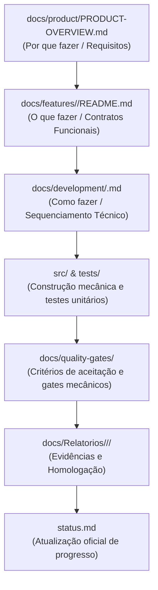

# Governança de Desenvolvimento e Planos Técnicos — ExtensionTools

> **Projeto:** ExtensionTools  
> **Classificação:** PUBLIC REPOSITORY (Safe-by-Default)  
> **Diretório:** `docs/development/`  
> **Painel Operacional Central:** [`status.md`](../../status.md)  
> **Arquitetura Base:** [`ARCHITECTURE.md`](../../ARCHITECTURE.md)  
> **Última Atualização:** 07/11/2026  

---

## 1. Finalidade do Diretório

O diretório `docs/development/` é o espaço reservado para **especificações técnicas de execução, planos operacionais de blocos de trabalho e sequenciamento de implementação** do ExtensionTools.

Enquanto `status.md` apresenta o painel consolidado de progresso e `docs/Relatorios/` armazena as evidências históricas de atividades já concluídas, `docs/development/` orienta o desenvolvedor e o agente de IA sobre **como executar uma fase ativa passo a passo antes de iniciar a codificação**.

---

## 2. Relação entre os Documentos do Ecossistema

Para evitar sobreposição e garantir responsabilidades inequívocas:

| Documento / Diretório | Responsabilidade Exclusiva | Momento de Consulta / Atualização |
| :--- | :--- | :--- |
| **`status.md`** | Visão executiva macro, percentuais de conclusão, checklists de tarefas e dependências entre milestones. | Consultar antes de iniciar qualquer tarefa; atualizar ao concluir blocos ou fases. |
| **`docs/features/`** | Especificação dos casos de uso, contratos de tipos e comportamento observável de cada ferramenta. | Consultar durante o design funcional e implementação da feature. |
| **`docs/development/`** | Detalhamento técnico de execução de um bloco ou fase: entrypoints, integrações e arquivos a criar. | Criar/consultar antes de iniciar a implementação do bloco. |
| **`docs/quality-gates/`** | Limiares inegociáveis de corte, comandos mecânicos e critérios objetivos de aceitação. | Executar antes de concluir qualquer bloco de código. |
| **`docs/Relatorios/`** | Provas materiais imutáveis (logs, cobertura, homologações e auditorias) de tarefas concluídas. | Emitir formalmente ao finalizar uma fase ou marco. |

---

## 3. Índice dos Planos de Desenvolvimento Existentes

| Marco / Fase | Bloco | Documento de Planejamento | Estado | Escopo Coberto |
| :---: | :---: | :--- | :---: | :--- |
| **M0** | H0 | [`H0-INITIALIZATION.md`](H0-INITIALIZATION.md) | **Histórico** | Especificação fundacional de setup, tooling e segurança inicial do repositório. |
| **M3-P1** | Bloco 1 | [`M3-PHASE-1-BLOCO-1.md`](M3-PHASE-1-BLOCO-1.md) | **Ativo** | Estruturação física dos entrypoints WXT, bootstrap React 19 e casca visual do Side Panel. |
| **Dev** | Setup | [`LOCAL-ENVIRONMENT.md`](LOCAL-ENVIRONMENT.md) | **Ativo** | Automação do ambiente local de desenvolvimento com `npm run dev`, WXT, web-ext e Chrome. |

---

## 4. Convenções para Novos Planos Técnicos

Ao criar um novo plano de desenvolvimento em `docs/development/`:
1. **Nomenclatura:** Adotar o padrão `<MILESTONE>-<FASE>-<BLOCO>.md` (ex: `M3-PHASE-1-BLOCO-1.md` ou `M4-PHASE-1-TEXT-DIFF.md`).
2. **Estrutura Mínima Obrigatória:**
   - Identificação do marco, fase, tarefas cobertas e status.
   - Objetivo principal e delimitação estrita de escopo (o que NÃO será feito no bloco).
   - Diagrama de composição e direção de dependências.
   - Estrutura física proposta de arquivos em `src/` e `tests/`.
   - Sequenciamento detalhado de implementação tarefa por tarefa com critérios de aceitação objetivos.
   - Lista de Quality Gates aplicáveis antes do encerramento.

---

## 5. Fluxo Canônico de Desenvolvimento

Todo avanço no projeto deve seguir rigorosamente a esteira de 7 etapas:
1. **Requisito de Produto:** Validado em `PRODUCT-OVERVIEW.md`.
2. **Especificação da Feature:** Formalizada em `docs/features/`.
3. **Planejamento Técnico:** Documentado em `docs/development/`.
4. **Implementação Incremental:** Construção modular em `src/` com testes unitários em `tests/`.
5. **Quality Gates Mecânicos:** Execução de formatação, lint, boundary-linter, typecheck e testes (`pnpm test:unit`).
6. **Relatório de Homologação:** Registro de evidências e parecer em `docs/Relatorios/`.
7. **Atualização de Status:** Marcação de checklists em `status.md` e atualização do índice de relatórios.
