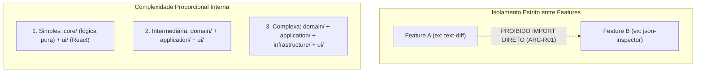

# Catálogo de Features e Especificações Funcionais — ExtensionTools

> **Projeto:** ExtensionTools  
> **Classificação:** PUBLIC REPOSITORY (Safe-by-Default)  
> **Diretório:** `docs/features/`  
> **Arquitetura Base:** [`ARCHITECTURE.md`](../../ARCHITECTURE.md)  
> **Visão de Produto:** [`docs/product/PRODUCT-OVERVIEW.md`](../product/PRODUCT-OVERVIEW.md)  
> **Design System:** [`DESIGN.md`](../../DESIGN.md)  
> **Última Atualização:** 07/11/2026  

---

## 1. Propósito do Catálogo

O diretório `docs/features/` centraliza o inventário, as especificações funcionais, os contratos de interação e os critérios de aceitação de todas as **capacidades de produto** do ExtensionTools.

Sua finalidade é fornecer uma ponte transparente entre a visão de produto (`PRODUCT-OVERVIEW.md`) e a implementação técnica em código (`src/features/`), garantindo que desenvolvedores humanos e agentes de IA compreendam o comportamento esperado de cada ferramenta antes de iniciar sua construção.

---

## 2. Conceito de Feature no ExtensionTools

No ExtensionTools, uma **Feature** é definida como uma **capacidade funcional coesa e autônoma** que resolve um problema específico do usuário ou sustenta uma operação chave de produtividade técnica.

### Diferenciação Conceitual Rigorosa

| Conceito | Definição no Projeto | Localização no Código | Exemplo |
| :--- | :--- | :--- | :--- |
| **Feature de Produto** | Ferramenta analítica ou utilitário final voltado à manipulação de dados pelo usuário. | `src/features/<feature-name>/` | `text-diff`, `json-inspector`, `xml-inspector` |
| **Capacidade Estrutural (Shell)** | Componente funcional que organiza o layout, navegação e apresentação de ferramentas na interface. | `src/features/workspace-shell/`<br>`src/features/tool-navigation/` | `workspace-shell`, `tool-navigation` |
| **Application Composition** | Ponto de orquestração técnica que integra a casca, a navegação e a feature ativa dentro de um contexto WXT. | `src/app/sidepanel/` | `SidePanelApp.tsx` |
| **Infrastructure / Platform** | Serviços transversais que encapsulam APIs do navegador ou do sistema operacional. | `src/platform/` | `persistence/`, `messaging/`, `browser/` |
| **Shared Primitives** | Componentes visuais atômicos sem estado de negócio, reutilizáveis universalmente. | `src/shared/ui/` | `Button`, `Input`, `Card`, `Badge` |

---

## 3. Filosofia Arquitetural: Feature-First

O desenvolvimento das features obedece estritamente às diretrizes canônicas de [`ARCHITECTURE.md`](../../ARCHITECTURE.md):



1. **Encapsulamento por API Pública:** Cada feature expõe suas capacidades exclusivamente através de seu arquivo raiz `src/features/<feature>/index.ts`. O acesso a submódulos internos privados (`core/`, `domain/`, `ui/`) a partir de módulos externos é barrado mecanicamente pelo Boundary Linter (`QG-02`).
2. **Pureza do Domínio:** Lógicas de cálculo, formatação, validação e transformações de dados residem em funções puras na pasta `core/` ou `domain/`, livres de React, JSX e APIs globais de navegador (`window`, `chrome.*`).

---

## 4. Catálogo Canônico das Capacidades

### 4.1. Capacidades Estruturais da Plataforma (Milestone M3)

| Identificador | Nome Oficial | Finalidade Principal | Estado Atual | Especificação |
| :--- | :--- | :--- | :---: | :--- |
| **`FEAT-SHELL`** | **Workspace Shell** | Casca estrutural permanente do Side Panel (Header, Workspace Container e Status Bar). | **Especificada** | [`workspace-shell/README.md`](workspace-shell/README.md) |
| **`FEAT-NAV`** | **Tool Navigation** | Mecanismo desacoplado de seleção, alternador de ferramentas e foco acessível. | **Especificada** | [`tool-navigation/README.md`](tool-navigation/README.md) |

### 4.2. Ferramentas do Catálogo de Produto (Milestones M4 e M5)

As 12 ferramentas de produto aprovadas em `docs/product/PRODUCT-OVERVIEW.md` estão catalogadas a seguir:

| ID | Ferramenta | Categoria Arquitetural | Objetivo Principal | Milestone de Início | Estado Documental |
| :---: | :--- | :---: | :--- | :---: | :---: |
| **F01** | `text-diff` | Simples (`core` + `ui`) | Comparador visual de textos com diff de linhas e palavras. | **M4 (Piloto)** | Planejada |
| **F02** | `json-inspector` | Simples (`core` + `ui`) | Inspetor em árvore hierárquica, validador de sintaxe e filtros JSON. | M5 | Planejada |
| **F03** | `xml-inspector` | Simples (`core` + `ui`) | Inspetor, validador, busca XPath e formatação de XML. | M5 | Planejada |
| **F04** | `markdown` | Simples (`core` + `ui`) | Editor e pré-visualizador de documentos GitHub Flavored Markdown. | M5 | Planejada |
| **F05** | `pdf-export` | Simples (`core` + `ui`) | Exportador local de relatórios e conteúdos compilados em PDF. | M5 | Planejada |
| **F06** | `quick-files` | Simples (`core` + `ui`) | Espaço de trabalho volátil em memória para manipulação ágil de arquivos. | M5 | Planejada |
| **F07** | `calendar` | Simples (`core` + `ui`) | Calendário compacto para consulta e marcação local de compromissos. | M5 | Planejada |
| **F08** | `tab-workspaces` | Intermediária (`domain` + `app` + `ui`) | Agrupador e organizador de abas Chromium por contexto investigativo. | M5 | Planejada |
| **F09** | `reference-hub` | Intermediária (`domain` + `app` + `ui`) | Catálogo local de referências técnicas, regulatórias e documentais. | M5 | Planejada |
| **F10** | `snippet-library` | Intermediária (`domain` + `app` + `ui`) | Acervo categorizado de trechos de código e queries reutilizáveis. | M5 | Planejada |
| **F11** | `evidence-capture` | Complexa (`domain` + `app` + `infra` + `ui`) | Captura estruturada de evidências web com cálculo de hash criptográfico. | M5 | Planejada |
| **F12** | `investigation-board` | Complexa (`domain` + `app` + `infra` + `ui`) | Quadro analítico visual para conexões entre evidências, notas e nós. | M5 | Planejada |

---

## 5. Ciclo de Vida e Estados das Features

Toda feature percorre os seguintes estados formais:

```text
[Planejada] ──► [Especificada] ──► [Em Desenvolvimento] ──► [Implementada] ──► [Verificada] ──► [Homologada]
```

- **Planejada:** Aprovada conceitualmente em `PRODUCT-OVERVIEW.md` e alocada a um milestone em `status.md`.
- **Especificada:** Possui documento dedicado em `docs/features/<feature>/README.md` contendo contratos de entrada/saída, regras e critérios de aceitação.
- **Em Desenvolvimento:** Código em construção em branch ou etapa ativa do milestone correspondente.
- **Implementada:** Componentes e funções concluídos, com suíte de testes unitários criada.
- **Verificada:** Aprovada em 100% dos testes e validada pelo Boundary Linter (`QG-02`) e typecheck (`QG-03`).
- **Homologada:** Submetida a testes de integração/E2E com relatório formal emitido em `docs/Relatorios/`.

---

## 6. Convenções para Novas Especificações

Ao criar a documentação de uma feature em `docs/features/<feature-name>/README.md`, deve-se adotar a seguinte estrutura padronizada:
1. **Identificação e Metadados:** ID da feature, nome, status, categoria de complexidade, milestone associado.
2. **Visão Geral e Problema Resolvido:** Referência direta à dor do usuário descrita em `PRODUCT-OVERVIEW.md`.
3. **Casos de Uso e Comportamentos Esperados:** Fluxos operacionais detalhados.
4. **Contratos Funcionais e Interfaces:** Tipos TypeScript de entrada e saída.
5. **Limites Arquiteturais e Regras de Isolamento:** O que a feature NÃO deve fazer.
6. **Requisitos de UI/UX e Acessibilidade:** Tokens aplicáveis e referências a `DESIGN.md`.
7. **Estratégia de Testes:** Casos unitários de core e testes de integração de componentes.
8. **Critérios de Aceitação Verificáveis:** Checklist de Definition of Done (DoD).
