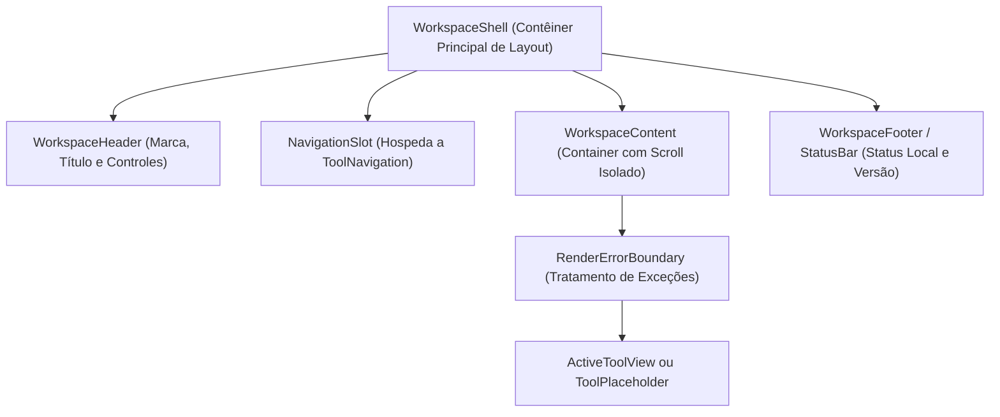

# Especificação Funcional — Workspace Shell (`FEAT-SHELL`)

> **Projeto:** ExtensionTools  
> **Identificador:** `FEAT-SHELL`  
> **Status:** ESPECIFICADA — PRONTA PARA IMPLEMENTAÇÃO (M3-PHASE-1 / Bloco 1)  
> **Papel Arquitetural:** Capacidade Estrutural da Plataforma (Side Panel Shell)  
> **Diretório:** `docs/features/workspace-shell/`  
> **Arquitetura Base:** [`ARCHITECTURE.md`](../../../ARCHITECTURE.md)  
> **Design System:** [`DESIGN.md`](../../../DESIGN.md)  
> **Decisão Vinculada:** [`ADR-005`](../../architecture/adr/ADR-005-composicao-sidepanel-shell-navegacao.md)  

---

## 1. Visão Geral

O **Workspace Shell** é a casca visual permanente e o contêiner estrutural do ExtensionTools no **Side Panel** do Chromium.

Sua finalidade é fornecer um ambiente de trabalho coeso, estável e previsível, delimitando claramente as zonas de controle institucional, seleção de ferramentas, área de trabalho ativa e rodapé de status.

### Por que o Workspace Shell é Necessário Antes das Ferramentas de Produto?
Antes que ferramentas analíticas individuais (como `text-diff` ou `json-inspector`) possam ser desenvolvidas, é indispensável que a extensão possua uma superfície padronizada onde esses utilitários sejam instanciados. Sem o Workspace Shell, cada ferramenta precisaria reinventar cabeçalhos, barras de ferramentas, margens e tratamentos de erro, fragmentando a experiência do usuário e violando os princípios do Design System.

---

## 2. Responsabilidades Principais

1. **Estrutura de Layout Vertical Unificada:** Organizar a janela do Side Panel em três seções bem delineadas:
   - **Cabeçalho (Header):** Identidade visual institucional (logotipo em Brand Red, nome da extensão e indicador de status).
   - **Área de Navegação (Navigation Slot):** Espaço dedicado para acomodar a barra seletora de ferramentas (`ToolNavigation`).
   - **Contêiner Central de Trabalho (Workspace Container):** Região expansível com rolagem independente onde a ferramenta ativa é montada.
   - **Barra de Status (Status Bar):** Rodapé discreto informando o modo de execução local, indicador de persistência e versão.
2. **Isolamento de Falhas de Renderização:** Proteger a extensão contra quebras totais de tela através de um `RenderErrorBoundary` integrado, impedindo que uma exceção em uma ferramenta desmonte o cabeçalho ou o alternador de navegação.
3. **Composição Declarativa de Slots:** Receber seus conteúdos internos via composição React pura (`children` ou propriedades de nó), sem criar acoplamento com classes ou modelos internos de ferramentas.

---

## 3. Componentes Estruturais Planejados

A arquitetura do Workspace Shell propõe os seguintes componentes conceituais em `src/features/workspace-shell/ui/`:



- **`WorkspaceShell`:** Componente raiz da casca visual. Gerencia as dimensões verticais (100vh), fundo neutro (`#101013`) e contenção de layout.
- **`WorkspaceHeader`:** Barra superior compacta (altura 48px) com tipografia de marca e ícone tecnológico em Brand Red (`#DF2531`).
- **`WorkspaceContent`:** Região central flexível (`flex-1 overflow-auto`), garantindo que o scroll do conteúdo de uma ferramenta não afete a fixação do cabeçalho nem da barra de navegação.
- **`ToolPlaceholder`:** Tela informativa inicial apresentada quando nenhuma ferramenta está carregada ou para ferramentas em estágio de planejamento (com título, descrição e estado visual limpo).
- **`RenderErrorBoundary`:** Limite de captura de exceções do React que renderiza uma mensagem amigável de recuperação caso ocorra erro inesperado na renderização visual.

---

## 4. Limites Arquiteturais Inegociáveis

Em estrito respeito à arquitetura Feature-First e às regras do Boundary Linter (`QG-02`):
- ❌ **O Shell NUNCA executa lógica de ferramentas:** O Shell não sabe calcular diff, não sabe analisar XML e não manipula árvores JSON.
- ❌ **O Shell NUNCA acessa armazenamento de ferramentas:** Não lê nem grava dados que pertençam a casos de uso de utilitários específicos.
- ❌ **O Shell NUNCA importa submódulos privados de features:** Dependências entre a aplicação e as features ocorrem exclusivamente no ponto de composição (`src/app/sidepanel/SidePanelApp.tsx`).
- ❌ **O Shell NÃO gerencia estado global das ferramentas:** Cada ferramenta é dona de seu estado interno de trabalho.

---

## 5. Contratos de Integração e Composição

O Workspace Shell é consumido na aplicação via composição simples:

```tsx
// Exemplo conceitual de consumo no SidePanelApp
<WorkspaceShell
  header={<WorkspaceHeader title="ExtensionTools" />}
  navigation={<ToolNavigation activeToolId={activeTool} onSelectTool={setActiveTool} />}
  footer={<WorkspaceStatusBar version="0.1.0" mode="Local-First" />}
>
  <RenderErrorBoundary fallback={<ShellErrorFallback />}>
    {renderActiveTool(activeTool)}
  </RenderErrorBoundary>
</WorkspaceShell>
```

---

## 6. Estados da Interface

| Estado | Descrição Visual | Comportamento Esperado |
| :--- | :--- | :--- |
| **Normal (Ativo)** | Cabeçalho fixo, navegação ativa e ferramenta montada em `WorkspaceContent`. | Interação fluida do usuário com a ferramenta selecionada. |
| **Vazio / Inicial** | Cabeçalho e navegação visíveis; `ToolPlaceholder` exibido no contêiner. | Informa os utilitários disponíveis e orienta o usuário a selecionar uma ferramenta. |
| **Falha de Renderização** | Banner de alerta contido no contêiner central via `RenderErrorBoundary`. | Cabeçalho e navegação continuam funcionando, permitindo que o usuário troque de ferramenta. |

---

## 7. Requisitos Visuais e Design System

Em estrita consonância com [`DESIGN.md`](../../../DESIGN.md):
- **Superfície Base (Nível 0):** Fundo preto puro / grafite profundo (`#101013`).
- **Painéis e Contêineres (Nível 1):** Fundo `#1E1E22` com bordas sutis `1px solid #2B2B33`.
- **Acentos de Marca:** Indicadores e logotipo em Brand Red sólido (`#DF2531`).
- **Tipografia:** Família sans-serif tecnológica para títulos e rótulos de UI; altura de linha confortável.
- **Acessibilidade:** Regiões com landmarks semânticos ARIA (`<header>`, `<nav>`, `<main>`, `<footer>`), suporte a navegação por teclado e contraste compatível com WCAG 2.2 AA.

---

## 8. Estratégia de Testes Previstos

1. **Testes Unitários de Renderização (`tests/unit/workspace-shell/`):**
   - Renderização correta dos quatro slots (Header, Navigation, Content, Footer).
   - Verificação de classes utilitárias de contenção de overflow e dimensões verticais.
   - Renderização do `ToolPlaceholder` com metadados corretos.
   - Captura de erro pelo `RenderErrorBoundary` sem quebra da árvore global do React.
2. **Testes de Integração de Layout:**
   - Composição harmoniosa do Shell com mock de barra de navegação e componentes primitivos de `src/shared/ui/`.

---

## 9. Critérios de Aceitação Verificáveis (Definition of Done)

- [ ] Componente `WorkspaceShell` implementado em `src/features/workspace-shell/` e exportado via `index.ts`.
- [ ] Subdivisão em Header, Content, Navigation Slot e Footer/StatusBar.
- [ ] `RenderErrorBoundary` implementado para contenção segura de falhas locais de UI.
- [ ] `ToolPlaceholder` limpo e tecnológico para ferramentas ainda não construídas.
- [ ] 100% dos testes unitários da casca passando com louvor no Vitest.
- [ ] Zero violações de limites arquiteturais detectadas pelo Boundary Linter (`pnpm run lint:arch`).

---

## 10. Exclusões Explícitas do Bloco 1

Para evitar complexidade desnecessária e manter o foco na entrega enxuta do Bloco 1, **NÃO fazem parte do escopo inicial**:
- Sistema de abas dinâmicas múltiplas no estilo navegador.
- Redimensionamento manual de painéis com splitters arrastáveis.
- Gerenciamento de janelas pop-up desacopladas.
- Persistência avançada de histórico de telas.
