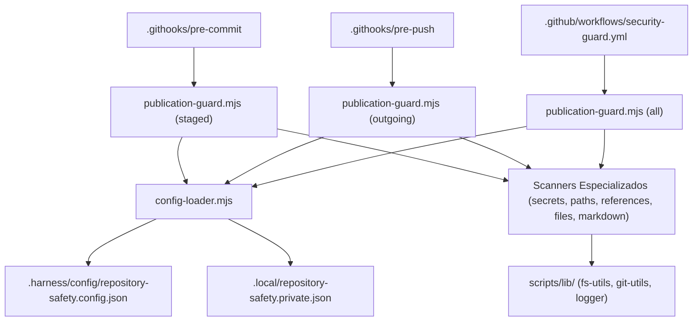

# QG-01 — Repository Safety

> **Quality Gate:** QG-01  
> **Nome Canônico:** Repository Safety (Segurança do Repositório Público)  
> **Classificação:** PUBLIC REPOSITORY SAFETY  
> **Documento Canônico:** `docs/quality-gates/01-repository-safety.md`  
> **Harness de Referência:** `docs/architecture/HARNESS-ARCHITECTURE.md`  
> **Política Pública de Segurança:** `SECURITY.md`  

---

## 1. Identificação

| Atributo | Especificação Canônica |
| :--- | :--- |
| **ID** | `QG-01` |
| **Nome** | Repository Safety |
| **Categoria** | Segurança / Confidencialidade |
| **Prioridade** | **Essencial (P0 / Crítica)** |
| **Milestone Relacionada** | M0 (H0), M2 (H1, Fase 0 e Fase 1 de Scripts) |
| **Estado da Implementação** | `Implementado e validado` |
| **Dependências Técnicas** | Node.js >= 20, Git CLI, `scripts/lib/` (fs-utils, git-utils, logger) |
| **Mecanismos Relacionados** | `SEC-01` (`config-loader.mjs`), `SEC-02` (`publication-guard.mjs`), `SEC-03` (`scan-forbidden-references.mjs`), `SEC-04` (`scan-markdown.mjs`), `SEC-05` (`scan-private-paths.mjs`), `SEC-06` (`scan-secrets.mjs`), `SEC-07` (`scan-sensitive-files.mjs`), `SEC-08` (`scan-git-history.mjs` - Planejado) |
| **Hooks e Pipelines** | `.githooks/pre-commit`, `.githooks/pre-push`, `.github/workflows/security-guard.yml` |

---

## 2. Responsabilidade

O `QG-01` é responsável por proteger o repositório público do ExtensionTools contra qualquer forma de vazamento de informações confidenciais, credenciais, segredos criptográficos, identificadores corporativos proibidos, caminhos privados de estações de trabalho locais e arquivos sensíveis não autorizados para versionamento público.

O gate atua como uma barreira preventiva *fail-closed* que bloqueia localmente commits (`pre-commit`), envios remotos (`pre-push`) e pull requests na esteira de CI antes que qualquer dado inadequado se torne público ou seja gravado no histórico indelével do Git.

---

## 3. Problema Resolvido

Em projetos mantidos em repositórios públicos no GitHub desenvolvidos com auxílio de agentes de inteligência artificial e múltiplos desenvolvedores, erros operacionais triviais podem expor dados sensíveis com consequências severas. Este gate resolve especificamente:

1. **Vazamento de Tokens e Credenciais:** Previne que chaves de API, tokens do GitHub/AWS, senhas e certificados privados sejam commitados em código, testes ou arquivos `.env`.
2. **Exposição de Identificadores Corporativos Privados:** Assegura que nomes de organizações, projetos internos restritos, codinomes ou referências empresariais não apareçam no repositório público.
3. **Vazamento de Caminhos Absolutos de Máquinas Locais:** Impede a persistência de diretórios específicos como `/home/<usuario>/` ou `C:\Users\<usuario>\` em configurações, scripts ou documentação gerada por agentes.
4. **Versionamento de Arquivos Proibidos:** Bloqueia a inclusão de arquivos `.pem`, `.key`, `.pfx`, dumps `.sql`, backups `.bak` ou relatórios restritos de auditoria.
5. **Ilusão de Segurança por Remoção Tardia:** Previne o erro comum de commitar um segredo e tentar "apagá-lo" em commit posterior (o que mantém o dado no histórico do Git).
6. **Contorno Acidental de Hooks:** Garante verificação redundante na esteira de CI (`GitHub Actions`) caso um hook local seja contornado ou não esteja instalado.

---

## 4. Fundamentos Técnicos

O funcionamento do `QG-01` fundamenta-se nos seguintes princípios técnicos e de arquitetura do Git:

### 4.1. Inspeção de Conteúdo em Três Escopos Distintos
O gate distingue rigorosamente três escopos de análise no Git:
- **`staged` (Pré-commit):** Inspeciona exclusivamente os blobs armazenados na *staging area* do Git (`git diff --cached`). O scanner lê o conteúdo real que está prestes a ser commitado diretamente do objeto Git (`git show :caminho`), evitando inspecionar o arquivo na working tree (que pode conter alterações ainda não preparadas).
- **`outgoing` (Pré-push):** Inspeciona a faixa de commits locais que existem na branch atual mas ainda não foram enviados ao upstream remoto (`git rev-list @{upstream}..HEAD` ou comparação com branch base `origin/main` / `origin/master`).
- **`all` (CI / Auditoria Total):** Inspeciona todos os arquivos rastreados (`git ls-files`) e arquivos locais do projeto contra as regras de conformidade.

### 4.2. Carregamento Dual de Configuração (Pública e Privada)
- **Configuração Pública (`.harness/config/repository-safety.config.json`):** Versionada no Git, define extensões proibidas, padrões universais de segredos e caminhos privados genéricos.
- **Configuração Privada (`.local/repository-safety.private.json`):** Ignorada pelo Git (`.gitignore`), reside exclusivamente na máquina do desenvolvedor e contém termos corporativos confidenciais proibidos. A ausência da configuração privada no ambiente local onde ela é exigida bloqueia a publicação por segurança (*Safe-by-Default*).

---

## 5. Funcionamento Previsto

### 5.1. Comportamento Implementado e Comprovado
Atualmente, o `publication-guard.mjs` orquestra em cadeia os scanners de segurança:
1. `config-loader.mjs`: Carrega e valida schemas das regras públicas e privadas.
2. `scan-sensitive-files.mjs`: Avalia nomes de arquivos e extensões contra listas de bloqueio.
3. `scan-secrets.mjs`: Executa expressões regulares contra strings de alta entropia, chaves RSA/OpenSSH, tokens de provedores e credenciais.
4. `scan-private-paths.mjs`: Detecta menções a diretórios de estações locais (`/home/`, `C:\Users\`, `/Users/`).
5. `scan-forbidden-references.mjs`: Compara palavras e termos com a lista privada confidencial.
6. `scan-markdown.mjs`: Audita documentos `.md` quanto a diretórios não autorizados, sufixos restritos (`*.private.md`) ou marcadores de confidencialidade.

### 5.2. Comportamento Proposto / Evolução (`SEC-08`)
- **Varredura Histórica do Git (`scan-git-history.mjs`):** Auditoria profunda sobre commits anteriores, tags e referências do Git antes da primeira publicação pública ou em pipelines agendados de segurança, garantindo que nenhum segredo antigo resida em branches ou commits órfãos.

---

## 6. Regras Verificáveis

| Código da Regra | Condição de Reprovação (FAIL) | Ação / Código |
| :--- | :--- | :---: |
| **SEC-R01** | Qualquer arquivo staged ou rastreado contém segredo ou padrão de token de API | `exit 1` |
| **SEC-R02** | Qualquer arquivo staged ou rastreado contém termo restrito corporativo privado | `exit 1` |
| **SEC-R03** | Qualquer arquivo staged ou rastreado contém caminho absoluto POSIX ou Windows privado | `exit 1` |
| **SEC-R04** | Arquivo presente no escopo possui extensão proibida (`.env`, `.pem`, `.key`, `.sql`, etc.) | `exit 1` |
| **SEC-R05** | Arquivo Markdown contém marcadores de confidencialidade restrita ou sufixo `.private.md` | `exit 1` |
| **SEC-R06** | Arquivo de relatório de auditoria (`*REPORT*.md`, `*RELATORIO*.md`) fora de `docs/Relatorios/` | `exit 1` |
| **SEC-ERR01** | Arquivo de configuração pública corrompido ou inexistente | `exit 2` |
| **SEC-ERR02** | Falha de execução do Git CLI (e.g. repositório sem branch inicial, erro de IO) | `exit 2` |

---

## 7. Integração Arquitetural

---

## 8. Ferramentas e Implementação

- **Runtime:** Node.js v20+ em modo ESM nativo (`"type": "module"`).
- **Scripts Existentes:**
  - `scripts/security/publication-guard.mjs`
  - `scripts/security/config-loader.mjs`
  - `scripts/security/scan-secrets.mjs`
  - `scripts/security/scan-sensitive-files.mjs`
  - `scripts/security/scan-private-paths.mjs`
  - `scripts/security/scan-forbidden-references.mjs`
  - `scripts/security/scan-markdown.mjs`
- **Bibliotecas Compartilhadas:** `scripts/lib/git-utils.mjs`, `scripts/lib/fs-utils.mjs`, `scripts/lib/logger.mjs`.
- **Configurações:** `.harness/config/repository-safety.config.json`, `.harness/config/repository-safety.private.example.json`.

---

## 9. Estratégia de Testes

A eficácia do `QG-01` é assegurada por testes automatizados com Vitest:
- **Testes Unitários de Scanners (`tests/harness/security/security-scanners.test.ts`):** Validação isolada de cada expressão regular e regra de parsing contra strings sintéticas válidas e inválidas.
- **Testes de Integração com Git (`tests/harness/security/git-integration.test.ts`):** Criação de repositórios Git temporários em `tmpdir`, simulando commits staged com segredos sintéticos, repositórios sem commits anteriores e cenários de push.
- **Testes Negativos:** Verificação de que tokens sintéticos de teste (ex: no formato `AKIA...`) disparam reprovação imediata (`exit 1`).
- **Testes de Borda:** Tratamento de arquivos vazios (0 bytes), binários grandes (> 5MB) e caminhos de arquivos com espaços e acentuação.
- **Testes de Resiliência a Falhas:** Comprovação de que arquivos JSON malformados geram `exit 2` e não `exit 0`.

---

## 10. Falsos Positivos e Falsos Negativos

### 10.1. Mitigação de Falsos Positivos
- **Exceções Declaradas:** Arquivos de exemplo intencionais (`.env.example`, `.harness/config/*.example.json`) são permitidos explicitamente pela configuração pública.
- **Linhas Ignoradas:** Capacidade de suprimir alertas falsos via comentário estruturado `// safety-ignore-next-line` quando estritamente justificado.

### 10.2. Mitigação de Falsos Negativos
- **Inspeção de Blobs Autênticos:** Ao inspecionar commits staged, o scanner lê o objeto do Git e não o arquivo no disco, impedindo que modificações feitas após o `git add` mas antes do commit mascarem um segredo.
- **Decodificação de Codificações Comuns:** Verificação de strings em Base64 e URLEncode para evitar ofuscação de credenciais.

---

## 11. Critérios de Aceitação

Para que o `QG-01` seja homologado como aprovado em qualquer execução:
1. **Zero Violações Críticas:** Nenhum segredo, caminho absoluto ou termo confidencial detectado no escopo inspecionado.
2. **Zero Arquivos Proibidos:** Nenhum arquivo rastreado ou staged pertencente à lista de extensões ou nomes proibidos.
3. **Execução Operacional Perfeita:** Todos os scanners encerram com código `0`, sem erros de leitura ou exceções não tratadas.
4. **Respeito aos Hooks:** Os hooks de pré-commit e pré-push devem abortar a operação do Git imediatamente caso o validador retorne código diferente de `0`.

---

## 12. Evolução Planejada

1. **Implementação do `SEC-08` (`scan-git-history.mjs`):** Script dedicado a auditar árvores históricas e commits órfãos (Fase 2 de Scripts).
2. **Varredura Incremental Concorrente:** Paralelização da leitura de arquivos utilizando `Worker Threads` do Node.js para repositórios com grande volume de arquivos.
3. **Auditoria de Entropia de Shannon:** Adição de cálculo de entropia para detectar senhas e segredos randômicos que não correspondam a formatos conhecidos de provedores.

---

## 13. Referências

- **Plano de Desenvolvimento e Homologação:** [`docs/Relatorios/m2/quality-gates/QG-01-PLANO-DESENVOLVIMENTO-E-HOMOLOGACAO.md`](../Relatorios/m2/quality-gates/QG-01-PLANO-DESENVOLVIMENTO-E-HOMOLOGACAO.md)
- **Política de Segurança:** [`SECURITY.md`](../../SECURITY.md)
- **Governança do Harness:** [`docs/architecture/HARNESS-ARCHITECTURE.md`](../architecture/HARNESS-ARCHITECTURE.md)
- **Instruções de Agentes:** [`AGENTS.md`](../../AGENTS.md)
- **Relatório de Validação H1:** [`docs/Relatorios/m2/phase-1-scanners/H1-REPOSITORY-SAFETY-REPORT.md`](../Relatorios/m2/phase-1-scanners/H1-REPOSITORY-SAFETY-REPORT.md)
- **Relatório de Implementação de Scripts Fase 00:** [`docs/Relatorios/m2/planejamento-scripts/RELATORIO-IMPLEMENTACAO-FASE-SCRIPTS-00.md`](../Relatorios/m2/planejamento-scripts/RELATORIO-IMPLEMENTACAO-FASE-SCRIPTS-00.md)
- **Relatório de Implementação de Scripts Fase 01:** [`docs/Relatorios/m2/planejamento-scripts/RELATORIO-IMPLEMENTACAO-FASE-SCRIPTS-01.md`](../Relatorios/m2/planejamento-scripts/RELATORIO-IMPLEMENTACAO-FASE-SCRIPTS-01.md)
