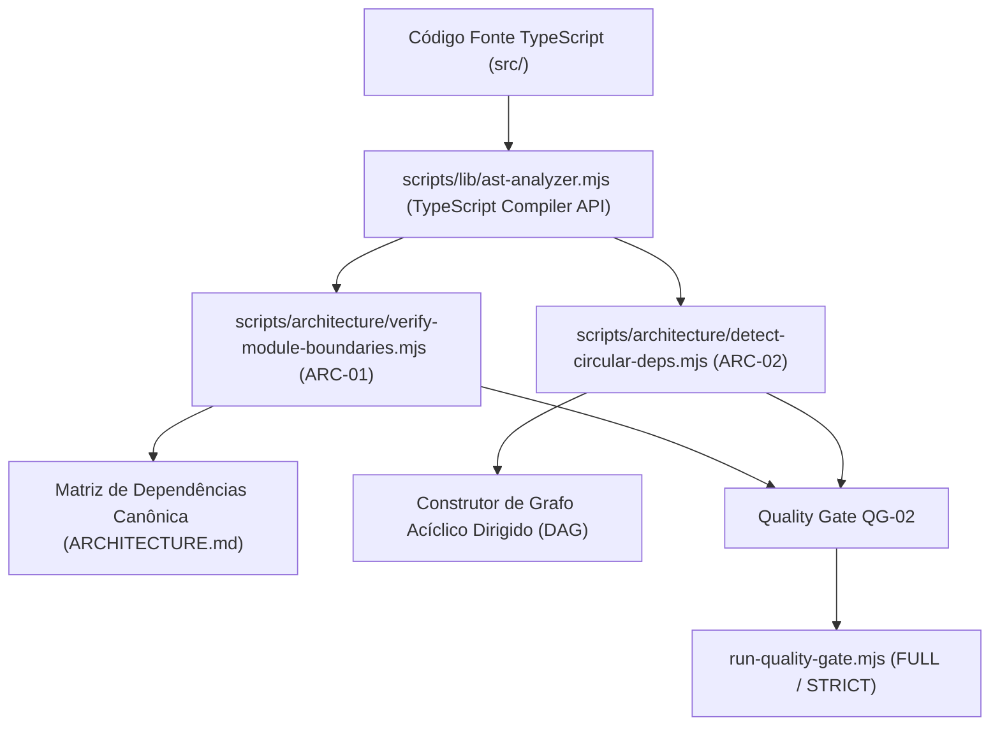

# QG-02 — Architecture Boundaries

> **Quality Gate:** QG-02  
> **Nome Canônico:** Architecture Boundaries (Limites e Fronteiras Arquiteturais)  
> **Classificação:** ARCHITECTURAL GOVERNANCE  
> **Documento Canônico:** `docs/quality-gates/02-architecture-boundaries.md`  
> **Arquitetura Base:** `ARCHITECTURE.md`  
> **Status:** Parcialmente Implementado (Base analítica AST validada; linters em especificação para M2-PHASE-4)  

---

## 1. Identificação

| Atributo | Especificação Canônica |
| :--- | :--- |
| **ID** | `QG-02` |
| **Nome** | Architecture Boundaries |
| **Categoria** | Arquitetura / Integridade Estrutural |
| **Prioridade** | **Essencial (P0 / Crítica)** |
| **Milestone Relacionada** | M1 (Fundamentos), M2-PHASE-4 (Implementação Automatizada) |
| **Estado da Implementação** | `Parcialmente implementado` (Parser AST funcional em `scripts/lib/ast-analyzer.mjs`; scripts `ARC-01` e `ARC-02` planejados) |
| **Dependências Técnicas** | Node.js >= 20, TypeScript Compiler API, `scripts/lib/ast-analyzer.mjs`, `scripts/lib/fs-utils.mjs` |
| **Mecanismos Relacionados** | `ARC-01` (`verify-module-boundaries.mjs`), `ARC-02` (`detect-circular-deps.mjs`), `scripts/lib/ast-analyzer.mjs` |
| **Hooks e Pipelines** | Hook de pré-push, CI (`security-guard.yml` expandido), Orquestrador `run-quality-gate.mjs` |

---

## 2. Responsabilidade

O `QG-02` é responsável por auditar estaticamente todo o código-fonte TypeScript/React do ExtensionTools para garantir que os limites arquiteturais, a separação de responsabilidades e as regras de dependência da organização **Feature-First modular** sejam preservados sem exceções não autorizadas.

O gate impede o acoplamento cruzado ilegal entre módulos, a violação de encapsulamento interno de features, a importação direta de APIs de navegador ou UI dentro do domínio puro e a formação de dependências circulares.

---

## 3. Problema Resolvido

Em arquiteturas modulares operadas com agentes de IA, é frequente que geradores de código criem atalhos impróprios para resolver tarefas rapidamente, gerando:
1. **Acoplamento Cruzado Indiscriminado (Deep Cross-Feature Imports):** Módulos importando componentes internos ou funções privadas uns dos outros (`import { Table } from '@/features/calendar/ui/Table'`), tornando impossível modificar uma feature sem quebrar outras.
2. **Dependências Circulares:** Ciclos de importação entre arquivos (`A -> B -> C -> A`) que causam comportamentos indefinidos em tempo de execução (*TDZ - Temporal Dead Zone*), dificultam o *tree-shaking* e degradam o empacotamento do WXT.
3. **Contaminação do Domínio Puro:** Inclusão de dependências do React, JSX ou chamadas diretas a APIs globais do navegador (`window`, `chrome.storage`) dentro de classes de domínio, parsers de XML/JSON ou algoritmos de diff.
4. **Vazamento de Detalhes de Implementação:** Entrypoints consumindo submódulos internos de uma feature em vez de sua interface pública (`index.ts`).
5. **Divergência entre Path Aliases e Imports Relativos:** Inconsistência no uso do alias `@/*` e navegações relativas confusas com dezenas de `../../`.

---

## 4. Fundamentos Técnicos

### 4.1. Arquitetura Feature-First Modular e Proporcional
O ExtensionTools adota uma organização onde o código é agrupado prioritariamente por **capacidade funcional de negócio** (`src/features/<feature-name>/`), e não por tipo técnico de arquivo (`controllers/`, `views/`, `models/`). 

Conforme formalizado em `ARCHITECTURE.md`, as features são classificadas em três níveis de complexidade proporcional:
- **Features Simples (`core/` + `ui/`):** Utilitários focados em transformações puras e visualização (e.g., `text-diff`, `xml-inspector`, `json-inspector`, `markdown`).
- **Features Intermediárias (`domain/` + `application/` + `ui/`):** Gestão local de entidades e coleções (e.g., `snippet-library`, `reference-hub`).
- **Features Complexas (`domain/` + `application/` + `infrastructure/` + `ui/`):** Ricas em regras, persistência estruturada e invariantes criptográficas (e.g., `evidence-capture`, `investigation-board`).

### 4.2. Análise Estática Baseada em AST (Abstract Syntax Tree)
Diferente de verificadores baseados em expressões regulares frágeis que falham diante de comentários, quebras de linha ou strings literais, o `QG-02` utiliza a **TypeScript Compiler API** através do módulo canônico `scripts/lib/ast-analyzer.mjs`. A árvore sintática abstrata é percorrida para extrair com precisão cirúrgica:
- Declarações de importação estáticas (`import { x } from '...'`).
- Importações dinâmicas (`import('...')`).
- Reexportações (`export { y } from '...'`).
- Importações exclusivas de tipo (`import type { Z } from '...'`).

---

## 5. Funcionamento Previsto

### 5.1. Comportamento Implementado e Comprovado
- A biblioteca `scripts/lib/ast-analyzer.mjs` está **implementada e validada** por suíte de testes Vitest (`tests/harness/lib/ast-analyzer.test.ts`), oferecendo suporte nativo para carregar arquivos TypeScript/TSX, parsear nós `ImportDeclaration` / `ExportDeclaration` e resolver especificadores de módulos relativos e com aliases.

### 5.2. Comportamento Proposto / Em Desenvolvimento (M2-PHASE-4)
O orquestrador arquitetural executará duas verificações principais:

1. **`ARC-01` (`verify-module-boundaries.mjs`):**
   - Varre recursivamente `src/`.
   - Para cada arquivo, resolve os caminhos dos imports para seus arquivos de destino reais.
   - Aplica a matriz de dependências permitidas confrontando camada de origem vs camada de destino.
   - Dispara erro com nome do arquivo, linha, coluna e motivo da violação.
2. **`ARC-02` (`detect-circular-deps.mjs`):**
   - Constrói o grafo direcionado de dependências de todos os arquivos de `src/`.
   - Executa algoritmo de Busca em Profundidade (DFS) com detecção de retroconexões (*back-edges*) para identificar ciclos de dependência.
   - Relata o ciclo completo (e.g. `feature/a.ts -> feature/b.ts -> feature/a.ts`).

---

## 6. Regras Verificáveis e Matriz de Dependências

### 6.1. Matriz Canônica de Dependências

A matriz a seguir define formalmente o que cada camada em `src/` pode ou não importar:

| Camada de Origem \ Destino | `entrypoints/` | `features/*/ui` | `features/*/core/domain` | `features/*/application` | `features/*/infra` | Outra Feature | `platform/` | `shared/` |
| :--- | :---: | :---: | :---: | :---: | :---: | :---: | :---: | :---: |
| **`entrypoints/`** | ❌ Proibido | ❌ Proibido | ❌ Proibido | ❌ Proibido | ❌ Proibido | ✅ Apenas `index.ts` | ✅ Permitido | ✅ Permitido |
| **`features/*/ui`** | ❌ Proibido | ✅ Própria | ✅ Própria | ✅ Própria | ❌ Proibido | ❌ Proibido | ✅ Permitido | ✅ Permitido |
| **`features/*/core/domain`** | ❌ Proibido | ❌ Proibido | ✅ Própria | ❌ Proibido | ❌ Proibido | ❌ Proibido | ❌ Proibido | ✅ Apenas Tipos |
| **`features/*/application`**| ❌ Proibido | ❌ Proibido | ✅ Própria | ✅ Própria | ❌ Proibido | ❌ Proibido | ⚠️ Apenas Interfaces | ✅ Permitido |
| **`features/*/infra`** | ❌ Proibido | ❌ Proibido | ✅ Própria | ❌ Proibido | ✅ Própria | ❌ Proibido | ✅ Permitido | ✅ Permitido |
| **`platform/`** | ❌ Proibido | ❌ Proibido | ❌ Proibido | ❌ Proibido | ❌ Proibido | ❌ Proibido | ✅ Permitido | ✅ Permitido |
| **`shared/`** | ❌ Proibido | ❌ Proibido | ❌ Proibido | ❌ Proibido | ❌ Proibido | ❌ Proibido | ❌ Proibido | ✅ Permitido |

### 6.2. Regras e Códigos de Encerramento

| Código da Regra | Condição de Reprovação (FAIL) | Ação / Código |
| :--- | :--- | :---: |
| **ARC-R01** | Import direto entre pastas internas de features distintas (Cross-Feature Import) | `exit 1` |
| **ARC-R02** | Detecção de dependência circular no grafo de arquivos (`A -> B -> ... -> A`) | `exit 1` |
| **ARC-R03** | Arquivos de `core/` ou `domain/` importando React, JSX ou APIs do navegador | `exit 1` |
| **ARC-R04** | Entrypoints importando arquivos internos de uma feature ignorando o `index.ts` | `exit 1` |
| **ARC-R05** | Camada `shared/` importando qualquer arquivo de `features/`, `platform/` ou `entrypoints/` | `exit 1` |
| **ARC-R06** | Camada `platform/` importando arquivos de `features/` ou `entrypoints/` | `exit 1` |
| **ARC-ERR01** | Erro de sintaxe que impeça a geração de AST de arquivos TypeScript | `exit 2` |

---

## 7. Integração Arquitetural

---

## 8. Ferramentas e Implementação

- **Compilador TypeScript Oficial:** Utilização nativa do pacote `typescript` (v7+) instalado como `devDependency`.
- **Analisador de AST:** [`scripts/lib/ast-analyzer.mjs`](../../scripts/lib/ast-analyzer.mjs).
- **Scripts em Desenvolvimento (M2-PHASE-4):**
  - `scripts/architecture/verify-module-boundaries.mjs`
  - `scripts/architecture/detect-circular-deps.mjs`
- **Configuração de Resolução de Caminhos:** `tsconfig.json` (`paths: { "@/*": ["./src/*"] }`).

---

## 9. Estratégia de Testes

- **Testes Unitários da API de AST (`tests/harness/lib/ast-analyzer.test.ts`):** Já comprovam a extração correta de imports com aliases, imports dinâmicos e imports de tipos puros.
- **Testes de Fixtures Sintéticas (`tests/harness/architecture/`):**
  - Criação de estruturas de diretórios temporárias com features simuladas em `tmpdir`.
  - Cenário positivo: Features isoladas comunicando-se via `index.ts` e `shared/` (deve passar com código 0).
  - Cenário negativo 1: `featureA/ui` importando `featureB/core` diretamente (deve falhar com `exit 1` indicando arquivo e linha exatos).
  - Cenário negativo 2: Três arquivos com dependência circular `A -> B -> C -> A` (deve falhar com `exit 1` e exibir o ciclo textual).
  - Cenário de tipos: Garantir que `import type` entre fronteiras permitidas não seja bloqueado inadvertidamente quando for inofensivo em tempo de execução.

---

## 10. Falsos Positivos e Falsos Negativos

### 10.1. Mitigação de Falsos Positivos
- **Imports Exclusivos de Tipo (`import type`):** Não devem ser confundidos com acoplamento em tempo de execução quando respeitam contratos de interfaces compartilhadas.
- **Resolução Exata de Aliases:** O analisador deve resolver o alias `@/` baseado na configuração oficial do `tsconfig.json`, sem presunções hardcoded.

### 10.2. Mitigação de Falsos Negativos
- **Imports Dinâmicos:** A análise deve inspecionar nós `ts.isCallExpression` onde o identificador é `import()`, evitando que agentes ocultem dependências proibidas usando carregamento preguiçoso (*lazy loading*).
- **Reexportações em Cadeia:** Verificação de declarações `export * from '...'` e `export { x } from '...'` para impedir vazamento indireto de fronteiras.

---

## 11. Critérios de Aceitação

Para homologação do `QG-02`:
1. **Zero Violações de Limites:** 100% dos imports em `src/` em estrita conformidade com a matriz de dependências.
2. **Grafo Estritamente Acíclico:** Zero dependências circulares detectadas em toda a base de código.
3. **Pureza de Domínio Comprovada:** Nenhum arquivo sob `core/` ou `domain/` contendo importações de React, hooks visuais ou APIs de plataforma.
4. **Relatório Claro:** Em caso de violação, o console deve exibir o caminho completo, a linha do arquivo e a regra infringida com instrução clara de correção.

---

## 12. Evolução Planejada

1. **Construção dos Scripts `ARC-01` e `ARC-02`:** Conclusão da fase M2-PHASE-4 do roadmap do Harness.
2. **Integração como Regra ESLint Personalizada:** Futura transição das regras de limites para plugin ESLint sob demanda, acelerando feedback no editor de código (IDE).
3. **Geração Automática de Diagramas de Módulos:** Capacidade do `ast-analyzer.mjs` de gerar grafos Mermaid da arquitetura real do projeto para inclusão automática em relatórios.

---

## 13. Referências

- **Arquitetura Canônica:** [`ARCHITECTURE.md`](../../ARCHITECTURE.md)
- **Harness Architecture:** [`docs/architecture/HARNESS-ARCHITECTURE.md`](../architecture/HARNESS-ARCHITECTURE.md)
- **Relatório de Planejamento de Scripts:** [`docs/Relatorios/m2/planejamento-scripts/RELATORIO-PLANEJAMENTO-DESENVOLVIMENTO-SCRIPTS.md`](../Relatorios/m2/planejamento-scripts/RELATORIO-PLANEJAMENTO-DESENVOLVIMENTO-SCRIPTS.md)
- **Implementação do Analisador AST:** [`scripts/lib/ast-analyzer.mjs`](../../scripts/lib/ast-analyzer.mjs)
- **Testes do Analisador AST:** [`tests/harness/lib/ast-analyzer.test.ts`](../../tests/harness/lib/ast-analyzer.test.ts)
