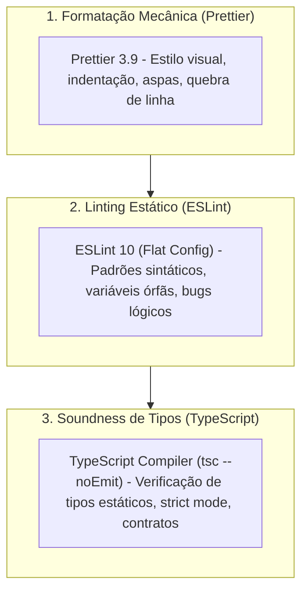
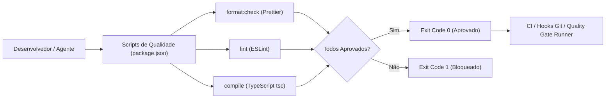

# QG-03 — Static Code Quality

> **Quality Gate:** QG-03\
****Nome Canônico:** Static Code Quality (Qualidade Estática de Código)\
****Classificação:** STATIC ANALYSIS & TYPE SOUNDNESS\
****Documento Canônico:** `docs/quality-gates/03-static-code-quality.md`\
****Arquitetura Base:** `ARCHITECTURE.md`\
****Status:** Implementado e Validado (TypeScript strict, ESLint 10 e Prettier integrados aos scripts e CI)

---

## 1. Identificação

| Atributo | Especificação Canônica |
| --- | --- |
| **ID** | `QG-03` |
| **Nome** | Static Code Quality |
| **Categoria** | Qualidade Estática / Sintaxe / Tipagem |
| **Prioridade** | **Essencial (P0 / Crítica)** |
| **Milestone Relacionada** | M0 (Configuração Base), Todas as Milestones subsequentes |
| **Estado da Implementação** | `Implementado e validado` |
| **Dependências Técnicas** | TypeScript 7+, ESLint 10+, Prettier 3+, Node.js &gt;= 20 |
| **Mecanismos Relacionados** | `pnpm run compile`, `pnpm run lint`, `pnpm run format:check`, `pnpm run format` |
| **Arquivos de Configuração** | `tsconfig.json`, `eslint.config.js`, `.prettierrc`, `.prettierignore` |
| **Hooks e Pipelines** | Pré-commit (format/lint rápido), CI (`.github/workflows/security-guard.yml`) |

---

## 2. Responsabilidade

O `QG-03` é responsável por garantir a integridade sintática, semântica e estilística de todo o código-fonte do projeto. Ele atua como guardião da solidez estática (*type soundness*), impedindo a introdução de erros de tipagem, variáveis não utilizadas, código inalcançável, discrepâncias de formatação e violações das melhores práticas de JavaScript moderno e React.

---

## 3. Problema Resolvido

No desenvolvimento assistido por agentes de IA e engenharia colaborativa, código gerado dinamicamente apresenta tendências a:

1. **Tipagem Frouxa e Proliferação de** `any`**:** Introdução de tipos implícitos ou casting descuidado que anula a proteção em tempo de compilação do TypeScript.
2. **Erros Silenciosos de Runtime:** Referências a propriedades inexistentes, chamadas a métodos em objetos potencialmente nulos (`null` ou `undefined`) e desrespeito a assinaturas de funções.
3. **Variáveis e Módulos Órfãos:** Imports não utilizados e variáveis mortas que inflam o bundle e confundem os leitores do código e ferramentas de análise.
4. **Guerras de Estilo e Diffs Poluídos:** Conflitos de mesclagem no Git gerados por quebras de linha distintas, espaços vs tabs, ponto-e-vírgula ou aspas alternadas entre arquivos.
5. **Inconsistência de Paradigmas:** Mistura de CommonJS com ESM ou uso de APIs legadas obsoletas.

---

## 4. Fundamentos Técnicos

O `QG-03` fundamenta-se na distinção formal entre três camadas independentes de análise estática:

- **Formatação (Prettier):** Foco unicamente em estética e consistência de texto (espaços, vírgulas, indentação). O Prettier reescreve o código sem alterar a árvore sintática (AST).
- **Linting (ESLint):** Foco na detecção de antipadrões de código, variáveis não utilizadas, potenciais loops infinitos e violações de convenções de JavaScript/ECMAScript.
- **Verificação de Tipos (TypeScript):** Foco na semântica de tipos, validando se os tipos de argumentos, retornos, interfaces, contratos genéricos e propriedades coincidem rigorosamente em tempo de compilação.

---

## 5. Funcionamento Previsto

### 5.1. Comportamento Implementado e Comprovado

As ferramentas estão totalmente configuradas e operacionais no repositório:

- **Typecheck (**`pnpm run compile`**):** Executa `tsc --noEmit` utilizando o `tsconfig.json` oficial:
  - Modo estrito ativado (`"strict": true`).
  - Resolução de módulos moderna para empacotadores (`"moduleResolution": "Bundler"`).
  - Isolamento de módulos (`"isolatedModules": true`).
  - Suporte a JSX React 19 (`"jsx": "react-jsx"`).
  - Aliases de caminho configurados (`"@/*": ["./src/*"]`).
- **Linter (**`pnpm run lint`**):** Executa `eslint .` via Flat Config oficial (`eslint.config.js`):
  - Extensão `@eslint/js` recomendada.
  - Globais de Browser e Node configurados via pacote `globals`.
  - Tratamento de variáveis órfãs (`no-unused-vars` permitindo prefixo `_`).
- **Formatador (**`pnpm run format:check` **/** `pnpm run format`**):**
  - Configurado via `.prettierrc` (aspas simples, sem ponto-e-vírgula desnecessário, largura padrão).
  - Ignora artefatos de build e pastas privadas via `.prettierignore`.

### 5.2. Integração com a Esteira de CI

O workflow `.github/workflows/security-guard.yml` já executa sequencialmente:

1. `pnpm run compile`
2. `pnpm run lint`
3. `pnpm run format:check`

---

## 6. Regras Verificáveis

| Código da Regra | Ferramenta | Condição de Reprovação (FAIL) | Ação / Código |
| --- | --- | --- | --- |
| **STC-R01** | TypeScript | Qualquer erro de compilação ou tipo apontado pelo `tsc` | `exit 1` |
| **STC-R02** | ESLint | Qualquer erro sintático ou violação de regra recomendada do ESLint | `exit 1` |
| **STC-R03** | ESLint | Avisos (*warnings*) não justificados em arquivos sob inspeção | `exit 1` |
| **STC-R04** | Prettier | Qualquer arquivo apresentando divergência de formatação com o padrão | `exit 1` |
| **STC-ERR01** | Runtime | Falha de carregamento de plugins, parser corrompido ou erro de sintaxe impeditivo | `exit 2` |

### 6.1. Exclusões Canônicas Obrigatórias

As seguintes árvores de arquivos são formalmente ignoradas pelas verificações estáticas para evitar custos computacionais e interferências em código de terceiros ou artefatos transitórios:

- `node_modules/`
- `.output/` (Build final gerado pelo WXT)
- `.wxt/` (Tipos e artefatos gerados dinamicamente pelo framework)
- `dist/` e `build/`
- `coverage/`
- `.local/` (Configurações locais de segurança privadas)

---

## 7. Integração Arquitetural

---

## 8. Ferramentas e Implementação

- **Compilador TypeScript:** `typescript` (v7.0.2).
- **Linter:** `eslint` (v10.14.0), `@eslint/js` (v10.0.1), `globals` (v17.14.0).
- **Formatador:** `prettier` (v3.9.10).
- **Configurações Existentes:**
  - `tsconfig.json`
  - `eslint.config.js`
  - `.prettierrc`
  - `.prettierignore`
- **Comandos Oficiais em** `package.json`**:**
  - `pnpm run compile`
  - `pnpm run lint`
  - `pnpm run format:check`
  - `pnpm run format`

---

## 9. Estratégia de Testes

- **Verificação Contínua em CI:** Execução obrigatória em cada push e pull request.
- **Validação Cruzada de Tipos:** Garantia de que contratos compartilhados em `src/shared/types` e `src/platform/` não causem quebras em cascata nas features.
- **Testes de Regras em Código Real:** Validação de que código em `src/` e `scripts/` compila sem alertas.

---

## 10. Falsos Positivos e Falsos Negativos

### 10.1. Mitigação de Falsos Positivos

- **Parâmetros Intencionalmente Não Utilizados:** Configuração de `argsIgnorePattern: '^_'` no ESLint, permitindo que parâmetros de assinatura obrigatórios (e.g. em callbacks ou contratos) não disparem alertas falsos quando prefixados com sublinhado (`_req`, `_idx`).
- **Tipos Dinâmicos em Arquivos de Configuração:** Uso controlado de `skipLibCheck: true` no `tsconfig.json` para evitar que declarações de tipos imperfeitas em bibliotecas sob `node_modules` bloqueiem o build do projeto.

### 10.2. Mitigação de Falsos Negativos

- **Proibição de** `any` **Implícito:** A opção `strict: true` impede que parâmetros sem anotação assumam tipo `any` silenciosamente.
- **Resolução Estrita de JSON:** `"resolveJsonModule": true` garante que arquivos JSON importados sejam tipados e validados contra seu schema.

---

## 11. Critérios de Aceitação

Para que o `QG-03` considere o código aprovado:

1. **Zero Erros TypeScript:** `tsc --noEmit` conclui com código `0` sem nenhuma mensagem de erro no terminal.
2. **Zero Erros ESLint:** `eslint .` encerra com código `0`.
3. **Formatação 100% Homogênea:** `prettier --check .` encerra com código `0`, confirmando que todos os arquivos versionáveis aderem às regras de formatação.
4. **Sem Supressões Ocultas:** Nenhum uso desnecessário de `// @ts-ignore` ou `/* eslint-disable */` sem justificativa arquitetural documentada.

---

## 12. Evolução Planejada

1. **Adição de Plugin React Hooks e TypeScript ao ESLint:** À medida que os componentes de interface React 19 forem implementados em M3, integrar `@typescript-eslint` e `eslint-plugin-react-hooks` ao Flat Config.
2. **Integração de Linter de Acessibilidade (a11y):** Inclusão de `eslint-plugin-jsx-a11y` para detecção de atributos ARIA e tags semânticas em tempo de desenvolvimento.
3. **Execução em Modo Incremental no Pré-Commit:** Utilização de ferramentas focadas em arquivos modificados (`lint-staged`) para acelerar o modo FAST.

---

## 13. Referências

- **Arquitetura de Software:** `ARCHITECTURE.md`
- **Configuração TypeScript:** `tsconfig.json`
- **Configuração ESLint:** `eslint.config.js`
- **Configuração Prettier:** `.prettierrc`
- **Workflow de Integração Contínua:** `.github/workflows/security-guard.yml`
- **Contratos do Pacote:** `package.json`