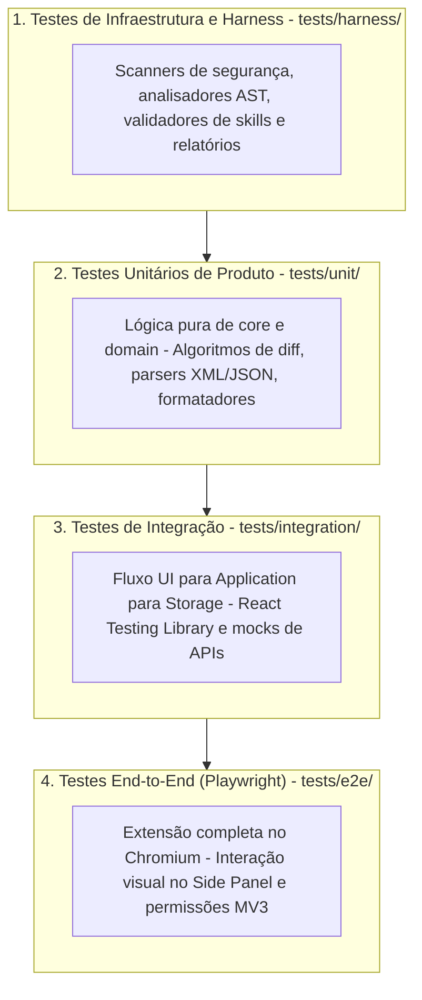
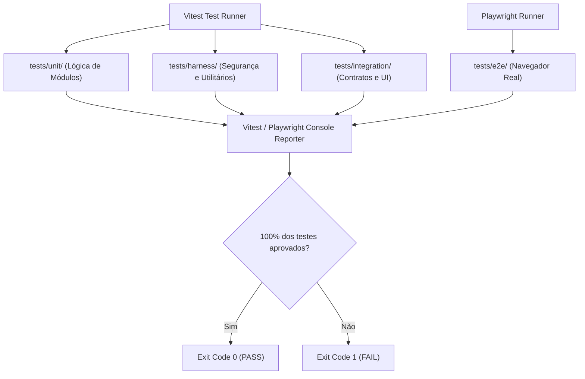

# QG-04 — Automated Testing

> **Quality Gate:** QG-04  
> **Nome Canônico:** Automated Testing (Testes Automatizados e Prevenção de Regressões)  
> **Classificação:** FUNCTIONAL INTEGRITY & REGRESSION PREVENTION  
> **Documento Canônico:** `docs/quality-gates/04-automated-testing.md`  
> **Arquitetura Base:** `ARCHITECTURE.md` (Seção 7 — Estratégia de Testabilidade)  
> **Status:** Parcialmente Implementado (Suíte do Harness com 60 testes aprovada; testes unitários e de integração de produto aguardando implementação de features em M3+)  

---

## 1. Identificação

| Atributo | Especificação Canônica |
| :--- | :--- |
| **ID** | `QG-04` |
| **Nome** | Automated Testing |
| **Categoria** | Testes / Qualidade Funcional |
| **Prioridade** | **Essencial (P0 / Crítica)** |
| **Milestone Relacionada** | M0/M2 (Harness Tests), M3 a M8 (Product Tests) |
| **Estado da Implementação** | `Parcialmente implementado` (Suíte Vitest do Harness validada; testes de produto estruturados com `.gitkeep`) |
| **Dependências Técnicas** | Vitest 5.1+, Playwright 1.64+, Node.js >= 20 |
| **Mecanismos Relacionados** | `pnpm run test:security`, `pnpm run test:unit`, `pnpm run test:e2e`, `QAL-02` (`test-scripts-suite.mjs` - Planejado) |
| **Diretórios de Teste** | `tests/unit/`, `tests/integration/`, `tests/e2e/`, `tests/harness/`, `tests/harness/fixtures/` |
| **Hooks e Pipelines** | Pré-push (harness e unitários rápidos), CI (`security-guard.yml` expandido) |

---

## 2. Responsabilidade

O `QG-04` é responsável por garantir que as funcionalidades, regras de transformação, parsers, persistência, contratos e integrações do ExtensionTools funcionem exatamente conforme especificado e permaneçam imunes a regressões lógicas ao longo do ciclo de vida da aplicação.

O gate assegura que nenhuma alteração de código seja integrada ou publicada sem a comprovação mecânica de testes determinísticos que desafiem casos positivos, negativos e condições de borda.

---

## 3. Problema Resolvido

A ausência de uma pirâmide de testes rigorosa no desenvolvimento com agentes autônomos e humanos acarreta:
1. **Regressões Silenciosas:** Modificações pontuais em uma biblioteca de diff ou parser de XML que quebram o processamento de entidades HTML ou caracteres especiais sem disparar erros de compilação.
2. **Fragilidade de Mocks Excessivos:** Testes que passam com 100% de cobertura teórica porque todos os componentes externos estão mockados de forma irrealista, falhando catastrófica e instantaneamente no navegador real.
3. **Flakiness (Instabilidade Intermitente):** Testes concorrentes mal isolados, dependentes de relógio local ou com temporizadores arbitrários (`setTimeout`), gerando falsas falhas e desconfiança na esteira.
4. **Testes Superficiais ("Tautológicos"):** Testes que apenas verificam se uma função foi chamada com determinados parâmetros sem avaliar o resultado concreto ou o estado resultante.

---

## 4. Fundamentos Técnicos

### 4.1. Pirâmide de Testes no ExtensionTools
O ExtensionTools adota uma estratégia pragmática de testes dividida em quatro camadas de isolamento decrescente:

### 4.2. Qualidade de Asserção sobre Cobertura Numérica Arbitrária
A governança do projeto rejeita metas arbitrárias de cobertura (e.g. "exigir 90% em tudo"), pois tais métricas incentivam testes triviais sem asserções profundas. A prioridade é:
- **100% de Cobertura Lógica em Funções Críticas de `core/` e `domain/`:** Casos de sucesso, erro e limites numéricos.
- **Asserções Semânticas:** Uso de checagens de propriedades reais e imutabilidade de estado.
- **Testes Negativos Mandatórios:** Todo caso de uso deve possuir testes comprovando que entradas inválidas disparam as exceções e erros de domínio adequados.

---

## 5. Funcionamento Previsto

### 5.1. Comportamento Implementado e Comprovado
- **Suíte de Testes do Harness (`pnpm run test:security`):** Executa suíte Vitest focada em infraestrutura e segurança em `tests/harness/`:
  - 60 testes automatizados cobrindo `fs-utils`, `git-utils`, `logger`, `ast-analyzer`, `validate-skills`, `validate-reports` e scanners de segurança.
  - Execução pura em ESM, sem dependências de frameworks pesados, rodando em sub-segundos.
  - Integrada com sucesso ao workflow do GitHub Actions (`.github/workflows/security-guard.yml`).

### 5.2. Comportamento Previsto para as Próximas Milestones (M3 a M8)
- **Testes Unitários de Features (`pnpm run test:unit`):** Serão ativados a partir de M4 (com a implementação do piloto `text-diff`), focando na suíte de algoritmos em `src/features/*/core/`.
- **Testes de Integração (`tests/integration/`):** Validação de adapters de armazenamento local (IndexedDB fake) e barramento de mensagens.
- **Testes E2E com Playwright (`pnpm run test:e2e`):** Execução da extensão carregada como unpacked no Chromium headless, garantindo que o Side Panel abra e responda a cliques.

---

## 6. Regras Verificáveis

| Código da Regra | Camada | Condição de Reprovação (FAIL) | Ação / Código |
| :--- | :--- | :--- | :---: |
| **TST-R01** | Todas | Qualquer teste que falhar em uma suíte executada | `exit 1` |
| **TST-R02** | Unit / Core | Funções de parsing e manipulação de dados sem testes de borda (entradas nulas, vazias, malformadas) | `exit 1` |
| **TST-R03** | Test Harness | Teste com comportamento instável (*flaky*) identificado em três execuções consecutivas | `exit 1` |
| **TST-R04** | Asserções | Teste que executa código sem asserção explícita (`expect`) | `exit 1` |
| **TST-ERR01** | Runtime | Falha de carregamento do Vitest, timeout de runner ou falha no setup de fixtures | `exit 2` |

---

## 7. Integração Arquitetural

---

## 8. Ferramentas e Implementação

- **Test Runner Primário:** `vitest` (v5.1.0) configurado para execução ESM nativa com suporte a TypeScript.
- **Test Runner E2E de Extensões:** `@playwright/test` (v1.64.1).
- **Módulos de Teste Atuais:**
  - `tests/harness/security/security-scanners.test.ts`
  - `tests/harness/security/git-integration.test.ts`
  - `tests/harness/lib/ast-analyzer.test.ts`
  - `tests/harness/lib/fs-utils.test.ts`
  - `tests/harness/lib/git-utils.test.ts`
  - `tests/harness/lib/logger.test.ts`
  - `tests/harness/quality/validate-skills.test.ts`
  - `tests/harness/quality/validate-reports.test.ts`
- **Comandos no `package.json`:**
  - `pnpm run test:security`
  - `pnpm run test:unit`
  - `pnpm run test:e2e`

---

## 9. Estratégia de Testes

- **Isolamento Total em Memória:** Testes unitários de `core/` não dependem de sistema de arquivos nem de variáveis globais de ambiente.
- **Fixtures Sintéticas Sanitizadas:** Utilização de arquivos de teste estritamente sintéticos (`document-example.xml`, `sample-data.json`), sem dados reais de produção.
- **Testes Adversariais:** Submissão de entradas maliciosas (e.g. payloads XML com entidades externas DTD, strings com injeção de script) para certificar que parsers falham de forma segura.
- **Mutation Testing (Técnica Complementar):** Aplicação de testes de mutação em pontos críticos do harness (como nos scanners de segredos) para confirmar que testes falham se a lógica do scanner for deliberadamente alterada.

---

## 10. Falsos Positivos e Falsos Negativos

### 10.1. Mitigação de Falsos Positivos
- **Eliminação de Dependências de Tempo Real:** Proibição de asserções dependentes de `Date.now()` ou intervalos de tempo arbitrários; uso de mocks de relógio do Vitest (`vi.useFakeTimers()`).
- **Limpeza Rigorosa de Estado:** Garantia de que cada teste limpa seus arquivos temporários ou registros de memória em blocos `afterEach` ou `afterAll`.

### 10.2. Mitigação de Falsos Negativos
- **Proibição de Asserções Vagas:** Substituição de asserções frouxas como `expect(result).toBeDefined()` por asserções de igualdade estrita `expect(result).toEqual(...)`.
- **Verificação de Tratamento de Rejeições:** Comprovação de que Promises rejeitadas são explicitamente capturadas e testadas (`await expect(...).rejects.toThrow(...)`).

---

## 11. Critérios de Aceitação

Para aprovação do `QG-04`:
1. **Taxa de Aprovação:** 100% dos testes executados na suíte correspondente devem passar com sucesso.
2. **Determinismo:** Nenhuma falha intermitente observada em múltiplas execuções no mesmo commit.
3. **Desempenho da Suíte:** A suíte de testes unitários e de harness deve executar em menos de 10 segundos no ambiente de desenvolvimento local.
4. **Sem Alertas de Descontinuação Críticos:** Zero avisos não tratados de APIs deprecadas emitidos pelo runner de testes.

---

## 12. Evolução Planejada

1. **Ativação da Suíte de Unidade em M4:** Desenvolvimento dos testes unitários para a feature piloto `text-diff`.
2. **Script `QAL-02` (`test-scripts-suite.mjs`):** Validador formal e runner unificado da suíte do harness (Fase 2 de Scripts).
3. **Ambiente E2E de Extensão em M6:** Configuração completa do Playwright com perfil do Chrome pré-carregado com a extensão para validar renderização no Side Panel.

---

## 13. Referências

- **Arquitetura Base:** [`ARCHITECTURE.md`](../../ARCHITECTURE.md) (Seção 7)
- **Harness Architecture:** [`docs/architecture/HARNESS-ARCHITECTURE.md`](../architecture/HARNESS-ARCHITECTURE.md)
- **Relatório de Validação H2:** [`docs/Relatorios/m2/phase-2-skills-canonicas/H2-SKILLS-FORMALIZATION-REPORT.md`](../Relatorios/m2/phase-2-skills-canonicas/H2-SKILLS-FORMALIZATION-REPORT.md)
- **Configuração de Dependências:** [`package.json`](../../package.json)
