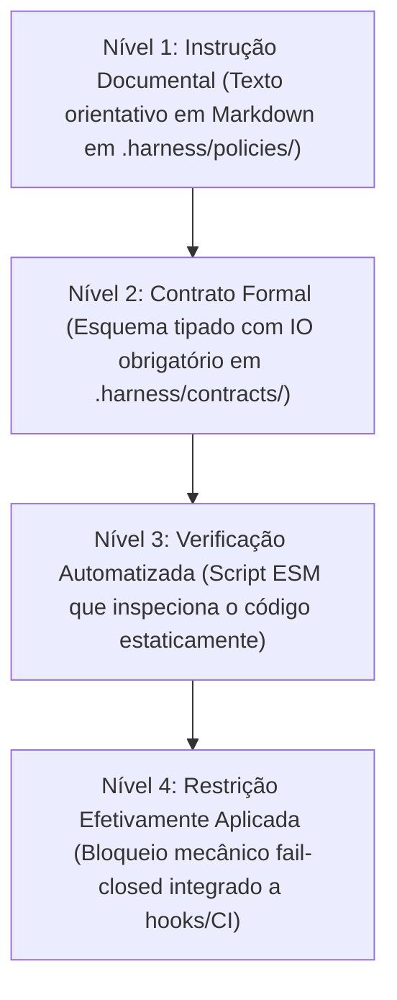
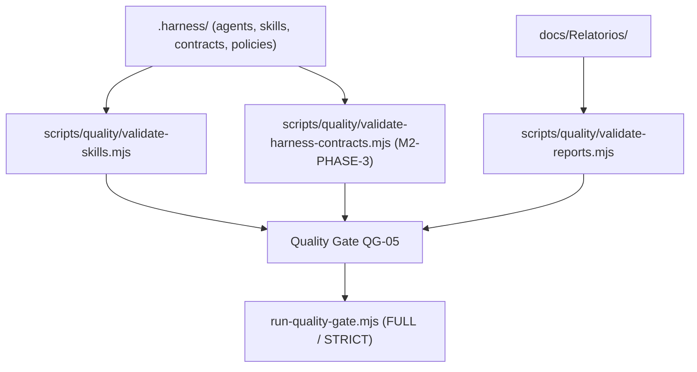

# QG-05 — Harness Compliance

> **Quality Gate:** QG-05  
> **Nome Canônico:** Harness Compliance (Conformidade Estrutural do Harness)  
> **Classificação:** HARNESS GOVERNANCE & AI CONTRACT ENFORCEMENT  
> **Documento Canônico:** `docs/quality-gates/05-harness-compliance.md`  
> **Harness de Referência:** `docs/architecture/HARNESS-ARCHITECTURE.md`  
> **Status:** Parcialmente Implementado (Validadores de skills e relatórios ativos; contratos e políticas em formalização na M2-PHASE-3)  

---

## 1. Identificação

| Atributo | Especificação Canônica |
| :--- | :--- |
| **ID** | `QG-05` |
| **Nome** | Harness Compliance |
| **Categoria** | Governança / Harness / Agentes e Skills |
| **Prioridade** | **Essencial (P1 / Alta)** |
| **Milestone Relacionada** | M0 (Setup Inicial), M2-PHASE-2 (Skills), M2-PHASE-3 (Contratos e Políticas) |
| **Estado da Implementação** | `Parcialmente implementado` (Validação de Skills e Relatórios concluída; validação de Contratos/Políticas planejada) |
| **Dependências Técnicas** | Node.js >= 20, scripts ESM de qualidade em `scripts/quality/` |
| **Mecanismos Relacionados** | `validate-skills.mjs`, `validate-reports.mjs`, scripts planejados de auditoria de contratos |
| **Diretórios Governados** | `.harness/agents/`, `.harness/skills/`, `.harness/contracts/`, `.harness/policies/`, `.harness/config/` |
| **Hooks e Pipelines** | Modo FULL / STRICT no orquestrador `run-quality-gate.mjs`, CI |

---

## 2. Responsabilidade

O `QG-05` é responsável por validar a conformidade estrutural, sintática, normativa e semântica de todos os artefatos que compõem o **Harness de Engenharia Assistida por IA** do ExtensionTools.

O gate assegura que agentes, skills, contratos de entrada/saída, políticas técnicas e configurações do Harness atendam rigorosamente aos seus esquemas definidos, possuam metadados válidos, respeitem as restrições de repositório público e não apresentem dependências circulares ou regras conflitantes.

---

## 3. Problema Resolvido

Em ecossistemas de desenvolvimento com múltiplos agentes de IA especializados (Architect, Developer, Security Auditor, etc.), a degradação de instruções e templates é um risco contínuo. Este gate resolve:
1. **Corrupção de Metadados e Frontmatter:** Arquivos de skill ou agente com blocos YAML malformados que impedem o reconhecimento ou a injeção de contexto pelo sistema.
2. **Omissão de Seções Normativas Críticas:** Documentos de skills sem matriz de tratamento de erros, sem critérios de aceitação ou sem políticas anti-alucinação.
3. **Ilusão de Aplicação Técnica de Políticas:** Confundir a existência de um arquivo Markdown meramente descritivo com uma restrição efetivamente aplicada e auditada por código real.
4. **Dispersão Documental de Agentes:** Criação ad hoc de subagentes ou skills duplicadas que competem entre si ou desrespeitam o catálogo oficial.
5. **Vazamento de Referências e Caminhos Privados nas Instruções:** Inclusão acidental de caminhos absolutos locais de desenvolvedores dentro de prompts ou templates versionados.

---

## 4. Fundamentos Técnicos

### 4.1. Os Quatro Níveis de Rigor do Harness
Para evitar declarações falsas de conformidade, o `QG-05` opera com uma distinção explícita entre quatro níveis de formalização:

> [!IMPORTANT]
> **Invariante de Governança:**  
> O `QG-05` nunca declara que uma política de governança está "implementada" a menos que ela tenha atingido o **Nível 4** (código validador real + testes + integração a hooks/CI). A existência de arquivos Markdown representa apenas os Níveis 1 ou 2.

### 4.2. Estrutura Canônica das 9 Skills
Conforme validado em `M2-PHASE-2`, todo arquivo `.harness/skills/<skill-name>/SKILL.md` deve conter obrigatoriamente:
- Frontmatter YAML com `name` e `description` idênticos ao catálogo canônico.
- As 13 seções essenciais obrigatórias (Identificação, Propósito, Escopo, Condições de Ativação, Pré-requisitos, Fontes de Verdade, Contrato de Entrada, Contrato de Saída, Procedimento Passo a Passo, Ferramentas, Matriz de Erros, Política Anti-Alucinação e Critérios de Aceitação).
- Ausência total de caminhos privados ou menções confidenciais.

---

## 5. Funcionamento Previsto

### 5.1. Comportamento Implementado e Comprovado
- **Validador de Skills (`scripts/quality/validate-skills.mjs`):**
  - Varre todas as subpastas de `.harness/skills/`.
  - Audita a existência exata das 9 skills canônicas (`architecture-review`, `code-review`, `documentation`, `implementation`, `public-repository-safety`, `release-validation`, `script-development`, `security-audit`, `testing`).
  - Realiza parsing estrito do frontmatter YAML sem bibliotecas externas.
  - Verifica a presença integral das 13 seções obrigatórias.
  - Testa ausência de caminhos privados locais.
  - Validado por suíte de testes Vitest em `tests/harness/quality/validate-skills.test.ts`.
- **Validador de Relatórios (`scripts/quality/validate-reports.mjs`):**
  - Audita se relatórios residem exclusivamente sob `docs/Relatorios/` e possuem índice `README.md`.
  - Validado por testes em `tests/harness/quality/validate-reports.test.ts`.

### 5.2. Comportamento Proposto / Em Desenvolvimento (M2-PHASE-3)
- **Validador de Contratos e Políticas (`validate-harness-contracts.mjs`):**
  - Auditoria dos esquemas de IO em `.harness/contracts/`.
  - Verificação de referências cruzadas entre agentes e skills (garantindo que agentes referenciem apenas skills reais).
  - Validação de que nenhuma política em `.harness/policies/` contradiga as diretrizes de `ARCHITECTURE.md` ou `SECURITY.md`.

---

## 6. Regras Verificáveis

| Código da Regra | Componente | Condição de Reprovação (FAIL) | Ação / Código |
| :--- | :--- | :--- | :---: |
| **HAR-R01** | Skills | Arquivo `SKILL.md` ausente em qualquer uma das 9 pastas canônicas | `exit 1` |
| **HAR-R02** | Skills | Frontmatter YAML corrompido, incompleto ou com nome divergente da pasta | `exit 1` |
| **HAR-R03** | Skills | Omissão de qualquer uma das 13 seções normativas obrigatórias | `exit 1` |
| **HAR-R04** | Agentes | Agente em `.harness/agents/` referenciando skill ou contrato inexistente | `exit 1` |
| **HAR-R05** | Contratos | Esquema de entrada/saída violado ou contrato corrompido em `.harness/contracts/` | `exit 1` |
| **HAR-R06** | Segurança | Presença de caminho absoluto de desenvolvedor em qualquer artefato do Harness | `exit 1` |
| **HAR-ERR01** | Runtime | Erro de IO ou permissão ao varrer o diretório `.harness/` | `exit 2` |

---

## 7. Integração Arquitetural

---

## 8. Ferramentas e Implementação

- **Scripts Existentes:**
  - `scripts/quality/validate-skills.mjs`
  - `scripts/quality/validate-reports.mjs`
- **Artefatos Auditados:**
  - `.harness/skills/*/SKILL.md` (9 skills canônicas)
  - `.harness/agents/*.md` (9 agentes canônicos)
  - `.harness/contracts/`
  - `.harness/policies/`
  - `.harness/templates/skill-template.md`
- **Testes Unitários:**
  - `tests/harness/quality/validate-skills.test.ts`
  - `tests/harness/quality/validate-reports.test.ts`

---

## 9. Estratégia de Testes

- **Testes Positivos:** Validação de que os arquivos reais do repositório passam sem nenhum alerta.
- **Testes Negativos com Fixtures Temporárias:**
  - Simulação de uma skill com YAML corrompido em `tmpdir` (deve falhar com `exit 1`).
  - Simulação de skill faltando uma das 13 seções (deve reportar a regra `MISSING_REQUIRED_SECTION`).
  - Injeção de caminho privado sintético `/home/<dev>/` dentro de um `SKILL.md` (deve reprovar com `PRIVATE_PATH_DETECTED`).
- **Testes de Resiliência:** Arquivo sem permissão de leitura deve emitir `exit 2` e mensagem explicativa.

---

## 10. Falsos Positivos e Falsos Negativos

### 10.1. Mitigação de Falsos Positivos
- **Tolerância a Formatações de Bloco YAML:** O parser nativo de frontmatter suporta delimitadores multilinha (`>`, `|`, `>-`) para descrições longas de skills sem disparar erros espúrios de parsing.

### 10.2. Mitigação de Falsos Negativos
- **Inspeção de Cabeçalhos Exatos:** O validador compara o texto dos cabeçalhos das seções normalizando espaços, impedindo que títulos parecidos porém incorretos mascarem a ausência da seção canônica.

---

## 11. Critérios de Aceitação

Para homologação do `QG-05`:
1. **100% das 9 Skills Válidas:** `validate-skills.mjs` encerra com código `0`.
2. **Governança de Relatórios Limpa:** `validate-reports.mjs` encerra com código `0`.
3. **Consistência de Contratos:** Zero referências quebradas entre agentes e skills.
4. **Auditabilidade Comprovada:** Testes automatizados do validador passando com 100% de sucesso no Vitest.

---

## 12. Evolução Planejada

1. **Conclusão da M2-PHASE-3:** Criação e validação automatizada dos contratos de IO de agentes em `.harness/contracts/` e políticas em `.harness/policies/`.
2. **Linter Semântico de Agentes:** Verificação automática de prompts de agentes para prevenir instruções ambíguas ou alucinações de escopo.
3. **Exportação de Matriz de Capacidades:** Script para consolidar automaticamente a tabela de agentes e skills para visualização em `README.md` e relatórios.

---

## 13. Referências

- **Harness Architecture:** [`docs/architecture/HARNESS-ARCHITECTURE.md`](../architecture/HARNESS-ARCHITECTURE.md)
- **Instruções Universais de Agentes:** [`AGENTS.md`](../../AGENTS.md)
- **Relatório de Homologação H2:** [`docs/Relatorios/m2/phase-2-skills-canonicas/H2-SKILLS-FORMALIZATION-REPORT.md`](../Relatorios/m2/phase-2-skills-canonicas/H2-SKILLS-FORMALIZATION-REPORT.md)
- **Validador de Skills:** [`scripts/quality/validate-skills.mjs`](../../scripts/quality/validate-skills.mjs)
- **Validador de Relatórios:** [`scripts/quality/validate-reports.mjs`](../../scripts/quality/validate-reports.mjs)
