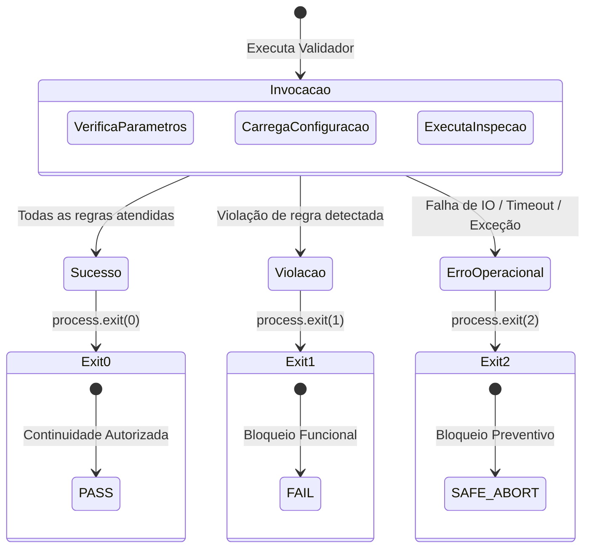
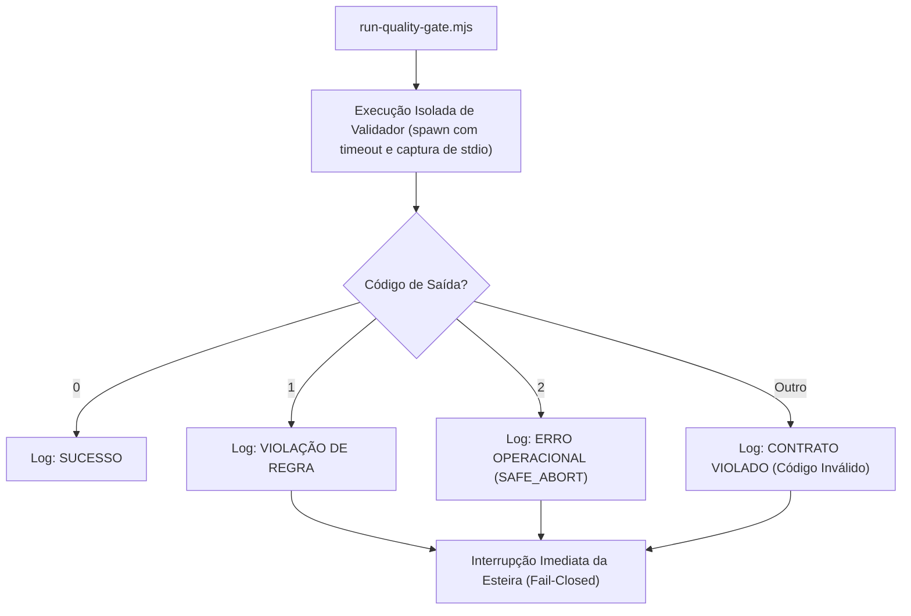

# QG-06 — Validator Reliability

> **Quality Gate:** QG-06  
> **Nome Canônico:** Validator Reliability (Confiabilidade e Resiliência dos Validadores)  
> **Classificação:** META-QUALITY & VALIDATOR INTEGRITY  
> **Documento Canônico:** `docs/quality-gates/06-validator-reliability.md`  
> **Harness de Referência:** `docs/architecture/HARNESS-ARCHITECTURE.md`  
> **Status:** Implementado e Validado (Biblioteca utilitária robusta em `scripts/lib/`, contrato de exit codes comprovado e suíte de testes adversariais ativa)  

---

## 1. Identificação

| Atributo | Especificação Canônica |
| :--- | :--- |
| **ID** | `QG-06` |
| **Nome** | Validator Reliability |
| **Categoria** | Meta-Qualidade / Integridade Operacional |
| **Prioridade** | **Essencial (P0 / Crítica)** |
| **Milestone Relacionada** | M2 (Fases 0 e 1 de Scripts), Governança Contínua |
| **Estado da Implementação** | `Implementado e validado` |
| **Dependências Técnicas** | Node.js >= 20, `scripts/lib/` (fs-utils, git-utils, logger) |
| **Mecanismos Relacionados** | Contrato de Exit Codes (`0`, `1`, `2`), Tratamento de Subprocessos com Timeout, Gestão Atômica de `tmpdir` |
| **Testes de Validação** | `tests/harness/lib/*.test.ts`, `tests/harness/security/security-scanners.test.ts`, `tests/harness/quality/*.test.ts` |
| **Hooks e Pipelines** | Todos os modos do orquestrador de Quality Gates e CI |

---

## 2. Responsabilidade

O `QG-06` é o Quality Gate de **meta-qualidade** responsável por auditar a confiabilidade, o determinismo, a tolerância a falhas e a resiliência dos próprios scripts, scanners e validadores que compõem o sistema de Quality Gates do ExtensionTools.

Ele garante que nenhum validador falhe silenciosamente, que erros inesperados de infraestrutura sejam traduzidos em bloqueio imediato (*fail-closed*), que recursos temporários sejam limpos de forma atômica e que nenhum teste ou scanner produza falsas aprovações (*silent passes*).

---

## 3. Problema Resolvido

Mecanismos de verificação de qualidade são softwares e, como tais, estão sujeitos a defeitos, fragilidades operacionais e suposições ingênuas de ambiente. O `QG-06` elimina:
1. **Falso Sucesso por Falha Operacional (*Silent Pass*):** Um scanner que não consegue ler um arquivo de configuração restrito ou falha ao executar um comando Git e encerra com código `0` em vez de abortar.
2. **Vazamento de Arquivos Temporários:** Scripts de teste que criam diretórios em `tmpdir` e os deixam órfãos após falhas inesperadas, degradando o disco e o ambiente de desenvolvimento.
3. **Bloqueio Indefinido por Subprocessos Travados (*Hanging Processes*):** Subprocessos ou chamadas de sistema que congelam indefinidamente sem limite de tempo (*timeout*), travando pipelines de CI e hooks locais.
4. **Instabilidade por Ambiguidade de Exit Codes:** Scripts que retornam código `-1`, strings ou valores inconsistentes que impedem o orquestrador de distinguir falha funcional de falha operacional.
5. **Comportamento Não-Determinístico:** Validadores cujos resultados oscilam dependendo da ordem de leitura do sistema de arquivos ou de variáveis de ambiente não declaradas.

---

## 4. Fundamentos Técnicos

### 4.1. O Contrato Canônico Universal de Exit Codes
Todos os scripts de validação, scanners e orquestradores do ExtensionTools são estritamente obrigados a aderir ao contrato triplo de códigos de saída:

- **`0` — PASS:** Execução concluída com sucesso. Zero violações encontradas.
- **`1` — FAIL:** Violação legítima de regra de negócio ou qualidade detectada (e.g. segredo encontrado, import proibido). Bloqueio seguro.
- **`2` — SAFE_ABORT:** Erro operacional impeditivo (e.g. arquivo de configuração ilegível, Git CLI ausente, JSON corrompido, timeout). Bloqueio preventivo obrigatório.

### 4.2. Gestão Segura de Recursos e Filesystem (`scripts/lib/fs-utils.mjs`)
- **Limpeza Garantida:** Criação de diretórios temporários via `fs.mkdtemp` envelopada em blocos `try...finally` determinísticos para assegurar remoção recursiva mesmo sob exceções não tratadas (`rmSync(tmp, { recursive: true, force: true })`).
- **Resolução Canônica de Caminhos:** Normalização obrigatória de caminhos de arquivos para formato POSIX (`/`), prevenindo divergências entre Linux, macOS e Windows.

### 4.3. Execução Controlada de Subprocessos (`scripts/lib/git-utils.mjs`)
- Execução de binários externos via `node:child_process` com limites explícitos de buffer de saída (`maxBuffer: 10 * 1024 * 1024`) e cancelamento forçado por timeout.

---

## 5. Funcionamento Previsto

### 5.1. Comportamento Implementado e Comprovado
A confiabilidade dos validadores já é garantida pela biblioteca de utilitários em `scripts/lib/`:
- **`logger.mjs`:** Formata mensagens estruturadas com timestamps, níveis (`INFO`, `WARN`, `ERROR`, `SUCCESS`) e suporte a supressão de cores em pipelines não-interativos (`NO_COLOR`).
- **`fs-utils.mjs`:** Métodos seguros de varredura recursiva (`walkDirectory`), leitura segura de JSON (`readJsonSafe`) e checagem de existência.
- **`git-utils.mjs`:** Abstração de baixo nível para consulta do Git, testada inclusive em cenários extremos como repositórios recém-inicializados sem nenhum commit (`HEAD` órfão) e working trees limpas.

### 5.2. Governança Contínua para Novos Scripts
Todo novo script de validação desenvolvido para o projeto (seja em arquitetura, documentação ou release) deve obrigatoriamente:
1. Importar os utilitários de `scripts/lib/`.
2. Conter bloco `try...catch` de nível superior que capture qualquer exceção inesperada e encerre com `exit 2`.
3. Possuir uma suíte dedicada de testes no diretório `tests/harness/` que simule cenários de falha.

---

## 6. Regras Verificáveis

| Código da Regra | Condição de Reprovação (FAIL) | Ação / Código |
| :--- | :--- | :---: |
| **REL-R01** | Script validador encerra com código diferente de `0`, `1` ou `2` | `exit 1` |
| **REL-R02** | Bloco `catch` em script de validação que suprime erro e encerra com `exit 0` (*silent pass*) | `exit 1` |
| **REL-R03** | Subprocesso que excede o tempo limite de execução configurado (Timeout) | `exit 2` |
| **REL-R04** | Resíduos de diretórios temporários deixados em disco após a execução dos testes | `exit 1` |
| **REL-R05** | Validador apresentando comportamentos divergentes em execuções sucessivas sobre o mesmo commit | `exit 1` |
| **REL-ERR01** | Falha interna no runner de testes ou indisponibilidade de memória de subprocesso | `exit 2` |

---

## 7. Integração Arquitetural

---

## 8. Ferramentas e Implementação

- **Módulos Centrais de Confiabilidade:**
  - `scripts/lib/fs-utils.mjs`
  - `scripts/lib/git-utils.mjs`
  - `scripts/lib/logger.mjs`
  - `scripts/lib/ast-analyzer.mjs`
- **Suíte de Testes de Confiabilidade:**
  - `tests/harness/lib/fs-utils.test.ts`
  - `tests/harness/lib/git-utils.test.ts`
  - `tests/harness/lib/logger.test.ts`
  - `tests/harness/lib/ast-analyzer.test.ts`
- **Plataforma:** Node.js v20+ ESM nativo.

---

## 9. Estratégia de Testes

- **Testes Adversariais dos Utilitários:**
  - Simulação de comandos Git inexistentes ou que falham com código de erro diferente de zero.
  - Leitura de arquivos inexistentes ou corrompidos verificando o retorno seguro de `null` ou emissão de `SAFE_ABORT`.
- **Testes de Isolamento de Git (`git-integration.test.ts`):**
  - Criação de múltiplos repositórios temporários em paralelo.
  - Verificação de comportamento em repositório sem branch `origin/main` configurada.
- **Testes de Integridade de Stream:** Comprovação de que saídas volumosas em stdout/stderr não causam estouro de buffer ou truncamento silencioso de mensagens de erro.

---

## 10. Falsos Positivos e Falsos Negativos

### 10.1. Mitigação de Falsos Positivos
- **Diferenciação Semântica de Exceções:** Distinguir claramente quando um arquivo não existe porque a regra exige que ele não exista (situação normal) de quando ele não existe por erro de caminho do validador (situação de erro operacional).

### 10.2. Mitigação de Falsos Negativos
- **Testes de Injeção de Falhas (Chaos Testing em Pequena Escala):** Os testes do harness intencionalmente alimentam os scanners com strings maliciosas e arquivos inválidos para comprovar que a detecção dispara infalivelmente.

---

## 11. Critérios de Aceitação

Para homologação do `QG-06`:
1. **Contrato Estrito de Saída:** 100% dos scripts em `scripts/` aderem ao contrato de exit codes `0`, `1` e `2`.
2. **Zero Falsas Aprovações:** Comprovação em testes de que falhas de IO ou arquivos ausentes resultam em bloqueio (`exit 2`).
3. **Idempotência e Determinismo:** Execuções repetidas do mesmo validador produzem logs e decisões idênticas.
4. **Resiliência a Ambientes Sem Commits:** Os scanners e ferramentas Git devem operar sem quebras em repositórios recém-clonados ou sem histórico prévio.

---

## 12. Evolução Planejada

1. **Script `QAL-02` (`test-scripts-suite.mjs`):** Validador autônomo para rodar todas as suítes de testes do harness com geração de relatório JSON de telemetria.
2. **Framework de Testes de Mutação para Scripts:** Automação de injeção de mutantes (e.g. trocar `>=` por `>`, inverter booleanos) nos scanners de segurança para auditar se a suíte de testes detecta as alterações.
3. **Monitoramento de Memória e Recursos:** Adição de medição de pegada de memória durante a varredura para garantir que os validadores operem com baixo consumo de RAM.

---

## 13. Referências

- **Harness Architecture:** [`docs/architecture/HARNESS-ARCHITECTURE.md`](../architecture/HARNESS-ARCHITECTURE.md)
- **Relatório de Planejamento de Scripts:** [`docs/Relatorios/m2/planejamento-scripts/RELATORIO-PLANEJAMENTO-DESENVOLVIMENTO-SCRIPTS.md`](../Relatorios/m2/planejamento-scripts/RELATORIO-PLANEJAMENTO-DESENVOLVIMENTO-SCRIPTS.md)
- **Biblioteca Base de Filesystem:** [`scripts/lib/fs-utils.mjs`](../../scripts/lib/fs-utils.mjs)
- **Biblioteca Base de Git:** [`scripts/lib/git-utils.mjs`](../../scripts/lib/git-utils.mjs)
- **Biblioteca Base de Logger:** [`scripts/lib/logger.mjs`](../../scripts/lib/logger.mjs)
