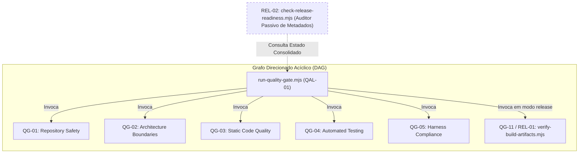
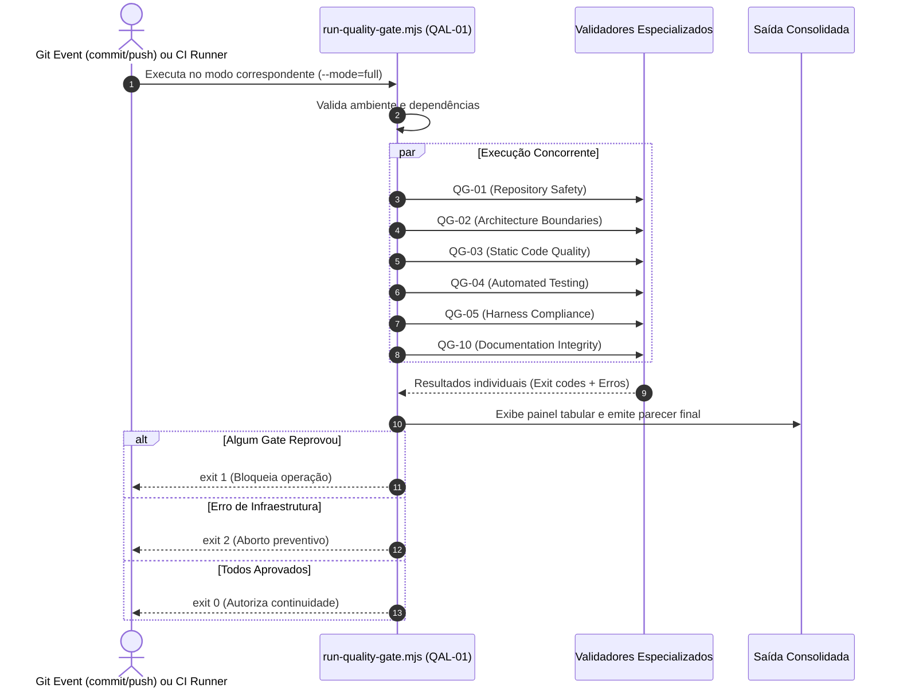

# QG-07 — Pipeline Integration

> **Quality Gate:** QG-07  
> **Nome Canônico:** Pipeline Integration (Integração e Orquestração da Esteira de Qualidade)  
> **Classificação:** WORKFLOW ORCHESTRATION & CI/CD GOVERNANCE  
> **Documento Canônico:** `docs/quality-gates/07-pipeline-integration.md`  
> **Harness de Referência:** `docs/architecture/HARNESS-ARCHITECTURE.md`  
> **Status:** Parcialmente Implementado (Git Hooks e GitHub Actions ativos; orquestrador CLI `QAL-01` planejado na Fase 2 de Scripts)  

---

## 1. Identificação

| Atributo | Especificação Canônica |
| :--- | :--- |
| **ID** | `QG-07` |
| **Nome** | Pipeline Integration |
| **Categoria** | Orquestração / CI/CD / Automação |
| **Prioridade** | **Essencial (P0 / Crítica)** |
| **Milestone Relacionada** | M0/M2 (Hooks e CI Básico), M2 (Fase 2 de Scripts — `QAL-01`), M8 (Release Pipeline) |
| **Estado da Implementação** | `Parcialmente implementado` (Hooks Git e Workflow GitHub Actions funcionais; runner `QAL-01` especificado) |
| **Dependências Técnicas** | Node.js >= 20, pnpm 12+, Git CLI, GitHub Actions Runner |
| **Mecanismos Relacionados** | `QAL-01` (`run-quality-gate.mjs`), `.githooks/pre-commit`, `.githooks/pre-push`, `.github/workflows/security-guard.yml` |
| **Modos Suportados** | `FAST`, `FULL`, `STRICT`, `RELEASE` |
| **Hooks e Pipelines** | Git Hooks locais, CI em Pull Requests e Pushes na branch principal |

---

## 2. Responsabilidade

O `QG-07` é responsável por integrar e orquestrar harmonicamente todos os Quality Gates nos pontos críticos do fluxo de engenharia de software (SDLC) do ExtensionTools.

Ele garante que as verificações corretas sejam acionadas no momento adequado (evitando lentidão desnecessária no ciclo de edição e assegurando auditoria completa antes da mesclagem ou distribuição), propagando erros com política *fail-closed*, registrando evidências auditáveis e mantendo um grafo de execução estritamente acíclico.

---

## 3. Problema Resolvido

A ausência de uma integração orquestrada e padronizada de qualidade resulta em:
1. **Sobrecarga e Fricção no Desenvolvimento Local:** Hooks de pré-commit lentos (rodando suítes pesadas de E2E a cada pequeno commit), levando desenvolvedores a burlar as verificações com `git commit --no-verify`.
2. **Divergência entre Validação Local e CI:** Comandos que passam na máquina do engenheiro mas quebram na nuvem por diferenças de argumentos, caminhos ou versões de dependências.
3. **Dependências Circulares em Pipelines de Release:** O orquestrador chamando o script de release, que por sua vez chama o orquestrador recursivamente, gerando loops infinitos ou travas.
4. **Falta de Padronização de Logs e Evidências:** Cada ferramenta gerando saída em formatos dispersos sem consolidação de status final.

---

## 4. Fundamentos Técnicos

### 4.1. Desacoplamento Acíclico de Execução
Para eliminar qualquer risco de chamada circular entre a esteira de qualidade e a esteira de publicação (conforme formalizado no relatório técnico `RELATORIO-PLANEJAMENTO-DESENVOLVIMENTO-SCRIPTS.md`), o `QG-07` estabelece a seguinte topologia de execução direcionada:

- **`run-quality-gate.mjs` (`QAL-01`):** É o **orquestrador ativo**. Ele encadeia subprocessos, captura exit codes, formata o painel final e decide o resultado booleano da esteira.
- **`check-release-readiness.mjs` (`REL-02`):** É um **auditor passivo**. Ele valida metadados do `package.json`, conferência do `status.md` e limpeza do repositório Git. **Ele não invoca o Quality Gate internamente**; em vez disso, consulta o status da esteira. O grafo é estritamente acíclico.

### 4.2. Mapeamento dos 4 Modos Operacionais

| Modo | Gatilho | Gates Executados | Alvo Temporal | Tolerância a Falha |
| :--- | :--- | :--- | :---: | :---: |
| **`FAST`** | Pré-commit local (`git commit`) | `QG-01` (staged), `QG-03` (incremental) | < 2s | Zero violações |
| **`FULL`** | Pré-push local (`git push`), Pull Request CI | `QG-01`, `QG-02`, `QG-03`, `QG-04`, `QG-05`, `QG-10` | < 30s | Zero violações |
| **`STRICT`** | Mesclagem em `main`, Encerramento de Milestone | Todos do `FULL` + `QG-06` + `QG-08` + `QG-09` + Testes Integração | < 2min | Zero violações |
| **`RELEASE`**| Tagging de versão, Preparação para Chrome Web Store | Todos do `STRICT` + `QG-11` + `QG-12` + `QG-13` | < 5min | Zero violações |

---

## 5. Funcionamento Previsto

### 5.1. Comportamento Implementado e Comprovado
- **Git Hooks Ativos:**
  - `.githooks/pre-commit`: Executa `node scripts/security/publication-guard.mjs staged`.
  - `.githooks/pre-push`: Executa `node scripts/security/publication-guard.mjs outgoing`.
- **Pipeline de Integração Contínua (GitHub Actions):**
  - Workflow `.github/workflows/security-guard.yml` dispara em pushes e PRs para as branches principais.
  - Configura Node.js 22 e pnpm com `--frozen-lockfile`.
  - Valida configuração de segurança pública.
  - Executa `publication-guard.mjs all`, `pnpm run test:security`, `pnpm run compile`, `pnpm run lint` e `pnpm run format:check`.

### 5.2. Comportamento Proposto / Em Desenvolvimento (Fase 2 de Scripts)
- **Implementação do `QAL-01` (`run-quality-gate.mjs`):**
  - CLI unificado com flag `--mode=<fast|full|strict|release>`.
  - Execução concorrente de gates independentes via `Promise.allSettled`.
  - Painel consolidado em terminal com cores, tempos de execução e resumo de falhas.
  - Geração de artefato JSON estruturado de evidência (`.output/quality-gate-report.json`).

---

## 6. Regras Verificáveis

| Código da Regra | Condição de Reprovação (FAIL) | Ação / Código |
| :--- | :--- | :---: |
| **PIP-R01** | Qualquer Quality Gate obrigatório do modo selecionado reprovar com exit code `1` | `exit 1` |
| **PIP-R02** | Qualquer validador sofrer falha operacional ou aborto seguro com exit code `2` | `exit 2` |
| **PIP-R03** | Tempo limite total de execução do pipeline exceder a tolerância estabelecida | `exit 2` |
| **PIP-R04** | Tentativa de invocação circular detectada na pilha de subprocessos | `exit 2` |
| **PIP-ERR01** | Ausência de ambiente mínimo (Node.js < 20 ou pnpm indisponível) | `exit 2` |

---

## 7. Integração Arquitetural

---

## 8. Ferramentas e Implementação

- **Orquestrador Previsto:** `scripts/quality/run-quality-gate.mjs` (`QAL-01`).
- **Hooks do Repositório:** `.githooks/pre-commit`, `.githooks/pre-push`.
- **Configuração de CI:** `.github/workflows/security-guard.yml`.
- **Gerenciador de Pacotes:** `pnpm` (v12.16.1) com travamento estrito de lockfile (`pnpm-lock.yaml`).
- **Node.js:** Versão LTS (v20+ localmente, v22 em CI).

---

## 9. Estratégia de Testes

- **Testes de Integração de Hooks (`tests/harness/security/git-integration.test.ts`):** Validação de que commits inválidos são interceptados pelo hook de pré-commit e pré-push em repositórios temporários.
- **Testes Unitários do Orquestrador `QAL-01` (`tests/harness/quality/run-quality-gate.test.ts`):**
  - Simulação de modos `fast`, `full`, `strict`, `release`.
  - Simulação de falha de um dos gates verificando se o orquestrador propaga o código `1`.
  - Simulação de erro operacional verificando propagação do código `2`.
  - Verificação de interrupção imediata (*short-circuit*) sob falha crítica de segurança.

---

## 10. Falsos Positivos e Falsos Negativos

### 10.1. Mitigação de Falsos Positivos
- **Execução Concorrente com Saída Normalizada:** Evitar interleaving de logs misturados no terminal que confundem o desenvolvedor; buffers são capturados separadamente e exibidos de forma estruturada ao final.

### 10.2. Mitigação de Falsos Negativos
- **Avaliação Agregada Estrita (`Promise.allSettled`):** O orquestrador aguarda a finalização de todas as checagens do modo para consolidar o relatório, mas se qualquer uma falhar, o status global é irrevogavelmente `REPROVADO`.

---

## 11. Critérios de Aceitação

Para homologação do `QG-07`:
1. **Orquestração Fluida:** Um comando único (`pnpm run quality:gate --mode=full`) executa a bateria completa e retorna em menos de 30 segundos.
2. **Propagação Correta de Status:** Falha em qualquer gate individual causa o encerramento do orquestrador com código `1` ou `2`.
3. **Paridade Local vs CI:** A execução local no modo correspondente produz exatamente a mesma decisão emitida na esteira do GitHub Actions.
4. **Ausência de Dependência Circular:** Grafo de chamadas entre scripts de qualidade e scripts de release estritamente direcionado e verificado.

---

## 12. Evolução Planejada

1. **Implementação de `QAL-01` na Fase 2 de Scripts:** Criação do script ESM do orquestrador.
2. **Dashboard de Telemetria Local:** Visualização simplificada de tendências de qualidade em formato markdown ou HTML local após execuções do modo STRICT.
3. **Cache Inteligente de Artefatos:** Reaproveitamento de checagens estáticas para arquivos inalterados entre execuções sucessivas no modo FAST.

---

## 13. Referências

- **Harness Architecture:** [`docs/architecture/HARNESS-ARCHITECTURE.md`](../architecture/HARNESS-ARCHITECTURE.md)
- **Relatório de Planejamento de Scripts:** [`docs/Relatorios/m2/planejamento-scripts/RELATORIO-PLANEJAMENTO-DESENVOLVIMENTO-SCRIPTS.md`](../Relatorios/m2/planejamento-scripts/RELATORIO-PLANEJAMENTO-DESENVOLVIMENTO-SCRIPTS.md)
- **Workflow do GitHub Actions:** [`.github/workflows/security-guard.yml`](../../.github/workflows/security-guard.yml)
- **Hooks do Git:** [`.githooks/pre-commit`](../../.githooks/pre-commit), [`.githooks/pre-push`](../../.githooks/pre-push)
