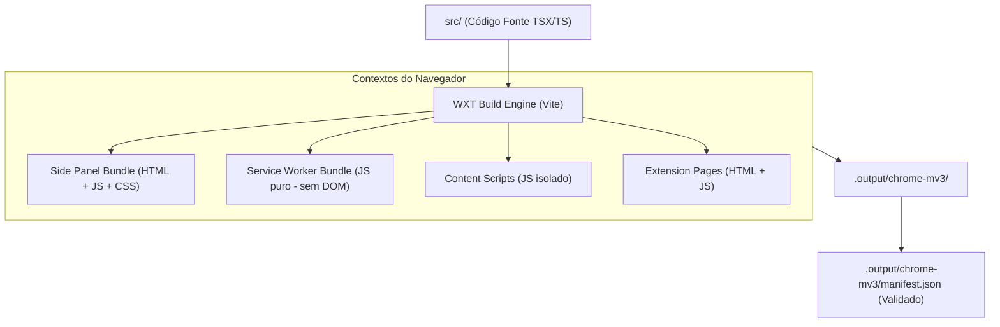
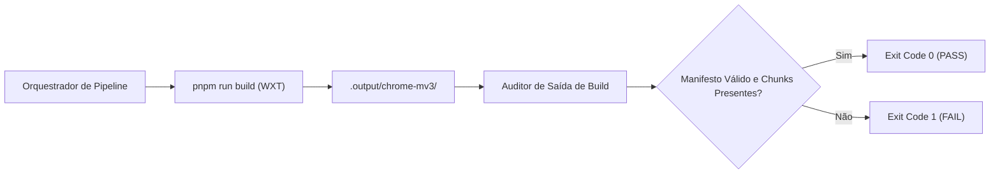

# QG-08 — Build Integrity

> **Quality Gate:** QG-08  
> **Nome Canônico:** Build Integrity (Integridade de Compilação e Empacotamento WXT/MV3)  
> **Classificação:** COMPILATION & BUNDLE INTEGRITY  
> **Documento Canônico:** `docs/quality-gates/08-build-integrity.md`  
> **Framework:** WXT + React 19 + Manifest V3 + Tailwind CSS  
> **Status:** Planejado / Em Preparação (WXT configurado em `wxt.config.ts`; compilação ativa de produto prevista a partir de M3)  

---

## 1. Identificação

| Atributo | Especificação Canônica |
| :--- | :--- |
| **ID** | `QG-08` |
| **Nome** | Build Integrity |
| **Categoria** | Build / Compilação / Empacotamento |
| **Prioridade** | **Progressiva (Ativação em M3 / Crítica em M8)** |
| **Milestone Relacionada** | M0 (Configuração WXT), M3 (Product Shell), M8 (Release) |
| **Estado da Implementação** | `Planejado` (Infraestrutura declarada em `wxt.config.ts`; código de produto em entrypoints aguardado em M3) |
| **Dependências Técnicas** | WXT 0.21+, Vite, React 19, TypeScript, Node.js >= 20 |
| **Mecanismos Relacionados** | `pnpm run build` (`wxt build`), `pnpm run zip` (`wxt zip`) |
| **Diretórios de Entrada/Saída** | Entrada: `src/entrypoints/`, `src/`; Saída: `.output/chrome-mv3/` |
| **Hooks e Pipelines** | Modo STRICT / RELEASE no orquestrador `run-quality-gate.mjs` |

---

## 2. Responsabilidade

O `QG-08` é responsável por verificar a integridade, corretude e ausência de erros na compilação e empacotamento da extensão através do framework **WXT** direcionado ao padrão **Manifest V3**.

Ele assegura que todos os entrypoints obrigatórios da extensão (Side Panel, Background Service Worker, Content Scripts e Páginas Expandidas) sejam compilados com sucesso, que o arquivo de manifesto gerado seja sintaticamente válido perante a especificação do Chrome/Chromium e que o pacote final gerado não contenha chunks órfãos ou avisos críticos de bundling.

---

## 3. Problema Resolvido

No empacotamento de extensões de navegador complexas com Vite/WXT e React 19, falhas sutis de build podem passar despercebidas se avaliadas apenas pelo código-fonte:
1. **Quebra Silenciosa de Entrypoints:** Arquivos com nomes incorretos ou estruturas não reconhecidas pelo WXT gerando builds que não registram o Side Panel ou o Background Service Worker no manifesto final.
2. **Incompatibilidade com Manifest V3:** Inclusão indevida de código que depende de APIs exclusivas do DOM (`window`, `document`) dentro do Service Worker em segundo plano (`background`), causando falha imediata de inicialização no navegador.
3. **Erros de Resolução de Assets:** Arquivos de imagem, ícones ou fontes referenciados em CSS/Tailwind que não são copiados para a pasta de distribuição `.output/`, resultando em recursos 404 em tempo de execução.
4. **Chunks Inflados e Circularidade em Bundles:** Criação de múltiplos pacotes redundantes ou duplicação de instâncias do React 19 entre diferentes contextos da extensão.

---

## 4. Fundamentos Técnicos

### 4.1. Arquitetura de Build do WXT no Manifest V3
O WXT opera sobre o Vite para orquestrar compilações multi-contexto especializadas:

- **Isolamento de Contexto:** O Service Worker roda em ambiente headless V8 sem acesso ao DOM; a compilação do WXT deve garantir que dependências visuais não vazem para `background/`.
- **Geração Automática de Manifesto:** O WXT gera dinamicamente o `manifest.json` com base nas configurações de `wxt.config.ts` e na detecção automática dos arquivos sob `src/entrypoints/`.

---

## 5. Funcionamento Previsto

### 5.1. Comportamento Atual no Repositório
- O WXT está instalado (`wxt@0.21.5`) e configurado em `wxt.config.ts`:
  - Módulo oficial React ativado (`@wxt-dev/module-react`).
  - Diretório fonte configurado para `src`.
  - Manifesto base definido com versão, nome e `permissions: []`.
- O comando `pnpm run build` executa a chamada a `wxt build`.

### 5.2. Comportamento Previsto com a Implementação de M3+
Quando o Milestone M3 (Product Shell) introduzir os arquivos reais dos entrypoints:
1. O gate executará o build de produção via `wxt build`.
2. Inspecionará o diretório `.output/chrome-mv3/` para certificar:
   - Presença do `manifest.json` com campos `manifest_version: 3`.
   - Registro correto de `side_panel.default_path` apontando para o arquivo HTML compilado.
   - Presença dos ícones oficiais da extensão.
3. Auditoria do log de compilação: zero alertas críticos de empacotamento (*critical bundling warnings*).

---

## 6. Regras Verificáveis

| Código da Regra | Condição de Reprovação (FAIL) | Ação / Código |
| :--- | :--- | :---: |
| **BLD-R01** | O comando `pnpm run build` falha ou encerra com exit code diferente de zero | `exit 1` |
| **BLD-R02** | O diretório `.output/chrome-mv3/` não é gerado ou está vazio | `exit 1` |
| **BLD-R03** | O arquivo `.output/chrome-mv3/manifest.json` está ausente ou é um JSON inválido | `exit 1` |
| **BLD-R04** | O `manifest.json` gerado não declara `manifest_version: 3` | `exit 1` |
| **BLD-R05** | Entrypoint do Side Panel declarado mas o arquivo HTML de destino não foi compilado | `exit 1` |
| **BLD-ERR01** | Erro de memória do Node.js (OOM) ou falha de leitura em disco durante o build | `exit 2` |

---

## 7. Integração Arquitetural

---

## 8. Ferramentas e Implementação

- **Framework de Build:** `wxt` (v0.21.5).
- **Módulo React:** `@wxt-dev/module-react` (v1.2.2).
- **Motor CSS:** `@tailwindcss/vite` e `tailwindcss` (v4.3.4).
- **Configuração Canônica:** [`wxt.config.ts`](../../wxt.config.ts).
- **Scripts em `package.json`:**
  - `"build": "wxt build"`
  - `"zip": "wxt zip"`

---

## 9. Estratégia de Testes

- **Testes de Smoke de Build:** Execução do build em ambiente limpo de CI e validação da árvore de saída gerada.
- **Validação de Schema de Manifesto:** Testes automatizados que lêem `.output/chrome-mv3/manifest.json` e o validam contra o esquema JSON oficial de Manifest V3 do Chrome.
- **Testes de Carregamento Headless:** Teste com Playwright que inicializa o Chromium com a flag `--load-extension=.output/chrome-mv3/` para certificar que o navegador aceita a extensão sem erros de inicialização.

---

## 10. Falsos Positivos e Falsos Negativos

### 10.1. Mitigação de Falsos Positivos
- **Diferenciação de Warnings Estéticos vs Erros Reais:** Configurar o bundler para ignorar avisos inofensivos de chunks de tamanho quando justificados, focando em erros de resolução e quebra de imports.

### 10.2. Mitigação de Falsos Negativos
- **Inspeção de Saída Real:** Não considerar o build aprovado apenas pelo código de saída `0` do WXT; inspecionar fisicamente no disco se os arquivos gerados contêm tamanho maior que zero bytes.

---

## 11. Critérios de Aceitação

Para aprovação do `QG-08`:
1. **Compilação Limpa:** `pnpm run build` conclui com código `0` em menos de 45 segundos.
2. **Estrutura Completa de MV3:** Diretório `.output/chrome-mv3/` contendo `manifest.json`, chunks de script e assets visuais.
3. **Validação de Sintaxe do Manifesto:** Nenhuma advertência de permissão desconhecida ou campo obsoleto emitida pelo motor de empacotamento.

---

## 12. Evolução Planejada

1. **Ativação Formal em M3:** Validação do primeiro build funcional com o Side Panel do produto.
2. **Auditoria de Tamanho de Bundle (Bundle Budget):** Definição de limites máximos de tamanho para o bundle do Side Panel (e.g. max 1.5MB) para evitar carregamento lento.
3. **Verificação Cross-Browser:** Expansão futura para testar builds direcionados ao Firefox (`wxt build -b firefox`).

---

## 13. Referências

- **Arquitetura Base:** [`ARCHITECTURE.md`](../../ARCHITECTURE.md)
- **Configuração WXT:** [`wxt.config.ts`](../../wxt.config.ts)
- **Documentação Oficial WXT:** [https://wxt.dev](https://wxt.dev)
- **Especificação Manifest V3:** [https://developer.chrome.com/docs/extensions/mv3/](https://developer.chrome.com/docs/extensions/mv3/)
