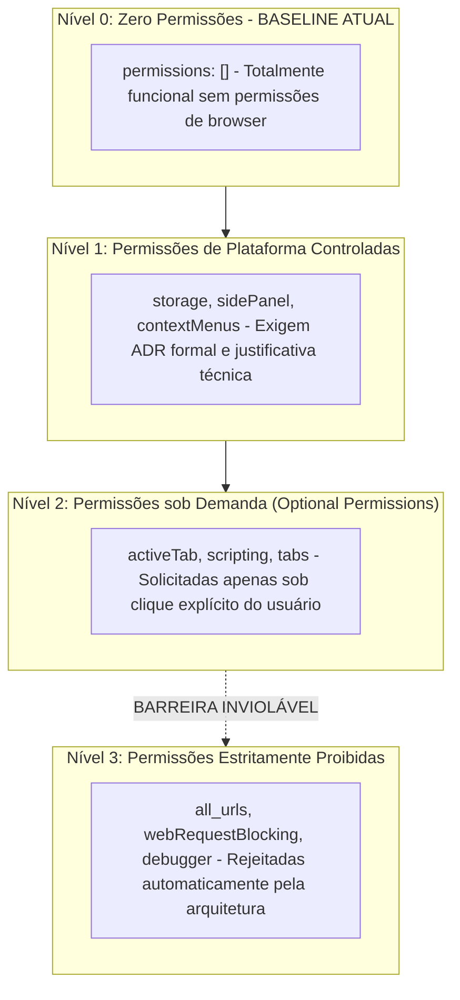
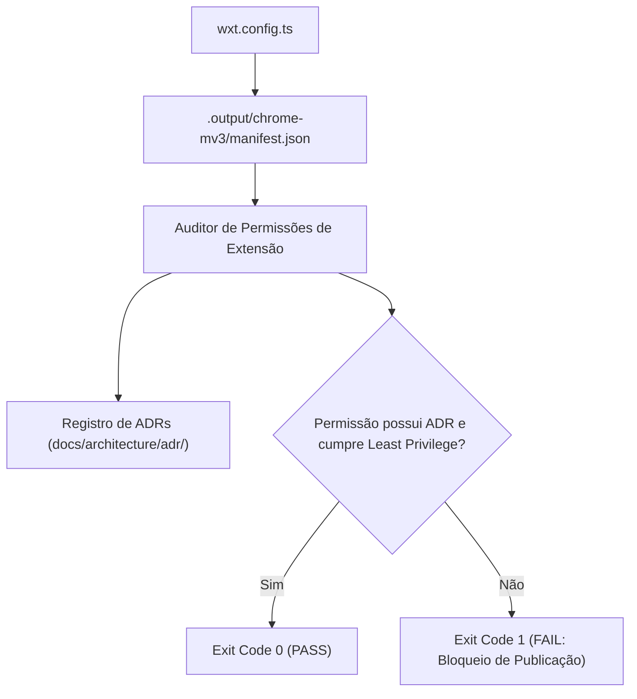

# QG-09 — Browser Permissions

> **Quality Gate:** QG-09  
> **Nome Canônico:** Browser Permissions (Governança e Menor Privilégio no Manifest V3)  
> **Classificação:** PLATFORM SECURITY & LEAST PRIVILEGE  
> **Documento Canônico:** `docs/quality-gates/09-browser-permissions.md`  
> **Arquitetura Base:** `ARCHITECTURE.md` (Seção 6 — Segurança e Superfície de Ataque)  
> **Status:** Parcialmente Implementado (Manifesto inicial configurado com zero permissões; validador automatizado de diff em especificação)  

---

## 1. Identificação

| Atributo | Especificação Canônica |
| :--- | :--- |
| **ID** | `QG-09` |
| **Nome** | Browser Permissions |
| **Categoria** | Segurança de Plataforma / Permissões WebExtension |
| **Prioridade** | **Progressiva (Ativação em M3 / Crítica em M8)** |
| **Milestone Relacionada** | M0 (Definição Base), M3 (Platform Shell), M8 (Release) |
| **Estado da Implementação** | `Parcialmente implementado` (Baseline seguro `permissions: []` validado em `wxt.config.ts`; linter de manifesto planejado) |
| **Dependências Técnicas** | Node.js >= 20, analisador JSON de manifesto |
| **Mecanismos Relacionados** | `wxt.config.ts`, auditor de permissões planejado, registros de ADR em `docs/architecture/adr/` |
| **Hooks e Pipelines** | Modo STRICT / RELEASE no orquestrador `run-quality-gate.mjs`, auditoria de PRs |

---

## 2. Responsabilidade

O `QG-09` é responsável por governar, auditar e restringir formalmente as permissões de API solicitadas pela extensão perante o navegador (Chrome/Chromium), aplicando com rigor o **Princípio do Menor Privilégio (*Principle of Least Privilege*)** sob as especificações do Manifest V3.

O gate impede a adição acidental, preguiçosa ou não autorizada de permissões invasivas (como `<all_urls>`, `webRequest`, `cookies` ou acesso amplo a abas), exigindo que cada permissão declarada seja estritamente necessária, tecnicamente justificada por um Architecture Decision Record (ADR) aprovado e mapeada para a feature correspondente.

---

## 3. Problema Resolvido

No desenvolvimento de extensões com assistência de IA, modelos tendem frequentemente a sugerir permissões genéricas amplas para facilitar implementações rápidas, criando severos riscos:
1. **Exposição Excessiva de Superfície de Ataque:** Concessão de acesso irrestrito ao tráfego de rede ou a abas abertas do usuário sem necessidade técnica real.
2. **Rejeição na Chrome Web Store:** A política de desenvolvedores do Google exige justificativas detalhadas para cada permissão solicitada e rejeita sumariamente extensões que solicitam permissões além do escopo de sua funcionalidade primária.
3. **Alarme nos Usuários na Instalação:** Permissões invasivas geram alertas de instalação assustadores ("Pode ler e alterar todos os seus dados nos sites visitados"), destruindo a confiança no produto.
4. **Vazamento entre Features:** Uma feature simples de formatação (e.g., `text-diff` ou `xml-inspector`) operando em um ambiente com permissões que ela jamais deveria acessar.

---

## 4. Fundamentos Técnicos

### 4.1. Filosofia Local-First e Privilégio Mínimo
O ExtensionTools foi projetado para operar predominantemente em **modo Local-First** no Side Panel. A imensa maioria de suas funcionalidades manipula dados fornecidos diretamente pelo usuário (via colar ou upload de arquivo local), não necessitando de acesso ao DOM de sites de terceiros.



### 4.2. Permissões sob Demanda (*Optional Permissions*)
Para recursos como captura de tela ou inspeção da aba atual (em `evidence-capture` ou `quick-files`), o ExtensionTools prioriza o uso de **permissões opcionais em tempo de execução** (`chrome.permissions.request()`), solicitadas unicamente no momento em que o usuário clica no botão correspondente, mantendo o manifesto base limpo.

---

## 5. Funcionamento Previsto

### 5.1. Comportamento Atual no Repositório
O arquivo canônico `wxt.config.ts` declara atualmente o estado de privilégio mínimo absoluto:
```typescript
manifest: {
  name: 'ExtensionTools',
  description: 'Extensão modular de produtividade local-first para navegadores',
  version: '0.1.0',
  manifest_version: 3,
  permissions: [],
}
```

### 5.2. Mapeamento Arquitetural Previsto (Features vs Permissões)

| Feature | Permissões Mínimas Necessárias | Modo de Solicitação | Justificativa Arquitetural |
| :--- | :--- | :--- | :--- |
| **`text-diff`** | Nenhuma (`[]`) | Não aplicável | Processamento puro em memória |
| **`xml-inspector`** | Nenhuma (`[]`) | Não aplicável | Parsing e validação local |
| **`json-inspector`** | Nenhuma (`[]`) | Não aplicável | Formatação e árvore em memória |
| **`markdown`** | Nenhuma (`[]`) | Não aplicável | Renderização local |
| **`quick-files`** | Nenhuma ou `storage` local | Declarada se aprovada em ADR | Cache de arquivos recentes |
| **`calendar`** | `storage` local | Declarada se aprovada em ADR | Persistência de notas locais |
| **`snippet-library`**| `storage` local | Declarada se aprovada em ADR | Persistência de biblioteca |
| **`tab-workspaces`** | `tabs` | Opcional sob demanda | Gerenciamento de abas abertas |
| **`evidence-capture`**| `activeTab`, `scripting` | Opcional sob demanda | Captura de evidência pontual |

---

## 6. Regras Verificáveis

| Código da Regra | Condição de Reprovação (FAIL) | Ação / Código |
| :--- | :--- | :---: |
| **PRM-R01** | Manifesto final contém permissões invasivas proibidas (`<all_urls>`, `*://*/*`, `webRequestBlocking`) | `exit 1` |
| **PRM-R02** | Adição de qualquer permissão em `permissions` ou `host_permissions` sem ADR correspondente em `docs/architecture/adr/` | `exit 1` |
| **PRM-R03** | Permissão declarada como obrigatória no manifesto quando poderia tecnicamente ser opcional (*optional*) | `exit 1` |
| **PRM-R04** | Presença de permissões não utilizadas por nenhuma feature implementada | `exit 1` |
| **PRM-ERR01** | Erro de leitura do `wxt.config.ts` ou falha ao parsear o manifesto gerado | `exit 2` |

---

## 7. Integração Arquitetural



---

## 8. Ferramentas e Implementação

- **Configuração de Origem:** [`wxt.config.ts`](../../wxt.config.ts).
- **Especificação de Referência:** Diretrizes de Segurança em [`SECURITY.md`](../../SECURITY.md) e [`ARCHITECTURE.md`](../../ARCHITECTURE.md).
- **Validador Proposto:** Script de inspeção de manifesto integrado ao orquestrador `run-quality-gate.mjs`.

---

## 9. Estratégia de Testes

- **Testes de Comparação Estática de Manifesto:** Testes unitários que comparam as permissões presentes no manifesto compilado com uma lista de permissões autorizadas (*allowlist*).
- **Testes de Regressão de Menor Privilégio:** Garantir que modificações em `wxt.config.ts` que adicionem qualquer nova string ao array `permissions` falhem se a documentação da ADR não for fornecida.
- **Testes de Isolamento de Host:** Garantir que nenhuma host permission ampla seja injetada durante o build.

---

## 10. Falsos Positivos e Falsos Negativos

### 10.1. Mitigação de Falsos Positivos
- **Permissões Nativas Inofensivas:** Permitir permissões necessárias à própria arquitetura do Side Panel (`sidePanel`) quando a funcionalidade for ativada em M3, desde que devidamente documentada.

### 10.2. Mitigação de Falsos Negativos
- **Inspeção de Permissões Implícitas de Conteúdo:** O validador deve checar não apenas `permissions`, mas também `host_permissions` e o array `matches` de `content_scripts`, prevenindo injeções acidentais em todos os domínios da web.

---

## 11. Critérios de Aceitação

Para aprovação do `QG-09`:
1. **Conformidade com ADRs:** Toda permissão listada no manifesto deve possuir um ADR correspondente e aprovado em `docs/architecture/adr/`.
2. **Zero Permissões Amplas:** Proibição irrestrita de `<all_urls>` e matchers universais.
3. **Preferência por Permissões sob Demanda:** Recursos com acesso à aba atual devem usar estritamente `activeTab` disparado por clique do usuário.

---

## 12. Evolução Planejada

1. **Automação do Linter de Permissões em M3:** Criação de script ESM para comparar o manifesto com a tabela de permissões aprovadas a cada execução do modo STRICT.
2. **Geração Automática de Matriz de Privacidade:** Script para documentar na página pública da extensão a finalidade exata de cada permissão solicitada.

---

## 13. Referências

- **Arquitetura Base:** [`ARCHITECTURE.md`](../../ARCHITECTURE.md) (Seção 6)
- **Política de Segurança:** [`SECURITY.md`](../../SECURITY.md)
- **Configuração WXT:** [`wxt.config.ts`](../../wxt.config.ts)
- **Diretrizes de Permissões da Chrome Web Store:** [https://developer.chrome.com/docs/webstore/permissions/](https://developer.chrome.com/docs/webstore/permissions/)
