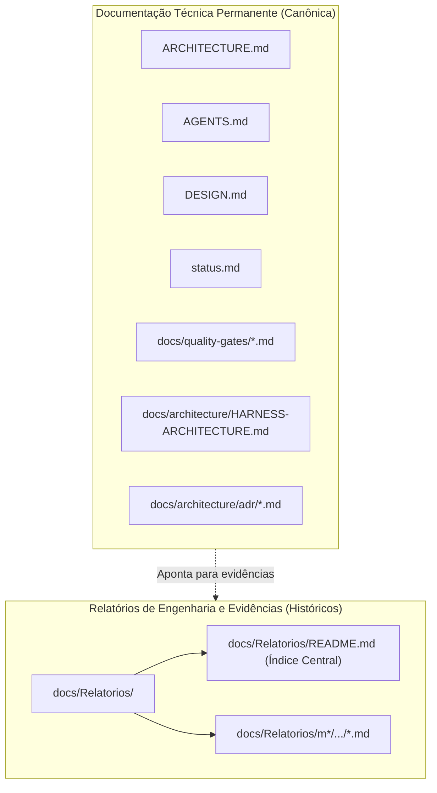
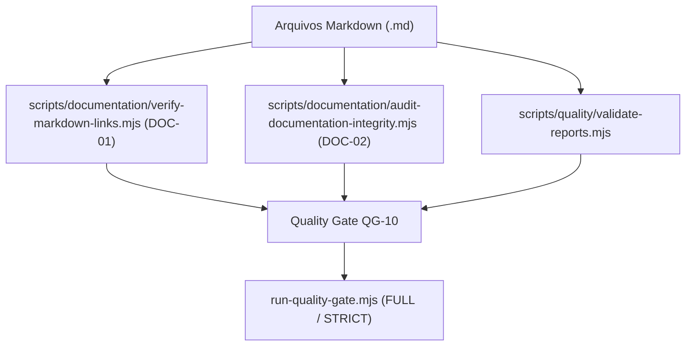

# QG-10 — Documentation Integrity

> **Quality Gate:** QG-10  
> **Nome Canônico:** Documentation Integrity (Integridade Documental, Links e Rastreabilidade)  
> **Classificação:** DOCUMENTATION GOVERNANCE & REPOSITORY HYGIENE  
> **Documento Canônico:** `docs/quality-gates/10-documentation-integrity.md`  
> **Harness de Referência:** `docs/architecture/HARNESS-ARCHITECTURE.md`  
> **Status:** Parcialmente Implementado (Validador anti-dispersão de relatórios ativo; linters de links e integridade estrutural em especificação)  

---

## 1. Identificação

| Atributo | Especificação Canônica |
| :--- | :--- |
| **ID** | `QG-10` |
| **Nome** | Documentation Integrity |
| **Categoria** | Documentação / Governança / Rastreabilidade |
| **Prioridade** | **Progressiva (Ativação Contínua / Essencial na Governança)** |
| **Milestone Relacionada** | M0/M2 (Padronização Documental), M2 (Fase 4 de Scripts — `DOC-01`, `DOC-02`), Governança Contínua |
| **Estado da Implementação** | `Parcialmente implementado` (Validador `validate-reports.mjs` validado; `DOC-01` e `DOC-02` planejados) |
| **Dependências Técnicas** | Node.js >= 20, scripts ESM de qualidade em `scripts/quality/` e `scripts/documentation/` |
| **Mecanismos Relacionados** | `validate-reports.mjs`, `DOC-01` (`verify-markdown-links.mjs`), `DOC-02` (`audit-documentation-integrity.mjs`) |
| **Diretórios Governados** | `docs/`, `docs/quality-gates/`, `docs/architecture/`, `docs/Relatorios/`, `.harness/`, raiz do projeto (`*.md`) |
| **Hooks e Pipelines** | Modo FULL / STRICT no orquestrador `run-quality-gate.mjs`, CI |

---

## 2. Responsabilidade

O `QG-10` é responsável por auditar e garantir a integridade referencial, a coerência estrutural, a ausência de links quebrados e o respeito aos limites de governança documental de todo o repositório do ExtensionTools.

Ele assegura a separação inequívoca entre **documentação técnica permanente** e **relatórios de engenharia**, elimina a dispersão de documentos normativos, impede contradições entre instruções e preserva a rastreabilidade histórica orientada a evidências.

---

## 3. Problema Resolvido

Em projetos com múltiplos agentes de IA e engenheiros humanos colaborando ao longo de meses, o ecossistema documental sofre de patologias crônicas:
1. **Links Quebrados (*Dead Links*):** Referências em Markdown a arquivos renomeados, movidos ou excluídos que levam o desenvolvedor ou agente a caminhos inexistentes (erro 404 local).
2. **Dispersão e Proliferação de Relatórios:** Relatórios de implementação ou testes salvos em pastas de código (`src/`), em subpastas de features ou na raiz do repositório, poluindo o controle de versão.
3. **Duplicação de Fontes Normativas (*Split Truth*):** Múltiplos documentos tentando definir as mesmas regras arquiteturais com redações ligeiramente divergentes, confundindo modelos de IA.
4. **Desatualização de Índices e Sumários:** Arquivos `README.md` que listam tabelas de documentos ou milestones que não correspondem à estrutura real do disco.

---

## 4. Fundamentos Técnicos

### 4.1. A Fronteira entre Documentação Permanente e Relatórios
A arquitetura documental do ExtensionTools estabelece uma separação estrutural inegociável:

- **Documentação Permanente:** Descreve a arquitetura viva, regras, padrões, especificações e referências canônicas do sistema. Reside na raiz, em `docs/architecture/`, `docs/quality-gates/` ou `.harness/`.
- **Relatórios de Engenharia (`docs/Relatorios/`):** Registros históricos, estáticos e imutáveis de planejamento, implementação, testes e validação. É expressamente proibido versionar relatórios fora de `docs/Relatorios/`.

### 4.2. Rastreabilidade com Links Relativos
Todo link em documentos Markdown deve ser **estritamente relativo**, permitindo navegação perfeita tanto no visualizador do GitHub na web quanto em editores locais (VS Code, Antigravity) e em clones novos do repositório.

---

## 5. Funcionamento Previsto

### 5.1. Comportamento Implementado e Comprovado (Estado Vigente)
- **Validador Anti-Dispersão de Relatórios (`scripts/quality/validate-reports.mjs`):**
  - Implementado e coberto por 10 testes Vitest (`tests/harness/quality/validate-reports.test.ts`).
  - Varre todo o repositório impedindo a existência de arquivos de relatório fora de `docs/Relatorios/` (detectando padrões como `*REPORT*.md`, `*RELATORIO*.md`, `*VALIDACAO*.md`, `*REVISAO*.md`).
  - Audita a existência física do diretório canônico `docs/Relatorios/` e do arquivo de índice central `docs/Relatorios/README.md`.
  - **Limitação Conhecida (Ressalva Formal):** A verificação mecânica de links cruzados e a auditoria semântica da hierarquia interna de pastas de milestone não são executadas pelo script atual, constituindo entrega progressiva programada para os scripts `DOC-01` e `DOC-02`.

### 5.2. Comportamento Previsto com Scripts `DOC-01` e `DOC-02` (Implementação Progressiva Pendente)
- **`verify-markdown-links.mjs` (`DOC-01`):**
  - Faz parsing de todos os arquivos Markdown do repositório.
  - Extrai todos os links em formato Markdown (formato de link Markdown padrão) e referências HTML (`<a href="...">`).
  - Para cada link relativo local, verifica fisicamente a existência do arquivo no filesystem a partir do diretório do documento.
  - Se contiver âncora de fragmento (`#secao`), valida se o título ou âncora correspondente existe no documento de destino.
- **`audit-documentation-integrity.mjs` (`DOC-02`):**
  - Audita a existência de todos os documentos canônicos obrigatórios listados em `ARCHITECTURE.md` e `status.md`.
  - Verifica convenções de nomenclatura e ausência de arquivos vazios (0 bytes).

---

## 6. Regras Verificáveis

| Código da Regra | Condição de Reprovação (FAIL) | Ação / Código |
| :--- | :--- | :---: |
| **DOC-R01** | Presença de arquivo de relatório fora da árvore canônica `docs/Relatorios/` | `exit 1` |
| **DOC-R02** | Link relativo quebrado em qualquer arquivo Markdown versionado | `exit 1` |
| **DOC-R03** | Arquivo canônico obrigatório ausente do repositório | `exit 1` |
| **DOC-R04** | Documento técnico contendo regras concorrentes ou contraditórias com `ARCHITECTURE.md` | `exit 1` |
| **DOC-R05** | Documento com 0 bytes ou contendo marcadores órfãos de conflito Git (`<<<<<<< HEAD`) | `exit 1` |
| **DOC-ERR01** | Erro de IO ou permissão ao percorrer árvores de documentação | `exit 2` |

---

## 7. Integração Arquitetural

---

## 8. Ferramentas e Implementação

- **Scripts Atuais:**
  - `scripts/quality/validate-reports.mjs`
- **Scripts em Desenvolvimento (Fase 4 de Scripts):**
  - `scripts/documentation/verify-markdown-links.mjs` (`DOC-01`)
  - `scripts/documentation/audit-documentation-integrity.mjs` (`DOC-02`)
- **Bibliotecas Auxiliares:** `scripts/lib/fs-utils.mjs`, `scripts/lib/logger.mjs`.

---

## 9. Estratégia de Testes

- **Testes Positivos:** Validação de que a estrutura atual de `docs/` e `docs/Relatorios/` passa sem nenhuma violação.
- **Testes com Fixtures Sintéticas:**
  - Criação de pasta temporária com documento contendo link relativo para arquivo inexistente (deve falhar com `exit 1` apontando linha e URL quebrada).
  - Criação de arquivo com âncora inexistente `README.md#secao-que-nao-existe` (deve reportar fragmento inválido).
  - Injeção de arquivo `TESTE-RELATORIO.md` dentro de `src/features/` (deve falhar imediatamente no validador anti-dispersão).

---

## 10. Falsos Positivos e Falsos Negativos

### 10.1. Mitigação de Falsos Positivos
- **Ignorar Links Externos Opcionais em Desenvolvimento:** O verificador de links não deve falhar por falta de conexão com a internet; URLs web (`https://...`) devem ser apenas validadas sintaticamente ou verificadas em modo online opcional, focando primariamente em links locais relativos.

### 10.2. Mitigação de Falsos Negativos
- **Tratamento de Caracteres Especiais em Âncoras:** Normalização rigorosa de títulos com acentos e caracteres especiais para compatibilidade com os geradores de âncora do GitHub (e.g. `#1-identificação` vs `#1-identificacao`).

---

## 11. Critérios de Aceitação

Para homologação do `QG-10`:
1. **Zero Links Quebrados:** 100% dos links relativos entre documentos Markdown resolvem para arquivos existentes.
2. **Governança Anti-Dispersão Rígida:** Zero relatórios encontrados fora de `docs/Relatorios/`.
3. **Índice Atualizado:** O arquivo `docs/Relatorios/README.md` lista com precisão todos os relatórios presentes na hierarquia.
4. **Ausência de Conflitos:** Nenhum arquivo de documentação contendo marcadores de mesclagem não resolvida.

---

## 12. Evolução Planejada

1. **Construção dos Scripts `DOC-01` e `DOC-02`:** Implementação na Fase 4 de automações de scripts.
2. **Validador de Diagramas Mermaid:** Checagem estática de sintaxe de blocos `mermaid` em arquivos Markdown para evitar diagramas quebrados na renderização do GitHub.
3. **Sincronizador Automático de Sumários:** Utilitário para regenerar sumários navegáveis automaticamente em documentos longos.

---

## 13. Referências

- **Arquitetura Base:** [`ARCHITECTURE.md`](../../ARCHITECTURE.md)
- **Harness Architecture:** [`docs/architecture/HARNESS-ARCHITECTURE.md`](../architecture/HARNESS-ARCHITECTURE.md)
- **Índice Canônico de Relatórios:** [`docs/Relatorios/README.md`](../Relatorios/README.md)
- **Validador de Relatórios:** [`scripts/quality/validate-reports.mjs`](../../scripts/quality/validate-reports.mjs)
- **Relatório de Reorganização Documental:** [`docs/Relatorios/governanca-documental/RELATORIO-REORGANIZACAO-RELATORIOS.md`](../Relatorios/governanca-documental/RELATORIO-REORGANIZACAO-RELATORIOS.md)
