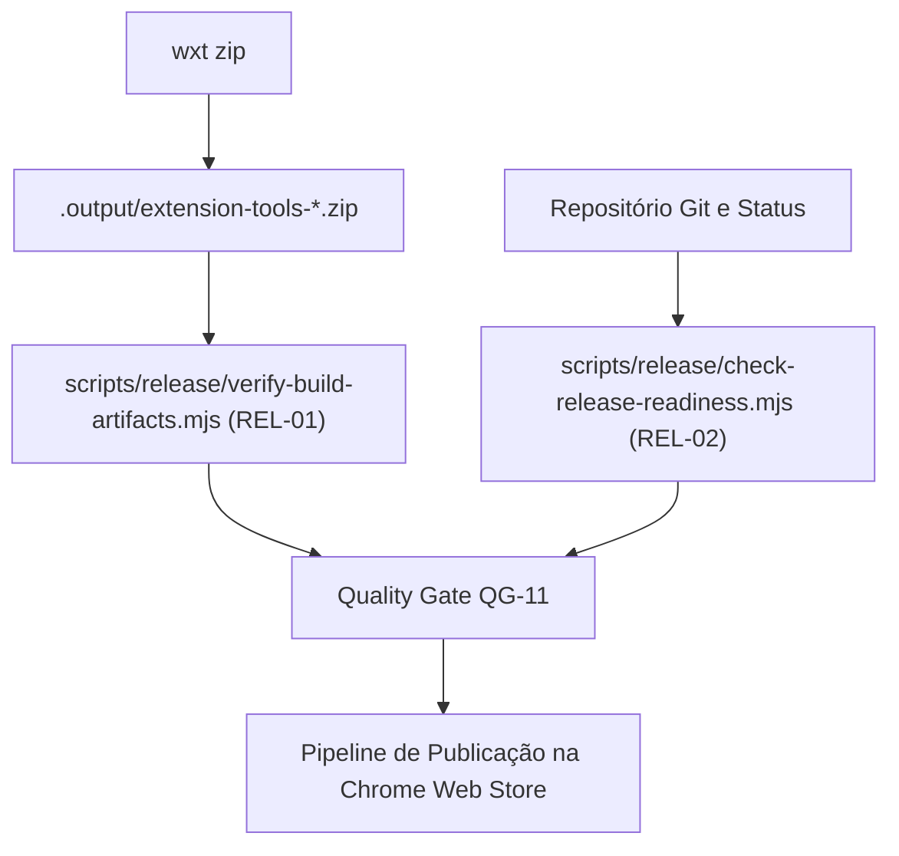

# QG-11 — Release Artifact Integrity

> **Quality Gate:** QG-11  
> **Nome Canônico:** Release Artifact Integrity (Auditoria do Pacote Distribuível e Prontidão de Release)  
> **Classificação:** RELEASE GOVERNANCE & DISTRIBUTION AUDIT  
> **Documento Canônico:** `docs/quality-gates/11-release-artifact-integrity.md`  
> **Harness de Referência:** `docs/architecture/HARNESS-ARCHITECTURE.md`  
> **Status:** Planejado (Mecanismos `REL-01` e `REL-02` especificados para a Milestone M8 / Fase 6 de Scripts)  

---

## 1. Identificação

| Atributo | Especificação Canônica |
| :--- | :--- |
| **ID** | `QG-11` |
| **Nome** | Release Artifact Integrity |
| **Categoria** | Release / Distribuição / Empacotamento Seguro |
| **Prioridade** | **Progressiva (Crítica em M8 — Release Readiness)** |
| **Milestone Relacionada** | M8 (Release Readiness & Distribution) |
| **Estado da Implementação** | `Planejado` (Especificado detalhadamente no planejamento da Fase 6 de Scripts) |
| **Dependências Técnicas** | Node.js >= 20, utilitário de descompactação ZIP em memória (ESM), Git CLI |
| **Mecanismos Relacionados** | `REL-01` (`verify-build-artifacts.mjs`), `REL-02` (`check-release-readiness.mjs`), `pnpm run zip` |
| **Artefato Auditado** | Arquivo ZIP gerado pelo WXT sob `.output/*.zip` |
| **Hooks e Pipelines** | Modo RELEASE no orquestrador `run-quality-gate.mjs`, pipeline de publicação |

---

## 2. Responsabilidade

O `QG-11` é responsável por auditar o arquivo compactado final (`.zip`) gerado para distribuição na **Chrome Web Store**, garantindo que o artefato distribuível contenha estritamente os arquivos necessários para execução no navegador e que nenhum resíduo de desenvolvimento, código-fonte original, arquivos de teste ou dados sensíveis sejam empacotados e disponibilizados publicamente aos usuários finais.

O gate diferencia-se formalmente do `QG-08 (Build Integrity)`: enquanto o `QG-08` verifica se a compilação do WXT teve sucesso, o `QG-11` audita o arquivo binário/ZIP final empacotado que será submetido à loja de extensões.

---

## 3. Problema Resolvido

No empacotamento automático de extensões, é comum que ferramentas de build incluam arquivos indesejados no pacote ZIP final:
1. **Vazamento de Código-Fonte e Comentários:** Inclusão inadvertida de arquivos TypeScript originais (`.ts`, `.tsx`), arquivos de configuração interna ou notas de desenvolvimento dentro do ZIP.
2. **Inclusão de Testes e Mocks:** Arquivos de teste (`.test.ts`, `.spec.ts`), fixtures ou dados de simulação embutidos no pacote de produção, inflando desnecessariamente o tamanho do download.
3. **Exposição de Sourcemaps de Desenvolvimento:** Mapas de fonte (`.map`) com caminhos locais de estações de trabalho de desenvolvedores empacotados no bundle público.
4. **Divergência de Versão SemVer:** Desalinhamento entre a versão declarada no `package.json`, a versão no `manifest.json`, a versão descrita no `status.md` e a tag Git da release.
5. **Tentativa de Release com Repositório Sujo:** Geração de pacote de release a partir de uma árvore de trabalho do Git com alterações não commitadas ou commits não enviados.

---

## 4. Fundamentos Técnicos

### 4.1. Auditoria Estrita do Arquivo ZIP em Memória (`REL-01`)
O script `verify-build-artifacts.mjs` descompacta a tabela de cabeçalhos e arquivos do arquivo `.zip` gerado pelo WXT sem extraí-lo fisicamente para o disco, aplicando uma lista rigorosa de permissões (*allowlist*) e proibições (*blocklist*):

```mermaid
flowchart TD
    Zip[".output/*.zip (Pacote Final WXT)"] --> Auditor["verify-build-artifacts.mjs (REL-01)"]
    
    subgraph Allowlist ["Lista de Arquivos Permitidos"]
        A1["manifest.json (Validado MV3)"]
        A2["chunks compilados JS (.js em subpastas)"]
        A3["estilos compilados CSS (.css)"]
        A4["entrypoints HTML (.html compilados)"]
        A5["assets públicos (ícones .png, SVG autorizados)"]
    end

    subgraph Blocklist ["Lista de Arquivos Estritamente Proibidos"]
        B1["Fontes TypeScript (*.ts, *.tsx)"]
        B2["Testes e Fixtures (*.test.*, *.spec.*, fixtures/)"]
        B3["Documentação e Relatórios (*.md, docs/)"]
        B4["Arquivos de Configuração (*.config.*, tsconfig.*)"]
        B5["Sourcemaps não autorizados (*.js.map)"]
        B6["Arquivos ocultos ou de sistema (.git*, .DS_Store)"]
    end

    Auditor --> Allowlist
    Auditor --> Blocklist
    Auditor --> Decision{"Pacote 100% Conforme?"}
    Decision -->|Sim| Pass["Aprovado para Publicação"]
    Decision -->|Não| Fail["Bloqueio da Release (exit 1)"]
```

### 4.2. Desacoplamento entre `QAL-01` e `REL-02`
Conforme formalizado na Seção 16 do relatório de planejamento de scripts:
- **`run-quality-gate.mjs --mode=release` (`QAL-01`)** centraliza a execução de todos os testes, typecheck, lint, build e invoca o `REL-01` para auditar o ZIP.
- **`check-release-readiness.mjs` (`REL-02`)** é um auditor passivo de pré-condições que checa versões e status sem reinvocar o orquestrador de gates, eliminando qualquer dependência circular.

---

## 5. Funcionamento Previsto

### 5.1. Comportamento Previsto para a Milestone M8
Quando o comando de preparação de release for disparado:
1. O WXT gera o pacote compactado via `wxt zip`.
2. O script `verify-build-artifacts.mjs` (`REL-01`) inspeciona o arquivo `.zip` gerado:
   - Extrai o `manifest.json` do interior do ZIP e valida versão e permissões.
   - Percorre todos os caminhos relativos de arquivos contidos no arquivo compactado.
   - Comprova que nenhum arquivo corresponde aos padrões proibidos (*blocklist*).
   - Valida se os ícones obrigatórios declarados no manifesto (16x16, 48x48, 128x128) estão presentes e legíveis.
3. O script `check-release-readiness.mjs` (`REL-02`) confere:
   - Árvore do Git limpa (`git status --porcelain` vazio).
   - Branch ativa é a branch de release ou `main`.
   - Versão SemVer coincide rigorosamente em `package.json`, `wxt.config.ts`, `status.md` e na tag Git pretendida.

---

## 6. Regras Verificáveis

| Código da Regra | Condição de Reprovação (FAIL) | Ação / Código |
| :--- | :--- | :---: |
| **REL-R01** | Presença de qualquer arquivo com extensão `.ts`, `.tsx`, `.test.*`, `.spec.*` ou `.md` dentro do ZIP | `exit 1` |
| **REL-R02** | Presença de sourcemaps de desenvolvimento (`*.map`) dentro do pacote ZIP | `exit 1` |
| **REL-R03** | `manifest.json` ausente na raiz do arquivo ZIP | `exit 1` |
| **REL-R04** | Divergência de versão SemVer entre `package.json`, `wxt.config.ts` e `manifest.json` | `exit 1` |
| **REL-R05** | Repositório Git com arquivos modificados ou staged não commitados no momento da release | `exit 1` |
| **REL-R06** | Ícones obrigatórios da extensão referenciados no manifesto ausentes dentro do pacote ZIP | `exit 1` |
| **REL-ERR01** | Arquivo ZIP corrompido, vazio (0 bytes) ou ilegível | `exit 2` |

---

## 7. Integração Arquitetural

---

## 8. Ferramentas e Implementação

- **Scripts em Desenvolvimento (Fase 6 de Scripts):**
  - `scripts/release/verify-build-artifacts.mjs` (`REL-01`)
  - `scripts/release/check-release-readiness.mjs` (`REL-02`)
- **Dependência Técnica Proposta:** Módulo ESM nativo ou biblioteca leve de descompactação ZIP (e.g. `jszip` ou parser binário puro de cabeçalhos ZIP).
- **Integração de Comandos:**
  - `pnpm run zip`
  - `pnpm run release:check` (modo release de qualidade)

---

## 9. Estratégia de Testes

- **Testes com Arquivos ZIP Sintéticos (`tests/harness/release/`):**
  - Criação de arquivos ZIP temporários contendo propositalmente um arquivo `test.ts` ou `.env` (o validador deve falhar com `exit 1` identificando o arquivo proibido).
  - Simulação de arquivo ZIP contendo sourcemap `.js.map` (deve falhar).
  - Simulação de pacote limpo contendo apenas `manifest.json`, `background.js`, `sidepanel.html` e `icon.png` (deve passar com código `0`).
- **Testes de Validação SemVer:** Comprovação de que disparidades entre `0.1.0` e `0.1.1` em arquivos de configuração disparam alarme imediato.

---

## 10. Falsos Positivos e Falsos Negativos

### 10.1. Mitigação de Falsos Positivos
- **Nomes de Arquivos Minificados que Contêm Padrões:** A verificação deve auditar o caminho relativo completo e as extensões canônicas, e não fazer buscas ingênuas de substring que possam casar com nomes de hashes de chunks (e.g. `chunk-md5-hash.js`).

### 10.2. Mitigação de Falsos Negativos
- **Inspeção Recursiva Completa de Diretórios do ZIP:** O analisador deve inspecionar 100% dos nós do arquivo compactado, impedindo que subpastas profundas (como `assets/vendor/`) ocultem arquivos indevidos.

---

## 11. Critérios de Aceitação

Para homologação do `QG-11`:
1. **Pacote Distribuível 100% Limpo:** Zero arquivos fonte, testes, relatórios ou sourcemaps dentro do ZIP.
2. **Manifesto Válido:** `manifest.json` com versão exata do SemVer e permissões correspondentes aos ADRs aprovados.
3. **Árvore Git Totalmente Limpa:** Nenhuma alteração pendente de commit.
4. **Relatório de Release Emitido:** Geração de sumário em `docs/Relatorios/m8/` certificando a auditoria do artefato antes do envio à Web Store.

---

## 12. Evolução Planejada

1. **Construção dos Scripts `REL-01` e `REL-02`:** Conclusão da Fase 6 de Scripts no encerramento de M7/início de M8.
2. **Integração com API de Publicação da Web Store:** Publicação automatizada através de tokens autenticados na esteira do GitHub Actions.
3. **Assinatura Criptográfica de Pacote:** Geração de hash SHA-256 e assinatura digital do arquivo compactado para verificação de integridade pública.

---

## 13. Referências

- **Harness Architecture:** [`docs/architecture/HARNESS-ARCHITECTURE.md`](../architecture/HARNESS-ARCHITECTURE.md)
- **Relatório de Planejamento de Scripts:** [`docs/Relatorios/m2/planejamento-scripts/RELATORIO-PLANEJAMENTO-DESENVOLVIMENTO-SCRIPTS.md`](../Relatorios/m2/planejamento-scripts/RELATORIO-PLANEJAMENTO-DESENVOLVIMENTO-SCRIPTS.md) (Seções 16 e 18)
- **Status e Painel de Progresso:** [`status.md`](../../status.md)
- **Configuração WXT:** [`wxt.config.ts`](../../wxt.config.ts)
