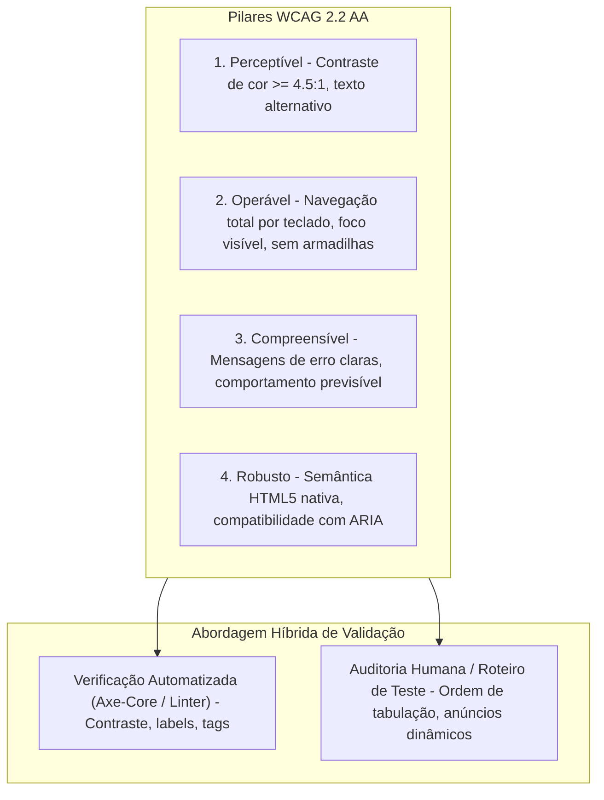
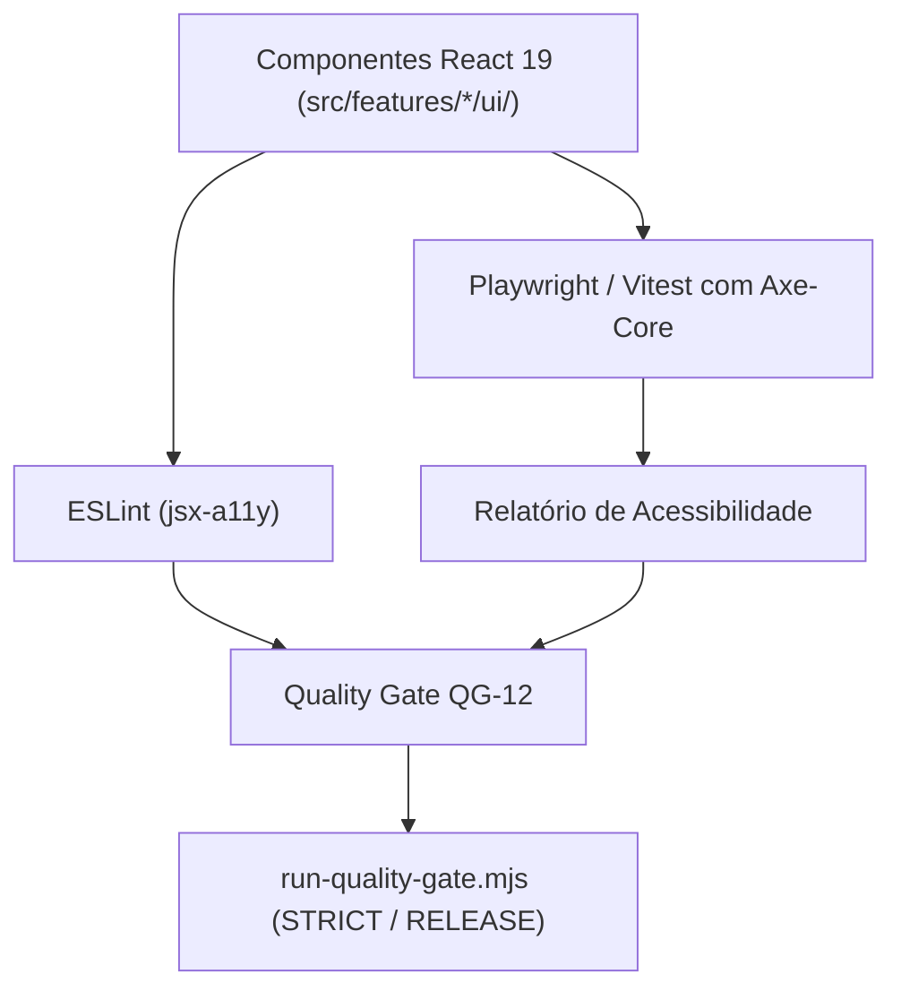

# QG-12 — Accessibility

> **Quality Gate:** QG-12  
> **Nome Canônico:** Accessibility (Conformidade com Acessibilidade e Inclusão Digital)  
> **Classificação:** ACCESSIBILITY & USABILITY (WCAG 2.2 AA)  
> **Documento Canônico:** `docs/quality-gates/12-accessibility.md`  
> **Design System de Referência:** `DESIGN.md`  
> **Status:** Planejado / Em Preparação (Diretrizes e tokens semânticos definidos em `DESIGN.md`; auditoria mecânica e testes visuais previstos para M3/M4)  

---

## 1. Identificação

| Atributo | Especificação Canônica |
| :--- | :--- |
| **ID** | `QG-12` |
| **Nome** | Accessibility (a11y) |
| **Categoria** | Acessibilidade / Usabilidade / Interface |
| **Prioridade** | **Progressiva (Ativação com a primeira UI em M3/M4 / Crítica em M7)** |
| **Milestone Relacionada** | M1 (Design System), M3 (Product Shell), M4 (Piloto Text-Diff), M7 (Hardening) |
| **Estado da Implementação** | `Planejado` (Tokens de cores AA/AAA documentados em `DESIGN.md`; validadores de JSX e testes axe-core em planejamento) |
| **Dependências Técnicas** | `@axe-core/playwright`, `eslint-plugin-jsx-a11y`, React 19, Tailwind CSS |
| **Mecanismos Relacionados** | Inspeção automatizada de a11y em componentes, linter JSX, checklist de auditoria manual de foco |
| **Padrão Normativo** | W3C WCAG 2.2 (Nível AA Obrigatório / AAA Recomendado em Contraste de Texto) |
| **Hooks e Pipelines** | Modo STRICT / RELEASE no orquestrador `run-quality-gate.mjs`, testes de integração |

---

## 2. Responsabilidade

O `QG-12` é responsável por garantir que as interfaces de usuário da extensão (renderizadas no Side Panel ou em páginas expandidas) sejam universalmente utilizáveis e totalmente acessíveis a pessoas com deficiência, idosos ou usuários que operam exclusivamente via teclado ou tecnologias assistivas (leitores de tela).

O gate assegura a conformidade estrita com os critérios de sucesso das **Diretrizes de Acessibilidade para Conteúdo Web (WCAG 2.2 Nível AA)**, protegendo atributos como contraste mínimo, navegação por teclado, estados visíveis de foco e semântica estrutural correta.

---

## 3. Problema Resolvido

No desenvolvimento de interfaces em extensões de navegador com foco em ferramentas técnicas, a acessibilidade é frequentemente negligenciada:
1. **Inoperabilidade via Teclado:** Componentes customizados (como botões feitos com `
` ou ``) que não recebem foco via tecla `Tab` e não respondem à tecla `Enter` ou `Espaço`.
2. **Armadilhas de Foco (*Focus Traps*):** Modais ou janelas flutuantes que prendem o foco do teclado impedindo o usuário de navegar pelo restante do Side Panel.
3. **Contraste Insuficiente de Cores:** Textos secundários, placeholders ou ícones sutis que não possuem contraste de luminância suficiente contra o fundo (menos de 4.5:1), impedindo a leitura por pessoas com baixa visão ou em ambientes com luz solar intensa.
4. **Ausência de Feedback para Leitores de Tela:** Ações assíncronas (como cálculo de diff, formatação XML ou cópia para a área de transferência) que alteram a tela sem emitir anúncios em regiões ativas (`aria-live`).
5. **Falta de Rótulos em Botões com Apenas Ícones:** Botões que exibem apenas um ícone gráfico (como uma lixeira ou engrenagem) sem texto acessível (`aria-label`), tornando a interface indecifrável para quem utiliza leitores de tela.

---

## 4. Fundamentos Técnicos

### 4.1. Alinhamento com os Tokens Semânticos de `DESIGN.md`
O ExtensionTools adota uma paleta minimalista de alto contraste definida em `DESIGN.md` com tokens específicos para modo claro e escuro:
- **Razão de Contraste Mínima para Texto Normal:** 4.5:1 (Conformidade WCAG AA).
- **Razão de Contraste Mínima para Texto Grande e Elementos de UI:** 3:1.
- **Tokens de Foco Explícito:** Um anel de foco bem delineado (`ring-2 ring-blue-500 ring-offset-2`) com contraste mínimo de 3:1 contra o fundo é obrigatório para todos os elementos interativos.

### 4.2. Limitações das Verificações Automatizadas
Validadores automatizados (como Axe ou linters) são essenciais, mas conseguem detectar apenas cerca de 40% a 50% dos problemas reais de acessibilidade. Portanto, o `QG-12` é estruturado sobre uma abordagem **híbrida**: verificações mecânicas automatizadas complementadas por checklists operacionais determinísticos em testes de integração e revisão humana.

---

## 5. Funcionamento Previsto

### 5.1. Comportamento Previsto para as Milestones M3 e M4
Com a introdução do Shell da aplicação (M3) e da primeira funcionalidade interativa (`text-diff` em M4):
1. **Linter Estático em Tempo de Edição:** O ESLint com plugin `jsx-a11y` audita os componentes React impedindo o uso de elementos não-semânticos com eventos de clique sem role e tabIndex correspondentes.
2. **Auditoria Automatizada em Testes de Integração (`tests/integration/`):**
   - Execução do `@axe-core/playwright` ou `vitest-axe` sobre os componentes renderizados.
   - Avaliação de contraste de cores, tags de formulário, atributos `aria-*` e hierarquia de títulos (`h1`, `h2`, `h3`).
3. **Teste de Fluxo de Teclado:** Simulação de navegação sequencial com a tecla `Tab` verificando que todos os botões, caixas de texto e controles recebem foco na ordem lógica de leitura.

---

## 6. Regras Verificáveis

| Código da Regra | Condição de Reprovação (FAIL) | Ação / Código |
| :--- | :--- | :---: |
| **A11Y-R01** | Violação de regra de severidade crítica ou séria detectada pelo Axe-Core | `exit 1` |
| **A11Y-R02** | Botão ou elemento interativo que só possui ícone sem `aria-label` ou texto oculto descritivo | `exit 1` |
| **A11Y-R03** | Elemento interativo que não pode ser ativado via teclado (`Enter` ou `Espaço`) | `exit 1` |
| **A11Y-R04** | Remoção de contorno de foco (`outline: none` ou `focus:outline-none`) sem substituição por anel de foco visível | `exit 1` |
| **A11Y-R05** | Texto de interface com razão de contraste inferior a 4.5:1 (ou 3:1 para texto grande) | `exit 1` |
| **A11Y-R06** | Formulário ou campo de entrada sem `<label>` associado ou `aria-labelledby` | `exit 1` |
| **A11Y-ERR01** | Falha de inicialização do motor de auditoria de acessibilidade | `exit 2` |

---

## 7. Integração Arquitetural

---

## 8. Ferramentas e Implementação

- **Analisador Estático JSX:** `eslint-plugin-jsx-a11y` integrado ao ESLint 10 Flat Config.
- **Motor de Auditoria Dinâmica:** `axe-core` via `@axe-core/playwright`.
- **Tokens de Design System:** [`DESIGN.md`](../../DESIGN.md).
- **Framework de Componentes:** React 19 + Tailwind CSS 4.

---

## 9. Estratégia de Testes

- **Testes Automatizados de Componentes:**
  - Renderização do componente visual (e.g. formulário de diff de texto ou visualizador XML).
  - Execução de `await axe(container)` asserindo `expect(results).toHaveNoViolations()`.
- **Testes de Navegação por Teclado:**
  - Disparo de eventos `userEvent.tab()` comprovando que o elemento seguinte ativo é o esperado.
  - Comprovação de que caixas de diálogo modais aprisionam o foco internamente enquanto abertas e o restauram ao botão disparador quando fechadas via `Escape`.
- **Testes de Regiões Dinâmicas:** Comprovação de que mensagens de status temporárias ("Copiado com sucesso!") residem em elementos com `role="status"` ou `aria-live="polite"`.

---

## 10. Falsos Positivos e Falsos Negativos

### 10.1. Mitigação de Falsos Positivos
- **Cálculo de Contraste em Elementos Ocultos:** Validar que o scanner não calcule contraste de texto em elementos ocultos (`display: none` ou `aria-hidden="true"`).

### 10.2. Mitigação de Falsos Negativos
- **Textos Dinâmicos e Estados de Hover/Focus:** Auditar o contraste não apenas no estado de repouso, mas também nos estados de `hover`, `active` e `focus-visible`.

---

## 11. Critérios de Aceitação

Para homologação do `QG-12`:
1. **Zero Violações Críticas Axe-Core:** 100% dos componentes de UI aprovados na suíte automatizada sem violações críticas ou sérias.
2. **Navegabilidade 100% por Teclado:** Todas as operações do Side Panel executáveis de ponta a ponta sem o uso do mouse.
3. **Contraste em Modo Claro e Escuro:** Atendimento às razões mínimas de 4.5:1 em ambos os temas visuais do Design System.
4. **Rótulos Acessíveis:** Zero botões mudos ou elementos sem semântica declarada.

---

## 12. Evolução Planejada

1. **Configuração de `eslint-plugin-jsx-a11y` em M3:** Integração das regras ao Flat Config com a chegada dos componentes de UI.
2. **Suíte Automatizada de Axe nos Testes E2E (M6/M7):** Varredura de acessibilidade completa no Side Panel montado no navegador Chromium real.
3. **Auditoria de Movimento Reduzido:** Suporte e testes para a preferência de sistema do usuário `prefers-reduced-motion` para desativar animações desnecessárias.

---

## 13. Referências

- **Design System e Tokens Visuais:** [`DESIGN.md`](../../DESIGN.md)
- **Arquitetura Base:** [`ARCHITECTURE.md`](../../ARCHITECTURE.md)
- **Diretrizes WCAG 2.2 do W3C:** [https://www.w3.org/TR/WCAG22/](https://www.w3.org/TR/WCAG22/)
- **Documentação do Axe-Core:** [https://github.com/dequelabs/axe-core](https://github.com/dequelabs/axe-core)
