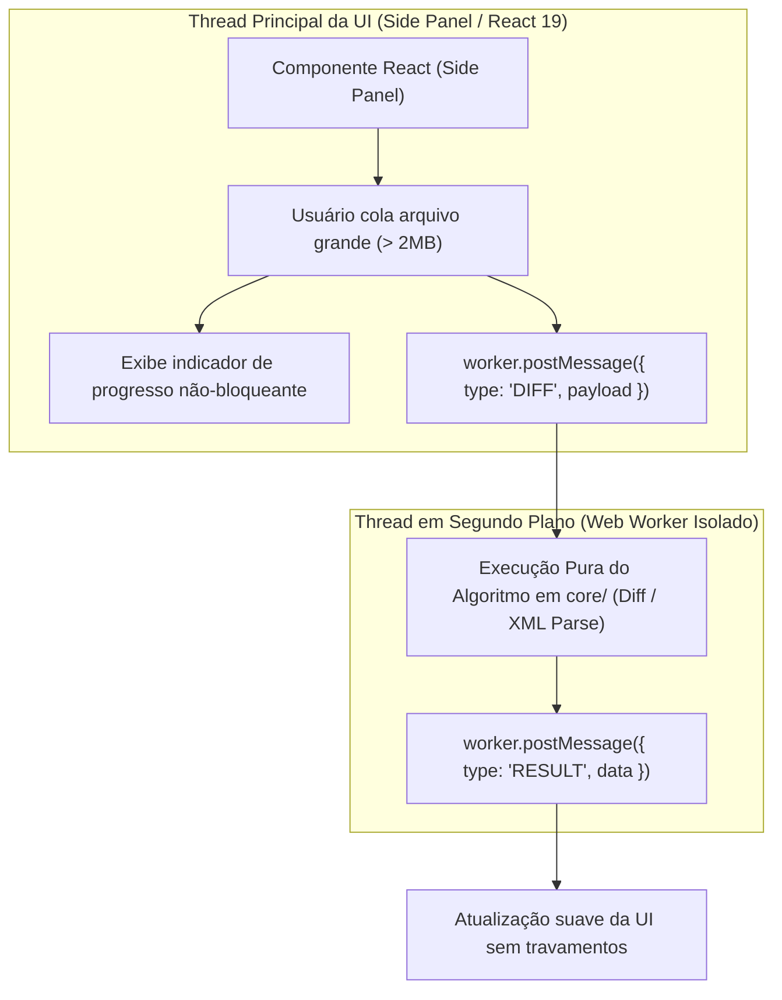
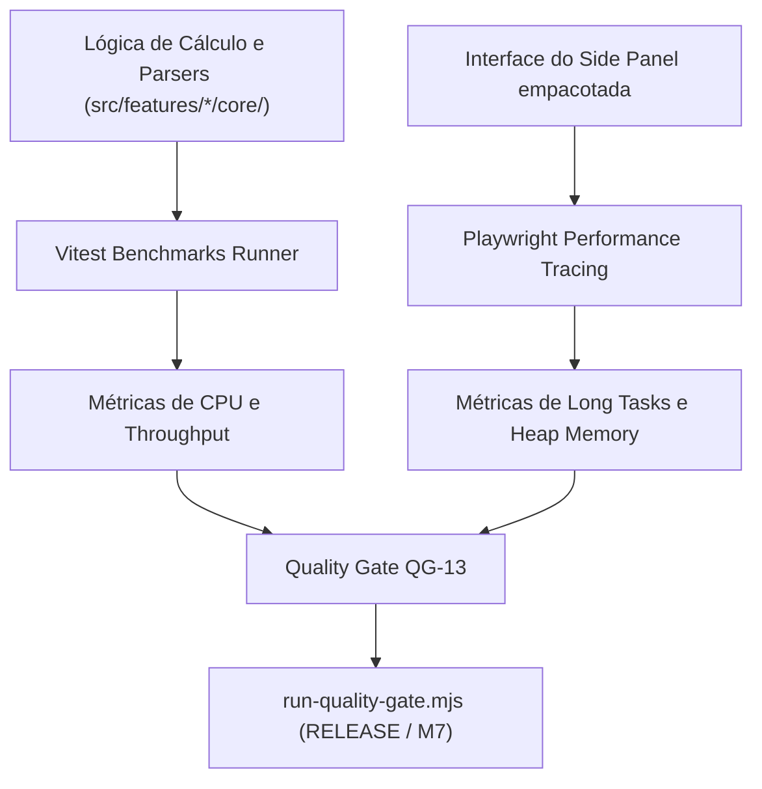

# QG-13 — Performance

> **Quality Gate:** QG-13  
> **Nome Canônico:** Performance (Desempenho, Não-Bloqueio de UI e Eficiência de Recursos)  
> **Classificação:** RUNTIME EFFICIENCY & RESPONSIVENESS  
> **Documento Canônico:** `docs/quality-gates/13-performance.md`  
> **Arquitetura Base:** `ARCHITECTURE.md` (Mitigação do Risco RSK-03)  
> **Status:** Planejado (Diretrizes arquiteturais de Web Workers documentadas; benchmarks e suíte automatizada previstos para M4 e M7)  

---

## 1. Identificação

| Atributo | Especificação Canônica |
| :--- | :--- |
| **ID** | `QG-13` |
| **Nome** | Performance |
| **Categoria** | Desempenho / Responsividade / Uso de Recursos |
| **Prioridade** | **Progressiva (Ativação em M4 / Crítica em M7 — Quality & Hardening)** |
| **Milestone Relacionada** | M1 (Diretrizes), M4 (Piloto Text-Diff), M7 (Hardening & Benchmarks) |
| **Estado da Implementação** | `Planejado` (Conceito arquitetural de processamento assíncrono estabelecido; testes automatizados de benchmark em planejamento) |
| **Dependências Técnicas** | Vitest Benchmark / Node.js Performance Hooks / Playwright Performance Tracing |
| **Mecanismos Relacionados** | Testes de carga de parsers em `core/`, profiling de renderização do Side Panel, monitoramento de memória |
| **Risco Mitigado** | **RSK-03** (Bloqueio do Side Panel ao processar arquivos pesados) |
| **Hooks e Pipelines** | Modo RELEASE no orquestrador `run-quality-gate.mjs`, esteira de benchmarking |

---

## 2. Responsabilidade

O `QG-13` é responsável por auditar o desempenho de tempo de execução, a eficiência no consumo de memória, a velocidade de inicialização e a responsividade geral da extensão, impedindo que tarefas computacionalmente intensivas bloqueiem a thread principal de renderização (*Main UI Thread*) do navegador.

O gate assegura que ferramentas como visualizadores de XML, parsers de JSON, algoritmos de diff de texto e captura de evidências processem volumes substanciais de dados sem degradar a experiência do usuário ou causar travamentos (*freezes*) no Side Panel.

---

## 3. Problema Resolvido

Extensões de navegador operam em um ambiente altamente restrito, compartilhando recursos com as abas de navegação do usuário. Falhas de performance comuns incluem:
1. **Congelamento da Interface (*UI Jank / Freezing*):** Execução síncrona de algoritmos de diff complexos (O(ND)) ou parsing de arquivos XML de 10MB na thread principal do JavaScript, tornando o Side Panel inerte por segundos.
2. **Vazamentos de Memória (*Memory Leaks*):** Retenção desnecessária de grandes árvores de objetos JSON ou nós de AST em referências globais que nunca são liberadas pelo Garbage Collector.
3. **Inicialização Lenta do Painel (*Cold Start Delay*):** Carregamento excessivo de módulos e bibliotecas não utilizadas no momento em que o usuário clica para abrir a extensão, gerando telas brancas temporárias perceptíveis.
4. **Degradação de Bateria e CPU:** Loops ineficientes de re-renderização em componentes React sem memoização adequada ou timers contínuos desnecessários.

---

## 4. Fundamentos Técnicos

### 4.1. Processamento Fora da Thread Principal (Web Workers & Streaming)
Conforme estabelecido em `ARCHITECTURE.md` para mitigar o risco **RSK-03**:
- Qualquer processamento computacionalmente intensivo (e.g. diff de arquivos com milhares de linhas, validação de schemas XML pesados ou criptografia de evidências) deve ser executado fora da thread principal utilizando **Web Workers** dedicados ou técnicas de fatiamento em micro-tarefas (`requestIdleCallback` / geradores assíncronos).

### 4.2. Linhas de Base Técnicas (*Performance Baselines*)
Para evitar métricas arbitrárias descoladas da realidade do usuário, o `QG-13` define orçamentos mensuráveis fundamentados na experiência do usuário em extensões:
- **Cold Start do Side Panel:** < 300ms até o primeiro frame interativo (*First Contentful Paint*).
- **Warm Start do Side Panel:** < 100ms quando já instanciado.
- **Pegada de Memória em Repouso (*Idle Memory Footprint*):** < 50MB após a limpeza do Garbage Collector.
- **Processamento de Carga Pesada (Diff/XML 5MB):** Conclusão em < 1.5s sem bloquear animações da UI (mantendo taxa estável >= 60 FPS).

---

## 5. Funcionamento Previsto

### 5.1. Comportamento Previsto para as Milestones M4 e M7
- **M4 (Validação do Algoritmo de Diff):**
  - Criação de suíte de benchmarks sintéticos com Vitest (`tests/unit/text-diff/diff-performance.bench.ts`) medindo tempo de execução para diffs de 1.000, 5.000 e 10.000 linhas.
  - Comprovação de que regressões de tempo de cálculo acima de 20% em relação ao baseline homologado falham o gate.
- **M7 (Auditoria Completa de Performance & Hardening):**
  - Rastreamento de performance com Playwright Tracing (`trace.start()`, medição de métricas de Web Vitals locais).
  - Testes de estresse de memória com injeção repetida de grandes volumes de texto, comprovando que a memória retorna ao baseline após o descarte dos dados.

---

## 6. Regras Verificáveis

| Código da Regra | Condição de Reprovação (FAIL) | Ação / Código |
| :--- | :--- | :---: |
| **PRF-R01** | Tempo de execução de algoritmo de `core/` excede o limite do baseline homologado em mais de 20% | `exit 1` |
| **PRF-R02** | Bloqueio da thread principal de UI por mais de 50ms (*Long Task*) durante operações de dados | `exit 1` |
| **PRF-R03** | Consumo de memória em repouso da extensão excedendo 80MB após ciclo de GC | `exit 1` |
| **PRF-R04** | Tempo de inicialização inicial (*Cold Start*) do Side Panel excedendo 500ms em hardware de referência | `exit 1` |
| **PRF-R05** | Vazamento persistente de memória detectado após 10 ciclos de execução consecutiva de parsing | `exit 1` |
| **PRF-ERR01** | Falha de infraestrutura no runner de benchmarks ou ambiente sob carga concorrente anormal | `exit 2` |

---

## 7. Integração Arquitetural

---

## 8. Ferramentas e Implementação

- **Mecanismo de Benchmark:** Vitest Bench (`vitest bench` com motor Tinybench).
- **Rastreamento de Tracing de Browser:** Chrome DevTools Protocol (CDP) via Playwright.
- **Métricas do Node.js:** Módulo nativo `node:perf_hooks` para medições precisas de nanossegundos.
- **Arquitetura de Isolamento:** Web Workers nativos da Web API.

---

## 9. Estratégia de Testes

- **Testes de Benchmark Determinísticos:**
  - Isolamento do ambiente de teste (fechamento de processos concorrentes).
  - Execução de rodadas de aquecimento (*warmup runs*) para estabilização da compilação JIT do V8 antes da coleta de amostras.
- **Testes de Estresse de Entrada:**
  - Arquivo XML sintético de 5MB com milhares de nós aninhados.
  - Arquivo JSON sintético de 10MB com arrays profundos.
  - Textos de 10.000 linhas com edições intercaladas.
- **Comprovação de Memória Heap:** Leitura de `process.memoryUsage().heapUsed` antes e após o processamento, comprovando que objetos transitórios são coletados.

---

## 10. Falsos Positivos e Falsos Negativos

### 10.1. Mitigação de Falsos Positivos
- **Tolerância a Flutuações de Hardware da CI:** Em ambientes virtuais de CI onde a CPU é compartilhada, aplicar margem de tolerância estatística baseada em desvio padrão (*standard deviation*) para evitar que pequenas lentidões da nuvem reprovem o gate indevidamente.

### 10.2. Mitigação de Falsos Negativos
- **Testes de Long Tasks com Limiares Claros:** Utilizar a API do Chrome `PerformanceObserver` configurada para capturar especificamente tarefas com duração superior a 50 milissegundos.

---

## 11. Critérios de Aceitação

Para homologação do `QG-13`:
1. **Sem Tarefas Longas na Thread Principal:** Todas as transformações de arquivos pesados delegadas a Web Workers ou fatiadas de forma imperceptível ao usuário.
2. **Respeito aos Baselines:** Suíte de benchmarks cumprindo 100% dos limites de tempo estabelecidos.
3. **Consumo de Memória Saudável:** Estabilidade da memória heap após ciclos repetidos de uso da extensão.
4. **Relatório de Performance Emitido:** Registro auditável de métricas em `docs/Relatorios/m7/`.

---

## 12. Evolução Planejada

1. **Implementação de Web Worker Helper em `src/platform/` (M3/M4):** Utilitário tipado para despachar facilmente cálculos de features para threads de background.
2. **Automação de Benchmarks de Comparação de Diffs (M4):** Medição de performance dos algoritmos de diff contra bibliotecas de mercado.
3. **Integração de Alertas de Degradação de Performance na CI (M7):** Relatórios de PR comparando o tempo de execução do commit atual contra a média da branch `main`.

---

## 13. Referências

- **Arquitetura Base:** [`ARCHITECTURE.md`](../../ARCHITECTURE.md) (Seção 1.1 e Mitigação RSK-03)
- **Status e Riscos:** [`status.md`](../../status.md) (Seção 15.1 — Risco RSK-03)
- **Documentação Vitest Bench:** [https://vitest.dev/guide/features.html#benchmarking](https://vitest.dev/guide/features.html#benchmarking)
- **Diretrizes de Performance do Chrome Web Store:** [https://developer.chrome.com/docs/extensions/mv3/performance/](https://developer.chrome.com/docs/extensions/mv3/performance/)
