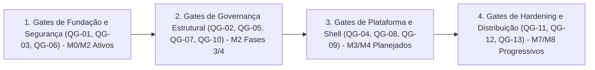
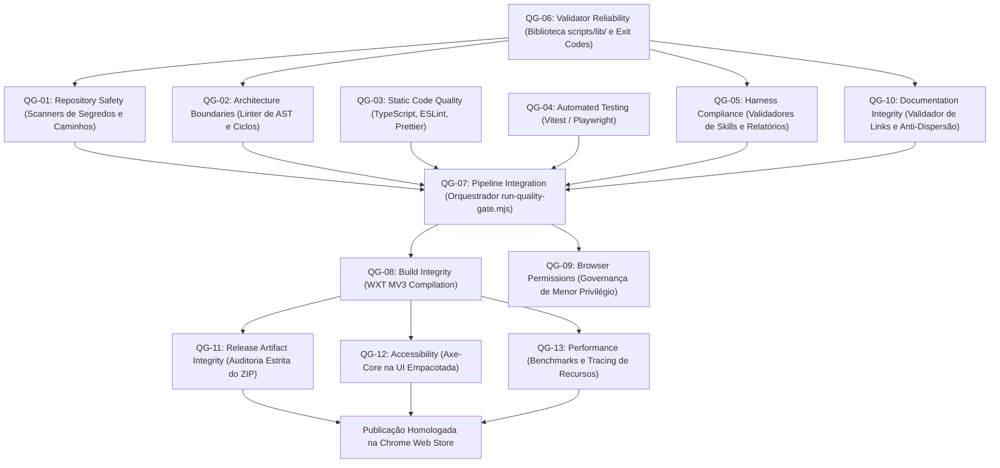
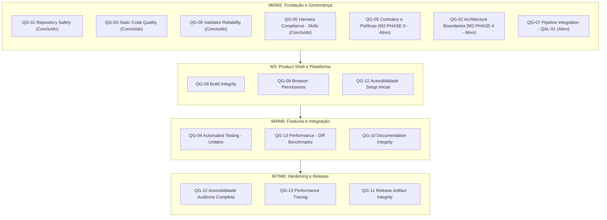

# Quality Gates Roadmap — Planejamento de Implementação e Evolução

> **Projeto:** ExtensionTools  
> **Classificação:** PUBLIC REPOSITORY  
> **Status:** Documento Canônico de Planejamento e Sequenciamento  
> **Diretório Canônico Oficial:** `docs/quality-gates/`  
> **Harness de Referência:** `docs/architecture/HARNESS-ARCHITECTURE.md`  
> **Acompanhamento Geral:** `status.md`  
> **Última Atualização:** 06/11/2026  

---

## Sumário Navegável

- [1. Visão Geral da Estratégia Incremental](#1-visão-geral-da-estratégia-incremental)
- [2. Matriz Consolidada de Implementação dos Quality Gates](#2-matriz-consolidada-de-implementação-dos-quality-gates)
- [3. Matriz de Dependências Técnicas e Grafo de Interdependência](#3-matriz-de-dependências-técnicas-e-grafo-de-interdependência)
- [4. Sequenciamento Recomendado por Fases e Milestones](#4-sequenciamento-recomendado-por-fases-e-milestones)
  - [4.1. Milestone M0/M2: Fundação e Governança do Harness (Concluído / Em Andamento)](#41-milestone-m0m2-fundação-e-governança-do-harness-concluído--em-andamento)
  - [4.2. Milestone M3: Product Shell e Plataforma](#42-milestone-m3-product-shell-e-plataforma)
  - [4.3. Milestone M4: Piloto Funcional Text-Diff](#43-milestone-m4-piloto-funcional-text-diff)
  - [4.4. Milestone M5/M6: Catálogo de Features e Integração](#44-milestone-m5m6-catálogo-de-features-e-integração)
  - [4.5. Milestone M7/M8: Hardening, Acessibilidade, Performance e Release](#45-milestone-m7m8-hardening-acessibilidade-performance-e-release)
- [5. Critérios Universais de Homologação (Definition of Done)](#5-critérios-universais-de-homologação-definition-of-done)
- [6. Referências e Governança](#6-referências-e-governança)

---

# 1. Visão Geral da Estratégia Incremental

A engenharia do **ExtensionTools** adota um princípio fundamental: **a qualidade e a segurança não são fases finais de teste injetadas tardiamente no projeto, mas invariantes mecânicas que sustentam cada etapa da evolução do código**.

No entanto, exigir que todos os 13 Quality Gates operem em sua plenitude desde o primeiro dia resultaria em sobrecarga desproporcional (*overengineering*), com validadores inspecionando artefatos, interfaces e arquivos que ainda não existem. Por essa razão, a implantação dos Quality Gates segue uma **estratégia estritamente incremental e proporcional à maturidade do produto**:

1. **Fase 1 (Fundação e Segurança):** Proteção inegociável contra vazamento de segredos em repositório público, formatação consistente, typecheck estrito e utilitários confiáveis com exit codes padronizados.
2. **Fase 2 (Governança Estrutural e Arquitetura):** Linter de fronteiras modulares Feature-First com AST, auditoria de contratos do Harness, prevenção de dependências circulares e controle anti-dispersão de relatórios.
3. **Fase 3 (Plataforma, Testes e Shell):** Ativação de testes unitários de produto, integridade do build WXT no Manifest V3 e governança de privilégio mínimo em permissões de browser.
4. **Fase 4 (Hardening, Acessibilidade, Performance e Release):** Testes de estresse, auditoria estrita do arquivo ZIP distribuível, conformidade WCAG 2.2 AA e benchmarks de responsividade sem bloqueio de thread.

---

# 2. Matriz Consolidada de Implementação dos Quality Gates

A tabela a seguir consolida o estado real auditado no repositório, os objetivos técnicos, prioridades, dependências e critérios de entrega para cada um dos 13 Quality Gates:

| ID | Quality Gate | Prioridade | Estado Auditado | Milestone Alvo | Dependências Críticas | Implementação Necessária | Testes Necessários | Evidências Existentes | Pendências Principais |
| :--- | :--- | :---: | :---: | :---: | :--- | :--- | :--- | :--- | :--- |
| **QG-01** | **Repository Safety** | **P0 (Crítica)** | `Implementado e validado` | M0 / M2 | Git CLI, `scripts/lib/` | `SEC-08` (Auditor de Histórico do Git) | Testes de git staged, outgoing e all | 19 testes em `git-integration.test.ts`, suíte de scanners | Implementar `SEC-08` na Fase 2 de Scripts |
| **QG-02** | **Architecture Boundaries** | **P0 (Crítica)** | `Parcialmente implementado` | M2-PHASE-4 | TS Compiler API, `ast-analyzer.mjs` | Scripts `ARC-01` e `ARC-02` em `scripts/architecture/` | Fixtures sintéticas de features com imports ilegais e ciclos | `ast-analyzer.mjs` implementado com testes em `tests/harness/lib/` | Desenvolver `ARC-01` e `ARC-02` em M2-PHASE-4 |
| **QG-03** | **Static Code Quality** | **P0 (Crítica)** | `Implementado e validado` | M0 / M2 | TS 7+, ESLint 10, Prettier 3 | Plugin jsx-a11y em M3 | Verificação contínua no CI em cada PR | Configurações ativas em `tsconfig.json`, `eslint.config.js`, CI | Atualizar flat config quando componentes React forem criados |
| **QG-04** | **Automated Testing** | **P0 (Crítica)** | `Parcialmente implementado` | M3 / M4 / M6 | Vitest 5+, Playwright 1.64+ | Testes unitários de `core/` e integração em `tests/` | Testes comportamentais de parsing, diff e store | 60 testes de infraestrutura e harness passando no Vitest | Criar testes unitários para o piloto `text-diff` em M4 |
| **QG-05** | **Harness Compliance** | **P1 (Alta)** | `Parcialmente implementado` | M2-PHASE-3 | Scripts ESM de qualidade | Contratos formais em `.harness/contracts/` e políticas | Fixtures com skills e contratos malformados | 9 skills validadas por `validate-skills.mjs` e relatórios validados | Concluir contratos de IO e políticas técnicas na M2-PHASE-3 |
| **QG-06** | **Validator Reliability** | **P0 (Crítica)** | `Implementado e validado` | M2 / Contínua | Node.js nativo ESM | Script `QAL-02` (runner da suíte de scripts) | Testes de timeout, resiliência a IO e exit codes | Contrato de exit codes 0/1/2 validado em `scripts/lib/` | Implementar `QAL-02` na Fase 2 de Scripts |
| **QG-07** | **Pipeline Integration** | **P0 (Crítica)** | `Parcialmente implementado` | M2 / M8 | Git hooks, GitHub Actions | Orquestrador `QAL-01` (`run-quality-gate.mjs`) | Testes de simulação de modos fast, full e strict | Hooks `.githooks/` e workflow `.github/workflows/` ativos | Construir orquestrador multi-modo CLI `QAL-01` |
| **QG-08** | **Build Integrity** | **P1 (Alta)** | `Planejado` | M3 / M8 | WXT 0.21+, React 19, Vite | Auditor estático de saída de compilação em `.output/` | Testes de compilação headless no Chromium | `wxt.config.ts` configurado e operacional | Aguardando implementação de entrypoints do produto em M3 |
| **QG-09** | **Browser Permissions** | **P1 (Alta)** | `Parcialmente implementado` | M3 / M8 | Analisador de Manifesto MV3 | Linter automatizado comparando manifesto com ADRs | Testes de diff de permissões contra allowlist | Baseline seguro `permissions: []` ativo em `wxt.config.ts` | Automatizar linter de permissões e criar ADRs em M3 |
| **QG-10** | **Documentation Integrity** | **P2 (Média)** | `Parcialmente implementado` | M2 (Fase 4 Scripts) | Node.js fs-utils | Scripts `DOC-01` (links) e `DOC-02` (integridade) | Fixtures com links quebrados e âncoras órfãs | `validate-reports.mjs` ativo com 100% de conformidade | Desenvolver `DOC-01` e `DOC-02` na Fase 4 de Scripts |
| **QG-11** | **Release Artifact Integrity**| **P0 (Release)** | `Planejado` | M8 | Parser ZIP binário em memória | Scripts `REL-01` (auditor ZIP) e `REL-02` (readiness) | Fixtures com arquivos ZIP contendo fontes e sourcemaps | Especificação detalhada em relatório de scripts v2.1 | Implementar scripts na Fase 6 de Scripts (M8) |
| **QG-12** | **Accessibility (a11y)** | **P1 (Alta)** | `Planejado` | M3 / M4 / M7 | Axe-Core, React 19, Tailwind | Regras JSX e suíte de auditoria dinâmica com Axe | Testes de navegação por teclado e contraste de cores | Tokens visuais AA/AAA documentados em `DESIGN.md` | Ativar suíte Axe-Core com os componentes visuais em M3/M4 |
| **QG-13** | **Performance** | **P1 (Alta)** | `Planejado` | M4 / M7 | Vitest Bench, Web Workers | Web Worker dispatcher e suíte de benchmarks de diff | Testes de estresse com arquivos pesados (> 5MB) e medição de heap | Mitigação do risco RSK-03 formalizada na arquitetura | Criar suíte de benchmarks e Web Workers em M4/M7 |

---

# 3. Matriz de Dependências Técnicas e Grafo de Interdependência

Nenhum Quality Gate opera no vácuo. O grafo a seguir demonstra as relações de precedência técnica e acoplamento estritamente unidirecional entre os gates:

### Principais Regras de Precedência Arquitetural
1. **Confiabilidade Base (`QG-06`):** Antecede todos os validadores customizados, pois fornece as bibliotecas de sistema de arquivos, subprocessos e contrato de códigos de saída.
2. **Arquitetura Formalizada Antecede Linter (`QG-02`):** O linter mecânico de limites só pode ser codificado porque a matriz canônica de dependências já foi formalizada em `ARCHITECTURE.md`.
3. **Contratos Antecedem Validação de Harness (`QG-05`):** A verificação de compliance de agentes exige que os contratos em `.harness/contracts/` estejam estabelecidos (foco da M2-PHASE-3).
4. **Build Antecede Auditoria de Release (`QG-08` -> `QG-11`):** Não há como auditar um arquivo distribuível `.zip` sem antes compilar a extensão via WXT.
5. **Grafo Acíclico Obrigatório:** O orquestrador `QG-07` orquestra a execução dos validadores; os validadores de folhas (`QG-01` a `QG-13`) jamais reinvocam o orquestrador.

---

# 4. Sequenciamento Recomendado por Fases e Milestones

A ordem de implementação segue estritamente a redução de riscos e o suporte às fases construtivas do projeto:

## 4.1. Milestone M0/M2: Fundação e Governança do Harness (Concluído / Em Andamento)
- **Foco Imediato:**
  - `QG-05 (M2-PHASE-3)`: Formalização dos contratos de IO de agentes em `.harness/contracts/` e políticas em `.harness/policies/`.
  - `QG-02 (M2-PHASE-4)`: Implementação dos scripts `ARC-01` (`verify-module-boundaries.mjs`) e `ARC-02` (`detect-circular-deps.mjs`) utilizando a base em `ast-analyzer.mjs`.
  - `QG-07 (Fase 2 de Scripts)`: Implementação do orquestrador CLI unificado `run-quality-gate.mjs` (`QAL-01`) e da suíte do harness `test-scripts-suite.mjs` (`QAL-02`).

## 4.2. Milestone M3: Product Shell e Plataforma
- **Foco Imediato:**
  - `QG-08`: Auditoria do primeiro build compilável com Side Panel e Background Service Worker no WXT.
  - `QG-09`: Auditoria estrita do manifesto confirmando privilégio mínimo na introdução de persistência (`IndexedDB` local) e barramento tipado de mensagens.
  - `QG-12`: Configuração de `eslint-plugin-jsx-a11y` no Flat Config do ESLint para os primeiros componentes de layout.

## 4.3. Milestone M4: Piloto Funcional Text-Diff
- **Foco Imediato:**
  - `QG-04`: Primeira suíte abrangente de testes unitários de produto para os algoritmos puros em `src/features/text-diff/core/`.
  - `QG-13`: Estabelecimento da primeira linha de base (baseline) de performance e benchmarks de diff para grandes volumes de texto.
  - `QG-12`: Validação de acessibilidade por teclado e contraste de cores nos componentes do diff.

## 4.4. Milestone M5/M6: Catálogo de Features e Integração
- **Foco Imediato:**
  - `QG-02`: Aplicação contínua da matriz Feature-First impedindo que o crescimento do catálogo de 12 features gere dependências cruzadas.
  - `QG-04`: Expansão da pirâmide de testes com testes de integração e componentes com React Testing Library.
  - `QG-10`: Execução dos scripts `DOC-01` e `DOC-02` para garantir que a documentação de cada nova feature mantenha links válidos e sem dispersão.

## 4.5. Milestone M7/M8: Hardening, Acessibilidade, Performance e Release
- **Foco Imediato:**
  - `QG-12` e `QG-13`: Auditoria profunda com Axe-Core e Playwright Performance Tracing sob carga real.
  - `QG-11`: Implementação dos scripts `REL-01` e `REL-02`, validação de ausência de resíduos no ZIP e certificação final para publicação na Chrome Web Store.

---

# 5. Critérios Universais de Homologação (Definition of Done)

Para que um Quality Gate seja formalmente considerado **`Implementado e validado`** (passando do estado de planejamento para operação plena), ele deve cumprir integralmente o seguinte checklist de 8 pontos:

- [ ] **1. Implementação Funcional Completa:** O script ou ferramenta reside em seu diretório canônico sob `scripts/` ou configuração oficial, operando em Node.js ESM nativo ou através de binário oficial com contrato de exit codes `0`, `1` e `2`.
- [ ] **2. Regras Formalmente Documentadas:** O documento canônico correspondente em `docs/quality-gates/` detalha a responsabilidade, problema resolvido, fundamentos, regras e códigos de encerramento.
- [ ] **3. Suíte de Testes Automatizados:** O validador possui testes no Vitest em `tests/harness/` cobrindo cenários positivos e comprovando que código válido é aprovado com código `0`.
- [ ] **4. Testes Negativos e de Injeção de Falhas:** A suíte de testes comprova que violações reais ou sintéticas disparam reprovação imediata (`exit 1`) com localização clara do erro.
- [ ] **5. Resiliência Operacional (Fail-Closed):** Comprovação em testes de que arquivos de configuração corrompidos, ausência de binários ou falhas de IO encerram a execução com código `2` (*SAFE_ABORT*), nunca com falso sucesso.
- [ ] **6. Integração Efetiva aos Pipelines:** O gate está conectado ao orquestrador `run-quality-gate.mjs`, aos Git Hooks locais ou ao workflow do GitHub Actions correspondente ao seu modo operacional.
- [ ] **7. Resultados Reprodutíveis e Determinísticos:** O gate produz rigorosamente o mesmo resultado em execuções repetidas localmente e na nuvem para o mesmo commit.
- [ ] **8. Registro de Evidências Auditável:** A execução emite logs legíveis e, nos modos aplicáveis, gera relatório ou artefato de status registrado sob `docs/Relatorios/` ou `.output/`.

---

# 6. Referências e Governança

- **Índice Canônico de Quality Gates:** [`docs/quality-gates/README.md`](README.md)
- **Status Geral e Roadmap de Milestones:** [`status.md`](../../status.md)
- **Arquitetura de Software:** [`ARCHITECTURE.md`](../../ARCHITECTURE.md)
- **Governança de Agentes:** [`AGENTS.md`](../../AGENTS.md)
- **Arquitetura do Harness:** [`docs/architecture/HARNESS-ARCHITECTURE.md`](../architecture/HARNESS-ARCHITECTURE.md)
- **Planejamento Técnico da Esteira de Scripts:** [`docs/Relatorios/m2/planejamento-scripts/RELATORIO-PLANEJAMENTO-DESENVOLVIMENTO-SCRIPTS.md`](../Relatorios/m2/planejamento-scripts/RELATORIO-PLANEJAMENTO-DESENVOLVIMENTO-SCRIPTS.md)
- **Índice Canônico de Relatórios:** [`docs/Relatorios/README.md`](../Relatorios/README.md)
