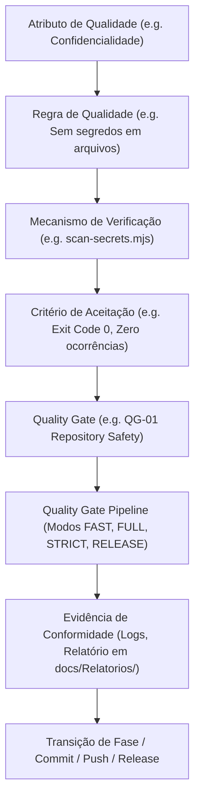
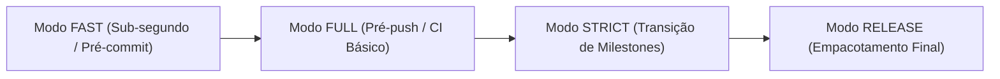
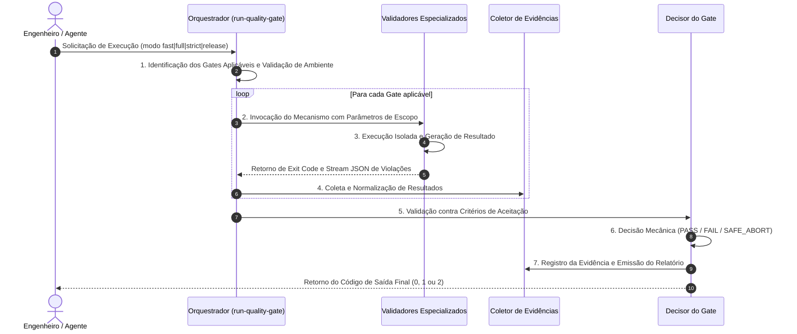

# Quality Gates — Sistema Canônico de Garantia da Qualidade do ExtensionTools

> **Projeto:** ExtensionTools  
> **Classificação:** PUBLIC REPOSITORY  
> **Status:** Documentação Canônica e Planejamento Arquitetural  
> **Diretório Canônico Oficial:** `docs/quality-gates/`  
> **Harness de Referência:** `docs/architecture/HARNESS-ARCHITECTURE.md`  
> **Arquitetura Base:** `ARCHITECTURE.md`  
> **Última Atualização:** 06/11/2026  

---

## Sumário Navegável

- [1. Conceito e Fundamentos de Quality Gates](#1-conceito-e-fundamentos-de-quality-gates)
  - [1.1. O que é um Quality Gate em Engenharia de Software](#11-o-que-é-um-quality-gate-em-engenharia-de-software)
  - [1.2. Distinção Conceitual Rigorosa](#12-distinção-conceitual-rigorosa)
  - [1.3. Grafo de Relacionamento entre os Conceitos](#13-grafo-de-relacionamento-entre-os-conceitos)
- [2. Problemas que os Quality Gates Resolvem](#2-problemas-que-os-quality-gates-resolvem)
- [3. Filosofia dos Quality Gates no ExtensionTools](#3-filosofia-dos-quality-gates-no-extensiontools)
  - [3.1. Os 10 Princípios Norteadores](#31-os-10-princípios-norteadores)
- [4. Catálogo Canônico dos Quality Gates](#4-catálogo-canônico-dos-quality-gates)
- [5. Modos de Execução da Esteira](#5-modos-de-execução-da-esteira)
  - [5.1. Modo FAST](#51-modo-fast)
  - [5.2. Modo FULL](#52-modo-full)
  - [5.3. Modo STRICT](#53-modo-strict)
  - [5.4. Modo RELEASE](#54-modo-release)
- [6. Ciclo de Execução e Decisão Mecânica](#6-ciclo-de-execução-e-decisão-mecânica)
  - [6.1. Fluxo Passo a Passo](#61-fluxo-passo-a-passo)
  - [6.2. Política de Falhas e Resultados Inconclusivos (Fail-Closed)](#62-política-de-falhas-e-resultados-inconclusivos-fail-closed)
- [7. Estrutura Canônica da Documentação](#7-estrutura-canônica-da-documentação)
- [8. Referências e Governança](#8-referências-e-governança)

---

# 1. Conceito e Fundamentos de Quality Gates

## 1.1. O que é um Quality Gate em Engenharia de Software

Em engenharia de software moderna, um **Quality Gate** (Portão de Qualidade) é um ponto de controle determinístico, formal e automatizado inserido no ciclo de vida de desenvolvimento de software (SDLC) que avalia se um conjunto de entregáveis atende a um conjunto explícito e mensurável de critérios técnicos antes de permitir a transição para a próxima etapa do processo (como a criação de um commit, o envio para o repositório remoto, a mesclagem de uma pull request ou a publicação de um pacote de release).

No contexto do **ExtensionTools** — uma extensão de navegador modular construída com React 19, TypeScript, Manifest V3 e WXT destinada a um **repositório público no GitHub** e operada através de **desenvolvimento assistido por IA** —, os Quality Gates deixam de ser simples etapas burocráticas e passam a ser a **fronteira inegociável de governança e segurança**. Eles garantem que agentes autônomos e desenvolvedores humanos operem sob contratos estritos, impedindo que alucinações, simplificações indevidas, vazamento de dados ou violações arquiteturais entrem na base de código.

## 1.2. Distinção Conceitual Rigorosa

Para evitar imprecisões semânticas comuns na literatura de desenvolvimento, a governança do ExtensionTools estabelece distinções inequívocas entre os seguintes conceitos:

| Conceito | Definição Formal | Papel no ExtensionTools | Exemplo Concreto |
| :--- | :--- | :--- | :--- |
| **Atributo de Qualidade** | Propriedade não funcional ou característica de sistema desejada (segurança, manutenibilidade, performance, modularidade). | O *fim* pretendido pela arquitetura. | Segurança da Informação e Confidencialidade em repositório público. |
| **Regra de Qualidade** | Enunciado normativo, invariante ou prescrição técnica que define o que é permitido ou proibido para atingir o atributo. | A *especificação* da restrição técnica. | "Nenhum arquivo versionado pode conter strings que correspondam a tokens AWS, chaves privadas ou identificadores privados." |
| **Mecanismo de Verificação** | A ferramenta, rotina, analisador estático ou script automatizado que inspeciona o código para testar a regra. | O *instrumento mecânico* de inspeção. | O script ESM `scripts/security/scan-secrets.mjs` ou o compilador `tsc --noEmit`. |
| **Quality Gate** | Ponto de decisão formal que agrega um ou mais mecanismos de verificação e emite um parecer booleano vinculativo (`APROVADO` / `REPROVADO`). | A *fronteira de autorização* de um marco ou etapa. | `QG-01 (Repository Safety)`: avalia os resultados de todos os scanners de segurança de forma integrada. |
| **Quality Gate Pipeline** | Sequência orquestrada de Quality Gates acionada em momentos específicos do ciclo de trabalho (pre-commit, CI, release). | A *esteira de execução* com dependências e ordem controladas. | O orquestrador `run-quality-gate.mjs` executando gates em cascata acíclica. |
| **Critério de Aceitação** | Condição necessária, suficiente e mensurável para que uma verificação seja homologada como bem-sucedida. | O *limiar matemático/lógico* de corte. | Exit code `0` de todos os scanners; zero violações de alta ou média severidade; 100% de testes unitários passando. |
| **Evidência de Conformidade** | Registro imutável, auditável e verificável gerado pela execução do mecanismo comprovando o atendimento ao critério. | A *prova material* que autoriza a continuidade. | Log estruturado de execução, relatório em `docs/Relatorios/` e arquivo `.output/report.json`. |

## 1.3. Grafo de Relacionamento entre os Conceitos

---

# 2. Problemas que os Quality Gates Resolvem

O desenvolvimento de extensões de navegador modulares em ambiente de colaboração com IA apresenta riscos complexos que não podem ser geridos por inspeção manual casual. O sistema de Quality Gates do ExtensionTools foi desenhado para eliminar cirurgicamente as seguintes patologias:

1. **Vazamento Acidental de Segredos e Informações Privadas:** Em repositórios públicos, a publicação de uma credencial, chave de API, caminho absoluto de workstation ou termo confidencial é catastrófica e frequentemente irreversível. Quality Gates mecânicos barram alterações antes de saírem do ambiente local.
2. **Erosão Arquitetural e Acoplamento Espaguete:** Em arquiteturas *Feature-First*, agentes de IA ou engenheiros sob pressão tendem a criar imports cruzados ("atalhos") entre pastas de módulos distintos (`import from '../other-feature/core'`). Validadores estáticos mantêm os limites entre features intransponíveis.
3. **Regressões Lógicas Silenciosas:** Alterações em parsers de XML, diff de texto ou tratamento de streams de dados podem quebrar casos de borda sutis sem gerar erros de compilação. Testes automatizados executados sistematicamente impedem a degradação de comportamento.
4. **Falsos Sucessos e Ilusão de Conformidade (*Silent Failures*):** Scanners que encontram falhas operacionais (e.g. arquivo de configuração ausente ou erro de permissão no filesystem) e encerram com status de sucesso (`exit 0`). Os gates impõem o princípio *Fail-Closed*.
5. **Divergência entre Documentação e Código Real:** Declarações em arquivos de status de que uma funcionalidade ou política "está ativa", quando não há testes ou código correspondente no repositório. O gate de governança exige evidências comprováveis.
6. **Poluição e Inconsistência de Código:** Divergências de formatação, tipos frouxos (`any` implícito), variáveis órfãs e padrões obsoletos degradam o contexto fornecido a modelos de IA. A checagem estática contínua garante código limpo e determinístico.
7. **Empacotamento de Artefatos Indevidos no Pacote Final:** Inclusão de testes, fixtures, arquivos fonte `.ts` ou sourcemaps de desenvolvimento no arquivo ZIP da extensão enviado à Chrome Web Store.
8. **Violação do Princípio do Menor Privilégio no Manifest V3:** Adição descuidada de permissões amplas (`<all_urls>`, `webRequestBlocking`) que expõem o usuário e causam rejeição na auditoria da Web Store.

---

# 3. Filosofia dos Quality Gates no ExtensionTools

## 3.1. Os 10 Princípios Norteadores

A engenharia do ExtensionTools adota dez princípios inegociáveis que regem a concepção e operação de todos os Quality Gates:

1. **Fail-Closed (Falha Segura):** Toda falha de execução, erro inesperado de ambiente, ausência de arquivo de configuração obrigatório ou resultado ambíguo deve resultar em **reprovação imediata do gate** (`exit 1` ou `exit 2`). A ausência de evidência de conformidade é equivalente à violação comprovada.
2. **Determinismo Absoluto:** Uma verificação executada sobre o mesmo estado do repositório deve produzir rigorosamente o mesmo resultado, independentemente de quem a executa, da hora do dia ou da carga da máquina. Resultados flutuantes (*flaky tests*) são tratados como bugs críticos do próprio gate.
3. **Reprodutibilidade Local:** Todo Quality Gate executado na esteira de Integração Contínua (CI) deve poder ser reproduzido localmente pelo desenvolvedor com um comando idêntico. Não existem verificações exclusivas da nuvem que não possam ser auditadas na estação de trabalho.
4. **Rastreabilidade e Evidência Auditável:** Nenhuma transição é autorizada com base em declarações verbais. Toda aprovação exige logs com timestamp, identificação dos arquivos examinados e relatórios canônicos centralizados em `docs/Relatorios/`.
5. **Responsabilidades Bem Definidas (Single Responsibility):** Cada Quality Gate protege um atributo de qualidade claramente delimitado. O verificador de segurança não valida regras de linting; o verificador de arquitetura não audita tipografia de UI.
6. **Baixo Acoplamento e Grafo Acíclico:** Os Quality Gates não possuem dependências circulares entre si. O orquestrador de gates invoca os validadores especializados; validadores de folhas nunca reinvocam o orquestrador.
7. **Segurança por Padrão (*Safe-by-Default*):** O repositório nasce bloqueado para publicação remota e com zero permissões no Manifest V3. Cada liberação ou adição de privilégio exige justificação arquitetural (ADR) e validação mecânica.
8. **Verificações Independentes dos Agentes:** Os testes e validadores mecânicos não confiam nas autoavaliações dos modelos de linguagem. O parecer de conformidade é emitido pelo runtime do Node.js e do compilador, nunca pela autoanálise do agente.
9. **Complexidade Proporcional:** As ferramentas de validação utilizam a menor solução técnica suficiente (Node.js nativo ESM, TypeScript Compiler API, Vitest). Não são introduzidos frameworks monolíticos pesados para tarefas solucionáveis com scripts coesos.
10. **Implementação Incremental e Orientada a Milestones:** Os Quality Gates evoluem em sincronia com a maturidade do produto. Controles essenciais operam desde a fundação; verificações de release, a11y e performance são ativadas à medida que interfaces e artefatos reais são desenvolvidos.

---

# 4. Catálogo Canônico dos Quality Gates

A tabela a seguir apresenta os 13 Quality Gates do ExtensionTools, correlacionados aos atributos que protegem, à sua prioridade e ao seu **estado real auditado no repositório**:

| ID | Quality Gate | Atributo Protegido | Prioridade | Estado Auditado no Repositório | Documento Detalhado |
| :--- | :--- | :--- | :--- | :--- | :--- |
| **QG-01** | **Repository Safety** | Confidencialidade e Segurança do Repositório | **Essencial** | `Implementado e validado` | [`01-repository-safety.md`](01-repository-safety.md) |
| **QG-02** | **Architecture Boundaries** | Modularidade e Isolamento Feature-First | **Essencial** | `Parcialmente implementado` | [`02-architecture-boundaries.md`](02-architecture-boundaries.md) |
| **QG-03** | **Static Code Quality** | Consistência Sintática e Corretude de Tipos | **Essencial** | `Implementado e validado` | [`03-static-code-quality.md`](03-static-code-quality.md) |
| **QG-04** | **Automated Testing** | Confiabilidade e Não-Regressão Funcional | **Essencial** | `Parcialmente implementado` | [`04-automated-testing.md`](04-automated-testing.md) |
| **QG-05** | **Harness Compliance** | Governança de Agentes, Skills e Políticas | **Essencial** | `Parcialmente implementado` | [`05-harness-compliance.md`](05-harness-compliance.md) |
| **QG-06** | **Validator Reliability** | Integridade Operacional dos Próprios Gates | **Essencial** | `Implementado e validado` | [`06-validator-reliability.md`](06-validator-reliability.md) |
| **QG-07** | **Pipeline Integration** | Orquestração do Fluxo de Trabalho (SDLC) | **Essencial** | `Parcialmente implementado` | [`07-pipeline-integration.md`](07-pipeline-integration.md) |
| **QG-08** | **Build Integrity** | Integridade de Empacotamento Manifest V3 | **Progressivo** | `Planejado` | [`08-build-integrity.md`](08-build-integrity.md) |
| **QG-09** | **Browser Permissions** | Menor Privilégio na Plataforma WebExtension | **Progressivo** | `Parcialmente implementado` | [`09-browser-permissions.md`](09-browser-permissions.md) |
| **QG-10** | **Documentation Integrity** | Confiabilidade Documental e Rastreabilidade | **Progressivo** | `Parcialmente implementado` | [`10-documentation-integrity.md`](10-documentation-integrity.md) |
| **QG-11** | **Release Artifact Integrity**| Conformidade para Distribuição na Web Store | **Progressivo** | `Planejado` | [`11-release-artifact-integrity.md`](11-release-artifact-integrity.md) |
| **QG-12** | **Accessibility (a11y)** | Acessibilidade Universal e Usabilidade (WCAG)| **Progressivo** | `Planejado` | [`12-accessibility.md`](12-accessibility.md) |
| **QG-13** | **Performance** | Eficiência de Recursos e Responsividade UI | **Progressivo** | `Planejado` | [`13-performance.md`](13-performance.md) |

> [!NOTE]
> **Convenção de Estados:**  
> - `Implementado e validado`: Código funcional presente no repositório e coberto por testes automatizados comprovados.  
> - `Parcialmente implementado`: Parte da infraestrutura ou validadores existe, mas faltam componentes ou suítes de teste de produto.  
> - `Planejado`: Arquitetura especificada e documentada, com implementação programada para milestone futuro.  

---

# 5. Modos de Execução da Esteira

Para equilibrar velocidade de desenvolvimento com rigor inegociável de segurança, a arquitetura de Quality Gates prevê quatro modos operacionais padronizados:

## 5.1. Modo FAST
- **Finalidade:** Feedback ultrarrápido durante o ciclo de edição e antes da gravação de commits locais.
- **Ponto de Execução:** Hook de `.githooks/pre-commit` e comando manual do desenvolvedor.
- **Escopo de Verificação:** Apenas arquivos na *staging area* do Git (`git diff --cached`).
- **Gates Ativados:**
  - `QG-01` (Scanners de segredos, caminhos privados e referências sobre blobs staged).
  - `QG-03` (Formatação e lint incremental dos arquivos alterados).
- **Tempo Alvo:** < 2 segundos.

## 5.2. Modo FULL
- **Finalidade:** Validação abrangente de integridade antes do envio de alterações para o repositório ou integração de branches.
- **Ponto de Execução:** Hook de `.githooks/pre-push` e pipeline básico de Pull Request no GitHub Actions.
- **Escopo de Verificação:** Commits locais não enviados (`outgoing`) ou árvore de trabalho completa.
- **Gates Ativados:**
  - `QG-01` (Segurança completa sobre commits a enviar).
  - `QG-02` (Validação estática de limites arquiteturais Feature-First).
  - `QG-03` (Typecheck rigoroso de todo o projeto e lint geral).
  - `QG-04` (Execução de todos os testes unitários e de harness).
  - `QG-05` (Validação de conformidade estrutural do Harness).
  - `QG-10` (Validação anti-dispersão de relatórios).
- **Tempo Alvo:** < 30 segundos.

## 5.3. Modo STRICT
- **Finalidade:** Auditoria profunda e exaustiva para encerramento de milestones e transições de fase arquitetural.
- **Ponto de Execução:** Revisão de marcos pelo Orchestrator/Architect e pipelines de branch principal (`main`).
- **Escopo de Verificação:** Repositório integral, histórico de commits recente e integridade cruzada de contratos.
- **Gates Ativados:**
  - Todos os gates do modo `FULL`.
  - `QG-04` com testes de integração e análise de mutação quando aplicável.
  - `QG-06` (Execução de testes adversariais dos próprios validadores).
  - `QG-08` (Compilação WXT limpa sem avisos).
  - `QG-09` (Auditoria de permissões Manifest V3 contra tabela de ADRs).
  - `QG-10` (Auditoria completa de links em documentação técnica).
- **Tempo Alvo:** < 2 minutos.

## 5.4. Modo RELEASE
- **Finalidade:** Certificação formal de prontidão para distribuição pública da extensão na Chrome Web Store.
- **Ponto de Execução:** Esteira de tagging de versão e automação de release (`scripts/release/`).
- **Escopo de Verificação:** Pacote ZIP compilado (`.output/`), manifesto final e metadados de distribuição.
- **Gates Ativados:**
  - Todos os gates do modo `STRICT`.
  - `QG-11` (Descompactação e auditoria estrita do ZIP: ausência de fontes `.ts`, testes, fixtures ou mapas de dev).
  - `QG-12` (Auditoria automatizada e manual de acessibilidade WCAG).
  - `QG-13` (Benchmark de performance e footprint de memória da extensão).
- **Tempo Alvo:** Proporcional à suíte completa (< 5 minutos).

---

# 6. Ciclo de Execução e Decisão Mecânica

## 6.1. Fluxo Passo a Passo

Toda execução de Quality Gate segue uma sequência determinística de 7 passos:

1. **Solicitação:** Disparo do comando pelo usuário, hook Git ou agente autônomo informando o modo desejado.
2. **Identificação e Pré-condições:** O orquestrador valida se o ambiente possui dependências necessárias (Node.js >= 20, pnpm) e resolve os arquivos sob escopo.
3. **Execução Isolada:** Cada validador roda como subprocesso ou módulo independente, sem interferir no estado dos demais.
4. **Coleta de Resultados:** O orquestrador intercepta a saída padrão, código de encerramento e objetos de erro de cada validador.
5. **Avaliação dos Critérios:** As métricas de saída são confrontadas diretamente com as regras definidas na especificação do gate.
6. **Decisão:** O parecer é estritamente binário. Se qualquer critério falhar ou se uma checagem falhar operacionalmente, o gate é reprovado.
7. **Emissão de Evidência:** Um sumário legível é emitido no console e, em modos formais, um registro auditável é salvo em `docs/Relatorios/` ou `.output/`.

## 6.2. Política de Falhas e Resultados Inconclusivos (Fail-Closed)

O ExtensionTools padroniza o contrato de códigos de saída para todos os seus scripts e gates de qualidade:

| Código de Saída | Significado Canônico | Interpretação do Gate | Ação do Pipeline |
| :---: | :--- | :--- | :--- |
| **`0`** | **PASS (Sucesso)** | Todas as regras foram atendidas satisfatoriamente e comprovadas por evidências. | Continuidade autorizada. |
| **`1`** | **FAIL (Reprovação)** | Pelo menos uma violação de regra de qualidade foi detectada (e.g. segredo encontrado, import proibido, teste quebrado). | **Bloqueio imediato** da operação. Correção do código necessária. |
| **`2`** | **SAFE_ABORT (Erro Operacional)** | Falha no mecanismo de verificação (e.g. arquivo de configuração ilegível, comando do sistema ausente, erro de IO). | **Bloqueio preventivo imediato**. Proibido interpretar erro de execução como conformidade. |

> [!CAUTION]
> **Proibição Estrita de Supressão:**  
> É estritamente proibido utilizar `exit 0` em blocos `catch` de scripts validadores. Falhas inesperadas devem ser registradas com `logger.error` e emitir código `2`.

---

# 7. Estrutura Canônica da Documentação

A especificação técnica completa dos Quality Gates está estruturada nos seguintes documentos canônicos neste diretório:

### Gates Fundamentais (M2)
- [`01-repository-safety.md`](01-repository-safety.md) — Prevenção contra vazamento de segredos, referências corporativas e caminhos privados em repositório público (ver plano detalhado em [`docs/Relatorios/m2/quality-gates/QG-01-PLANO-DESENVOLVIMENTO-E-HOMOLOGACAO.md`](../Relatorios/m2/quality-gates/QG-01-PLANO-DESENVOLVIMENTO-E-HOMOLOGACAO.md)).
- [`02-architecture-boundaries.md`](02-architecture-boundaries.md) — Preservação dos limites modulares Feature-First e proibição de acoplamentos ilegais.
- [`03-static-code-quality.md`](03-static-code-quality.md) — Governança estática com TypeScript strict, ESLint 10 e Prettier.
- [`04-automated-testing.md`](04-automated-testing.md) — Estratégia de testes automatizados com Vitest e Playwright para prevenção de regressões.
- [`05-harness-compliance.md`](05-harness-compliance.md) — Conformidade estrutural de agentes, skills, contratos e políticas do Harness.
- [`06-validator-reliability.md`](06-validator-reliability.md) — Auditoria de confiabilidade, testes adversariais e tolerância a falhas dos próprios validadores.
- [`07-pipeline-integration.md`](07-pipeline-integration.md) — Integração aos hooks do Git, automações CI e orquestrador de esteira.

### Gates Progressivos (M3 a M8)
- [`08-build-integrity.md`](08-build-integrity.md) — Integridade de compilação, empacotamento WXT e conformidade com Manifest V3.
- [`09-browser-permissions.md`](09-browser-permissions.md) — Governança de privilégios e permissões mínimas no navegador.
- [`10-documentation-integrity.md`](10-documentation-integrity.md) — Integridade de links, rastreabilidade técnica e governança anti-dispersão de relatórios.
- [`11-release-artifact-integrity.md`](11-release-artifact-integrity.md) — Auditoria estrita do arquivo ZIP distribuível antes do envio à Web Store.
- [`12-accessibility.md`](12-accessibility.md) — Conformidade com padrões de acessibilidade WCAG 2.2 e navegação assistiva.
- [`13-performance.md`](13-performance.md) — Monitoramento de tempo de inicialização, pegada de memória e eficiência de processamento local.

### Planejamento e Roadmap
- [`QUALITY-GATES-ROADMAP.md`](QUALITY-GATES-ROADMAP.md) — Matriz de implementação, dependências técnicas, fases e critérios de homologação (*Definition of Done*).

---

# 8. Referências e Governança

- **Arquitetura de Software:** [`ARCHITECTURE.md`](../../ARCHITECTURE.md)
- **Governança de Agentes:** [`AGENTS.md`](../../AGENTS.md)
- **Instruções Operacionais Gemini:** [`GEMINI.md`](../../GEMINI.md)
- **Design System e Tokens de Interface:** [`DESIGN.md`](../../DESIGN.md)
- **Status e Painel de Progresso:** [`status.md`](../../status.md)
- **Arquitetura do Harness:** [`docs/architecture/HARNESS-ARCHITECTURE.md`](../architecture/HARNESS-ARCHITECTURE.md)
- **Política de Segurança Pública:** [`SECURITY.md`](../../SECURITY.md)
- **Planejamento Técnico da Esteira de Scripts:** [`docs/Relatorios/m2/planejamento-scripts/RELATORIO-PLANEJAMENTO-DESENVOLVIMENTO-SCRIPTS.md`](../Relatorios/m2/planejamento-scripts/RELATORIO-PLANEJAMENTO-DESENVOLVIMENTO-SCRIPTS.md)
- **Índice Canônico de Relatórios:** [`docs/Relatorios/README.md`](../Relatorios/README.md)
