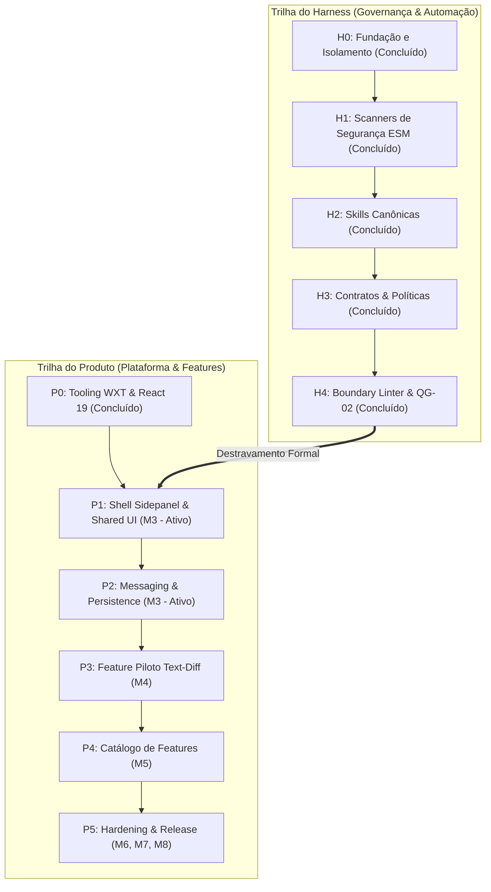
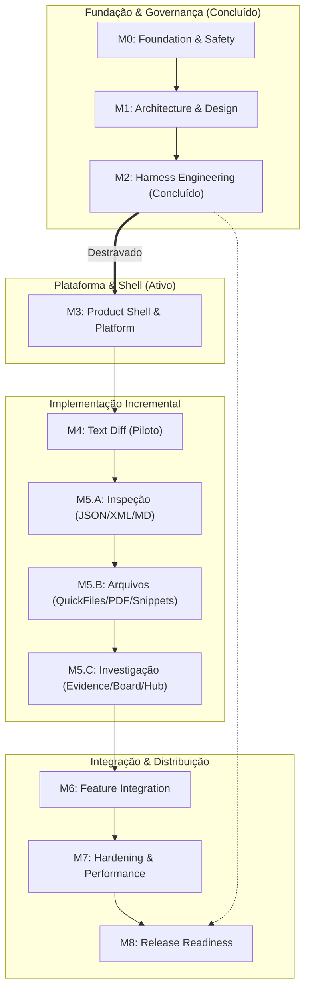

# Status, Roadmap e Governança do Desenvolvimento — ExtensionTools

> **Projeto:** ExtensionTools\
> \*\***Classificação:** PUBLIC REPOSITORY\
> \*\***Status Geral do Repositório:** **M2 HOMOLOGATED — M3 IN PROGRESS (BLOCO 0, BLOCO 1, BLOCO 2 E BLOCO 3 HOMOLOGADOS COM RESERVAS DOCUMENTADAS — BLOCO 4 DESBLOQUEADO) — PUBLICATION BLOCKED (SAFE-BY-DEFAULT)**\
> \*\***Framework Base:** WXT + Manifest V3 + React 19 + TypeScript + Tailwind CSS\
> \*\***Documento Canônico de Governança de Progresso:** `status.md`\
> \*\***Última Atualização:** 08/11/2026

---

## Sumário Navegável

- [PARTE A — PAINEL OPERACIONAL DE ACOMPANHAMENTO](#parte-a--painel-operacional-de-acompanhamento)
  - [1. Situação Atual do Desenvolvimento](#1-situa%C3%A7%C3%A3o-atual-do-desenvolvimento)
  - [2. Indicadores de Progresso](#2-indicadores-de-progresso)
  - [3. Linha do Tempo dos Milestones](#3-linha-do-tempo-dos-milestones)
  - [4. Fase Ativa — O Que Precisa Ser Feito Agora (M3-PHASE-4 Desbloqueada / Bloco 4 — Platform Persistence)](#4-fase-ativa--o-que-precisa-ser-feito-agora-m3-phase-4-desbloqueada--bloco-4--platform-persistence)
  - [5. Histórico de Homologação do Milestone Concluído (M2)](#5-hist%C3%B3rico-de-homologa%C3%A7%C3%A3o-do-milestone-conclu%C3%ADdo-m2)
  - [6. Gate de Transição — M2 → M3 e Desbloqueio da Plataforma](#6-gate-de-transi%C3%A7%C3%A3o--m2--m3-e-desbloqueio-da-plataforma)
  - [7. Estruturação Operacional do Milestone Ativo — M3: Product Shell & Platform Foundation](#7-estrutura%C3%A7%C3%A3o-operacional-do-milestone-ativo--m3-product-shell--platform-foundation)
- [PARTE B — ROADMAP TÉCNICO E DETALHAMENTO HISTÓRICO](#parte-b--roadmap-t%C3%A9cnico-e-detalhamento-hist%C3%B3rico)
  - [8. Identificação e Filosofia do Projeto](#8-identifica%C3%A7%C3%A3o-e-filosofia-do-projeto)
  - [9. Visão Geral e Separação de Trilhas de Engenharia](#9-vis%C3%A3o-geral-e-separa%C3%A7%C3%A3o-de-trilhas-de-engenharia)
  - [10. Marcos Arquiteturais e Decisões Fundamentais (ADRs)](#10-marcos-arquiteturais-e-decis%C3%B5es-fundamentais-adrs)
  - [11. Detalhamento dos Milestones (M0 a M8)](#11-detalhamento-dos-milestones-m0-a-m8)
  - [12. Catálogo e Planejamento das 12 Features](#12-cat%C3%A1logo-e-planejamento-das-12-features)
  - [13. Dependências e Caminho Crítico](#13-depend%C3%AAncias-e-caminho-cr%C3%ADtico)
  - [14. Critérios de Qualidade e Matriz de Quality Gates](#14-crit%C3%A9rios-de-qualidade-e-matriz-de-quality-gates)
  - [15. Gestão de Riscos, Impedimentos e Pendências](#15-gest%C3%A3o-de-riscos-impedimentos-e-pend%C3%AAncias)
  - [16. Histórico de Progresso Orientado por Evidências](#16-hist%C3%B3rico-de-progresso-orientado-por-evid%C3%AAncias)
  - [17. Regras de Manutenção e Governança para Agentes](#17-regras-de-manuten%C3%A7%C3%A3o-e-governan%C3%A7a-para-agentes)
  - [18. Referências e Evidências Canônicas](#18-refer%C3%AAncias-e-evid%C3%AAncias-can%C3%B4nicas)

---

# PARTE A — PAINEL OPERACIONAL DE ACOMPANHAMENTO

> [!IMPORTANT] 📌
> Propósito Operacional: Esta seção sintetiza o estado exato de execução do projeto para orientação instantânea de agentes autônomos e engenheiros humanos. A situação atual reflete rigorosamente os artefatos e testes validados no repositório.

---

## 1. Situação Atual do Desenvolvimento

| Atributo | Estado Canônico Confirmado |
| --- | --- |
| **Milestone Atual** | **M3 — Product Shell & Platform Foundation** |
| **Estado do Milestone** | `Em Andamento (Bloco 0, Bloco 1, Bloco 2 e Bloco 3 homologados; Blocos 4 e 5 pendentes)` |
| **Fase Atual** | `M3-PHASE-4` **— Platform Persistence & Storage (Desbloqueada / Pronta para Início)** |
| **Bloco Atual** | **Bloco 4 — Platform Persistence (Pronto para Início — Bloco 3 Homologado com Reservas Documentadas e 499 Testes Aprovados no Vitest)** |
| **Atividade Atual** | **Homologação formal do Bloco 3 (Platform Messaging) concluída com 499 testes aprovados no Vitest, zero violações de arquitetura e parecer APROVADO COM RESSALVAS DOCUMENTADAS; preparação para início do Bloco 4 (Platform Persistence & Storage)** |
| **Parecer Operacional Atual** | `COMPLETED_WITH_RESERVATIONS` (Bloco 3 homologado formalmente em `docs/Relatorios/m3/Bloco_3/RELATORIO-REVISAO-FINAL-BLOCO-3.md`; 499 testes totais no Vitest, typecheck rigoroso, lint limpo, boundary linter 100% e build WXT limpo) |
| **Próxima Ação Prioritária (Unívoca)** | **Iniciar o planejamento e implementação do Bloco 4 — Platform Persistence (**`M3-PHASE-4`**)** |
| **Próxima Etapa Planejada** | `M3-PHASE-4` **/ Platform Persistence & Storage (**`src/platform/persistence/`**)** |
| **Condição de Avanço para Bloco 4** | **ATENDIDA** (Blocos 0, 1, 2 e 3 homologados formalmente com evidências registradas) |
| **Fases Concluídas / Homologadas em M3** | **3 de 5 fases concluídas** (`M3-PHASE-1`, `M3-PHASE-2` e `M3-PHASE-3` concluídas; `M3-PHASE-4` e `M3-PHASE-5` pendentes) |
| **Blocos Homologados em M3** | **4 de 6 blocos homologados** (Bloco 0, Bloco 1, Bloco 2 e Bloco 3 concluídos/homologados; Blocos 4 e 5 pendentes) |
| **Tarefas Homologadas em M3** | **22 de 28 entregáveis concluídos** (`M3-P1-T01` a `M3-P1-T06`, `M3-P2-T01` a `M3-P2-T06`, `B3-F01` a `B3-F10`) |
| **Próximo Milestone** | **M4 — First Feature Pilot & Architecture Validation (Text Diff)** |
| **Status de Publicação Externa** | `BLOQUEADO` *(Safe-by-default — Nenhum segredo ou push remoto até M8)* |

---

## 2. Indicadores de Progresso

Os indicadores utilizam contagem simples auditada de fases e etapas. Não são utilizados percentuais arbitrários baseados em linhas de código. A conclusão de uma fase depende de evidências formais de homologação.

### 2.1. Progresso Geral de Milestones (M0 a M8)

- **Milestones Totais:** 9 (M0 a M8)
- **Milestones Concluídos / Homologados:** 3 (M0, M1, M2)
- **Milestone Ativo / Em Andamento:** 1 (M3 — Blocos 0, 1, 2 e 3 homologados com reservas documentadas; Bloco 4 desbloqueado)
- **Milestones Pendentes:** 5 (M4, M5, M6, M7, M8)
- **Indicador Visual Geral:**\
  `[███░░░░░░] 3/9 Milestones concluídos (33.3%)`

### 2.2. Progresso do Milestone Anterior Concluído (M2 — Harness Engineering & Governance)

- **Fases Totais:** 4 (`M2-PHASE-1`, `M2-PHASE-2`, `M2-PHASE-3`, `M2-PHASE-4`)
- **Fases Concluídas:** 4 (100%)
- **Tarefas de M2 Concluídas:** 38 de 38 tarefas verificáveis
- **Testes Automatizados Aprovados:** 155 testes no Vitest (100% de sucesso em 13 suítes)
- **Parecer Final de M2:** `COMPLETED_WITH_RESERVATIONS` (Auditoria independente aprovada)
- **Evidências Canônicas:**\
  `docs/Relatorios/m2/auditoria-final/RELATORIO-AUDITORIA-INTEGRAL-M2.md`,\
  `docs/Relatorios/m2/M2-HARNESS-REPORT.md`.

### 2.3. Progresso do Milestone Atual (M3 — Product Shell & Platform Foundation)

- **Fases Totais:** 5 (`M3-PHASE-1` a `M3-PHASE-5`)
- **Fases Concluídas / Homologadas:** 3 (60%) — `M3-PHASE-1`, `M3-PHASE-2` e `M3-PHASE-3` concluídas/homologadas
- **Fases em Andamento / Desbloqueadas:** 1 (`M3-PHASE-4` — Bloco 4 pronto para início)
- **Fases Pendentes:** 1 (`M3-PHASE-5`)
- **Blocos Totais:** 6 (Bloco 0 a Bloco 5)
- **Blocos Homologados / Concluídos:** 4 (Bloco 0 — Baseline e Prontidão; Bloco 1 — WXT & Side Panel Shell; Bloco 2 — Design System Primitivo; Bloco 3 — Platform Messaging)
- **Blocos Pendentes / Bloqueados:** 2 (Blocos 4 e 5)
- **Tarefas Totais de M3:** 28 tarefas planejadas
- **Tarefas Concluídas / Homologadas:** 22 (78.6%) — `M3-P1-T01` a `M3-P1-T06`, `M3-P2-T01` a `M3-P2-T06`, `B3-F01` a `B3-F10`
- **Tarefas Pendentes:** 6 (21.4%)
- **Indicador Visual do Milestone:**\
  `M3 — [████████░░] 3/5 Fases concluídas (4 Blocos concluídos; 22/28 tarefas concluídas, 6 pendentes)`
- **Evidência de Planejamento de M3:** `docs/Relatorios/m3/planejamento/RELATORIO-ESTRUTURACAO-OPERACIONAL-M3.md`
- **Evidência do Baseline (Bloco 0):** `docs/Relatorios/m3/bloco-0-baseline/RELATORIO-M3-BLOCO-0-BASELINE-E-PRONTIDAO.md`
- **Evidência da Homologação do Bloco 1:** `docs/Relatorios/m3/bloco-1-sidepanel-shell/RELATORIO-REVISAO-FINAL-BLOCO-1.md`
- **Evidência da Homologação do Bloco 2:** `docs/Relatorios/m3/Bloco_2/RELATORIO-EXECUCAO-BLOCO-2.md`
- **Evidência da Homologação do Bloco 3:** `docs/Relatorios/m3/Bloco_3/RELATORIO-REVISAO-FINAL-BLOCO-3.md`
- **Evidências de Implementação do Bloco 1:**
  - B1-F02: `docs/Relatorios/m3/bloco-1-sidepanel-shell/RELATORIO-IMPLEMENTACAO-B1-F02-TOOL-NAVIGATION.md`
  - B1-C01: `docs/Relatorios/m3/bloco-1-sidepanel-shell/RELATORIO-IMPLEMENTACAO-B1-C01-SIDEPANEL-APP.md`
  - B1-S01: `docs/Relatorios/m3/bloco-1-sidepanel-shell/RELATORIO-IMPLEMENTACAO-B1-S01-VISUAL-FOUNDATION.md`
- **Evidências de Planejamento do Bloco 2:** `docs/Relatorios/m3/Bloco_2/Planejamento/` (12 relatórios técnicos)

### 2.4. Progresso de Features de Produto

- **Features Previstas:** 12 ferramentas analíticas e de produtividade
- **Features Implementadas:** 0 (Início planejado em M4 para piloto `text-diff` e M5 para o catálogo)
- **Features Prontas para Especificação:** 1 (`FEAT-TEXT-DIFF` — aguarda M3 completo)

---

## 3. Linha do Tempo dos Milestones

```text
[M0: Foundation & Safety] (CONCLUÍDO - Validado em H0)
   │
   ▼
[M1: Architecture & Design] (CONCLUÍDO - Validado em ARCHITECTURE.md & DESIGN.md)
   │
   ▼
[M2: Harness Engineering] (CONCLUÍDO - Homologado com ressalvas em H4; 155 testes)
   │
   ├─► [M3: Product Shell & Platform] (EM ANDAMENTO — Blocos 0, 1, 2 e 3 Homologados; Bloco 4 Desbloqueado)
   │      │
   │      ├── Bloco 0: Baseline & Tooling ────────► [HOMOLOGADO c/ reservas]
   │      ├── Bloco 1: WXT & Side Panel Shell ────► [HOMOLOGADO c/ reservas]
   │      ├── Bloco 2: Design System Primitivo ───► [HOMOLOGADO — 288 testes Vitest 100% aprovados]
   │      ├── Bloco 3: Platform Messaging ────────► [HOMOLOGADO c/ reservas — 499 testes Vitest 100% aprovados]
   │      ├── Bloco 4: Platform Persistence ──────► [DESBLOQUEADO / PRONTO PARA INÍCIO]
   │      └── Bloco 5: Integração & Homologação ──► [PENDENTE]
   │      │
   │      ▼
   │   [M4: Feature Piloto Text-Diff] (PENDENTE - Depende de M3 completo e homologado)
   │      │
   │      ▼
   │   [M5: Core Features Catalogue] (PENDENTE - Depende de M4 validado)
   │      │
   │      ▼
   │   [M6: Feature Integration & UX] (PENDENTE - Depende de M5)
   │      │
   │      ▼
   │   [M7: Quality & Hardening] (PENDENTE - Depende de M6)
   │      │
   │      ▼
   └───► [M8: Release Readiness & Distribution] (PENDENTE - Depende de M7 + M2 integral)
```

---

## 4. Fase Ativa — O Que Precisa Ser Feito Agora (M3-PHASE-4 Desbloqueada / Bloco 4 — Platform Persistence)

### 4.1. Ficha de Identificação da Fase

- **Milestone:** M3 — Product Shell & Platform Foundation
- **Código da Fase:** `M3-PHASE-4`
- **Nome Oficial:** Platform Persistence & Storage
- **Bloco Atual:** **Bloco 4 — Platform Persistence**
- **Estado Operacional Atual:** `DESBLOQUEADA / PRONTA PARA INÍCIO` **(Blocos 0, 1, 2 e 3 formalmente homologados com 499 testes Vitest aprovados; pronta para desenho de contratos de persistência)**
- **Objetivo Central:** Estabelecer a infraestrutura de persistência local da plataforma sob a filosofia *Local-First*: definir as interfaces `StorageAdapter` e `KeyValueStore`, implementar o adaptador concreto `ChromeStorageAdapter` sobre `chrome.storage.local`, modelar a porta do futuro `IndexedDBAdapter` e validar quotas, isolamento e resiliência a falhas com testes automatizados determinísticos.
- **Dependências Técnicas:** M0, M1 e M2 concluídos; Bloco 0, Bloco 1, Bloco 2 e Bloco 3 de M3 homologados com evidências consolidadas — *Todas atendidas*.
- **Agentes Recomendados:** `Architect` / `Developer` / `Test Engineer` / `Security Auditor` (Orquestração: `Orchestrator`).
- **Quality Gates Aplicáveis:** `QG-01` (Repository Safety), `QG-02` (Architecture Boundaries), `QG-03` (Static Code Quality), `QG-04` (Automated Testing), `QG-08` (Build Integrity) e `QG-09` (Browser Permissions).

---

### 4.2. Matrizes dos Entregáveis Arquiteturais de M3

#### 4.2.1. Matriz dos Entregáveis Arquiteturais do Bloco 1 (Entrypoints WXT e Side Panel Shell)

A decomposição arquitetural do Bloco 1 estrutura-se em 6 entregáveis fundamentais. Todos tiveram sua implementação física concluída, revisada, corrigida e **Homologada com Reservas**:

| ID | Entregável Arquitetural | Responsabilidade Principal | Arquivos e Módulos Principais | Evidências e Testes | Estado Operacional |
| --- | --- | --- | --- | --- | --- |
| **B1-I01** | WXT Side Panel Entrypoint | Inicialização do runtime React 19 e montagem do container HTML | `src/entrypoints/sidepanel/index.html`, `main.tsx`, `App.tsx` | Reconhecimento pelo WXT, build em `.output/chrome-mv3/sidepanel.html`, teste de integração `sidepanel-app.test.tsx` | `Homologado` |
| **B1-I02** | Browser Panel Integration | Configuração de integração nativa Chromium Side Panel e Manifest V3 | `wxt.config.ts`, `src/entrypoints/background/index.ts`, `.output/chrome-mv3/manifest.json` | Manifest V3 gerado com `"sidePanel"`, `side_panel: {"default_path": "sidepanel.html"}`, Action API e teste `browser-panel.test.ts` | `Homologado` |
| **B1-F01** | Workspace Shell | Casca estrutural visual permanente (Header, Content container, ErrorBoundary) | `src/features/workspace-shell/` (`WorkspaceShell.tsx`, `WorkspaceHeader.tsx`, `WorkspaceContent.tsx`, `ToolPlaceholder.tsx`, `RenderErrorBoundary.tsx`) | 3 suítes Vitest com 11 testes unitários (`WorkspaceShell.test.tsx`, `ToolPlaceholder.test.tsx`, `RenderErrorBoundary.test.tsx`) | `Homologado` |
| **B1-F02** | Tool Navigation | Navegação atômica, controlada e acessível entre ferramentas | `src/features/tool-navigation/` (`ToolNavigation.tsx`, `NavigationItem.tsx`, `navigation.types.ts`) | Suíte Vitest com 6 testes unitários (`ToolNavigation.test.tsx`), relatório emitido | `Homologado` |
| **B1-C01** | Side Panel Application | Composition Root unívoco do Side Panel, seleção de ferramenta e catálogo estático | `src/app/sidepanel/` (`SidePanelApp.tsx`, `tool-catalog.ts`) | 2 suítes Vitest com 9 testes unitários (`SidePanelApp.test.tsx`, `tool-catalog.test.ts`), relatório formal emitido | `Homologado` |
| **B1-S01** | Visual Foundation | Design Tokens em `:root` e `@theme`, resets globais, a11y foco/movimento | `src/shared/styles/` (`tokens.css`, `globals.css`, `tokens.ts`), `src/entrypoints/sidepanel/style.css` | 2 suítes Vitest com 15 testes (`tokens.test.ts`, `visual-foundation.test.ts`), plugin `@tailwindcss/vite` ativo, relatório emitido | `Homologado` |

---

#### 4.2.2. Matriz dos Entregáveis Arquiteturais do Bloco 2 (Design System e Primitivos)

A decomposição arquitetural do Bloco 2 estrutura-se em entregáveis atômicos implementados em `src/shared/ui/` sob React 19 nativo e Tailwind 4. Todos foram implementados, testados e **Homologados**:

| ID | Entregável Arquitetural | Responsabilidade Principal | Arquivos e Módulos Principais | Evidências e Testes | Estado Operacional |
| --- | --- | --- | --- | --- | --- |
| **B2-F01** | Shared Contracts & Utils | Contratos base de tipagem (`VisualSize`, `FormFieldA11yProps`) e utilitário `cx` | `src/shared/ui/types.ts`, `src/shared/ui/utils/cx.ts` | Suíte Vitest `cx.test.ts` (3 testes), conformidade com ARC-R05 | `Homologado` |
| **B2-C01** | Button | Botão interativo acessível (variantes, `visualSize`, loading com spinner, anel de foco) | `src/shared/ui/button/Button.tsx`, `index.ts` | Suíte Vitest `Button.test.tsx` (10 testes unitários), `type="button"` por padrão | `Homologado` |
| **B2-C02** | Input | Campo textual acessível com amarração `label`, `hint`, `error`, `role="alert"` e `useId()` | `src/shared/ui/input/Input.tsx`, `index.ts` | Suíte Vitest `Input.test.tsx` (12 testes unitários), suporte a slots de ícones | `Homologado` |
| **B2-C03** | Select | Controle nativo `<select>` estilizado com chevron SVG decorativo e acessibilidade | `src/shared/ui/select/Select.tsx`, `index.ts` | Suíte Vitest `Select.test.tsx` (12 testes unitários), suporte a options e optgroup | `Homologado` |
| **B2-C04** | Panel | Contêiner estrutural com polimorfismo controlado (`div`, `section`, `aside`), superfícies e paddings | `src/shared/ui/panel/Panel.tsx`, `index.ts` | Suíte Vitest `Panel.test.tsx` (7 testes unitários), desacoplado de lógica de negócio | `Homologado` |
| **B2-C05** | Badge | Rotulagem informativa estática com 4 tonalidades semânticas (`neutral`, `success`, `warning`, `danger`) | `src/shared/ui/badge/Badge.tsx`, `index.ts` | Suíte Vitest `Badge.test.tsx` (6 testes unitários), contraste auditado WCAG 2.1 AA | `Homologado` |
| **B2-C06** | Icon & Glyph Catalogue | Catálogo tipado SVG inline nativo monocromático herdando cor do pai via `currentColor` | `src/shared/ui/icon/Icon.tsx`, `icons.tsx`, `index.ts` | Suíte Vitest `Icon.test.tsx` (8 testes unitários), modos decorativo e acessível | `Homologado` |
| **B2-API** | Public API & Integration | Barrel canônico `src/shared/ui/index.ts` e integração no Side Panel via `ToolPlaceholder` | `src/shared/ui/index.ts`, `src/features/workspace-shell/components/ToolPlaceholder.tsx` | Suíte Vitest `index.test.ts` (2 testes) e testes de regressão do Workspace Shell aprovados | `Homologado` |

---

#### 4.2.3. Matriz dos Entregáveis Arquiteturais do Bloco 3 (Platform Messaging)

A decomposição arquitetural do Bloco 3 estrutura-se em 10 fases técnicas sequenciais e 1 revisão final integradora. Todos foram integralmente implementados, testados com 499 testes no Vitest e **Homologados com Reservas Documentadas**:

| ID | Fase / Entregável | Responsabilidade Principal | Arquivos e Módulos Principais | Evidências e Testes | Estado Operacional |
| --- | --- | --- | --- | --- | --- |
| **B3-F01** | Protocol Contracts | Contratos tipados imutáveis, esquemas discriminados por `type` e envelopes | `src/platform/messaging/contracts.ts`, `contracts.typecheck.ts`, `index.ts` | 11 testes unitários (`contracts.test.ts`) e validação de compilação estrita | `Homologado` |
| **B3-F02** | Runtime Validation | Type guards defensivos puros com validação de limites e rejeição de protótipos | `src/platform/messaging/validation.ts`, `index.ts` | 68 testes unitários (`validation.test.ts`) com Unicode probes e fuzzing | `Homologado` |
| **B3-F03** | Error Handling | Fábricas funcionais puras `failure()` e `errorReply()`, catálogo de erros públicos | `src/platform/messaging/errors.ts`, `index.ts` | 16 testes unitários (`errors.test.ts`), blindagem contra stack trace leaks | `Homologado` |
| **B3-F04** | Transport Abstraction | Interface `MessageTransport` estabelecendo Inversão de Dependências (DIP) | `src/platform/messaging/transport.ts`, `index.ts` | 13 testes unitários (`transport.test.ts`), desacoplamento total de browser | `Homologado` |
| **B3-F05** | Browser Transport Adapter | Adaptador tecnológico concreto delegando para `browser.runtime.sendMessage` | `src/platform/messaging/browser-runtime-transport.ts`, `index.ts` | 12 testes unitários (`browser-runtime-transport.test.ts`), propagação de erros | `Homologado` |
| **B3-F06** | Messaging Client | Coordenador de envio com barreira de timeout local via `Promise.race()` sem retry | `src/platform/messaging/messaging-client.ts`, `index.ts` | 13 testes unitários (`messaging-client.test.ts`) com fake timers do Vitest | `Homologado` |
| **B3-F07** | Background Router | Roteador puro sem APIs de browser, autorização estrita via `SenderInfo` | `src/platform/messaging/background-router.ts`, `index.ts` | 12 testes unitários (`background-router.test.ts`) com spies de autorização | `Homologado` |
| **B3-F08** | Messaging Listener | Conexão com `runtime.onMessage`, retorno síncrono `true`, tolerância a canal fechado | `src/platform/messaging/register-background-messaging.ts`, `index.ts` | 8 testes unitários (`register-background-messaging.test.ts`), tolerância assíncrona | `Homologado` |
| **B3-F09** | Background Entrypoint | Composition Root do Service Worker com registro síncrono de Platform Messaging | `src/entrypoints/background/index.ts` | 11 testes de integração (`background-messaging-entrypoint.test.ts`, `browser-panel.test.ts`) | `Homologado` |
| **B3-F10** | Side Panel Integration & E2E | Serviço desacoplado `PlatformHealthService`, UI diagnóstica e fluxo ponta a ponta | `src/app/sidepanel/services/platform-health-service.ts`, `MessagingDiagnostic.tsx` | 10 testes (`platform-messaging-e2e.test.ts`, serviço e UI no Vitest) | `Homologado` |
| **B3-REV** | Revisão Final & Homologação | Auditoria técnica independente, limites modulares (QG-02) e segurança (QG-01) | `docs/Relatorios/m3/Bloco_3/RELATORIO-REVISAO-FINAL-BLOCO-3.md`, `ADR-006` | 499 testes aprovados (100%), 0 violações de limites, parecer COMPLETED_WITH_RESERVATIONS | `Homologado` |

---

### 4.3. Checklist Geral de Tarefas Operacionais de M3

#### Fase 1: `M3-PHASE-1` — Entrypoints WXT & Side Panel Shell (HOMOLOGADA COM RESERVAS) (HOMOLOGADA)

- [x] `M3-P1-T01` — Preparação do baseline de M3 e diagnóstico de compilação dos entrypoints WXT. *(Bloco 0 — Homologado formalmente com reservas em* `docs/Relatorios/m3/bloco-0-baseline/RELATORIO-M3-BLOCO-0-BASELINE-E-PRONTIDAO.md`*)*

- [x] `M3-P1-T02` — Estruturação física dos entrypoints WXT (`src/entrypoints/sidepanel/`, `background/`, `content/`). *(Bloco 1 / B1-I01 / B1-I02 — Homologado com reservas)*

- [x] `M3-P1-T03` — Bootstrap e inicialização do runtime React 19 no Side Panel (`main.tsx`, `App.tsx`). *(Bloco 1 / B1-I01 — Homologado com reservas)*

- [x] `M3-P1-T04` — Implementação do layout principal do Side Panel (Header, Workspace Container, Status Bar) conforme `DESIGN.md`. *(Bloco 1 / B1-F01 — Homologado com reservas)*

- [x] `M3-P1-T05` — Implementação do mecanismo atômico de navegação e alternador de ferramentas no shell. *(Bloco 1 / B1-F02 / B1-C01 — Homologado com reservas)*

- [x] `M3-P1-T06` — Validação de build WXT (`pnpm build`), verificação do Manifest V3 gerado e testes de renderização. *(Bloco 1 / B1-I02 / B1-S01 — Homologado com reservas; 228 testes Vitest aprovados)*

> [!NOTE] 💡
> Status de Conclusão da Fase 1: Todas as 6 tarefas operacionais da Fase 1 foram integralmente implementadas e homologadas sob parecer favorável com reservas. Evidência canônica consolidada em docs/Relatorios/m3/bloco-1-sidepanel-shell/RELATORIO-REVISAO-FINAL-BLOCO-1.md. A Fase 2 encontra-se desbloqueada.

#### Fase 2: `M3-PHASE-2` — Design System Primitivo (`src/shared/ui/`) — *HOMOLOGADA*

- [x] `M3-P2-T01` — Configuração e consolidação dos tokens visuais Tailwind CSS (paleta `#101013`, `#1E1E22`, `#DF2531`, tipografia, escala visual e utilitário `cx`). *(Bloco 2 — Homologado)*

- [x] `M3-P2-T02` — Implementação do componente atômico `Button` (Primary, Secondary, Danger, loading, spinner e foco acessível com 10 testes). *(Bloco 2 — Homologado)*

- [x] `M3-P2-T03` — Implementação dos componentes de formulário `Input` e `Select` acessíveis com amarração `useId()`, `error`, `hint` e `role="alert"` (24 testes). *(Bloco 2 — Homologado)*

- [x] `M3-P2-T04` — Implementação dos componentes estruturais `Panel` e `Badge` com polimorfismo controlado e 4 tonalidades (13 testes). *(Bloco 2 — Homologado)*

- [x] `M3-P2-T05` — Implementação do catálogo tipado de ícones SVG inline (`Icon`, `icons.tsx`) com modos decorativo e acessível (8 testes). *(Bloco 2 — Homologado)*

- [x] `M3-P2-T06` — Consolidação da API Pública (`src/shared/ui/index.ts`), integração de `ToolPlaceholder.tsx` no Side Panel e suíte de testes unitários no Vitest (60 novos testes, 288 testes totais aprovados). *(Bloco 2 — Homologado)*

> [!NOTE] 💡
> Status de Conclusão da Fase 2: Todas as 6 tarefas operacionais da Fase 2 foram integralmente implementadas, testadas e homologadas sob parecer favorável. Evidência canônica consolidada em docs/Relatorios/m3/Bloco2/RELATORIO-EXECUCAO-BLOCO-2.md. A Fase 3 (M3-PHASE-3 — Platform Messaging) encontra-se desbloqueada.

#### Fase 3: `M3-PHASE-3` — Platform Messaging Fortemente Tipado (`src/platform/messaging/`) — *CONCLUÍDA E VALIDADA*

- [x] `M3-P3-T01` — Definição dos contratos e esquemas tipados de mensagens entre Side Panel, Background e Content Scripts (`contracts.ts`, `contracts.typecheck.ts`, `index.ts`). *(Bloco 3 / B3-F01 — Concluído e Validado com 11 testes unitários no Vitest e typecheck estático)*

- [x] `M3-P3-T02` — Validação de mensagens em tempo de execução (`validation.ts`, `validation.test.ts`, `isRecord`, `isProtocolMessage`, `isKnownMessageType`, `readRequestId`, `isErrorCode`, `isRequestMessage`, `isReplyFor`). *(Bloco 3 / B3-F02 — Concluído e Validado com 67 testes unitários no Vitest)*

- [x] `M3-P3-T03` — Tratamento e padronização de erros de mensageria (`errors.ts`, `errors.test.ts`, `failure`, `errorReply`, catálogo de mensagens públicas `PUBLIC_ERROR_MESSAGES` e `publicErrorMessage`). *(Bloco 3 / B3-F03 — Concluído e Validado com 16 testes unitários no Vitest)*

- [x] `M3-P3-T04` — Porta de saída e contrato de transporte de mensagens (`transport.ts`, `transport.test.ts`, interface `MessageTransport`, DIP e retorno `Promise<unknown>`). *(Bloco 3 / B3-F04 — Concluído e Validado com 13 testes unitários no Vitest)*

- [x] `M3-P3-T05` — Adaptador de transporte concreto para o navegador (`browser-runtime-transport.ts`, `browser-runtime-transport.test.ts`, classe `BrowserRuntimeTransport`, DIP, `browser.runtime.sendMessage`). *(Bloco 3 / B3-F05 — Concluído e Validado com 12 testes unitários no Vitest)*

- [x] `M3-P3-T06` — Messaging Client com coordenação, timeout local e correlação unívoca (`messaging-client.ts`, `messaging-client.test.ts`, DIP). *(Bloco 3 / B3-F06 — Concluído e Validado com 11 testes unitários no Vitest)*

- [x] `M3-P3-T07` — Background Message Router com autorização rigorosa de remetente e despacho (`background-router.ts`, `background-router.test.ts`). *(Bloco 3 / B3-F07 — Concluído e Validado com 10 testes unitários no Vitest)*

- [x] `M3-P3-T08` — Background Messaging Listener conectando runtime.onMessage com resposta assíncrona (`register-background-messaging.ts`, `register-background-messaging.test.ts`). *(Bloco 3 / B3-F08 — Concluído e Validado com 7 testes unitários no Vitest)*

- [x] `M3-P3-T09` — Integração do Entrypoint de Background como Composition Root (`src/entrypoints/background/index.ts`, `background-messaging-entrypoint.test.ts`). *(Bloco 3 / B3-F09 — Concluído e Validado com 1 teste de integração e 10 testes de browser-panel)*

- [x] `M3-P3-T10` — Integração com Side Panel e fluxo completo End-to-End (`platform-health-service.ts`, `MessagingDiagnostic.tsx`, `platform-messaging-e2e.test.ts`). *(Bloco 3 / B3-F10 — Concluído e Validado com 4 testes E2E, 3 testes de serviço e 2 testes de UI no Vitest)*

> [!NOTE] 💡
> Status de Homologação da Fase 3: Todas as 10 tarefas do Bloco 3 (B3-F01 a B3-F10) e a revisão final B3-REVIEW foram integralmente concluídas sob parecer APROVADO COM RESSALVAS DOCUMENTADAS (COMPLETED_WITH_RESERVATIONS). 499 testes no Vitest 100% aprovados em 50 arquivos, typecheck rigoroso, linter de arquitetura limpo (zero violações ARC-R01 a ARC-R08) e build WXT funcional. Evidência canônica consolidada em docs/Relatorios/m3/Bloco_3/RELATORIO-REVISAO-FINAL-BLOCO-3.md. A Fase 4 (Platform Persistence & Storage) encontra-se desbloqueada e pronta para início.

#### Fase 4: `M3-PHASE-4` — Platform Persistence & Storage (`src/platform/persistence/`) — *PENDENTE*

- [ ] `M3-P4-T01` — Definição das interfaces e contratos de persistência local (`StorageAdapter`, `KeyValueStore`). *(Bloco 4)*

- [ ] `M3-P4-T02` — Implementação do adaptador `ChromeStorageAdapter` sobre `chrome.storage.local` com serialização e fallback. *(Bloco 4)*

- [ ] `M3-P4-T03` — Avaliação técnica e formalização do contrato para `IndexedDBAdapter` (visando features complexas). *(Bloco 4)*

- [ ] `M3-P4-T04` — Suíte de testes unitários com mocks de armazenamento local, cenários de quota e resiliência a falhas. *(Bloco 4)*

#### Fase 5: `M3-PHASE-5` — Validação, Testes Integrados e Homologação — *PENDENTE*

- [ ] `M3-P5-T01` — Integração ponta a ponta do Side Panel Shell com o barramento de mensageria e o armazenamento local. *(Bloco 5)*

- [ ] `M3-P5-T02` — Execução da esteira completa de Quality Gates aplicáveis (`QG-01` a `QG-04`, `QG-07` a `QG-10`, `QG-12`). *(Bloco 5)*

- [ ] `M3-P5-T03` — Auditoria arquitetural de fronteiras (comprovação de zero vazamentos entre platform, shared e entrypoints). *(Bloco 5)*

- [ ] `M3-P5-T04` — Emissão do Relatório Canônico de Homologação de M3 (`docs/Relatorios/m3/M3-PLATFORM-REPORT.md`) e Gate M3 → M4. *(Bloco 5)*

---

### 4.4. Critérios Canônicos da Revisão Final do Bloco 1

Para que o Bloco 1 seja homologado e o Bloco 2 seja desbloqueado, a auditoria consolidada deve atestar o cumprimento dos seguintes critérios:

1. **Arquitetura & Limites Modulares:**
   - Isolamento Feature-First estrito: zero importações cruzadas entre `tool-navigation` e `workspace-shell` (ARC-R01).
   - Encapsulamento por API pública: consumo exclusivo via `index.ts` das features (ARC-R02).
   - Isolamento de Shared: `src/shared/styles/` sem dependências de camadas superiores (ARC-R05).
   - Composição limpa: `SidePanelApp` atuando estritamente como Composition Root sem regras de domínio.
   - Estado de navegação com fonte única de verdade (`activeToolId`), derivando metadados estáticos do catálogo.
2. **Funcionalidade & Robustez:**
   - Montagem determinística da árvore React 19 no elemento `#root`.
   - Navegação funcional refletindo a ferramenta ativa sem desmontagens espúrias do shell.
   - Contenção de falhas via `RenderErrorBoundary` protegendo o cabeçalho e a barra de navegação contra erros de renderização.
3. **Integração com Navegador (Manifest V3 / Chromium):**
   - Manifest V3 gerado limpo com permissão mínima necessária (`sidePanel`).
   - Apontamento correto de `side_panel.default_path` para `sidepanel.html`.
4. **Fundamentos Visuais & Acessibilidade (WCAG 2.2 AA):**
   - Design Tokens em variáveis CSS `:root` e `@theme` do Tailwind 4 conforme `DESIGN.md`.
   - Indicador de foco visível padronizado (`:focus-visible`) com `outline: 2px solid #DF2531`.
   - Aderência a `prefers-reduced-motion` com redução de transições/animações para 0.01ms.
   - Contenção dimensional com `overflow-wrap: anywhere` prevenindo quebras de layout em larguras de 320px a 600px.
   - Prova matemática de contraste: Brand Red sobre Branco (4.72:1) e Texto sobre Fundo (18.52:1).
5. **Quality Gates & Segurança:**
   - QG-01 (Repository Safety): zero segredos, caminhos absolutos locais ou referências proibidas.
   - QG-02 (Architecture Boundaries): zero violações e zero dependências circulares via `boundary-linter.mjs`.
   - QG-03 (Static Code Quality): typecheck (`tsc --noEmit`), lint (`eslint .`) e formatação (`prettier`) 100% aprovados.
   - QG-04 (Automated Testing): 100% de aprovação na suíte de testes unitários (218 testes em 23 suítes).
   - QG-08 (Build Integrity): bundle WXT de produção gerado com sucesso sem erros.

---

### 4.5. Próxima Ação Prioritária (Unívoca)

> **Ação Imediata:** Executar a **Auditoria e Revisão Consolidada do Bloco 1 de M3-PHASE-1**, avaliando os 6 entregáveis arquiteturais (`B1-I01`, `B1-I02`, `B1-F01`, `B1-F02`, `B1-C01`, `B1-S01`) e os 5 eixos de aceitação (arquitetural, funcional, integração MV3, visual/a11y e qualidade/segurança), consolidando as evidências no relatório canônico de homologação do Bloco 1 para destravamento do Bloco 2.

---

## 5. Histórico de Homologação do Milestone Concluído (M2)

O milestone **M2 — Harness Engineering & Governance** foi integralmente executado, auditado e homologado sob o parecer `COMPLETED_WITH_RESERVATIONS`:

```text
M2-PHASE-1: Scanners de Segurança (H1) ─────────────► [CONCLUÍDO] (23 testes Vitest, 7 scripts ESM, publication-guard)
M2-PHASE-2: Formalização das Skills Canônicas (H2) ──► [CONCLUÍDO] (9 skills, validador estrutural, 8 testes)
M2-PHASE-3: Contratos e Políticas de Execução ───────► [CONCLUÍDO] (6 contratos, 11 políticas, validador, 35 testes)
M2-PHASE-4: Quality Gate Arquitetural Automatizado ──► [CONCLUÍDO / HOMOLOGADO] (QG-02 homologado, boundary-linter, lint:arch, hooks, 36 testes)
```

- **Total de Tarefas Executadas em M2:** 38 tarefas (`M2-P1-T01` a `M2-P4-T08`).
- **Total de Testes do Harness:** 155 testes aprovados (100% de sucesso em 13 suítes Vitest).
- **Ressalvas Formais Aceitas (Não-Bloqueantes):** Postergação do orquestrador CLI unificado `run-quality-gate.mjs` (`QAL-01` de QG-07) e do linter global de links markdown (`DOC-01/02` de QG-10) para etapas progressivas de automação de scripts, dado que as salvaguardas essenciais já operam nos Git Hooks e comandos do `package.json`.
- **Relatório de Auditoria Independente:** `docs/Relatorios/m2/auditoria-final/RELATORIO-AUDITORIA-INTEGRAL-M2.md`.
- **Relatório Consolidado de M2:** `docs/Relatorios/m2/M2-HARNESS-REPORT.md`.

---

## 6. Gate de Transição — M2 → M3 e Desbloqueio da Plataforma

O avanço entre a governança do harness (M2) e a implementação da plataforma/produto (M3) cumpriu todos os critérios canônicos de desbloqueio:

### 6.1. Checklist de Conclusão Formal de M2

- [x] Todas as 9 skills canônicas formalizadas e auditadas em `.harness/skills/`.

- [x] Contratos de execução estabelecidos em `.harness/contracts/`.

- [x] Políticas operacionais validadas em `.harness/policies/`.

- [x] Quality gate arquitetural (`boundary-linter.mjs`) implementado e integrado ao pipeline `pnpm test` e `package.json`.

- [x] Suíte de testes do harness aprovada com 100% de sucesso (155 testes).

- [x] Relatório canônico de conclusão de M2 publicado em `docs/Relatorios/m2/M2-HARNESS-REPORT.md`.

- [x] Auditoria integral independente concluída em `docs/Relatorios/m2/auditoria-final/RELATORIO-AUDITORIA-INTEGRAL-M2.md`.

### 6.2. Status de Desbloqueio de M3

> [!NOTE] 💡
> Desbloqueio Confirmado: O Milestone M3 está 100% destravado para estruturação física, scaffolding e implementação de código funcional da casca da extensão no Side Panel e adaptadores de plataforma. A fiscalização mecânica do Boundary Linter (QG-02) e os scanners de segurança (QG-01) operam ativamente sobre qualquer novo arquivo introduzido em src/.

---

## 7. Estruturação Operacional do Milestone Ativo — M3: Product Shell & Platform Foundation

### 7.1. Detalhamento dos Seis Blocos Incrementais de M3

| Bloco | Nome Oficial | Fases Cobertas | Tarefas Incluídas | Objetivo Principal | Dependências | Estado Operacional |
| --- | --- | --- | --- | --- | --- | --- |
| **Bloco 0** | **Preparação & Baseline** | `M3-PHASE-1` | `M3-P1-T01` | Diagnóstico de tooling WXT/React 19, preflight de build e reconciliação | M2 homologado | `HOMOLOGADO` *(Com reservas aceitas)* |
| **Bloco 1** | **WXT & Side Panel Shell** | `M3-PHASE-1` | `M3-P1-T02` a `M3-P1-T06` | Estruturar entrypoints, bootstrap React 19, layout Sidepanel, navegação e Visual Foundation | Bloco 0 | `HOMOLOGADO` *(Com reservas aceitas)* |
| **Bloco 2** | **Design System Primitivo** | `M3-PHASE-2` | `M3-P2-T01` a `M3-P2-T06` | Tokens Tailwind, componentes Button/Input/Card/Badge e testes a11y | Bloco 1 homologado | `HOMOLOGADO` |
| **Bloco 3** | **Platform Messaging** | `M3-PHASE-3` | `B3-F01` a `B3-F10`, `B3-REV` | Contratos tipados, runtime validation, error handling, transport port DIP, adapter concreto, client com timeout, router com autorização, listener assíncrono e Side Panel | Blocos 1 e 2 homologados | `HOMOLOGADO` *(Com reservas documentadas em `docs/Relatorios/m3/Bloco_3/RELATORIO-REVISAO-FINAL-BLOCO-3.md`)* |
| **Bloco 4** | **Platform Persistence** | `M3-PHASE-4` | `M3-P4-T01` a `M3-P4-T04` | StorageAdapter, ChromeStorageAdapter, IndexedDB contract e testes | Blocos 1, 2 e 3 homologados | `DESBLOQUEADO` *(Pronto para início)* |
| **Bloco 5** | **Integração & Homologação** | `M3-PHASE-5` | `M3-P5-T01` a `M3-P5-T04` | Integração shell-platform, build limpo WXT, QGs e destravamento para M4 | Blocos 2, 3 e 4 | `Pendente` |

### 7.2. Detalhamento das Tarefas por Fase

#### Fase 1: `M3-PHASE-1` — Entrypoints WXT & Side Panel Shell (HOMOLOGADA COM RESERVAS)

| ID | Título | Objetivo | Dependências | Escopo | Entregáveis | Quality Gates | Critério de Aceitação | Evidência | Estado |
| --- | --- | --- | --- | --- | --- | --- | --- | --- | --- |
| `M3-P1-T01` | Diagnóstico de Baseline & Tooling WXT | Validar compatibilidade do WXT e React 19 antes de escrever código | M2 homologado | Verificação de scripts, build preflight e configs | Relatório de preflight | QG-01, QG-03 | Build de teste e typecheck sem erros | Log de preflight | `Homologado` |
| `M3-P1-T02` | Estruturação dos Entrypoints WXT | Configurar diretórios físicos de entrypoints Manifest V3 | `M3-P1-T01` | Criar `sidepanel/`, `background/`, `content/` | Entrypoints com metadados WXT | QG-01, QG-02 | WXT reconhece entrypoints sem avisos | Arquivos criados (`B1-I01`, `B1-I02`) | `Homologado` |
| `M3-P1-T03` | Bootstrap React 19 no Side Panel | Inicializar o ciclo de vida do React no painel lateral | `M3-P1-T02` | Implementar `main.tsx` e `App.tsx` no Side Panel | Raiz React 19 montada e estilizada | QG-02, QG-03 | Renderização limpa sem hydration errors | Teste de montagem (`B1-I01`) | `Homologado` |
| `M3-P1-T04` | Layout Principal do Side Panel Shell | Construir casca visual padronizada conforme `DESIGN.md` | `M3-P1-T03` | Header tecnológico, container central, status bar | Componente de Shell e layout | QG-02, QG-12 | Conformidade visual com paleta e contraste | Testes unitários (`B1-F01`, `B1-S01`) | `Homologado` |
| `M3-P1-T05` | Navegação e Alternador de Workspaces | Permitir alternar visualização sem acoplar a features | `M3-P1-T04` | Navegador atômico no topo do Side Panel | Menu e rotas locais de workspace | QG-02, QG-03 | Troca de visão preservando estado de sessão | Testes unitários (`B1-F02`, `B1-C01`) | `Homologado` |
| `M3-P1-T06` | Validação de Build e Manifesto WXT | Assegurar que o bundle de produção seja gerado limpo | `M3-P1-T05` | Compilação com `pnpm build` e inspeção do MV3 | Pacote em `.output/` validado | QG-08, QG-09 | Zero erros de empacotamento; permissões mínimas | Log de build (`B1-I02`, `B1-S01`) | `Homologado` |

#### Fase 2: `M3-PHASE-2` — Design System Primitivo (`src/shared/ui/`) — *HOMOLOGADA*

| ID | Título | Objetivo | Dependências | Escopo | Entregáveis | Quality Gates | Critério de Aceitação | Evidência | Estado |
| --- | --- | --- | --- | --- | --- | --- | --- | --- | --- |
| `M3-P2-T01` | Configuração de Tokens Tailwind | Estabelecer variáveis semânticas de cor, fonte e borda | `M3-P1-T06` | Configurar cores `#101013`, `#1E1E22`, `#DF2531` | Tokens CSS e classes utilitárias | QG-01, QG-03 | Tokens exportados e validados | Config Tailwind e tokens.ts | `Homologado` |
| `M3-P2-T02` | Componente Atômico Button | Fornecer botão com variantes e acessibilidade WCAG | `M3-P2-T01` | Variantes Primary, Secondary, Ghost, Destructive | `Button.tsx` e types | QG-03, QG-12 | Navegação por teclado e foco visível | Testes unitários (10 testes) | `Homologado` |
| `M3-P2-T03` | Componentes de Entrada de Formulário | Fornecer inputs padronizados para ferramentas | `M3-P2-T01` | Componentes `Input`, `Textarea` e `Select` | Componentes em `src/shared/ui/` | QG-03, QG-12 | Labels associados e foco em Brand Red | Testes de render (24 testes) | `Homologado` |
| `M3-P2-T04` | Componentes Estruturais de Painel | Fornecer contêineres e cartões visuais limpos | `M3-P2-T01` | Componentes `Card`, `Panel` e `Badge` de status | Componentes em `src/shared/ui/` | QG-02, QG-03 | Superfícies com bordas e elevação correta | Testes visuais (13 testes) | `Homologado` |
| `M3-P2-T05` | Catálogo de Ícones e Indicadores | Padronizar feedback visual e ícones de ação | `M3-P2-T01` | Componentes `Icon`, `LoadingSpinner`, `EmptyState` | Utilitários visuais compartilhados | QG-03, QG-12 | Ícones SVG inline seguros, sem innerHTML | Testes unitários (8 testes) | `Homologado` |
| `M3-P2-T06` | Suíte de Testes de Acessibilidade UI | Comprovar contraste e acessibilidade dos primitivos | `M3-P2-T02..05` | Auditoria de contraste AA/AAA e foco por teclado | Testes com Vitest em `src/shared/ui/` | QG-04, QG-12 | 100% de testes passando sem violações a11y | `src/shared/ui/index.ts` e 60 testes Vitest | `Homologado` |

#### Fase 3: `M3-PHASE-3` — Platform Messaging Fortemente Tipado (`src/platform/messaging/`) — *HOMOLOGADA COM RESERVAS DOCUMENTADAS*

| ID | Título | Objetivo | Dependências | Escopo | Entregáveis | Quality Gates | Critério de Aceitação | Evidência | Estado |
| --- | --- | --- | --- | --- | --- | --- | --- | --- | --- |
| `M3-P3-T01` | Contratos e Tipos de Mensageria (B3-F01) | Tipar formalmente todas as mensagens de background | `M3-P1-T06` | Esquemas de mensagens e tipos de payload | `contracts.ts`, `contracts.typecheck.ts`, `index.ts` | QG-02, QG-03, QG-04 | Interfaces fortemente tipadas sem `any`, testes positivos e negativos | `contracts.test.ts` (11 testes Vitest), `contracts.typecheck.ts` (`tsc --noEmit`) | `Homologado` |
| `M3-P3-T02` | Validação de Mensagens em Runtime (B3-F02) | Validar mensagens em tempo de execução via type guards puros | `M3-P3-T01` | Type guards, bounds checking e inspeção estrutural | `validation.ts`, `validation.test.ts`, `index.ts` | QG-02, QG-03, QG-04 | Validação completa de solicitações e respostas com descarte fail-safe | `validation.test.ts` (68 testes Vitest) | `Homologado` |
| `M3-P3-T03` | Error Handling e Fábricas de Erro (B3-F03) | Construir representações padronizadas de falhas sem expor detalhes internos | `M3-P3-T01` | Fábricas puras `failure()`, `errorReply()` e catálogo de mensagens públicas | `errors.ts`, `errors.test.ts`, `index.ts` | QG-02, QG-03, QG-04 | Fábricas determinísticas, preservação de códigos e IDs, isolamento de exceções internas | `errors.test.ts` (16 testes Vitest) | `Homologado` |
| `M3-P3-T04` | Message Transport Port (B3-F04) | Definir porta de saída desacoplada de APIs de navegador | `M3-P3-T01` | Interface `MessageTransport` e contrato de envio assíncrono | `transport.ts`, `transport.test.ts`, `index.ts` | QG-02, QG-03, QG-04 | Inversão de dependência (DIP), entrada AnyRequest, retorno bruto Promise | `transport.test.ts` (13 testes Vitest) | `Homologado` |
| `M3-P3-T05` | Browser Runtime Adapter (B3-F05) | Adaptador concreto do transporte de mensagens via browser.runtime.sendMessage | `M3-P3-T04` | Implementação concreta da porta MessageTransport | `browser-runtime-transport.ts`, `browser-runtime-transport.test.ts`, `index.ts` | QG-02, QG-03, QG-04 | DIP estrito, encaminhamento AnyRequest, retorno bruto Promise, propagação de erros | `browser-runtime-transport.test.ts` (12 testes Vitest) | `Homologado` |
| `M3-P3-T06` | Messaging Client (B3-F06) | Coordenar solicitações tipadas com timeout local e correlação | `M3-P3-T04..05` | Envelope, correlação, timeout via Promise.race e conversão para MessageResult | `messaging-client.ts`, `messaging-client.test.ts`, `index.ts` | QG-02, QG-03, QG-04 | DIP estrito, timeout configurável, validação de IDs e proteção contra respostas malformadas | `messaging-client.test.ts` (13 testes Vitest) | `Homologado` |
| `M3-P3-T07` | Background Message Router (B3-F07) | Roteador com autorização de remetente e despacho para handlers | `M3-P3-T01..03` | Roteamento desacoplado do Chromium, autorização SenderInfo e conversão de falhas | `background-router.ts`, `background-router.test.ts`, `index.ts` | QG-02, QG-03, QG-04 | Isolamento total de APIs do navegador, testes negativos de autorização e handlers mock | `background-router.test.ts` (12 testes Vitest) | `Homologado` |
| `M3-P3-T08` | Background Messaging Listener (B3-F08) | Adaptador de entrada conectando runtime.onMessage ao roteador | `M3-P3-T07` | Registro de listener, resposta assíncrona com `return true` e tolerância a canal fechado | `register-background-messaging.ts`, `register-background-messaging.test.ts`, `index.ts` | QG-02, QG-03, QG-04 | Resposta assíncrona determinística, retorno `false` para outros protocolos e desregistro limpo | `register-background-messaging.test.ts` (8 testes Vitest) | `Homologado` |
| `M3-P3-T09` | Background Entrypoint Integration (B3-F09) | Composition Root do Service Worker com registro de Platform Messaging | `M3-P3-T07..08` | Integração em `src/entrypoints/background/index.ts` preservando Bloco 1 | `src/entrypoints/background/index.ts`, `background-messaging-entrypoint.test.ts` | QG-02, QG-03, QG-08 | Inicialização síncrona dos listeners no MV3, handler de ping registrado e zero regressões | `background-messaging-entrypoint.test.ts` (1 teste), `browser-panel.test.ts` (10 testes) | `Homologado` |
| `M3-P3-T10` | Side Panel Integration & E2E (B3-F10) | Serviço de aplicação, diagnóstico de UI no Side Panel e validação ponta a ponta | `M3-P3-T06..09` | `platform-health-service.ts`, `MessagingDiagnostic.tsx`, `SidePanelApp.tsx` e suite E2E | `platform-health-service.ts`, `MessagingDiagnostic.tsx`, `platform-messaging-e2e.test.ts` | QG-02, QG-03, QG-04, QG-12 | Fluxo completo do Side Panel ao Background funcionando com 100% de sucesso, reutilizando Bloco 2 | `platform-messaging-e2e.test.ts` (5 testes), `platform-health-service.test.ts` (3 testes), `MessagingDiagnostic.test.tsx` (2 testes) | `Homologado` |
| `M3-P3-REV` | Revisão Final & Homologação (B3-REVIEW) | Auditoria técnica independente, limites modulares (QG-02) e segurança (QG-01) | `M3-P3-T01..10` | Revisão integrada, concorrência fora de ordem e auditoria formal de QGs | `docs/Relatorios/m3/Bloco_3/RELATORIO-REVISAO-FINAL-BLOCO-3.md`, `ADR-006` | QG-01 a QG-04, QG-08, QG-12 | 499 testes aprovados (100%), 0 violações de limites, parecer COMPLETED_WITH_RESERVATIONS | `RELATORIO-REVISAO-FINAL-BLOCO-3.md`, `status.md` | `Homologado` |

#### Fase 4: `M3-PHASE-4` — Platform Persistence & Storage (`src/platform/persistence/`)

| ID | Título | Objetivo | Dependências | Escopo | Entregáveis | Quality Gates | Critério de Aceitação | Evidência | Estado |
| --- | --- | --- | --- | --- | --- | --- | --- | --- | --- |
| `M3-P4-T01` | Contrato de Persistência Local | Formalizar interface agnóstica de armazenamento | `M3-P1-T06` | Interface `StorageAdapter` e tipos de erro | `storage-adapter.contract.ts` | QG-02, QG-03 | Métodos get, set, remove e clear tipados | Contrato formal | `Planejado` |
| `M3-P4-T02` | Adaptador ChromeStorageLocal | Persistir preferências e pequenos estados no browser | `M3-P4-T01` | Implementar `ChromeStorageAdapter` | Adaptador sobre `chrome.storage.local` | QG-02, QG-04 | Serialização segura e isolamento por chave | Testes com mock | `Planejado` |
| `M3-P4-T03` | Avaliação e Contrato de IndexedDB | Planejar armazenamento estruturado para M5 | `M3-P4-T01` | Contrato para `IndexedDBAdapter` (coleções) | Interface e estudo de quota | QG-02, QG-03 | Interface compatível com Clean Architecture | Documento de ADR | `Planejado` |
| `M3-P4-T04` | Suíte de Testes de Armazenamento | Validar tratamento de erros e integridade de dados | `M3-P4-T02..03` | Testes de quota excedida, corrupção e fallback | Testes Vitest em `tests/unit/platform/` | QG-04, QG-06 | Resiliência comprovada sem crash da UI | Relatório de testes | `Planejado` |

#### Fase 5: `M3-PHASE-5` — Validação, Testes Integrados e Homologação

| ID | Título | Objetivo | Dependências | Escopo | Entregáveis | Quality Gates | Critério de Aceitação | Evidência | Estado |
| --- | --- | --- | --- | --- | --- | --- | --- | --- | --- |
| `M3-P5-T01` | Integração Shell + Plataforma | Conectar Side Panel aos adaptadores reais | Fases 1 a 4 | Plugar mensageria e storage na casca do painel | Side Panel integrado e funcional | QG-02, QG-04 | Troca de mensagens e persistência de sessão | Testes de integração | `Planejado` |
| `M3-P5-T02` | Execução dos Quality Gates de M3 | Auditar conformidade com todos os Quality Gates | `M3-P5-T01` | Rodar QG-01, 02, 03, 04, 07, 08, 09, 10 e 12 | Painel de conformidade aprovado | Todos aplicáveis | Zero falhas nos gates mecânicos | Logs dos gates | `Planejado` |
| `M3-P5-T03` | Auditoria de Limites Arquiteturais | Certificar que a plataforma não vazou dependências | `M3-P5-T01` | Executar `pnpm lint:arch` sobre todo o `src/` | Relatório de fronteiras aprovado | QG-02 | Zero violações ARC-R01 a ARC-R08 | Log do boundary-lint | `Planejado` |
| `M3-P5-T04` | Homologação de M3 & Gate para M4 | Certificar conclusão de M3 e destravamento de M4 | `M3-P5-T01..03` | Emissão de relatório e atualização de status | `docs/Relatorios/m3/M3-PLATFORM-REPORT.md` | QG-10 | Parecer APPROVED para M3 e READY para M4 | Relatório canônico | `Planejado` |

---

# PARTE B — ROADMAP TÉCNICO E DETALHAMENTO HISTÓRICO

---

## 8. Identificação e Filosofia do Projeto

| Atributo | Descrição / Valor Canônico |
| --- | --- |
| **Nome do Produto** | ExtensionTools |
| **Tipo de Aplicação** | Extensão modular de produtividade e análise técnica para navegadores |
| **Plataforma-Alvo Inicial** | Google Chrome e navegadores baseados em Chromium (Manifest V3) |
| **Repositório** | Repositório Público no GitHub (sob rigoroso isolamento e proteção contra segredos) |
| **Filosofia Central** | *Local-First*, Processamento Seguro no Navegador, Zero Dependência de Backend Obrigatório |
| **Estilo Arquitetural** | Feature-First Modular com Complexidade Proporcional e Baixo Acoplamento |
| **Identidade Visual** | Minimalista e Tecnológica (Preto `#101013`, Branco `#FFFFFF`, Vermelho `#DF2531` e Grafite `#1E1E22`) |
| **Harness de Desenvolvimento** | 9 Agentes Especializados, Skills Canônicas, Scanners Node.js ESM e Quality Gates Mecânicos |

---

## 9. Visão Geral e Separação de Trilhas de Engenharia

O desenvolvimento do **ExtensionTools** é conduzido de forma estritamente incremental, auditável e orientada por evidências. A meta principal é integrar 12 ferramentas de alta produtividade sob uma experiência fluida no Side Panel, garantindo a proteção perpétua do repositório público.

### 9.1. Ciclo Operacional Canônico

```text
Entender ➔ Especificar ➔ Estruturar ➔ Implementar ➔ Testar ➔ Revisar ➔ Validar ➔ Documentar ➔ Integrar
```

### 9.2. Separação de Trilhas de Engenharia



---

## 10. Marcos Arquiteturais e Decisões Fundamentais (ADRs)

A governança formal das decisões arquiteturais reside em `docs/architecture/README.md`, sendo cada decisão registrada com justificativas, trade-offs e consequências em `docs/architecture/adr/`:

| ID do Marco | Decisão Arquitetural | Documento Canônico | Impacto no Projeto |
| --- | --- | --- | --- |
| **ADR-001** | Adoção da Stack WXT, React 19 e TypeScript Estrito | `docs/architecture/adr/ADR-001-stack-wxt-react19-typescript.md` | Compilação otimizada para Manifest V3, tipagem rigorosa de entrypoints e isolamento de runtime. |
| **ADR-002** | Arquitetura Modular Feature-First com Isolamento Estrito | `docs/architecture/adr/ADR-002-arquitetura-modular-feature-first.md` | Isolamento das 12 features em diretórios autônomos com complexidade proporcional e API pública via `index.ts`. |
| **ADR-003** | Processamento Local-First e Privacidade Absoluta | `docs/architecture/adr/ADR-003-processamento-local-first.md` | Zero servidores de backend; processamento 100% no navegador e persistência segura em `chrome.storage` / `IndexedDB`. |
| **ADR-004** | Boundary Linter Automatizado via AST TypeScript | `docs/architecture/adr/ADR-004-boundary-linter-ast.md` | Fiscalização estática automatizada de limites modulares (ARC-R01 a ARC-R08) integrada ao CI e Git Hooks. |
| **ADR-005** | Composição do Side Panel Shell e Navegação Desacoplada | `docs/architecture/adr/ADR-005-composicao-sidepanel-shell-navegacao.md` | Composição declarativa no Side Panel (`SidePanelApp`), isolando layout (`WorkspaceShell`) e seleção (`ToolNavigation`). |
| **ADR-006** | Plataforma de Mensageria: Inversão de Dependências e Validação em Runtime | `docs/architecture/adr/ADR-006-platform-messaging-ports-adapters.md` | Barramento tipado Side Panel ↔ Background, DIP com `MessageTransport`, runtime validation, timeout local e `SenderInfo`. |

---

## 11. Detalhamento dos Milestones (M0 a M8)

### M0 — Foundation & Repository Safety

- **Objetivo:** Estabelecer a estrutura inicial do projeto, tooling fundamental, configurações de compilação e proteção do repositório público contra vazamentos.
- **Estado:** `Validado`
- **Progresso:** 4/4 fases concluídas (100%).
- **Dependências:** Nenhuma.
- **Evidências:** `docs/Relatorios/m0/foundation/H0-FOUNDATION-REPORT.md`.

---

### M1 — Architecture & Design Foundation

- **Objetivo:** Formalizar as decisões arquiteturais fundamentais, organização Feature-First, diretrizes de Design System e canonização documental.
- **Estado:** `Validado`
- **Progresso:** 3/3 fases concluídas (100%).
- **Dependências:** M0.
- **Evidências:** `ARCHITECTURE.md`, `DESIGN.md`.

---

### M2 — Harness Engineering & Governance

- **Objetivo:** Transformar o harness em um mecanismo autônomo, confiável e automatizado para guiar, verificar e auditar o desenvolvimento do produto.

- **Estado:** `Validado e Homologado com ressalvas aceitas (COMPLETED_WITH_RESERVATIONS)`

- **Progresso:** 4/4 fases concluídas (100%), 38 tarefas executadas, 155 testes aprovados.

- **Dependências:** M0, M1.

- **Fases Concluídas:**

  - [x] `M2-PHASE-1` (H1) — **Scanners de Segurança & Prevenção de Vazamento:** 7 scanners Node.js ESM, hooks Git e 23 testes em Vitest.

  - [x] `M2-PHASE-2` (H2) — **Formalização das Skills Canônicas:** 9 skills canônicas em `.harness/skills/`, validador estrutural e 8 testes.

  - [x] `M2-PHASE-3` (H3) — **Contratos de Execução e Políticas:** 6 contratos em `.harness/contracts/`, 11 políticas em `.harness/policies/`, validador e 35 testes.

  - [x] `M2-PHASE-4` (H4) — **Quality Gate Arquitetural Automatizado:** `ast-analyzer.mjs`, `dependency-graph.mjs`, `verify-module-boundaries.mjs`, `boundary-linter.mjs`, `lint:arch`, Git Hooks e 36 testes.

- **Evidências:**\
  `docs/Relatorios/m2/phase-1-scanners/H1-REPOSITORY-SAFETY-REPORT.md`,\
  `docs/Relatorios/m2/phase-2-skills-canonicas/H2-SKILLS-FORMALIZATION-REPORT.md`,\
  `docs/Relatorios/m2/phase-3-contratos-e-politicas/H3-CONTRACTS-REPORT.md`,\
  `docs/Relatorios/m2/phase-4-boundary-linter/H4-BOUNDARY-LINTER-REPORT.md`,\
  `docs/Relatorios/m2/M2-HARNESS-REPORT.md`,\
  `docs/Relatorios/m2/auditoria-final/RELATORIO-AUDITORIA-INTEGRAL-M2.md`.

---

### M3 — Product Shell & Platform Foundation

- **Objetivo:** Construir a infraestrutura mínima funcional da extensão no WXT (Side Panel, barramento de mensagens e adaptadores de plataforma) e primitivos compartilhados de UI.

- **Estado:** `Em Andamento (Bloco 0 e Bloco 1 homologados com reservas; Bloco 2 desbloqueado; Blocos 3 a 5 pendentes)`

- **Progresso:** 1/5 fases homologadas (Fase 1 com 6/6 tarefas homologadas; 2 de 6 blocos homologados: Bloco 0 e Bloco 1; 6/23 tarefas homologadas, 17 pendentes).

- **Dependências:** M2 concluído e homologado (*Atendida*).

- **Fases:**

  - [x] `M3-PHASE-1` — Entrypoints WXT & Side Panel Shell (*Homologada com reservas; 6 entregáveis B1-I01 a B1-S01 validados*).

  - [ ] `M3-PHASE-2` — Design System Primitivo (`src/shared/ui/`: Button, Input, Select, Panel, Badge, Icon — *Desbloqueada e pronta para início*).

  - [ ] `M3-PHASE-3` — Platform Messaging fortemente tipado (`src/platform/messaging/`).

  - [ ] `M3-PHASE-4` — Platform Persistence & Storage (`chrome.storage.local` e `IndexedDB` em `src/platform/persistence/`).

  - [ ] `M3-PHASE-5` — Validação da Plataforma e testes integrados no Chrome via WXT.

- **Entregáveis do Bloco 1:** Entrypoint WXT no Side Panel (`B1-I01`, `B1-I02`), casca estrutural permanente (`WorkspaceShell` / `B1-F01`), navegação atômica controlada (`ToolNavigation` / `B1-F02`), Composition Root unívoco (`SidePanelApp` / `B1-C01`), resiliência a falhas (`RenderErrorBoundary`), Design Tokens com a11y WCAG 2.2 AA (`Visual Foundation` / `B1-S01`) e integração Chromium com Action API.

- **Critérios de Homologação:** Zero violações no Boundary Linter (`QG-02`), zero segredos (`QG-01`), typecheck e lint limpos (`QG-03`), 228 testes automatizados aprovados no Vitest (`QG-04`), build limpo WXT gerando MV3 com Tailwind 4 (`QG-08`) e parecer formal de auditoria consolidada aprovado com reservas.

- **Evidências:**

  - Bloco 0: `docs/Relatorios/m3/bloco-0-baseline/RELATORIO-M3-BLOCO-0-BASELINE-E-PRONTIDAO.md`
  - Bloco 1 (B1-F02): `docs/Relatorios/m3/bloco-1-sidepanel-shell/RELATORIO-IMPLEMENTACAO-B1-F02-TOOL-NAVIGATION.md`
  - Bloco 1 (B1-C01): `docs/Relatorios/m3/bloco-1-sidepanel-shell/RELATORIO-IMPLEMENTACAO-B1-C01-SIDEPANEL-APP.md`
  - Bloco 1 (B1-S01): `docs/Relatorios/m3/bloco-1-sidepanel-shell/RELATORIO-IMPLEMENTACAO-B1-S01-VISUAL-FOUNDATION.md`
  - Relatório Consolidado de Homologação de M3: A ser emitido na conclusão de M3 em `docs/Relatorios/m3/M3-PLATFORM-REPORT.md`.

---

### M4 — First Feature Pilot & Architecture Validation

- **Objetivo:** Implementar a primeira funcionalidade representativa do catálogo (`FEAT-TEXT-DIFF`) de ponta a ponta para validar na prática a separação de responsabilidades, o fluxo Feature-First e o Design System.
- **Estado:** `Pendente` (Planejamento concluído; aguarda M3).
- **Progresso:** 0/5 fases concluídas (0%).
- **Dependências:** M3 completo.
- **Evidências:** A serem geradas em `docs/Relatorios/m4/M4-FEATURE-PILOT-REPORT.md`.

---

### M5 — Core Features Development

- **Objetivo:** Desenvolver incrementalmente as 11 funcionalidades restantes do catálogo, agrupadas em três blocos de afinidade técnica.
- **Estado:** `Pendente`
- **Progresso:** 0/3 blocos concluídos (0/11 features).
- **Dependências:** M4.
- **Blocos de Entrega:**
  - **Bloco A (Texto & Dados):** `json-inspector`, `xml-inspector`, `markdown`.
  - **Bloco B (Arquivos & Produtividade):** `quick-files`, `snippet-library`, `pdf-export`.
  - **Bloco C (Organização & Investigação Avançada):** `tab-workspaces`, `calendar`, `reference-hub`, `evidence-capture`, `investigation-board`.

---

### M6 — Feature Integration & User Experience

- **Objetivo:** Conectar fluxos de trabalho transversais entre as ferramentas.
- **Estado:** `Pendente`
- **Progresso:** 0/3 fases concluídas (0%).
- **Dependências:** M5.

---

### M7 — Quality, Security & Performance Hardening

- **Objetivo:** Submeter a extensão a testes de estresse, auditoria de permissões do navegador e testes E2E com Playwright.
- **Estado:** `Pendente`
- **Progresso:** 0/3 fases concluídas (0%).
- **Dependências:** M6.

---

### M8 — Release Readiness & Distribution

- **Objetivo:** Preparar a primeira distribuição controlada do ExtensionTools, cumprindo todas as políticas de segurança pública e governança.
- **Estado:** `Pendente` (Publicação bloqueada por padrão)
- **Progresso:** 0/4 fases concluídas (0%).
- **Dependências:** M7 e M2 integral.

---

## 12. Catálogo e Planejamento das 12 Features

```mermaid
flowchart LR
    subgraph Piloto["Piloto (M4)"]
        F1["FEAT-TEXT-DIFF"]
    end
    subgraph BlocoA["Bloco A: Texto & Dados (M5)"]
        F2["FEAT-JSON-INSPECTOR"]
        F3["FEAT-XML-INSPECTOR"]
        F4["FEAT-MARKDOWN"]
    end
    subgraph BlocoB["Bloco B: Arquivos & Produtividade (M5)"]
        F5["FEAT-QUICK-FILES"]
        F6["FEAT-SNIPPET-LIBRARY"]
        F7["FEAT-PDF-EXPORT"]
    end
    subgraph BlocoC["Bloco C: Investigação & Workspace (M5)"]
        F8["FEAT-TAB-WORKSPACES"]
        F9["FEAT-CALENDAR"]
        F10["FEAT-REFERENCE-HUB"]
        F11["FEAT-EVIDENCE-CAPTURE"]
        F12["FEAT-INVESTIGATION-BOARD"]
    end

    Piloto --> BlocoA
    BlocoA --> BlocoB
    BlocoB --> BlocoC
```



### 12.1. Tabela-Mestra das Funcionalidades

| Identificador | Nome da Feature | Complexidade Estrutural | Milestone Alvo | Prioridade | Estado Atual |
| --- | --- | --- | --- | --- | --- |
| `FEAT-TEXT-DIFF` | Text Diff | Direta (`core/` + `ui/`) | **M4 (Piloto)** | Alta | `Planejado` (aguarda M3) |
| `FEAT-JSON-INSPECTOR` | JSON Inspector | Direta (`core/` + `ui/`) | M5 (Bloco A) | Alta | `Pendente` |
| `FEAT-XML-INSPECTOR` | XML Inspector | Direta (`core/` + `ui/`) | M5 (Bloco A) | Alta | `Pendente` |
| `FEAT-MARKDOWN` | Markdown Workspace | Direta (`core/` + `ui/`) | M5 (Bloco A) | Alta | `Pendente` |
| `FEAT-QUICK-FILES` | Quick Files | Direta (`core/` + `ui/`) | M5 (Bloco B) | Média | `Pendente` |
| `FEAT-SNIPPET-LIBRARY` | Snippet Library | Direta (`core/` + `ui/`) | M5 (Bloco B) | Média | `Pendente` |
| `FEAT-PDF-EXPORT` | PDF Export | Direta (`core/` + `ui/`) | M5 (Bloco B) | Média | `Pendente` |
| `FEAT-TAB-WORKSPACES` | Tab Workspaces | Direta (`core/` + `ui/`) | M5 (Bloco C) | Média | `Pendente` |
| `FEAT-CALENDAR` | Calendar | Direta (`core/` + `ui/`) | M5 (Bloco C) | Média | `Pendente` |
| `FEAT-REFERENCE-HUB` | Reference Hub | Camadas (`domain/` + `app/` + `ui/`) | M5 (Bloco C) | Alta | `Pendente` |
| `FEAT-EVIDENCE-CAPTURE` | Evidence Capture | Camadas completas (Clean/DDD) | M5 (Bloco C) | Alta | `Pendente` |
| `FEAT-INVESTIGATION-BOARD` | Investigation Board | Camadas completas (Clean/DDD) | M5 (Bloco C) | Alta | `Pendente` |

---

## 13. Dependências e Caminho Crítico

### 13.1. Grafo Geral de Dependências Críticas



---

## 14. Critérios de Qualidade e Matriz de Quality Gates

> [!NOTE] 💡
> O sistema canônico de Quality Gates, catálogo detalhado (QG-01 a QG-13), modos de execução (FAST, FULL, STRICT, RELEASE) e roadmap de homologação estão formalizados em docs/quality-gates/.

Nenhum entregável é aceito no repositório sem cumprimento irrestrito dos Quality Gates:

| Verificação | Comando de Execução | Critério de Aceitação | Fases Exigidas |
| --- | --- | --- | --- |
| **Segurança de Repositório** | `pnpm run security:guard` | Zero segredos, caminhos absolutos ou dados restritos | Hooks pre-commit e pre-push |
| **Fronteiras Arquiteturais** | `pnpm run lint:arch` | Zero violações ARC-R01 a ARC-R08 e zero ciclos | Todas as fases (a partir de M2) |
| **Formatação** | `pnpm run format:check` | Zero divergências em todos os arquivos | Todas as fases |
| **Linting** | `pnpm run lint` | Zero erros e zero warnings não justificados | Todas as fases |
| **Typecheck** | `pnpm run compile` | Compilação TypeScript limpa (`tsc --noEmit`) | Todas as fases |
| **Testes Unitários** | `pnpm run test:unit` | 100% de aprovação, cobertura lógica proporcional | Todas as fases |
| **Testes de Segurança** | `pnpm run test:security` | 100% aprovado na suíte do harness (Vitest) | Todas as fases |
| **Build de Produção** | `pnpm run build` | Compilação WXT sem erros gerando `.output/` | A partir de M3 |
| **Acessibilidade** | Inspeção WCAG 2.2 | Navegação por teclado, contraste mínimo AA | M3, M4, M6 |

---

## 15. Gestão de Riscos, Impedimentos e Pendências

### 15.1. Registro de Riscos Monitorados

| ID | Categoria | Descrição do Risco | Impacto | Probabilidade | Mitigação Canônica | Estado |
| --- | --- | --- | --- | --- | --- | --- |
| **RSK-01** | Segurança | Vazamento de dados confidenciais no GitHub público | Crítico | Baixa | Scanners ESM em hooks locais e CI (`publication-guard.mjs`), bloqueio safe-by-default. | `Mitigado` |
| **RSK-02** | Arquitetura | Acoplamento excessivo entre features distintas | Alto | Baixa | Aplicação estrita do Feature-First, barramento tipado e Boundary Linter em `lint:arch`. | `Controlado` |
| **RSK-03** | Performance | Bloqueio do Side Panel ao processar arquivos pesados | Alto | Média | Parsers em Web Worker ou fatiamento de execução em lotes em `core/`. | `Planejado` |
| **RSK-04** | Acessibilidade | Dificuldade de navegação por teclado ou contraste baixo | Médio | Média | Conformidade obrigatória com os tokens semânticos de `DESIGN.md` e testes manuais de foco. | `Planejado` |

### 15.2. Impedimentos Atuais

- **Nenhum impedimento ativo:** O Milestone M2 foi formalmente homologado e o Milestone M3 está 100% destravado para execução.

### 15.3. Pendências Críticas Monitoradas (Ressalvas de M2)

1. **Orquestrador CLI de Quality Gates (**`run-quality-gate.mjs` **/** `QAL-01` **de QG-07):** Ressalva aceita no encerramento de M2. O acionamento unificado multi-modo (`fast`, `full`, `strict`) permanece planejado para evolução na Fase 2/5 de Scripts e M8, com proteção já garantida nos Git Hooks.
2. **Linter Global de Links Markdown (**`DOC-01/02` **de QG-10):** Ressalva aceita no encerramento de M2. Varredura global de links markdown planejada para a Fase 4 de automação de scripts.

---

## 16. Histórico de Progresso Orientado por Evidências

| Data | Milestone / Fase | Alteração Realizada | Evidência Canônica |
| --- | --- | --- | --- |
| **2026-11-04** | M0 (H0) | Inicialização da fundação do repositório, configuração do WXT, React 19, TypeScript, Tailwind e 9 agentes. | `docs/Relatorios/m0/foundation/H0-FOUNDATION-REPORT.md` |
| **2026-11-04** | M2 (H1) | Implementação dos scanners de segurança (segredos, caminhos, referências), hooks Git e CI. | `docs/Relatorios/m2/phase-1-scanners/H1-REPOSITORY-SAFETY-REPORT.md` |
| **2026-11-04** | M1 | Formalização canônica de `ARCHITECTURE.md` (Feature-First) e `DESIGN.md` (Design System Minimalista). | `ARCHITECTURE.md`, `DESIGN.md` |
| **2026-11-04** | Governança | Criação do documento canônico de acompanhamento e governança `status.md`. | `status.md` |
| **2026-11-04** | Governança | Reformulação operacional de `status.md` em duas partes (Painel Operacional + Roadmap Detalhado). | `status.md` |
| **2026-11-04** | M2 (Harness / Scripts) | Validação da Fase 0 dos Scripts: saneamento do `publication-guard` e expansão para 19 testes automatizados. | `scripts/security/publication-guard.mjs`, `tests/harness/security/git-integration.test.ts` |
| **2026-11-04** | M2 (Harness / Scripts) | Validação da Fase 1 dos Scripts: implementação de `fs-utils`, `git-utils`, `logger` e `ast-analyzer` em `scripts/lib/`, refatoração e 60 testes. | `scripts/lib/fs-utils.mjs`, `scripts/lib/git-utils.mjs`, `scripts/lib/logger.mjs`, `scripts/lib/ast-analyzer.mjs` |
| **2026-11-06** | Governança | Centralização canônica de relatórios em `docs/Relatorios/`, saneamento de diretórios legados e validador anti-dispersão documental. | `docs/Relatorios/governanca-documental/RELATORIO-REORGANIZACAO-RELATORIOS.md` |
| **2026-11-06** | Governança / Quality Gates | Estruturação e documentação canônica dos 13 Quality Gates em `docs/quality-gates/` (7 essenciais e 6 progressivos), catálogo e roadmap. | `docs/Relatorios/m2/quality-gates/RELATORIO-ESTRUTURACAO-CANONICA-QUALITY-GATES.md`, `docs/quality-gates/README.md` |
| **2026-11-07** | M2 (Quality Gates) | Conclusão do Plano de Desenvolvimento, Testes e Homologação do QG-01 (Repository Safety) com auditoria fática dos 7 scanners e integração Git. | `docs/Relatorios/m2/quality-gates/QG-01-PLANO-DESENVOLVIMENTO-E-HOMOLOGACAO.md` |
| **2026-11-07** | M2 (Bloco 0) | Conclusão do Bloco 0 (Preparação, Auditoria e Reconciliação do Baseline) para M2-PHASE-3 e M2-PHASE-4: parecer READY_WITH_RESERVATIONS. | `docs/Relatorios/m2/bloco-0-preparacao-reconciliacao/RELATORIO-BLOCO-0-BASELINE-E-RECONCILIACAO.md` |
| **2026-11-07** | M2 (Phase 3 / Bloco 1) | Implementação dos contratos canônicos em `.harness/contracts/` (`task-contract`, `agent-input`, `agent-output`, `skill-context`, `impediment`). | `docs/Relatorios/m2/phase-3-contratos-e-politicas/RELATORIO-IMPLEMENTACAO-BLOCO-1-CONTRATOS.md` |
| **2026-11-07** | M2 (Phase 3 / Bloco 2) | Implementação das 10 políticas operacionais do Harness em `.harness/policies/`. | `docs/Relatorios/m2/phase-3-contratos-e-politicas/RELATORIO-IMPLEMENTACAO-BLOCO-2-POLITICAS.md` |
| **2026-11-07** | M2 (Phase 3 / Bloco 3) | Implementação do validador automatizado de contratos e políticas (`validate-harness-contracts.mjs`) com 35 testes unitários e 100% de aprovação. | `docs/Relatorios/m2/phase-3-contratos-e-politicas/RELATORIO-IMPLEMENTACAO-BLOCO-3-VALIDADOR.md` |
| **2026-11-07** | M2 (Phase 4 / Bloco 5) | Implementação do analisador AST (`ast-analyzer.mjs`) com resolução de aliases e construtor de grafo (`dependency-graph.mjs`) com DFS $O(V+E)$. | `docs/Relatorios/m2/phase-4-boundary-linter/RELATORIO-IMPLEMENTACAO-BLOCO-5-ANALISADOR-E-GRAFO.md` |
| **2026-11-07** | M2 (Phase 4 / Bloco 6) | Implementação do verificador de limites (`verify-module-boundaries.mjs`) aplicando ARC-R01 a R08 e linter unificado (`boundary-linter.mjs`). | `docs/Relatorios/m2/phase-4-boundary-linter/RELATORIO-IMPLEMENTACAO-BLOCO-6-BOUNDARY-LINTER.md` |
| **2026-11-07** | M2 (Phase 4 / Bloco 7) | Integração do Boundary Linter com `package.json` (`lint:arch`), Git Hooks (`pre-commit`/`pre-push`), testes em subprocessos e homologação formal de `QG-02`. | `docs/Relatorios/m2/phase-4-boundary-linter/H4-BOUNDARY-LINTER-REPORT.md`, `docs/Relatorios/m2/M2-HARNESS-REPORT.md` |
| **2026-11-07** | M2 (Auditoria Final) | Auditoria técnica independente de todos os 8 blocos de M2, homologação formal com ressalvas aceitas (`COMPLETED_WITH_RESERVATIONS`) e destravamento para M3. | `docs/Relatorios/m2/auditoria-final/RELATORIO-AUDITORIA-INTEGRAL-M2.md` |
| **2026-11-07** | M3 (Planejamento) | Reconciliação canônica de `status.md` e estruturação operacional de M3 (5 fases, 23 tarefas e 6 blocos incrementais). | `docs/Relatorios/m3/planejamento/RELATORIO-ESTRUTURACAO-OPERACIONAL-M3.md` |
| **2026-11-07** | M3 (Bloco 0) | Conclusão da Investigação, Validação de Baseline e Prontidão de M3 (Parecer `READY_WITH_RESERVATIONS`). | `docs/Relatorios/m3/bloco-0-baseline/RELATORIO-M3-BLOCO-0-BASELINE-E-PRONTIDAO.md` |
| **2026-11-08** | M3 (Bloco 1 / B1-C01) | Implementação da composição SidePanelApp (Composition Root), tool-catalog, RenderErrorBoundary e testes integrados. | `docs/Relatorios/m3/bloco-1-sidepanel-shell/RELATORIO-IMPLEMENTACAO-B1-C01-SIDEPANEL-APP.md` |
| **2026-11-08** | M3 (Bloco 1 / B1-S01) | Implementação dos fundamentos visuais do Visual Foundation (`tokens.css`, `globals.css`, `tokens.ts`), tokens Tailwind 4 e 218 testes unitários. | `docs/Relatorios/m3/bloco-1-sidepanel-shell/RELATORIO-IMPLEMENTACAO-B1-S01-VISUAL-FOUNDATION.md` |
| **2026-11-08** | M3 (Bloco 1 / Revisão Final) | Reconciliação canônica do `status.md`: consolidação dos 6 entregáveis (`B1-I01` a `B1-S01`), unificação dos indicadores de progresso, registro do estado operacional `IN_REVIEW` e condicionamento do Bloco 2 à homologação formal do Bloco 1. | `status.md` |
| **2026-11-08** | Governança / File System | Criação da infraestrutura especializada em File System Access API: agente `file-system-engineer`, skill `file-system-access` com 4 referências normativas, suíte de governança `scripts/filesystem/` com 4 Quality Gates especializados (QG-FS-01 a QG-FS-04), 41 testes automatizados com fixtures e documentação canônica rastreável às 8 fontes oficiais. | `docs/architecture/file-system-access-architecture.md` |
| **2026-11-08** | M3 (Phase 3 / Bloco 3 / B3-F01) | Implementação dos contratos tipados de mensagens (`contracts.ts`), tipos derivados (`MessageType`, `RequestData`, `ResponseData`, `RequestMessage`, `AnyRequest`, `MessageReply`, `MessageResult`, `MessageError`, `MessageErrorCode`), testes de tipos com diretivas `@ts-expect-error` (`contracts.typecheck.ts`), barrel export (`index.ts`) e suíte de testes unitários com Vitest (`contracts.test.ts`, 11 testes aprovados). | `src/platform/messaging/contracts.ts`, `tests/unit/platform/messaging/contracts.test.ts` |
| **2026-11-08** | M3 (Phase 3 / Bloco 3 / B3-F02) | Implementação de validação de mensagens em tempo de execução (`validation.ts`), type guards puros (`isRecord`, `isBoundedString`, `isProtocolMessage`, `isKnownMessageType`, `readRequestId`, `isErrorCode`, `isRequestMessage`, `isReplyFor`), exportação via barrel (`index.ts`) e suíte de 67 testes unitários com Vitest (`validation.test.ts`, 413 testes totais aprovados no projeto). | `src/platform/messaging/validation.ts`, `tests/unit/platform/messaging/validation.test.ts`, `src/platform/messaging/index.ts` |
| **2026-11-08** | M3 (Phase 3 / Bloco 3 / B3-F03) | Implementação de Error Handling para Platform Messaging (`errors.ts`), fábricas puras `failure()` (`MessageResult<never>`) e `errorReply()` (`MessageReply<MessageType>`), catálogo de mensagens públicas controladas (`PUBLIC_ERROR_MESSAGES` e `publicErrorMessage`), exportação no barrel `index.ts` e suíte de 16 testes unitários no Vitest (`errors.test.ts`, 429 testes totais aprovados no projeto). | `src/platform/messaging/errors.ts`, `tests/unit/platform/messaging/errors.test.ts`, `src/platform/messaging/index.ts` |
| **2026-11-08** | M3 (Phase 3 / Bloco 3 / B3-F04) | Implementação da porta de saída de transporte de mensageria (`transport.ts`), interface `MessageTransport` com inversão de dependências (DIP), entrada tipada `AnyRequest`, retorno assíncrono `Promise<unknown>` para fronteira de confiança, exportação no barrel `index.ts` e suíte de 13 testes unitários no Vitest (`transport.test.ts`, 442 testes totais aprovados no projeto). | `src/platform/messaging/transport.ts`, `tests/unit/platform/messaging/transport.test.ts`, `src/platform/messaging/index.ts` |
| **2026-11-08** | M3 (Phase 3 / Bloco 3 / B3-F05) | Implementação do adaptador concreto de transporte de mensageria para o navegador (`browser-runtime-transport.ts`), classe `BrowserRuntimeTransport` implementando `MessageTransport` (DIP), encaminhamento via `browser.runtime.sendMessage()`, retorno assíncrono `Promise<unknown>` para fronteira de confiança, propagação transparente de rejeições, exportação via barrel `index.ts` e suíte de 12 testes unitários no Vitest (`browser-runtime-transport.test.ts`, 454 testes totais aprovados no projeto). | `src/platform/messaging/browser-runtime-transport.ts`, `tests/unit/platform/messaging/browser-runtime-transport.test.ts`, `src/platform/messaging/index.ts` |
| **2026-11-08** | M3 (Phase 3 / Bloco 3 / B3-F06) | Implementação do Messaging Client (`messaging-client.ts`), coordenação tipada de solicitações, geração determinística de IDs, barreira de timeout local configurável via `Promise.race()`, validação estrutural e de correlação via `isReplyFor`, conversão para `MessageResult` e suíte de 11 testes unitários com Vitest (`messaging-client.test.ts`). | `src/platform/messaging/messaging-client.ts`, `tests/unit/platform/messaging/messaging-client.test.ts`, `src/platform/messaging/index.ts` |
| **2026-11-08** | M3 (Phase 3 / Bloco 3 / B3-F07) | Implementação do Background Message Router (`background-router.ts`), fábrica `createBackgroundRouter`, política de autorização estrita por remetente (`SenderInfo`), despacho desacoplado de handlers (`platform.ping`), conversão de exceções em erros controlados (`HANDLER_FAILED`) e suíte de 10 testes unitários com Vitest (`background-router.test.ts`). | `src/platform/messaging/background-router.ts`, `tests/unit/platform/messaging/background-router.test.ts`, `src/platform/messaging/index.ts` |
| **2026-11-08** | M3 (Phase 3 / Bloco 3 / B3-F08) | Implementação do Background Messaging Listener (`register-background-messaging.ts`), conexão de `runtime.onMessage` ao roteador, resposta assíncrona determinística com retorno literal `true`, tolerância a canais fechados, descarte seguro de mensagens de outros protocolos e suíte de 7 testes unitários com Vitest (`register-background-messaging.test.ts`). | `src/platform/messaging/register-background-messaging.ts`, `tests/unit/platform/messaging/register-background-messaging.test.ts`, `src/platform/messaging/index.ts` |
| **2026-11-08** | M3 (Phase 3 / Bloco 3 / B3-F09) | Integração do Background Entrypoint como Composition Root (`src/entrypoints/background/index.ts`), composição do roteador e listener durante a inicialização do Service Worker Manifest V3, preservação de `sidePanel.setPanelBehavior` do Bloco 1 e suíte de testes de integração (`background-messaging-entrypoint.test.ts`, `browser-panel.test.ts`). | `src/entrypoints/background/index.ts`, `tests/integration/background-messaging-entrypoint.test.ts` |
| **2026-11-08** | M3 (Phase 3 / Bloco 3 / B3-F10) | Integração com Side Panel e validação ponta a ponta (`platform-health-service.ts`, `MessagingDiagnostic.tsx`, `SidePanelApp.tsx`), reutilização de primitivos do Bloco 2 (`Panel`, `Button`, `Badge`), prevenção de disparos concorrentes e suíte completa End-to-End com Vitest (`platform-messaging-e2e.test.ts`, 492 testes totais aprovados no projeto). | `src/app/sidepanel/services/platform-health-service.ts`, `src/app/sidepanel/components/MessagingDiagnostic.tsx`, `tests/integration/platform-messaging-e2e.test.ts` |
| **2026-11-08** | M3 (Phase 3 / Bloco 3 / B3-REVIEW) | Conclusão da Revisão Final, Auditoria Arquitetural e de Segurança do Bloco 3: aprovação de 499 testes unitários e de integração no Vitest (100% de sucesso em 50 arquivos), zero violações de limites modulares no Boundary Linter (QG-02), zero segredos no Publication Guard (QG-01), build WXT para Chrome MV3 limpo, homologação formal com ressalvas documentadas (COMPLETED_WITH_RESERVATIONS) e desbloqueio do Bloco 4 (Platform Persistence). | `docs/Relatorios/m3/Bloco_3/RELATORIO-REVISAO-FINAL-BLOCO-3.md`, `status.md` |
| **2026-11-08** | Governança / Documentação Pública | Reconciliação canônica e consolidação da documentação pública de M3: criação da especificação canônica de Platform Messaging (`docs/architecture/platform-messaging.md`), formalização do `ADR-006`, atualização de `ARCHITECTURE.md` (diagramas Mermaid de componentes e sequência de `platform.ping`, implementado vs planejado), modernização de `README.md`, atualização de índices (`docs/architecture/README.md`, `docs/Relatorios/README.md`) e saneamento integral de `status.md`. | `docs/architecture/platform-messaging.md`, `docs/architecture/adr/ADR-006-platform-messaging-ports-adapters.md`, `ARCHITECTURE.md`, `README.md`, `status.md` |

---

## 17. Regras de Manutenção e Governança para Agentes

Para assegurar a perenidade deste instrumento como centro de controle do desenvolvimento:

1. **Atualização Incremental Obrigatória:** Ao concluir qualquer etapa ou fase, o agente executor deve atualizar o checklist correspondente e recalcular os indicadores de M3 e gerais.
2. **Evidência Comprovada:** Nenhuma tarefa ou fase pode ser marcada como `Concluída` ou `Validada` sem a existência de testes passando, arquivos criados ou relatório publicado em `docs/Relatorios/`.
3. **Imutabilidade Histórica:** As decisões e entradas de histórico anteriores são preservadas; correções devem ser documentadas como aditivos cronológicos.
4. **Alinhamento Unívoco:** O Painel Operacional (Parte A) e o Roadmap Detalhado (Parte B) não podem apresentar divergências de fase ou estado.
5. **Segurança Perpétua:** Nunca incluir segredos, credenciais, caminhos absolutos ou marcadores corporativos restritos em relatórios ou notas de progresso.

---

## 18. Referências e Evidências Canônicas

- **Índice Canônico de Relatórios:** `docs/Relatorios/README.md`
- **Sistema Canônico de Quality Gates:** `docs/quality-gates/README.md`
- **Roadmap de Quality Gates:** `docs/quality-gates/QUALITY-GATES-ROADMAP.md`
- **Instruções Universais de Agentes:** `AGENTS.md`
- **Adaptação para Gemini / Antigravity:** `GEMINI.md`
- **Arquitetura de Software Canônica:** `ARCHITECTURE.md`
- **Arquitetura da File System Access API:** `docs/architecture/file-system-access-architecture.md`
- **Design System & Identidade Visual:** `DESIGN.md`
- **Arquitetura do Harness:** `docs/architecture/HARNESS-ARCHITECTURE.md`
- **Visão Geral das Ferramentas:** `docs/product/PRODUCT-OVERVIEW.md`
- **Relatório H0 (Fundação):** `docs/Relatorios/m0/foundation/H0-FOUNDATION-REPORT.md`
- **Relatório H1 (Segurança de Repositório):** `docs/Relatorios/m2/phase-1-scanners/H1-REPOSITORY-SAFETY-REPORT.md`
- **Relatório H2 (Skills Canônicas):** `docs/Relatorios/m2/phase-2-skills-canonicas/H2-SKILLS-FORMALIZATION-REPORT.md`
- **Relatório H3 (Contratos e Políticas):** `docs/Relatorios/m2/phase-3-contratos-e-politicas/H3-CONTRACTS-REPORT.md`
- **Relatório H4 (Boundary Linter e QG-02):** `docs/Relatorios/m2/phase-4-boundary-linter/H4-BOUNDARY-LINTER-REPORT.md`
- **Relatório Consolidado de M2:** `docs/Relatorios/m2/M2-HARNESS-REPORT.md`
- **Relatório de Auditoria Integral de M2:** `docs/Relatorios/m2/auditoria-final/RELATORIO-AUDITORIA-INTEGRAL-M2.md`
- **Relatório de Estruturação Operacional de M3:** `docs/Relatorios/m3/planejamento/RELATORIO-ESTRUTURACAO-OPERACIONAL-M3.md`
- **Relatório do Baseline e Prontidão de M3 (Bloco 0):** `docs/Relatorios/m3/bloco-0-baseline/RELATORIO-M3-BLOCO-0-BASELINE-E-PRONTIDAO.md`
- **Política de Segurança Pública:** `SECURITY.md`