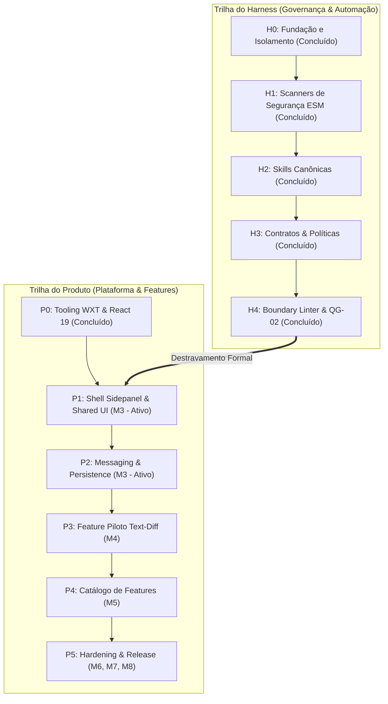
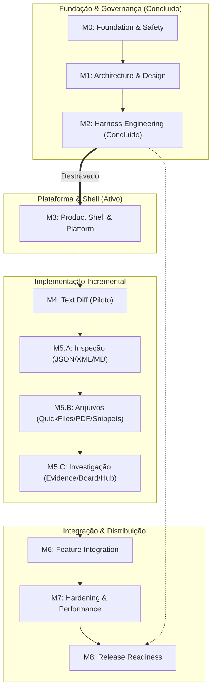

# Status, Roadmap e Governança do Desenvolvimento — ExtensionTools

> **Projeto:** ExtensionTools  
> **Classificação:** PUBLIC REPOSITORY  
> **Status Geral do Repositório:** **M2 HOMOLOGATED (COMPLETED WITH RESERVATIONS) — M3 ACTIVATED — PUBLICATION BLOCKED (SAFE-BY-DEFAULT)**  
> **Framework Base:** WXT + Manifest V3 + React 19 + TypeScript + Tailwind CSS  
> **Documento Canônico de Governança de Progresso:** `status.md`  
> **Última Atualização:** 07/11/2026  

---

## Sumário Navegável

- [PARTE A — PAINEL OPERACIONAL DE ACOMPANHAMENTO](#parte-a--painel-operacional-de-acompanhamento)
  - [1. Situação Atual do Desenvolvimento](#1-situação-atual-do-desenvolvimento)
  - [2. Indicadores de Progresso](#2-indicadores-de-progresso)
  - [3. Linha do Tempo dos Milestones](#3-linha-do-tempo-dos-milestones)
  - [4. Fase Ativa — O Que Precisa Ser Feito Agora (M3-PHASE-1 / Bloco 0)](#4-fase-ativa--o-que-precisa-ser-feito-agora-m3-phase-1--bloco-0)
  - [5. Histórico de Homologação do Milestone Concluído (M2)](#5-histórico-de-homologação-do-milestone-concluído-m2)
  - [6. Gate de Transição — M2 → M3 e Desbloqueio da Plataforma](#6-gate-de-transição--m2--m3-e-desbloqueio-da-plataforma)
  - [7. Estruturação Operacional do Milestone Ativo — M3: Product Shell & Platform Foundation](#7-estruturação-operacional-do-milestone-ativo--m3-product-shell--platform-foundation)
- [PARTE B — ROADMAP TÉCNICO E DETALHAMENTO HISTÓRICO](#parte-b--roadmap-técnico-e-detalhamento-histórico)
  - [8. Identificação e Filosofia do Projeto](#8-identificação-e-filosofia-do-projeto)
  - [9. Visão Geral e Separação de Trilhas de Engenharia](#9-visão-geral-e-separação-de-trilhas-de-engenharia)
  - [10. Marcos Arquiteturais e Decisões Fundamentais (ADRs)](#10-marcos-arquiteturais-e-decisões-fundamentais-adrs)
  - [11. Detalhamento dos Milestones (M0 a M8)](#11-detalhamento-dos-milestones-m0-a-m8)
  - [12. Catálogo e Planejamento das 12 Features](#12-catálogo-e-planejamento-das-12-features)
  - [13. Dependências e Caminho Crítico](#13-dependências-e-caminho-crítico)
  - [14. Critérios de Qualidade e Matriz de Quality Gates](#14-critérios-de-qualidade-e-matriz-de-quality-gates)
  - [15. Gestão de Riscos, Impedimentos e Pendências](#15-gestão-de-riscos-impedimentos-e-pendências)
  - [16. Histórico de Progresso Orientado por Evidências](#16-histórico-de-progresso-orientado-por-evidências)
  - [17. Regras de Manutenção e Governança para Agentes](#17-regras-de-manutenção-e-governança-para-agentes)
  - [18. Referências e Evidências Canônicas](#18-referências-e-evidências-canônicas)

---

# PARTE A — PAINEL OPERACIONAL DE ACOMPANHAMENTO

> [!IMPORTANT]
> **Propósito Operacional:** Esta seção sintetiza o estado exato de execução do projeto para orientação instantânea de agentes autônomos e engenheiros humanos. A situação atual reflete rigorosamente os artefatos e testes validados no repositório.

---

## 1. Situação Atual do Desenvolvimento

| Atributo | Estado Canônico Confirmado |
| :--- | :--- |
| **Milestone Atual** | **M3 — Product Shell & Platform Foundation** |
| **Estado do Milestone** | `Em Execução (Bloco 0 e Bloco 1 concluídos; Pronto para Bloco 2)` |
| **Fase Atual Executável** | **`M3-PHASE-2` — Design System Primitivo (`src/shared/ui/`)** |
| **Fase Anterior Concluída** | `M3-PHASE-1` — Entrypoints WXT & Side Panel Shell (B1-F01 Workspace Shell e B1-F02 Tool Navigation concluídas e validadas) |
| **Progresso de Fases em M3** | **1 de 5 fases concluídas** (*6 de 23 tarefas executadas: M3-P1-T01 a M3-P1-T06*) |
| **Fases Restantes em M3** | 4 fases (`M3-PHASE-2` a `M3-PHASE-5`) |
| **Próxima Ação Imediata** | Iniciar o **Bloco 2 de M3** (`M3-P2-T01` a `M3-P2-T06`: Design System Primitivo sob `src/shared/ui/`) |
| **Próximo Milestone** | **M4 — First Feature Pilot & Architecture Validation (Text Diff)** |
| **Condição de Início de M3** | **Desbloqueado e Validado** (Baseline do Bloco 0 auditado; Parecer `READY_WITH_RESERVATIONS`) |
| **Status de Publicação Externa** | **`BLOQUEADO`** *(Safe-by-default — Nenhum segredo ou push remoto até M8)* |

---

## 2. Indicadores de Progresso

Os indicadores utilizam contagem simples auditada de fases e etapas. Não são utilizados percentuais arbitrários baseados em linhas de código.

### 2.1. Progresso Geral de Milestones (M0 a M8)
- **Milestones Totais:** 9 (M0 a M8)
- **Milestones Concluídos:** 3 (M0, M1, M2)
- **Milestone Ativo / Em Andamento:** 1 (M3 — Bloco 0 concluído; Pronto para início do Bloco 1)
- **Milestones Pendentes:** 5 (M4, M5, M6, M7, M8)
- **Indicador Visual Geral:**  
  `[███░░░░░░] 3/9 Milestones concluídos (33.3%)`

### 2.2. Progresso do Milestone Anterior Concluído (M2 — Harness Engineering & Governance)
- **Fases Totais:** 4 (`M2-PHASE-1`, `M2-PHASE-2`, `M2-PHASE-3`, `M2-PHASE-4`)
- **Fases Concluídas:** 4 (100%)
- **Tarefas de M2 Concluídas:** 38 de 38 tarefas verificáveis
- **Testes Automatizados Aprovados:** 155 testes no Vitest (100% de sucesso em 13 suítes)
- **Parecer Final de M2:** `COMPLETED_WITH_RESERVATIONS` (Auditoria independente aprovada)
- **Evidências Canônicas:**  
  [`docs/Relatorios/m2/auditoria-final/RELATORIO-AUDITORIA-INTEGRAL-M2.md`](docs/Relatorios/m2/auditoria-final/RELATORIO-AUDITORIA-INTEGRAL-M2.md),  
  [`docs/Relatorios/m2/M2-HARNESS-REPORT.md`](docs/Relatorios/m2/M2-HARNESS-REPORT.md).

### 2.3. Progresso do Milestone Atual (M3 — Product Shell & Platform Foundation)
- **Fases Totais:** 5 (`M3-PHASE-1` a `M3-PHASE-5`)
- **Fases Concluídas:** 1 (20%) — `M3-PHASE-1` (Entrypoints WXT, Workspace Shell e Tool Navigation)
- **Fases em Andamento / Pronta para Início:** 1 (`M3-PHASE-2`)
- **Fases Pendentes:** 3 (`M3-PHASE-3`, `M3-PHASE-4`, `M3-PHASE-5`)
- **Tarefas Totais de M3:** 23 tarefas planejadas
- **Tarefas Concluídas:** 6 (26.1%) — Tarefas `M3-P1-T01` a `M3-P1-T06` concluídas
- **Indicador Visual do Milestone:**  
  `M3 — [███░░░░░░░░░] 1/5 Fases concluídas (6/23 tarefas)`
- **Evidência de Planejamento:** [`docs/Relatorios/m3/planejamento/RELATORIO-ESTRUTURACAO-OPERACIONAL-M3.md`](docs/Relatorios/m3/planejamento/RELATORIO-ESTRUTURACAO-OPERACIONAL-M3.md)
- **Evidência do Baseline (Bloco 0):** [`docs/Relatorios/m3/bloco-0-baseline/RELATORIO-M3-BLOCO-0-BASELINE-E-PRONTIDAO.md`](docs/Relatorios/m3/bloco-0-baseline/RELATORIO-M3-BLOCO-0-BASELINE-E-PRONTIDAO.md)
- **Evidência do Bloco 1 (Fase 1):** [`docs/Relatorios/m3/bloco-1-sidepanel-shell/RELATORIO-IMPLEMENTACAO-B1-F02-TOOL-NAVIGATION.md`](docs/Relatorios/m3/bloco-1-sidepanel-shell/RELATORIO-IMPLEMENTACAO-B1-F02-TOOL-NAVIGATION.md)

### 2.4. Progresso de Features de Produto
- **Features Previstas:** 12 ferramentas analíticas e de produtividade
- **Features Implementadas:** 0 (Início planejado em M4 para piloto `text-diff` e M5 para o catálogo)
- **Features Prontas para Especificação:** 1 (`FEAT-TEXT-DIFF` — aguarda M3 completo)

---

## 3. Linha do Tempo dos Milestones

```text
[M0: Foundation & Safety] (CONCLUÍDO - Validado em H0)
   │
   ▼
[M1: Architecture & Design] (CONCLUÍDO - Validado em ARCHITECTURE.md & DESIGN.md)
   │
   ▼
[M2: Harness Engineering] (CONCLUÍDO - Homologado com ressalvas aceitas em H4; 155 testes)
   │
   ├─► [M3: Product Shell & Platform] (ATUAL / PRONTO P/ INÍCIO - Desbloqueado para Bloco 0)
   │      │
   │      ▼
   │   [M4: Feature Piloto Text-Diff] (PENDENTE - Depende de M3 completo)
   │      │
   │      ▼
   │   [M5: Core Features Catalogue] (PENDENTE - Depende de M4 validado)
   │      │
   │      ▼
   │   [M6: Feature Integration & UX] (PENDENTE - Depende de M5)
   │      │
   │      ▼
   │   [M7: Quality & Hardening] (PENDENTE - Depende de M6)
   │      │
   │      ▼
   └───► [M8: Release Readiness & Distribution] (PENDENTE - Depende de M7 + M2 integral)
```

---

## 4. Fase Ativa — O Que Precisa Ser Feito Agora (M3-PHASE-1 / Bloco 1)

### 4.1. Ficha de Identificação da Fase
- **Milestone:** M3 — Product Shell & Platform Foundation
- **Código da Fase:** `M3-PHASE-1`
- **Nome Oficial:** Entrypoints WXT & Side Panel Shell
- **Bloco Atual:** **Bloco 1 — Estrutura WXT e Side Panel Shell (Fase 1)**
- **Estado Atual:** `Pronto para início` (Bloco 0 concluído e homologado sob `READY_WITH_RESERVATIONS`)
- **Objetivo Central:** Estabelecer a infraestrutura inicial de entrypoints do WXT para Manifest V3, inicializar o React 19 no Side Panel e estruturar a casca principal de layout (Header, Container Central, Status Bar) e alternador de workspaces.
- **Dependências Técnicas:** M0, M1 e M2 concluídos; Bloco 0 de M3 auditado — *Todas atendidas*.
- **Agentes Recomendados:** `Architect` / `Developer` / `Test Engineer` (Orquestração: `Orchestrator`).
- **Quality Gates Aplicáveis:** `QG-01` (Repository Safety), `QG-02` (Architecture Boundaries), `QG-03` (Static Code Quality), `QG-04` (Automated Testing), `QG-08` (Build Integrity) e `QG-09` (Browser Permissions).

### 4.2. Checklist Geral de Tarefas de M3

#### Fase 1: `M3-PHASE-1` — Entrypoints WXT & Side Panel Shell
- [x] `M3-P1-T01` — Preparação do baseline de M3 e diagnóstico de compilação dos entrypoints WXT. *(Bloco 0 — Homologado em `docs/Relatorios/m3/bloco-0-baseline/RELATORIO-M3-BLOCO-0-BASELINE-E-PRONTIDAO.md`)*
- [x] `M3-P1-T02` — Estruturação física dos entrypoints WXT (`src/entrypoints/sidepanel/`, `background/`, `content/`). *(Bloco 1 — Homologado em B1-F01/B1-F02)*
- [x] `M3-P1-T03` — Bootstrap e inicialização do runtime React 19 no Side Panel (`main.tsx`, `App.tsx`). *(Bloco 1 — Homologado em B1-F01/B1-F02)*
- [x] `M3-P1-T04` — Implementação do layout principal do Side Panel (Header, Workspace Container, Status Bar) conforme `DESIGN.md`. *(Bloco 1 — Homologado em B1-F01)*
- [x] `M3-P1-T05` — Implementação do mecanismo atômico de navegação e alternador de ferramentas no shell. *(Bloco 1 — Homologado em B1-F02)*
- [x] `M3-P1-T06` — Validação de build WXT (`pnpm build`), verificação do Manifest V3 gerado e testes de renderização. *(Bloco 1 — Homologado em B1-F01/B1-F02)*

#### Fase 2: `M3-PHASE-2` — Design System Primitivo (`src/shared/ui/`)
- [ ] `M3-P2-T01` — Configuração e validação dos tokens visuais Tailwind CSS (paleta `#101013`, `#1E1E22`, `#DF2531`, tipografia). *(Bloco 2)*
- [ ] `M3-P2-T02` — Implementação do componente atômico `Button` (Primary, Secondary, Ghost, Destructive e foco acessível). *(Bloco 2)*
- [ ] `M3-P2-T03` — Implementação dos componentes de formulário `Input`, `Textarea` e `Select` acessíveis. *(Bloco 2)*
- [ ] `M3-P2-T04` — Implementação dos componentes estruturais `Card`, `Panel` e `Badge`. *(Bloco 2)*
- [ ] `M3-P2-T05` — Implementação do catálogo de ícones e indicadores de estado (`Icon`, `LoadingSpinner`, `EmptyState`). *(Bloco 2)*
- [ ] `M3-P2-T06` — Suíte de testes unitários de renderização e conformidade de contraste WCAG 2.2 AA dos componentes primitivos. *(Bloco 2)*

#### Fase 3: `M3-PHASE-3` — Platform Messaging Fortemente Tipado (`src/platform/messaging/`)
- [ ] `M3-P3-T01` — Definição dos contratos e esquemas tipados de mensagens entre Side Panel, Background e Content Scripts. *(Bloco 3)*
- [ ] `M3-P3-T02` — Implementação do barramento de envio tipado (`sendMessage`) com timeout e tratamento fail-safe. *(Bloco 3)*
- [ ] `M3-P3-T03` — Implementação do despachante e receptor de mensagens (`onMessage`) com validação de payload. *(Bloco 3)*
- [ ] `M3-P3-T04` — Suíte de testes unitários e mocks determinísticos do barramento de mensageria com Vitest. *(Bloco 3)*

#### Fase 4: `M3-PHASE-4` — Platform Persistence & Storage (`src/platform/persistence/`)
- [ ] `M3-P4-T01` — Definição das interfaces e contratos de persistência local (`StorageAdapter`, `KeyValueStore`). *(Bloco 4)*
- [ ] `M3-P4-T02` — Implementação do adaptador `ChromeStorageAdapter` sobre `chrome.storage.local` com serialização e fallback. *(Bloco 4)*
- [ ] `M3-P4-T03` — Avaliação técnica e formalização do contrato para `IndexedDBAdapter` (visando features complexas). *(Bloco 4)*
- [ ] `M3-P4-T04` — Suíte de testes unitários com mocks de armazenamento local, cenários de quota e resiliência a falhas. *(Bloco 4)*

#### Fase 5: `M3-PHASE-5` — Validação, Testes Integrados e Homologação
- [ ] `M3-P5-T01` — Integração ponta a ponta do Side Panel Shell com o barramento de mensageria e o armazenamento local. *(Bloco 5)*
- [ ] `M3-P5-T02` — Execução da esteira completa de Quality Gates aplicáveis (`QG-01` a `QG-04`, `QG-07` a `QG-10`, `QG-12`). *(Bloco 5)*
- [ ] `M3-P5-T03` — Auditoria arquitetural de fronteiras (comprovação de zero vazamentos entre platform, shared e entrypoints). *(Bloco 5)*
- [ ] `M3-P5-T04` — Emissão do Relatório Canônico de Homologação de M3 (`docs/Relatorios/m3/M3-PLATFORM-REPORT.md`) e Gate M3 → M4. *(Bloco 5)*

### 4.3. Próxima Ação Prioritária (Unívoca)
> **Ação Imediata:** Iniciar o **Bloco 1 do Milestone M3 (`M3-PHASE-1`)** executando as tarefas **`M3-P1-T02` a `M3-P1-T06`**: Realizar a estruturação física dos entrypoints WXT (`sidepanel`, `background`, `content`), o bootstrap do React 19 no Side Panel Shell e a validação inicial de compilação sem regras de negócio de features.

---

## 5. Histórico de Homologação do Milestone Concluído (M2)

O milestone **M2 — Harness Engineering & Governance** foi integralmente executado, auditado e homologado sob o parecer **`COMPLETED_WITH_RESERVATIONS`**:

```text
M2-PHASE-1: Scanners de Segurança (H1) ─────────────► [CONCLUÍDO] (23 testes Vitest, 7 scripts ESM, publication-guard)
M2-PHASE-2: Formalização das Skills Canônicas (H2) ──► [CONCLUÍDO] (9 skills, validador estrutural, 8 testes)
M2-PHASE-3: Contratos e Políticas de Execução ───────► [CONCLUÍDO] (6 contratos, 11 políticas, validador, 35 testes)
M2-PHASE-4: Quality Gate Arquitetural Automatizado ──► [CONCLUÍDO / HOMOLOGADO] (QG-02 homologado, boundary-linter, lint:arch, hooks, 36 testes)
```

- **Total de Tarefas Executadas em M2:** 38 tarefas (`M2-P1-T01` a `M2-P4-T08`).
- **Total de Testes do Harness:** 155 testes aprovados (100% de sucesso em 13 suítes Vitest).
- **Ressalvas Formais Aceitas (Não-Bloqueantes):** Postergação do orquestrador CLI unificado `run-quality-gate.mjs` (`QAL-01` de QG-07) e do linter global de links markdown (`DOC-01/02` de QG-10) para etapas progressivas de automação de scripts, dado que as salvaguardas essenciais já operam nos Git Hooks e comandos do `package.json`.
- **Relatório de Auditoria Independente:** [`docs/Relatorios/m2/auditoria-final/RELATORIO-AUDITORIA-INTEGRAL-M2.md`](docs/Relatorios/m2/auditoria-final/RELATORIO-AUDITORIA-INTEGRAL-M2.md).
- **Relatório Consolidado de M2:** [`docs/Relatorios/m2/M2-HARNESS-REPORT.md`](docs/Relatorios/m2/M2-HARNESS-REPORT.md).

---

## 6. Gate de Transição — M2 → M3 e Desbloqueio da Plataforma

O avanço entre a governança do harness (M2) e a implementação da plataforma/produto (M3) cumpriu todos os critérios canônicos de desbloqueio:

### 6.1. Checklist de Conclusão Formal de M2
- [x] Todas as 9 skills canônicas formalizadas e auditadas em `.harness/skills/`.
- [x] Contratos de execução estabelecidos em `.harness/contracts/`.
- [x] Políticas operacionais validadas em `.harness/policies/`.
- [x] Quality gate arquitetural (`boundary-linter.mjs`) implementado e integrado ao pipeline `pnpm test` e `package.json`.
- [x] Suíte de testes do harness aprovada com 100% de sucesso (155 testes).
- [x] Relatório canônico de conclusão de M2 publicado em `docs/Relatorios/m2/M2-HARNESS-REPORT.md`.
- [x] Auditoria integral independente concluída em `docs/Relatorios/m2/auditoria-final/RELATORIO-AUDITORIA-INTEGRAL-M2.md`.

### 6.2. Status de Desbloqueio de M3
> [!NOTE]
> **Desbloqueio Confirmado:** O Milestone M3 está **100% destravado** para estruturação física, scaffolding e implementação de código funcional da casca da extensão no Side Panel e adaptadores de plataforma. A fiscalização mecânica do Boundary Linter (`QG-02`) e os scanners de segurança (`QG-01`) operam ativamente sobre qualquer novo arquivo introduzido em `src/`.

---

## 7. Estruturação Operacional do Milestone Ativo — M3: Product Shell & Platform Foundation

### 7.1. Detalhamento dos Seis Blocos Incrementais de M3

| Bloco | Nome Oficial | Fases Cobertas | Tarefas Incluídas | Objetivo Principal | Dependências |
| :---: | :--- | :--- | :--- | :--- | :--- |
| **Bloco 0** | **Preparação & Baseline** | `M3-PHASE-1` | `M3-P1-T01` | Diagnóstico de tooling WXT/React 19, preflight de build e reconciliação | M2 homologado |
| **Bloco 1** | **WXT & Side Panel Shell** | `M3-PHASE-1` | `M3-P1-T02` a `M3-P1-T06` | Estruturar entrypoints, bootstrap React 19, layout Sidepanel e navegação | Bloco 0 |
| **Bloco 2** | **Design System Primitivo** | `M3-PHASE-2` | `M3-P2-T01` a `M3-P2-T06` | Tokens Tailwind, componentes Button/Input/Card/Badge e testes a11y | Bloco 1 |
| **Bloco 3** | **Platform Messaging** | `M3-PHASE-3` | `M3-P3-T01` a `M3-P3-T04` | Contratos de mensagem, barramento tipado, dispatcher e testes | Bloco 1 |
| **Bloco 4** | **Platform Persistence** | `M3-PHASE-4` | `M3-P4-T01` a `M3-P4-T04` | StorageAdapter, ChromeStorageAdapter, IndexedDB contract e testes | Bloco 1 |
| **Bloco 5** | **Integração & Homologação** | `M3-PHASE-5` | `M3-P5-T01` a `M3-P5-T04` | Integração shell-platform, build limpo WXT, QGs e destravamento para M4 | Blocos 2, 3 e 4 |

### 7.2. Detalhamento das Tarefas por Fase

#### Fase 1: `M3-PHASE-1` — Entrypoints WXT & Side Panel Shell

| ID | Título | Objetivo | Dependências | Escopo | Entregáveis | Quality Gates | Critério de Aceitação | Evidência | Estado |
| :--- | :--- | :--- | :--- | :--- | :--- | :---: | :--- | :--- | :---: |
| `M3-P1-T01` | Diagnóstico de Baseline & Tooling WXT | Validar compatibilidade do WXT e React 19 antes de escrever código | M2 homologado | Verificação de scripts, build preflight e configs | Relatório de preflight | QG-01, QG-03 | Build de teste e typecheck sem erros | Log de preflight | `Pronto` |
| `M3-P1-T02` | Estruturação dos Entrypoints WXT | Configurar diretórios físicos de entrypoints Manifest V3 | `M3-P1-T01` | Criar `sidepanel/`, `background/`, `content/` | Entrypoints com metadados WXT | QG-01, QG-02 | WXT reconhece entrypoints sem avisos | Arquivos criados | `Planejado` |
| `M3-P1-T03` | Bootstrap React 19 no Side Panel | Inicializar o ciclo de vida do React no painel lateral | `M3-P1-T02` | Implementar `main.tsx` e `App.tsx` no Side Panel | Raiz React 19 montada e estilizada | QG-02, QG-03 | Renderização limpa sem hydration errors | Teste de montagem | `Planejado` |
| `M3-P1-T04` | Layout Principal do Side Panel Shell | Construir casca visual padronizada conforme `DESIGN.md` | `M3-P1-T03` | Header tecnológico, container central, status bar | Componente de Shell e layout | QG-02, QG-12 | Conformidade visual com paleta e contraste | Testes de snapshot | `Planejado` |
| `M3-P1-T05` | Navegação e Alternador de Workspaces | Permitir alternar visualização sem acoplar a features | `M3-P1-T04` | Navegador atômico no topo do Side Panel | Menu e rotas locais de workspace | QG-02, QG-03 | Troca de visão preservando estado de sessão | Testes unitários | `Planejado` |
| `M3-P1-T06` | Validação de Build e Manifesto WXT | Assegurar que o bundle de produção seja gerado limpo | `M3-P1-T05` | Compilação com `pnpm build` e inspeção do MV3 | Pacote em `.output/` validado | QG-08, QG-09 | Zero erros de empacotamento; permissões mínimas | Log de build | `Planejado` |

#### Fase 2: `M3-PHASE-2` — Design System Primitivo (`src/shared/ui/`)

| ID | Título | Objetivo | Dependências | Escopo | Entregáveis | Quality Gates | Critério de Aceitação | Evidência | Estado |
| :--- | :--- | :--- | :--- | :--- | :--- | :---: | :--- | :--- | :---: |
| `M3-P2-T01` | Configuração de Tokens Tailwind | Estabelecer variáveis semânticas de cor, fonte e borda | `M3-P1-T06` | Configurar cores `#101013`, `#1E1E22`, `#DF2531` | Tokens CSS e classes utilitárias | QG-01, QG-03 | Tokens exportados e validados | Config Tailwind | `Planejado` |
| `M3-P2-T02` | Componente Atômico Button | Fornecer botão com variantes e acessibilidade WCAG | `M3-P2-T01` | Variantes Primary, Secondary, Ghost, Destructive | `Button.tsx` e types | QG-03, QG-12 | Navegação por teclado e foco visível | Testes unitários | `Planejado` |
| `M3-P2-T03` | Componentes de Entrada de Formulário | Fornecer inputs padronizados para ferramentas | `M3-P2-T01` | Componentes `Input`, `Textarea` e `Select` | Componentes em `src/shared/ui/` | QG-03, QG-12 | Labels associados e foco em Brand Red | Testes de render | `Planejado` |
| `M3-P2-T04` | Componentes Estruturais de Painel | Fornecer contêineres e cartões visuais limpos | `M3-P2-T01` | Componentes `Card`, `Panel` e `Badge` de status | Componentes em `src/shared/ui/` | QG-02, QG-03 | Superfícies com bordas e elevação correta | Testes visuais | `Planejado` |
| `M3-P2-T05` | Catálogo de Ícones e Indicadores | Padronizar feedback visual e ícones de ação | `M3-P2-T01` | Componentes `Icon`, `LoadingSpinner`, `EmptyState`| Utilitários visuais compartilhados | QG-03, QG-12 | Ícones SVG inline seguros, sem innerHTML | Testes unitários | `Planejado` |
| `M3-P2-T06` | Suíte de Testes de Acessibilidade UI | Comprovar contraste e acessibilidade dos primitivos | `M3-P2-T02..05`| Auditoria de contraste AA/AAA e foco por teclado | Testes com Vitest em `src/shared/ui/`| QG-04, QG-12 | 100% de testes passando sem violações a11y | Relatório de testes | `Planejado` |

#### Fase 3: `M3-PHASE-3` — Platform Messaging Fortemente Tipado (`src/platform/messaging/`)

| ID | Título | Objetivo | Dependências | Escopo | Entregáveis | Quality Gates | Critério de Aceitação | Evidência | Estado |
| :--- | :--- | :--- | :--- | :--- | :--- | :---: | :--- | :--- | :---: |
| `M3-P3-T01` | Contratos e Tipos de Mensageria | Tipar formalmente todas as mensagens de background | `M3-P1-T06` | Esquemas de mensagens e tipos de payload | `contracts.ts` e `types.ts` | QG-02, QG-03 | Interfaces fortemente tipadas sem `any` | Arquivos de tipo | `Planejado` |
| `M3-P3-T02` | Barramento de Envio (sendMessage) | Despachar mensagens tipadas com timeout e fail-safe | `M3-P3-T01` | Função assíncrona `sendTypedMessage` | Módulo de envio em `src/platform/` | QG-02, QG-04 | Rejeição correta diante de timeout | Testes unitários | `Planejado` |
| `M3-P3-T03` | Receptor e Despachante (onMessage) | Processar mensagens em background com validação | `M3-P3-T01` | Roteador e handler seguro de mensagens | Módulo receptor em `src/platform/`| QG-01, QG-02 | Validação de payload com descarte de inválidos | Testes unitários | `Planejado` |
| `M3-P3-T04` | Suíte de Testes do Barramento | Garantir confiabilidade e determinismo da mensageria | `M3-P3-T02..03`| Mocks de `chrome.runtime` e testes de borda | Testes Vitest em `tests/unit/platform/`| QG-04, QG-06 | 100% de aprovação em cenários assíncronos | Relatório de testes | `Planejado` |

#### Fase 4: `M3-PHASE-4` — Platform Persistence & Storage (`src/platform/persistence/`)

| ID | Título | Objetivo | Dependências | Escopo | Entregáveis | Quality Gates | Critério de Aceitação | Evidência | Estado |
| :--- | :--- | :--- | :--- | :--- | :--- | :---: | :--- | :--- | :---: |
| `M3-P4-T01` | Contrato de Persistência Local | Formalizar interface agnóstica de armazenamento | `M3-P1-T06` | Interface `StorageAdapter` e tipos de erro | `storage-adapter.contract.ts` | QG-02, QG-03 | Métodos get, set, remove e clear tipados | Contrato formal | `Planejado` |
| `M3-P4-T02` | Adaptador ChromeStorageLocal | Persistir preferências e pequenos estados no browser | `M3-P4-T01` | Implementar `ChromeStorageAdapter` | Adaptador sobre `chrome.storage.local`| QG-02, QG-04 | Serialização segura e isolamento por chave | Testes com mock | `Planejado` |
| `M3-P4-T03` | Avaliação e Contrato de IndexedDB | Planejar armazenamento estruturado para M5 | `M3-P4-T01` | Contrato para `IndexedDBAdapter` (coleções) | Interface e estudo de quota | QG-02, QG-03 | Interface compatível com Clean Architecture | Documento de ADR | `Planejado` |
| `M3-P4-T04` | Suíte de Testes de Armazenamento | Validar tratamento de erros e integridade de dados | `M3-P4-T02..03`| Testes de quota excedida, corrupção e fallback | Testes Vitest em `tests/unit/platform/`| QG-04, QG-06 | Resiliência comprovada sem crash da UI | Relatório de testes | `Planejado` |

#### Fase 5: `M3-PHASE-5` — Validação, Testes Integrados e Homologação

| ID | Título | Objetivo | Dependências | Escopo | Entregáveis | Quality Gates | Critério de Aceitação | Evidência | Estado |
| :--- | :--- | :--- | :--- | :--- | :--- | :---: | :--- | :--- | :---: |
| `M3-P5-T01` | Integração Shell + Plataforma | Conectar Side Panel aos adaptadores reais | Fases 1 a 4 | Plugar mensageria e storage na casca do painel | Side Panel integrado e funcional | QG-02, QG-04 | Troca de mensagens e persistência de sessão | Testes de integração| `Planejado` |
| `M3-P5-T02` | Execução dos Quality Gates de M3 | Auditar conformidade com todos os Quality Gates | `M3-P5-T01` | Rodar QG-01, 02, 03, 04, 07, 08, 09, 10 e 12 | Painel de conformidade aprovado | Todos aplicáveis | Zero falhas nos gates mecânicos | Logs dos gates | `Planejado` |
| `M3-P5-T03` | Auditoria de Limites Arquiteturais | Certificar que a plataforma não vazou dependências | `M3-P5-T01` | Executar `pnpm lint:arch` sobre todo o `src/` | Relatório de fronteiras aprovado | QG-02 | Zero violações ARC-R01 a ARC-R08 | Log do boundary-lint| `Planejado` |
| `M3-P5-T04` | Homologação de M3 & Gate para M4 | Certificar conclusão de M3 e destravamento de M4 | `M3-P5-T01..03`| Emissão de relatório e atualização de status | `docs/Relatorios/m3/M3-PLATFORM-REPORT.md`| QG-10 | Parecer APPROVED para M3 e READY para M4 | Relatório canônico | `Planejado` |

---

# PARTE B — ROADMAP TÉCNICO E DETALHAMENTO HISTÓRICO

---

## 8. Identificação e Filosofia do Projeto

| Atributo | Descrição / Valor Canônico |
| :--- | :--- |
| **Nome do Produto** | ExtensionTools |
| **Tipo de Aplicação** | Extensão modular de produtividade e análise técnica para navegadores |
| **Plataforma-Alvo Inicial** | Google Chrome e navegadores baseados em Chromium (Manifest V3) |
| **Repositório** | Repositório Público no GitHub (sob rigoroso isolamento e proteção contra segredos) |
| **Filosofia Central** | *Local-First*, Processamento Seguro no Navegador, Zero Dependência de Backend Obrigatório |
| **Estilo Arquitetural** | Feature-First Modular com Complexidade Proporcional e Baixo Acoplamento |
| **Identidade Visual** | Minimalista e Tecnológica (Preto `#101013`, Branco `#FFFFFF`, Vermelho `#DF2531` e Grafite `#1E1E22`) |
| **Harness de Desenvolvimento** | 9 Agentes Especializados, Skills Canônicas, Scanners Node.js ESM e Quality Gates Mecânicos |

---

## 9. Visão Geral e Separação de Trilhas de Engenharia

O desenvolvimento do **ExtensionTools** é conduzido de forma estritamente incremental, auditável e orientada por evidências. A meta principal é integrar 12 ferramentas de alta produtividade sob uma experiência fluida no Side Panel, garantindo a proteção perpétua do repositório público.

### 9.1. Ciclo Operacional Canônico
```text
Entender ➔ Especificar ➔ Estruturar ➔ Implementar ➔ Testar ➔ Revisar ➔ Validar ➔ Documentar ➔ Integrar
```

### 9.2. Separação de Trilhas de Engenharia



---

## 10. Marcos Arquiteturais e Decisões Fundamentais (ADRs)

A governança formal das decisões arquiteturais reside em [`docs/architecture/README.md`](docs/architecture/README.md), sendo cada decisão registrada com justificativas, trade-offs e consequências em [`docs/architecture/adr/`](docs/architecture/adr/):

| ID do Marco | Decisão Arquitetural | Documento Canônico | Impacto no Projeto |
| :--- | :--- | :--- | :--- |
| **ADR-001** | Adoção da Stack WXT, React 19 e TypeScript Estrito | [`docs/architecture/adr/ADR-001-stack-wxt-react19-typescript.md`](docs/architecture/adr/ADR-001-stack-wxt-react19-typescript.md) | Compilação otimizada para Manifest V3, tipagem rigorosa de entrypoints e isolamento de runtime. |
| **ADR-002** | Arquitetura Modular Feature-First com Isolamento Estrito | [`docs/architecture/adr/ADR-002-arquitetura-modular-feature-first.md`](docs/architecture/adr/ADR-002-arquitetura-modular-feature-first.md) | Isolamento das 12 features em diretórios autônomos com complexidade proporcional e API pública via `index.ts`. |
| **ADR-003** | Processamento Local-First e Privacidade Absoluta | [`docs/architecture/adr/ADR-003-processamento-local-first.md`](docs/architecture/adr/ADR-003-processamento-local-first.md) | Zero servidores de backend; processamento 100% no navegador e persistência segura em `chrome.storage` / `IndexedDB`. |
| **ADR-004** | Boundary Linter Automatizado via AST TypeScript | [`docs/architecture/adr/ADR-004-boundary-linter-ast.md`](docs/architecture/adr/ADR-004-boundary-linter-ast.md) | Fiscalização estática automatizada de limites modulares (ARC-R01 a ARC-R08) integrada ao CI e Git Hooks. |
| **ADR-005** | Composição do Side Panel Shell e Navegação Desacoplada | [`docs/architecture/adr/ADR-005-composicao-sidepanel-shell-navegacao.md`](docs/architecture/adr/ADR-005-composicao-sidepanel-shell-navegacao.md) | Composição declarativa no Side Panel (`SidePanelApp`), isolando layout (`WorkspaceShell`) e seleção (`ToolNavigation`). |

---

## 11. Detalhamento dos Milestones (M0 a M8)

### M0 — Foundation & Repository Safety
- **Objetivo:** Estabelecer a estrutura inicial do projeto, tooling fundamental, configurações de compilação e proteção do repositório público contra vazamentos.
- **Estado:** `Validado`
- **Progresso:** 4/4 fases concluídas (100%).
- **Dependências:** Nenhuma.
- **Evidências:** [`docs/Relatorios/m0/foundation/H0-FOUNDATION-REPORT.md`](docs/Relatorios/m0/foundation/H0-FOUNDATION-REPORT.md).

---

### M1 — Architecture & Design Foundation
- **Objetivo:** Formalizar as decisões arquiteturais fundamentais, organização Feature-First, diretrizes de Design System e canonização documental.
- **Estado:** `Validado`
- **Progresso:** 3/3 fases concluídas (100%).
- **Dependências:** M0.
- **Evidências:** [`ARCHITECTURE.md`](ARCHITECTURE.md), [`DESIGN.md`](DESIGN.md).

---

### M2 — Harness Engineering & Governance
- **Objetivo:** Transformar o harness em um mecanismo autônomo, confiável e automatizado para guiar, verificar e auditar o desenvolvimento do produto.
- **Estado:** `Validado e Homologado com ressalvas aceitas (COMPLETED_WITH_RESERVATIONS)`
- **Progresso:** 4/4 fases concluídas (100%), 38 tarefas executadas, 155 testes aprovados.
- **Dependências:** M0, M1.
- **Fases Concluídas:**
  - [x] `M2-PHASE-1` (H1) — **Scanners de Segurança & Prevenção de Vazamento:** 7 scanners Node.js ESM, hooks Git e 23 testes em Vitest.
  - [x] `M2-PHASE-2` (H2) — **Formalização das Skills Canônicas:** 9 skills canônicas em `.harness/skills/`, validador estrutural e 8 testes.
  - [x] `M2-PHASE-3` (H3) — **Contratos de Execução e Políticas:** 6 contratos em `.harness/contracts/`, 11 políticas em `.harness/policies/`, validador e 35 testes.
  - [x] `M2-PHASE-4` (H4) — **Quality Gate Arquitetural Automatizado:** `ast-analyzer.mjs`, `dependency-graph.mjs`, `verify-module-boundaries.mjs`, `boundary-linter.mjs`, `lint:arch`, Git Hooks e 36 testes.
- **Evidências:**  
  [`docs/Relatorios/m2/phase-1-scanners/H1-REPOSITORY-SAFETY-REPORT.md`](docs/Relatorios/m2/phase-1-scanners/H1-REPOSITORY-SAFETY-REPORT.md),  
  [`docs/Relatorios/m2/phase-2-skills-canonicas/H2-SKILLS-FORMALIZATION-REPORT.md`](docs/Relatorios/m2/phase-2-skills-canonicas/H2-SKILLS-FORMALIZATION-REPORT.md),  
  [`docs/Relatorios/m2/phase-3-contratos-e-politicas/H3-CONTRACTS-REPORT.md`](docs/Relatorios/m2/phase-3-contratos-e-politicas/H3-CONTRACTS-REPORT.md),  
  [`docs/Relatorios/m2/phase-4-boundary-linter/H4-BOUNDARY-LINTER-REPORT.md`](docs/Relatorios/m2/phase-4-boundary-linter/H4-BOUNDARY-LINTER-REPORT.md),  
  [`docs/Relatorios/m2/M2-HARNESS-REPORT.md`](docs/Relatorios/m2/M2-HARNESS-REPORT.md),  
  [`docs/Relatorios/m2/auditoria-final/RELATORIO-AUDITORIA-INTEGRAL-M2.md`](docs/Relatorios/m2/auditoria-final/RELATORIO-AUDITORIA-INTEGRAL-M2.md).

---

### M3 — Product Shell & Platform Foundation
- **Objetivo:** Construir a infraestrutura mínima funcional da extensão no WXT (Side Panel, barramento de mensagens e adaptadores de plataforma) e primitivos compartilhados de UI.
- **Estado:** `Pronto para início estrutural (Bloco 0 de Preparação)`
- **Progresso:** 0/5 fases concluídas (0% — 23 tarefas planejadas em 6 blocos).
- **Dependências:** M2 concluído e homologado (*Atendida*).
- **Fases:**
  - [ ] `M3-PHASE-1` — Entrypoints WXT & Side Panel Shell (`src/entrypoints/sidepanel/` com React 19).
  - [ ] `M3-PHASE-2` — Design System Primitivo (`src/shared/ui/`: Button, Input, Select, Panel, Badge, Icon).
  - [ ] `M3-PHASE-3` — Platform Messaging fortemente tipado (`src/platform/messaging/`).
  - [ ] `M3-PHASE-4` — Platform Persistence & Storage (`chrome.storage.local` e `IndexedDB` em `src/platform/persistence/`).
  - [ ] `M3-PHASE-5` — Validação da Plataforma e testes integrados no Chrome via WXT.
- **Entregáveis:** Side Panel renderizando com layout oficial, navegação operacional e adaptadores tipados com cobertura de testes unitários.
- **Critérios de Aceitação:** `pnpm build` gera bundle limpo, renderização sem warnings no navegador e persistência testada via mocks.
- **Evidências:** A serem geradas em `docs/Relatorios/m3/M3-PLATFORM-REPORT.md`.

---

### M4 — First Feature Pilot & Architecture Validation
- **Objetivo:** Implementar a primeira funcionalidade representativa do catálogo (`FEAT-TEXT-DIFF`) de ponta a ponta para validar na prática a separação de responsabilidades, o fluxo Feature-First e o Design System.
- **Estado:** `Pendente` (Planejamento concluído; aguarda M3).
- **Progresso:** 0/5 fases concluídas (0%).
- **Dependências:** M3 completo.
- **Evidências:** A serem geradas em `docs/Relatorios/m4/M4-FEATURE-PILOT-REPORT.md`.

---

### M5 — Core Features Development
- **Objetivo:** Desenvolver incrementalmente as 11 funcionalidades restantes do catálogo, agrupadas em três blocos de afinidade técnica.
- **Estado:** `Pendente`
- **Progresso:** 0/3 blocos concluídos (0/11 features).
- **Dependências:** M4.
- **Blocos de Entrega:**
  - **Bloco A (Texto & Dados):** `json-inspector`, `xml-inspector`, `markdown`.
  - **Bloco B (Arquivos & Produtividade):** `quick-files`, `snippet-library`, `pdf-export`.
  - **Bloco C (Organização & Investigação Avançada):** `tab-workspaces`, `calendar`, `reference-hub`, `evidence-capture`, `investigation-board`.

---

### M6 — Feature Integration & User Experience
- **Objetivo:** Conectar fluxos de trabalho transversais entre as ferramentas.
- **Estado:** `Pendente`
- **Progresso:** 0/3 fases concluídas (0%).
- **Dependências:** M5.

---

### M7 — Quality, Security & Performance Hardening
- **Objetivo:** Submeter a extensão a testes de estresse, auditoria de permissões do navegador e testes E2E com Playwright.
- **Estado:** `Pendente`
- **Progresso:** 0/3 fases concluídas (0%).
- **Dependências:** M6.

---

### M8 — Release Readiness & Distribution
- **Objetivo:** Preparar a primeira distribuição controlada do ExtensionTools, cumprindo todas as políticas de segurança pública e governança.
- **Estado:** `Pendente` (Publicação bloqueada por padrão)
- **Progresso:** 0/4 fases concluídas (0%).
- **Dependências:** M7 e M2 integral.

---

## 12. Catálogo e Planejamento das 12 Features

```mermaid
flowchart LR
    subgraph Piloto["Piloto (M4)"]
        F1["FEAT-TEXT-DIFF"]
    end
    subgraph BlocoA["Bloco A: Texto & Dados (M5)"]
        F2["FEAT-JSON-INSPECTOR"]
        F3["FEAT-XML-INSPECTOR"]
        F4["FEAT-MARKDOWN"]
    end
    subgraph BlocoB["Bloco B: Arquivos & Produtividade (M5)"]
        F5["FEAT-QUICK-FILES"]
        F6["FEAT-SNIPPET-LIBRARY"]
        F7["FEAT-PDF-EXPORT"]
    end
    subgraph BlocoC["Bloco C: Investigação & Workspace (M5)"]
        F8["FEAT-TAB-WORKSPACES"]
        F9["FEAT-CALENDAR"]
        F10["FEAT-REFERENCE-HUB"]
        F11["FEAT-EVIDENCE-CAPTURE"]
        F12["FEAT-INVESTIGATION-BOARD"]
    end

    Piloto --> BlocoA
    BlocoA --> BlocoB
    BlocoB --> BlocoC
```



### 12.1. Tabela-Mestra das Funcionalidades

| Identificador | Nome da Feature | Complexidade Estrutural | Milestone Alvo | Prioridade | Estado Atual |
| :--- | :--- | :--- | :--- | :--- | :--- |
| `FEAT-TEXT-DIFF` | Text Diff | Direta (`core/` + `ui/`) | **M4 (Piloto)** | Alta | `Planejado` (aguarda M3) |
| `FEAT-JSON-INSPECTOR` | JSON Inspector | Direta (`core/` + `ui/`) | M5 (Bloco A) | Alta | `Pendente` |
| `FEAT-XML-INSPECTOR` | XML Inspector | Direta (`core/` + `ui/`) | M5 (Bloco A) | Alta | `Pendente` |
| `FEAT-MARKDOWN` | Markdown Workspace | Direta (`core/` + `ui/`) | M5 (Bloco A) | Alta | `Pendente` |
| `FEAT-QUICK-FILES` | Quick Files | Direta (`core/` + `ui/`) | M5 (Bloco B) | Média | `Pendente` |
| `FEAT-SNIPPET-LIBRARY` | Snippet Library | Direta (`core/` + `ui/`) | M5 (Bloco B) | Média | `Pendente` |
| `FEAT-PDF-EXPORT` | PDF Export | Direta (`core/` + `ui/`) | M5 (Bloco B) | Média | `Pendente` |
| `FEAT-TAB-WORKSPACES` | Tab Workspaces | Direta (`core/` + `ui/`) | M5 (Bloco C) | Média | `Pendente` |
| `FEAT-CALENDAR` | Calendar | Direta (`core/` + `ui/`) | M5 (Bloco C) | Média | `Pendente` |
| `FEAT-REFERENCE-HUB` | Reference Hub | Camadas (`domain/` + `app/` + `ui/`) | M5 (Bloco C) | Alta | `Pendente` |
| `FEAT-EVIDENCE-CAPTURE` | Evidence Capture | Camadas completas (Clean/DDD) | M5 (Bloco C) | Alta | `Pendente` |
| `FEAT-INVESTIGATION-BOARD`| Investigation Board | Camadas completas (Clean/DDD) | M5 (Bloco C) | Alta | `Pendente` |

---

## 13. Dependências e Caminho Crítico

### 13.1. Grafo Geral de Dependências Críticas


---

## 14. Critérios de Qualidade e Matriz de Quality Gates

> [!NOTE]
> O sistema canônico de Quality Gates, catálogo detalhado (QG-01 a QG-13), modos de execução (FAST, FULL, STRICT, RELEASE) e roadmap de homologação estão formalizados em [`docs/quality-gates/`](docs/quality-gates/README.md).

Nenhum entregável é aceito no repositório sem cumprimento irrestrito dos Quality Gates:

| Verificação | Comando de Execução | Critério de Aceitação | Fases Exigidas |
| :--- | :--- | :--- | :--- |
| **Segurança de Repositório** | `pnpm run security:guard` | Zero segredos, caminhos absolutos ou dados restritos | Hooks pre-commit e pre-push |
| **Fronteiras Arquiteturais** | `pnpm run lint:arch` | Zero violações ARC-R01 a ARC-R08 e zero ciclos | Todas as fases (a partir de M2) |
| **Formatação** | `pnpm run format:check` | Zero divergências em todos os arquivos | Todas as fases |
| **Linting** | `pnpm run lint` | Zero erros e zero warnings não justificados | Todas as fases |
| **Typecheck** | `pnpm run compile` | Compilação TypeScript limpa (`tsc --noEmit`) | Todas as fases |
| **Testes Unitários** | `pnpm run test:unit` | 100% de aprovação, cobertura lógica proporcional | Todas as fases |
| **Testes de Segurança**| `pnpm run test:security` | 100% aprovado na suíte do harness (Vitest) | Todas as fases |
| **Build de Produção** | `pnpm run build` | Compilação WXT sem erros gerando `.output/` | A partir de M3 |
| **Acessibilidade** | Inspeção WCAG 2.2 | Navegação por teclado, contraste mínimo AA | M3, M4, M6 |

---

## 15. Gestão de Riscos, Impedimentos e Pendências

### 15.1. Registro de Riscos Monitorados

| ID | Categoria | Descrição do Risco | Impacto | Probabilidade | Mitigação Canônica | Estado |
| :--- | :--- | :--- | :--- | :--- | :--- | :--- |
| **RSK-01** | Segurança | Vazamento de dados confidenciais no GitHub público | Crítico | Baixa | Scanners ESM em hooks locais e CI (`publication-guard.mjs`), bloqueio safe-by-default. | `Mitigado` |
| **RSK-02** | Arquitetura | Acoplamento excessivo entre features distintas | Alto | Baixa | Aplicação estrita do Feature-First, barramento tipado e Boundary Linter em `lint:arch`. | `Controlado` |
| **RSK-03** | Performance| Bloqueio do Side Panel ao processar arquivos pesados | Alto | Média | Parsers em Web Worker ou fatiamento de execução em lotes em `core/`. | `Planejado` |
| **RSK-04** | Acessibilidade| Dificuldade de navegação por teclado ou contraste baixo | Médio | Média | Conformidade obrigatória com os tokens semânticos de `DESIGN.md` e testes manuais de foco. | `Planejado` |

### 15.2. Impedimentos Atuais
- **Nenhum impedimento ativo:** O Milestone M2 foi formalmente homologado e o Milestone M3 está 100% destravado para execução.

### 15.3. Pendências Críticas Monitoradas (Ressalvas de M2)
1. **Orquestrador CLI de Quality Gates (`run-quality-gate.mjs` / `QAL-01` de QG-07):** Ressalva aceita no encerramento de M2. O acionamento unificado multi-modo (`fast`, `full`, `strict`) permanece planejado para evolução na Fase 2/5 de Scripts e M8, com proteção já garantida nos Git Hooks.
2. **Linter Global de Links Markdown (`DOC-01/02` de QG-10):** Ressalva aceita no encerramento de M2. Varredura global de links markdown planejada para a Fase 4 de automação de scripts.

---

## 16. Histórico de Progresso Orientado por Evidências

| Data | Milestone / Fase | Alteração Realizada | Evidência Canônica |
| :--- | :--- | :--- | :--- |
| **2026-11-04** | M0 (H0) | Inicialização da fundação do repositório, configuração do WXT, React 19, TypeScript, Tailwind e 9 agentes. | [`docs/Relatorios/m0/foundation/H0-FOUNDATION-REPORT.md`](docs/Relatorios/m0/foundation/H0-FOUNDATION-REPORT.md) |
| **2026-11-04** | M2 (H1) | Implementação dos scanners de segurança (segredos, caminhos, referências), hooks Git e CI. | [`docs/Relatorios/m2/phase-1-scanners/H1-REPOSITORY-SAFETY-REPORT.md`](docs/Relatorios/m2/phase-1-scanners/H1-REPOSITORY-SAFETY-REPORT.md) |
| **2026-11-04** | M1 | Formalização canônica de `ARCHITECTURE.md` (Feature-First) e `DESIGN.md` (Design System Minimalista). | [`ARCHITECTURE.md`](ARCHITECTURE.md), [`DESIGN.md`](DESIGN.md) |
| **2026-11-04** | Governança | Criação do documento canônico de acompanhamento e governança `status.md`. | [`status.md`](status.md) |
| **2026-11-04** | Governança | Reformulação operacional de `status.md` em duas partes (Painel Operacional + Roadmap Detalhado). | [`status.md`](status.md) |
| **2026-11-04** | M2 (Harness / Scripts) | Validação da Fase 0 dos Scripts: saneamento do `publication-guard` e expansão para 19 testes automatizados. | [`scripts/security/publication-guard.mjs`](scripts/security/publication-guard.mjs), [`tests/harness/security/git-integration.test.ts`](tests/harness/security/git-integration.test.ts) |
| **2026-11-04** | M2 (Harness / Scripts) | Validação da Fase 1 dos Scripts: implementação de `fs-utils`, `git-utils`, `logger` e `ast-analyzer` em `scripts/lib/`, refatoração e 60 testes. | [`scripts/lib/fs-utils.mjs`](scripts/lib/fs-utils.mjs), [`scripts/lib/git-utils.mjs`](scripts/lib/git-utils.mjs), [`scripts/lib/logger.mjs`](scripts/lib/logger.mjs), [`scripts/lib/ast-analyzer.mjs`](scripts/lib/ast-analyzer.mjs) |
| **2026-11-06** | Governança | Centralização canônica de relatórios em `docs/Relatorios/`, saneamento de diretórios legados e validador anti-dispersão documental. | [`docs/Relatorios/governanca-documental/RELATORIO-REORGANIZACAO-RELATORIOS.md`](docs/Relatorios/governanca-documental/RELATORIO-REORGANIZACAO-RELATORIOS.md) |
| **2026-11-06** | Governança / Quality Gates | Estruturação e documentação canônica dos 13 Quality Gates em `docs/quality-gates/` (7 essenciais e 6 progressivos), catálogo e roadmap. | [`docs/Relatorios/m2/quality-gates/RELATORIO-ESTRUTURACAO-CANONICA-QUALITY-GATES.md`](docs/Relatorios/m2/quality-gates/RELATORIO-ESTRUTURACAO-CANONICA-QUALITY-GATES.md), [`docs/quality-gates/README.md`](docs/quality-gates/README.md) |
| **2026-11-07** | M2 (Quality Gates) | Conclusão do Plano de Desenvolvimento, Testes e Homologação do QG-01 (Repository Safety) com auditoria fática dos 7 scanners e integração Git. | [`docs/Relatorios/m2/quality-gates/QG-01-PLANO-DESENVOLVIMENTO-E-HOMOLOGACAO.md`](docs/Relatorios/m2/quality-gates/QG-01-PLANO-DESENVOLVIMENTO-E-HOMOLOGACAO.md) |
| **2026-11-07** | M2 (Bloco 0) | Conclusão do Bloco 0 (Preparação, Auditoria e Reconciliação do Baseline) para M2-PHASE-3 e M2-PHASE-4: parecer READY_WITH_RESERVATIONS. | [`docs/Relatorios/m2/bloco-0-preparacao-reconciliacao/RELATORIO-BLOCO-0-BASELINE-E-RECONCILIACAO.md`](docs/Relatorios/m2/bloco-0-preparacao-reconciliacao/RELATORIO-BLOCO-0-BASELINE-E-RECONCILIACAO.md) |
| **2026-11-07** | M2 (Phase 3 / Bloco 1) | Implementação dos contratos canônicos em `.harness/contracts/` (`task-contract`, `agent-input`, `agent-output`, `skill-context`, `impediment`). | [`docs/Relatorios/m2/phase-3-contratos-e-politicas/RELATORIO-IMPLEMENTACAO-BLOCO-1-CONTRATOS.md`](docs/Relatorios/m2/phase-3-contratos-e-politicas/RELATORIO-IMPLEMENTACAO-BLOCO-1-CONTRATOS.md) |
| **2026-11-07** | M2 (Phase 3 / Bloco 2) | Implementação das 10 políticas operacionais do Harness em `.harness/policies/`. | [`docs/Relatorios/m2/phase-3-contratos-e-politicas/RELATORIO-IMPLEMENTACAO-BLOCO-2-POLITICAS.md`](docs/Relatorios/m2/phase-3-contratos-e-politicas/RELATORIO-IMPLEMENTACAO-BLOCO-2-POLITICAS.md) |
| **2026-11-07** | M2 (Phase 3 / Bloco 3) | Implementação do validador automatizado de contratos e políticas (`validate-harness-contracts.mjs`) com 35 testes unitários e 100% de aprovação. | [`docs/Relatorios/m2/phase-3-contratos-e-politicas/RELATORIO-IMPLEMENTACAO-BLOCO-3-VALIDADOR.md`](docs/Relatorios/m2/phase-3-contratos-e-politicas/RELATORIO-IMPLEMENTACAO-BLOCO-3-VALIDADOR.md) |
| **2026-11-07** | M2 (Phase 4 / Bloco 5) | Implementação do analisador AST (`ast-analyzer.mjs`) com resolução de aliases e construtor de grafo (`dependency-graph.mjs`) com DFS $O(V+E)$. | [`docs/Relatorios/m2/phase-4-boundary-linter/RELATORIO-IMPLEMENTACAO-BLOCO-5-ANALISADOR-E-GRAFO.md`](docs/Relatorios/m2/phase-4-boundary-linter/RELATORIO-IMPLEMENTACAO-BLOCO-5-ANALISADOR-E-GRAFO.md) |
| **2026-11-07** | M2 (Phase 4 / Bloco 6) | Implementação do verificador de limites (`verify-module-boundaries.mjs`) aplicando ARC-R01 a R08 e linter unificado (`boundary-linter.mjs`). | [`docs/Relatorios/m2/phase-4-boundary-linter/RELATORIO-IMPLEMENTACAO-BLOCO-6-BOUNDARY-LINTER.md`](docs/Relatorios/m2/phase-4-boundary-linter/RELATORIO-IMPLEMENTACAO-BLOCO-6-BOUNDARY-LINTER.md) |
| **2026-11-07** | M2 (Phase 4 / Bloco 7) | Integração do Boundary Linter com `package.json` (`lint:arch`), Git Hooks (`pre-commit`/`pre-push`), testes em subprocessos e homologação formal de `QG-02`. | [`docs/Relatorios/m2/phase-4-boundary-linter/H4-BOUNDARY-LINTER-REPORT.md`](docs/Relatorios/m2/phase-4-boundary-linter/H4-BOUNDARY-LINTER-REPORT.md), [`docs/Relatorios/m2/M2-HARNESS-REPORT.md`](docs/Relatorios/m2/M2-HARNESS-REPORT.md) |
| **2026-11-07** | M2 (Auditoria Final) | Auditoria técnica independente de todos os 8 blocos de M2, homologação formal com ressalvas aceitas (`COMPLETED_WITH_RESERVATIONS`) e destravamento para M3. | [`docs/Relatorios/m2/auditoria-final/RELATORIO-AUDITORIA-INTEGRAL-M2.md`](docs/Relatorios/m2/auditoria-final/RELATORIO-AUDITORIA-INTEGRAL-M2.md) |
| **2026-11-07** | M3 (Planejamento) | Reconciliação canônica de `status.md` e estruturação operacional de M3 (5 fases, 23 tarefas e 6 blocos incrementais). | [`docs/Relatorios/m3/planejamento/RELATORIO-ESTRUTURACAO-OPERACIONAL-M3.md`](docs/Relatorios/m3/planejamento/RELATORIO-ESTRUTURACAO-OPERACIONAL-M3.md) |
| **2026-11-07** | M3 (Bloco 0) | Conclusão da Investigação, Validação de Baseline e Prontidão de M3 (Parecer `READY_WITH_RESERVATIONS`). | [`docs/Relatorios/m3/bloco-0-baseline/RELATORIO-M3-BLOCO-0-BASELINE-E-PRONTIDAO.md`](docs/Relatorios/m3/bloco-0-baseline/RELATORIO-M3-BLOCO-0-BASELINE-E-PRONTIDAO.md) |

---

## 17. Regras de Manutenção e Governança para Agentes

Para assegurar a perenidade deste instrumento como centro de controle do desenvolvimento:

1. **Atualização Incremental Obrigatória:** Ao concluir qualquer etapa ou fase, o agente executor deve atualizar o checklist correspondente e recalcular os indicadores de M3 e gerais.
2. **Evidência Comprovada:** Nenhuma tarefa ou fase pode ser marcada como `Concluída` ou `Validada` sem a existência de testes passando, arquivos criados ou relatório publicado em `docs/Relatorios/`.
3. **Imutabilidade Histórica:** As decisões e entradas de histórico anteriores são preservadas; correções devem ser documentadas como aditivos cronológicos.
4. **Alinhamento Unívoco:** O Painel Operacional (Parte A) e o Roadmap Detalhado (Parte B) não podem apresentar divergências de fase ou estado.
5. **Segurança Perpétua:** Nunca incluir segredos, credenciais, caminhos absolutos ou marcadores corporativos restritos em relatórios ou notas de progresso.

---

## 18. Referências e Evidências Canônicas

- **Índice Canônico de Relatórios:** [`docs/Relatorios/README.md`](docs/Relatorios/README.md)
- **Sistema Canônico de Quality Gates:** [`docs/quality-gates/README.md`](docs/quality-gates/README.md)
- **Roadmap de Quality Gates:** [`docs/quality-gates/QUALITY-GATES-ROADMAP.md`](docs/quality-gates/QUALITY-GATES-ROADMAP.md)
- **Instruções Universais de Agentes:** [`AGENTS.md`](AGENTS.md)
- **Adaptação para Gemini / Antigravity:** [`GEMINI.md`](GEMINI.md)
- **Arquitetura de Software Canônica:** [`ARCHITECTURE.md`](ARCHITECTURE.md)
- **Design System & Identidade Visual:** [`DESIGN.md`](DESIGN.md)
- **Arquitetura do Harness:** [`docs/architecture/HARNESS-ARCHITECTURE.md`](docs/architecture/HARNESS-ARCHITECTURE.md)
- **Visão Geral das Ferramentas:** [`docs/product/PRODUCT-OVERVIEW.md`](docs/product/PRODUCT-OVERVIEW.md)
- **Relatório H0 (Fundação):** [`docs/Relatorios/m0/foundation/H0-FOUNDATION-REPORT.md`](docs/Relatorios/m0/foundation/H0-FOUNDATION-REPORT.md)
- **Relatório H1 (Segurança de Repositório):** [`docs/Relatorios/m2/phase-1-scanners/H1-REPOSITORY-SAFETY-REPORT.md`](docs/Relatorios/m2/phase-1-scanners/H1-REPOSITORY-SAFETY-REPORT.md)
- **Relatório H2 (Skills Canônicas):** [`docs/Relatorios/m2/phase-2-skills-canonicas/H2-SKILLS-FORMALIZATION-REPORT.md`](docs/Relatorios/m2/phase-2-skills-canonicas/H2-SKILLS-FORMALIZATION-REPORT.md)
- **Relatório H3 (Contratos e Políticas):** [`docs/Relatorios/m2/phase-3-contratos-e-politicas/H3-CONTRACTS-REPORT.md`](docs/Relatorios/m2/phase-3-contratos-e-politicas/H3-CONTRACTS-REPORT.md)
- **Relatório H4 (Boundary Linter e QG-02):** [`docs/Relatorios/m2/phase-4-boundary-linter/H4-BOUNDARY-LINTER-REPORT.md`](docs/Relatorios/m2/phase-4-boundary-linter/H4-BOUNDARY-LINTER-REPORT.md)
- **Relatório Consolidado de M2:** [`docs/Relatorios/m2/M2-HARNESS-REPORT.md`](docs/Relatorios/m2/M2-HARNESS-REPORT.md)
- **Relatório de Auditoria Integral de M2:** [`docs/Relatorios/m2/auditoria-final/RELATORIO-AUDITORIA-INTEGRAL-M2.md`](docs/Relatorios/m2/auditoria-final/RELATORIO-AUDITORIA-INTEGRAL-M2.md)
- **Relatório de Estruturação Operacional de M3:** [`docs/Relatorios/m3/planejamento/RELATORIO-ESTRUTURACAO-OPERACIONAL-M3.md`](docs/Relatorios/m3/planejamento/RELATORIO-ESTRUTURACAO-OPERACIONAL-M3.md)
- **Relatório do Baseline e Prontidão de M3 (Bloco 0):** [`docs/Relatorios/m3/bloco-0-baseline/RELATORIO-M3-BLOCO-0-BASELINE-E-PRONTIDAO.md`](docs/Relatorios/m3/bloco-0-baseline/RELATORIO-M3-BLOCO-0-BASELINE-E-PRONTIDAO.md)
- **Política de Segurança Pública:** [`SECURITY.md`](SECURITY.md)
